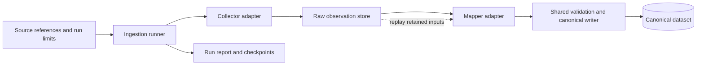

# Modular source-to-canonical acquisition pipeline

Status: approved by the builder on 2026-09-29; local synthetic slice and bounded oEmbed URL adapter implemented; comparison-grade live access unverified
Date: 2026-09-29
Decision owner: [Define the modular source-to-canonical acquisition pipeline](issues/04-select-pilot-evidence-scope.md)
Context: [Proposal](../../POPOSAL.md), [first acquisition milestone](first-acquisition-milestone.md)

## Purpose and constraints

Build a local pipeline that automatically processes source data into attributable canonical records. Start with TikTok references for known creators/content. Adding another provider for TikTok, or a provider for another platform, should usually require a source adapter and mapping tests, not changes to campaign logic or canonical persistence. A genuinely new domain concept may still require a canonical schema change.

The builder owns integrations. Marketer users can supply references and, where an eventual source requires it, complete an account-consent flow; they must not create developer applications or configure API credentials. TikTok for Business is unavailable to the builder. Regular developer API access is a possible future route, not an established capability. This design chooses no live endpoint or paid provider.

Known-creator fetching and refresh remain ahead of automated discovery. The first technical slice exercised ingestion using local test inputs. A later oEmbed adapter now resolves supplied real TikTok URLs, but does not retrieve comparison-grade creator evidence or validate the marketer's shortlist.

## Approaches considered

| Approach | Benefit | Cost or limitation |
| --- | --- | --- |
| **Collector → retained raw observations → mapper → shared canonical writer (recommended)** | Collection and mapping evolve independently; retained inputs support replay and provenance; multiple providers share identity rules. | Requires an observation envelope and explicit normalization contract. |
| Each connector writes canonical tables directly | Quick first connector. | Every connector must correctly implement identity, history, conflict handling, and retries. |
| Distributed event pipeline and dynamically loaded plugins | Independent deployment and high-throughput scaling. | Adds operations and contract management before this solo, local pilot needs them. |

Use one Python application with ordinary modules and an explicit adapter registry. Use local PostgreSQL for canonical and ingestion metadata, following the proposal, and a local directory for permitted raw payloads. Cloud hosting, model inference, a queue, and a plugin framework are unnecessary for the first slice.

## Data flow and ownership

The runner owns ordering, limits, persistence, and run status. A source adapter supplies two implementations: a collector that obtains source-shaped data, and a mapper that interprets a supported source format. They share source-specific knowledge but have separate interfaces so mapping can run without refetching.

**Platform and provider are different concepts.** `tiktok` identifies the platform described by evidence. A developer API, a licensed feed, and permitted web collection are different acquisition routes that might describe it. A provider can also cover several platforms. Canonical account/content identity must not depend on which provider delivered the evidence.

| Module / interface | Responsibility | Facts hidden from callers |
| --- | --- | --- |
| Collector: `collect(request, checkpoint) → batches` | Return bounded source payloads, references, coverage information, and opaque continuation checkpoints. | Authentication, HTTP or file access, provider query syntax, pagination, source errors. |
| Raw observation store: `save(batch) → observation references` | Persist payloads and metadata durably under the retention policy. | File paths now; object storage later; hashing and atomic local writes. |
| Mapper: `normalize(observation) → candidates + issues` | Deterministically interpret a declared format. Emit entity references, proposed facts, metrics, and field-level provenance. | Source field names, JSON paths or HTML selectors, timestamp/metric interpretation. |
| Canonical writer: `apply(candidates, derivation context) → result` | Validate, resolve compatible identities, preserve evidence/conflicts, and transactionally update canonical state. | Database layout, idempotency, field selection, supersession, and history. |
| Runner: `ingest(request)` and `replay(selection)` | Coordinate collection or replay, durable progress, retry limits, versions, and a readable result. | Coordination among the preceding modules. |

Adapters never write canonical tables directly. Mappers perform no network calls and read only retained payloads plus versioned configuration. Inject the collector, mapper registry, storage, clock, and writer into the runner. Downstream analysis consumes canonical data rather than provider payloads.

## Contracts

### Source reference and request

A request names the integration, authorization context when applicable, supplied references, and finite request/page/record limits. Each reference retains the original input and parsed platform/resource hints. Unsupported operations return an explicit issue; a provider need not support discovery, audience data, or every canonical field.

The supplied URL is `https://www.tiktok.com/@maronayannyan/video/7632620458235530504`. Intake may parse `platform=tiktok`, `resource_kind=video`, `handle_hint=maronayannyan`, and `native_id_hint="7632620458235530504"`. Store identifiers as strings. This is an unverified reference, not a retrieved profile, proof of ownership, or evidence of content or metrics. Never attach synthetic fixture metrics to this real reference.

### Raw observation envelope

Keep the payload source-shaped. The common envelope contains:

- Observation ID, run ID, provider/route ID, integration context, and platform when known.
- Input/resource reference, source URL when available, media type, declared format version, and payload location/hash. Unknown format versions are explicit.
- Collector `captured_at` and any source-reported `as_of` time separately. Import time of a saved file does not become its original observation time; missing capture time stays unknown.
- Coverage/query context: requested scope, returned resource/page, truncation, and continuation information. Retain only non-secret parameters.
- Source policy/context reference, retention deadline where applicable, and synthetic-test status. Exclude credentials, session cookies, and authentication headers.

Preserve permitted evidence without editing it in place. Expiry, deletion, and revocation can remove it; replay works only for payloads still permitted and retained. Where raw retention is prohibited, process transiently only if allowed and report replay as unavailable. No source is assumed to permit every processing or display use.

### Normalized candidates

Candidates use a small vocabulary: platform account, content item, field assertion, and metric observation. Include the raw observation reference, source field location, mapper version, and evidence status. Content can be known while its author account remains unresolved.

- External identity references carry platform, identifier namespace/scope, resource kind, and native identifier. Only compatible namespaces establish identity across providers; provider-local or application-scoped IDs require explicit equivalence evidence.
- Fields distinguish observed values (including a genuine zero), not returned, unavailable with a reason, and explicit removal/correction. Missing fields do not erase existing facts. Retrieval errors do not establish deletion.
- Metrics preserve native name/definition, value/unit, time/window, and population where available. Map to a shared metric only when meaning is established; equal labels do not prove equal definitions. Approximate displayed counts stay approximate.
- Publication, acquisition, source measurement, and processing times remain distinct, including their precision and uncertainty.
- Language does not establish audience country. Engagement does not establish sales or incremental lift.

### Canonical dataset

Start with typed account/content records, external identity links, field assertions, and metric observations. Supporting ingestion records hold runs, raw observations, derivations, and checkpoints. Exact SQL schema is an implementation-plan detail; identity, uniqueness, and history semantics here are the contract.

Canonical IDs are internal. A compatible, namespace-qualified stable external ID identifies the same entity across runs/providers. Handles are mutable aliases, not merge keys. Unresolved identity candidates stay inspectable without silently creating duplicate trusted accounts. Cross-platform creator/person merging is outside this slice.

Retain competing assertions. A versioned rule selects a preferred current field only when field-specific authority and time semantics justify it. Otherwise retain the conflict or unknown. Initially, implement only enough policy to prevent accidental overwrites, order comparable observations, and expose conflicts; a universal source-ranking engine is unnecessary.

## Run, refresh, and replay

1. Validate the request, supported operation, configured policy, and finite limits. Resolve credentials only when the selected collector needs them.
2. Collect a bounded batch. Persist raw observations and checkpoint metadata before advancing. If a payload file succeeds but metadata storage fails, reconcile the orphan on retry; a filesystem and database do not share a transaction.
3. Normalize with the registered format/mapper version. Keep malformed or unsupported observations inspectable with issues; they cannot silently become canonical facts.
4. Apply a derivation in one database transaction, keyed by observation ID, mapper version, and canonical-policy version. Retrying that derivation has no additional effect.
5. Record completion, partial results, and errors. Fetch checkpoints and mapping progress are separate: mapping failures can be retried locally without refetching retained pages. Resume unfinished derivations after a crash.

A new real capture can create a dated metric observation even when the value is unchanged. Replaying the same capture cannot create another entity or measurement. A changed mapper creates a traceable derivation superseding its prior result for that raw input; this is a correction, not another real-world measurement. Current views use the active derivation, preserving permitted audit history.

Fetching twice after interruption may happen. Stable IDs and transactional writes make the resulting state safe; exactly-once network delivery is not promised. Hashes identify duplicate bytes but are insufficient observation identities because time and acquisition context matter.

Retry transient failures with finite attempts and provider-directed delay where available. Permission failures require action, unsupported operations stay unsupported, and invalid data remains inspectable. Empty/truncated responses never prove complete absence. Report collected/normalized/applied counts, unresolved identities, missing fields, coverage limits, errors, and run bounds.

Expiry/revocation must remove the affected evidence from replay and current canonical views. Select another valid assertion or mark the field unknown. There are no search indexes, model extracts, or external projections in this slice; later projections must participate in the same deletion semantics.

## First implementation slice and acceptance

Use two deliberately different synthetic inputs: an API-shaped JSON fixture and a saved HTML fixture. Use synthetic IDs in an explicit test namespace. Each adapter parses its own format into the same vocabulary. Neither fixture is presented as a current TikTok schema or evidence of real access. Local fixture collectors exercise the collection interface without network calls.

The slice runs automatically from local input to canonical persistence and a report. Verify through the runner's interface that:

1. Both adapters describe one synthetic post through compatible IDs and produce one canonical record with separate provenance.
2. Replay creates no duplicate entity, assertion, or measurement. A changed mapper replaces its active derivation without another measurement.
3. Later captures preserve metric history. Older comparable data does not overwrite a newer value merely because it arrived later; incomparable metrics stay separate.
4. Missing fields, genuine zero, explicit removal, and malformed payloads remain distinct. Partial runs expose retained progress and coverage limits.
5. Interrupted runs resume from durable state. Reapplying a committed derivation is safe; retained data can be processed without its original collector.
6. Incompatible ID namespaces or shared handles alone cannot merge accounts. The fixture runs cannot verify the supplied real URL; a later oEmbed check is recorded separately.
7. Expired/revoked observations cannot support replay or current fields. Synthetic evidence is excluded from normal production reads.
8. Finite collection limits are enforced; configured credentials never enter retained evidence or logs. Fixture runs make no external request or LLM call.

The first selected live route is official oEmbed URL resolution. Its [bounded adapter](issues/16-implement-live-oembed-reference-adapter.md) passes actual responses transiently through the same collector/mapper seam while retaining only URL and operational provenance; it cannot write TikTok-returned creator facts under unverified commercial retention rights. Comparison-grade live acceptance still requires a separate source with confirmed authorization, actual payloads/fields, permitted uses/retention, costs, and coverage. Fixture tests and URL resolution cannot satisfy that later milestone.

The technical slice has no paid API or model dependency. Actual provider prices and workload must still be measured before claiming compliance with the eventual USD 100/month operating budget.

## Deliberate limits

Discovery, scheduling, ranking, LLM enrichment, campaign measurement, automatic cross-platform person matching, and additional projections follow later. Discovery will supply references to this same acquisition path. Market, language, brand, product, and campaign criteria belong in configuration/domain data, not hard-coded acquisition logic.

The builder approved this architecture and the local fixture-first slice on 2026-09-29. [The local implementation task](issues/12-implement-local-ingestion-slice.md) records the fixture collectors; [the oEmbed task](issues/16-implement-live-oembed-reference-adapter.md) records the limited live URL check. Neither establishes developer eligibility, comparison-grade creator evidence, or the integrated pilot specification.
