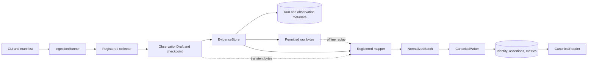

# Reading the ingestion foundation

`src/smi_ingestion` turns bounded source observations into attributable account/content facts. It already handles synthetic files, oEmbed URL checks, Bright Data responses, and an experimental direct-web route. The [review](review.md) records six repaired edge cases and the 80-test verification result. Campaign planning, frozen evidence sets, and shortlist persistence remain the next build.

## Follow one observation



1. [The CLI](../../src/smi_ingestion/cli.py#L20) builds a database connection factory, evidence store, canonical writer, and [explicit registry](../../src/smi_ingestion/adapters/registry.py#L28). `ingest` reads a manifest whose `adapter` names a registered collector/mapper pair. The [runner](../../src/smi_ingestion/runner.py#L24) hashes the exact manifest bytes and creates a durable run. A supplied URL is a reference with hints, not independently verified identity.
2. A [collector](../../src/smi_ingestion/contracts.py#L132) owns file/network I/O, source validation, retries, source policy, and an opaque continuation checkpoint. It returns one [observation draft](../../src/smi_ingestion/contracts.py#L38) per bounded call. That envelope carries source-shaped bytes, provider/format, reference, capture/source times, policy, synthetic status, coverage, and actual request attempts. One Bright Data response may contain several post rows inside this single envelope.
3. [EvidenceStore.save](../../src/smi_ingestion/evidence.py#L108) checks processing permission. If retention is allowed, it hashes the bytes, fsyncs a temporary file, and renames it before committing metadata. PostgreSQL records the observation, checkpoint, counters, and final-input flag together. Raw files and PostgreSQL are separate durability systems; failed metadata writes remove the file when possible, and `reconcile` removes old unreferenced UUID-shaped files after an interruption.
4. The [mapper](../../src/smi_ingestion/contracts.py#L138) interprets the declared format without network calls. It returns external identities, field states, metric candidates, and unresolved identities in a [NormalizedBatch](../../src/smi_ingestion/contracts.py#L112). Field/metric locators identify the originating JSON path or HTML selector. Missing stable identity remains unresolved; a handle alone never merges accounts. Non-retained bytes travel directly from the collector to mapping and disappear after that operation.
5. [CanonicalWriter.apply](../../src/smi_ingestion/canonical.py#L60) locks the observation, verifies processing policy, and resolves namespace-qualified identities. One transaction writes the derivation, assertions, metrics, unresolved records, and applied marker. A derivation key is `(observation ID, adapter:mapper version, canonical policy version)`. Reapplying the same key is a duplicate; a new mapper version deactivates the prior derivation while preserving its audit rows.
6. [CanonicalReader.entity](../../src/smi_ingestion/canonical.py#L149) selects active permitted fields; [metrics](../../src/smi_ingestion/canonical.py#L206) returns permitted active measurement history. The CLI's `inspect` combines them. Synthetic evidence is hidden by default. Comparable times order assertions within a provider; different providers or incomparable observations retain conflicting values, including removal-versus-observation conflicts. Missing fields do not erase older known values.

## Ownership and durable records

| Owner | Durable state / contract |
| --- | --- |
| [Runner](../../src/smi_ingestion/runner.py#L17) + [evidence store](../../src/smi_ingestion/evidence.py#L77) | `ingestion_runs`: manifest path/hash, adapter, checkpoint, input completion, finite limits/counters, status. `source_observations`: acquisition envelope, hashes/path, policy, coverage, mapping status. `ingestion_issues`: sanitized operational failures. |
| [Canonical writer](../../src/smi_ingestion/canonical.py#L23) | `canonical_entities` contains only `account` and `content`; `external_identities` keys by platform, namespace, kind, native ID, synthetic flag. `derivations` names the interpretation and marks one active derivation per observation. |
| [Canonical schema](../../src/smi_ingestion/schema.sql#L79) | `field_assertions`: observed / not_returned / unavailable / removed, JSON value, locator, reason. `metric_observations`: source-specific definition/name, value, precision, unit, measurement time, locator. `unresolved_candidates`: missing or conflicting identity evidence. |
| [Database](../../src/smi_ingestion/db.py#L10) | PostgreSQL connections, optional isolated schema, and additive schema migration. It contains no source interpretation. |

An `author_account` field currently contains an external account key as its assertion value. It is not a separate relationship table or a cross-platform Creator/person model. Canonical UUIDs are internal; source observation IDs are evidence identities, not post IDs. Matching bytes from a new capture do not by themselves deduplicate the capture.

The main architectural weakness is narrow but real: canonical reads import private policy helpers, and runner reporting reaches into the evidence database. The [deferred Standards finding](review.md#standards) recommends addressing that boundary when the next evidence API is designed.

## What each route can establish

| Adapter | Input and interpretation | Retention / identity |
| --- | --- | --- |
| `fixture-json`, `fixture-html` | [Local files](../../src/smi_ingestion/adapters/local.py#L23), mapped independently by [JSON](../../src/smi_ingestion/adapters/json_fixture.py#L10) and [HTML](../../src/smi_ingestion/adapters/html_fixture.py#L46) mappers. Demonstrate one compatible synthetic post with separate evidence. | Retained when manifest policy permits; `fixture:public`, always synthetic. |
| `tiktok-oembed` | [Bounded official endpoint check](../../src/smi_ingestion/adapters/tiktok_oembed.py#L91) for a supplied URL. Mapper validates the transient response and emits no account/content facts. | Operational metadata and generic uncertainty only; no retained response or creator assertions. |
| `brightdata-tiktok` | [Profile then posts](../../src/smi_ingestion/adapters/bright_data.py#L146); bounded paid scrape requests, resumable progress/snapshot GETs, no automatic paid retry. Current and legacy identity fields are supported. | Retained provider bytes; `tiktok:public`; provider-specific metric definitions. One live profile/ten-post check succeeded on [2026-10-12](../brightdata-source-readiness/api-retry-2026-10-12.md). |
| `tiktok-web` | [Public-page experiment](../../src/smi_ingestion/adapters/tiktok_web.py#L247); distinguishes bot challenges, partial evidence, unavailable pages, and source failures. Mapper v2 preserves original post indices and explicit missing/invalid fields. | HTML is transient; derived facts remain; `web:public` and separate metric definitions. Complete creator history is unverified. |

The web and Bright Data namespaces intentionally remain distinct. The same handle or matching label is insufficient evidence to merge identities or metric meanings. No automatic source fallback, discovery, refresh scheduler, or sales/audience inference exists. Shared [HTTP dispatch](../../src/smi_ingestion/adapters/http.py#L13) rejects redirect following so each transport invocation remains one counted request.

## Replay, policy, and failures

`replay OBSERVATION_ID` loads permitted retained bytes, verifies their hash, then maps/writes them without collection. A changed mapper corrects the interpretation of the same capture; it is not another real-world measurement. A new ingest run creates new capture evidence and can append metric history. Capture, source measurement, publication, and ingestion times remain separate; importing a file does not invent its missing capture time.

`resume RUN_ID` checks the original manifest hash, reconciles legacy committed-but-pending derivations, maps durable pending observations, and continues only if input is unfinished and limits permit. The new completion flag avoids another collector call after a durably saved final batch. Source-specific checkpoints can retain a Bright Data snapshot ID and polling cooldown. The runner's page/record limits count observation envelopes, not normalized post rows; `max_pages` defaults to 10 and has no separate CLI option today.

Malformed/unsupported mapping inputs are quarantined with an issue; already committed earlier observations survive. Request/byte limits and source failures produce a partial report. `complete_for_requested_input` only describes the requested input, not complete platform/creator coverage. Exit codes are 0 for success, 2 for partial, and 1 for a sanitized top-level failure. Historical issues remain audit entries and are not automatically cleared by a later replay.

Processing, raw retention, and display are separate policy flags. Expiry/revocation blocks replay/current display; `revoke` deletes a retained payload, and `expire` removes expired retained payloads. Canonical assertion values remain physically stored. Non-retained observations cannot be replayed or remapped after their bytes disappear. A crash before their canonical transaction commits can therefore still leave unrecoverable transient input; the fix protects already committed facts, not missing source bytes.

## Concrete source-offline examples

From the repository root, with the local PostgreSQL service available and dependencies installed:

```bash
uv run smi-ingest migrate
uv run smi-ingest ingest examples/synthetic/json-manifest.json
uv run smi-ingest ingest examples/synthetic/html-manifest.json
uv run smi-ingest inspect tiktok fixture:public content fixture-post-1 --include-synthetic
uv run smi-ingest inspect tiktok fixture:public content fixture-post-1
```

The first inspection shows one content identity, source provenance, and measurements 1000 and 1050 from separate captures; ordinary inspection hides the synthetic evidence. Copy an `observation_id` or `run_id` from the JSON output into these commands:

```bash
uv run smi-ingest replay OBSERVATION_ID
uv run smi-ingest resume RUN_ID
```

Replay reports `duplicate` for the unchanged mapper. These commands use synthetic files/local PostgreSQL and make no source request. The integration suite provides disposable-schema examples with cleanup, including actual CLI subprocesses:

```bash
uv run pytest -q tests/test_cli.py tests/test_pipeline.py
```

The real 19-post development snapshot can also be read without a database or source call:

```bash
uv run python - <<'PY'
import json
from pathlib import Path
path = Path('examples/curated/jp-kbeauty-tiktok-2026-10-05/observations.json')
snapshot = json.loads(path.read_text())
print(snapshot['dataset_id'], len(snapshot['records']), len(snapshot['collection_runs']))
PY
```

This reads the portable JSON only. Its accompanying manifests call the live web if ingested; there is no offline canonical importer for that snapshot yet.

## Boundary for the next pilot

The [accepted first slice](../beauty-intelligence-pilot/pilot-acceptance.md#first-implementation-slice-and-handoff) is an empty-database import of the frozen 19-post/17-account dataset, followed by a human-authored brief, bounded source-linked comparison, confirmed shortlist, and reopening the exact saved revision. The ingestion foundation provides identity, evidence, and derivation mechanics to build on.

The next implementation needs an explicit snapshot importer preserving original capture times and origin-to-local lineage; a dataset/digest/member contract; and a policy-aware frozen evidence reader exposing stable assertion/metric references and missingness/conflicts. Current `entity()`/`metrics()` reads cannot pin that set or reproduce an as-of decision by themselves. Campaign/shortlist storage, actor roles, semantic assertions, and propagation of evidence corrections/removals belong above this source ingestion boundary. These are [accepted future responsibilities](../beauty-intelligence-pilot/minimum-domain-contract.md#existing-implementation-cross-check), not tasks silently added to this review.
