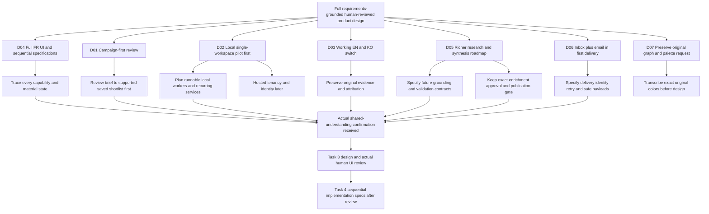

# Product decisions and human agreement

Analysis date: 2026-11-03. Status: human shared-understanding confirmation received through the live Orca coordinator. No production design or implementation changes are authorized by this report itself.

## Authority of this record

The dispatched worker asked the independent product frontier through Orca question `msg_a8f9cfa9305b`. The coordinator relayed the questions to the actual user, then returned the actual answers. The worker did not use its recommendations, elapsed time, or coordinator recommendations as consent. The original ask timed out without losing its question identity and was resumed with the same ID.

The later coordinator message `msg_ac190fcef36b`, created at `2026-11-03T04:06:44Z`, carries the user's explicit final confirmation. It supersedes the older ask reply's sentence that confirmation was still pending. This record relies on the coordinator's attributed relay of actual user answers; the worker did not claim direct access to the user's other terminal.

## Accepted requirements already settled by the repository

These remain accepted contracts, rather than new preferences elicited in this review:

| Decision ID | Existing agreement | Evidence |
| --- | --- | --- |
| BASE-01 | Save an attributed recommendation as a shortlist automatically, without runtime human approval | [operational A.4 L26](../../../../../docs/functional-requirements.md); [ADR 0003](../../../../../docs/adr/0003-automatic-shortlist-persistence.md) |
| BASE-02 | Every assistant-origin enrichment task needs human approval of its exact immutable scope; other configured origins retain independent authority | [operational B.3/B.6 L37/L40](../../../../../docs/functional-requirements.md); [ADR 0018](../../../../../docs/adr/0018-explicit-assistant-gap-scope.md) |
| BASE-03 | Only usable ingested/published KB support answers a question; raw fetched data does not | [operational B.4–5 L38–39](../../../../../docs/functional-requirements.md); [ADR 0017](../../../../../docs/adr/0017-exact-supported-answers.md) |
| BASE-04 | Discovery offers explicit regeneration and never replaces saved answers/recommendations silently | [operational A.6–7 L28–29](../../../../../docs/functional-requirements.md); [tasks L225](../../../../../docs/tasks.md) |
| BASE-05 | Monitoring investigation uses existing KB context, acquires no external data, and creates no campaign | [operational C.3 L46](../../../../../docs/functional-requirements.md); [ADR 0004](../../../../../docs/adr/0004-lightweight-monitoring-evidence.md) |
| BASE-06 | Exact history remains subject to current source permissions, retention, withdrawal, and dependency health | [ADR 0002](../../../../../docs/adr/0002-pinned-support-current-policy.md) |
| BASE-07 | Approval, monetary admission, resource limits, and information-value stopping are separate controls | [operational spending L65–74](../../../../../docs/functional-requirements.md); [costs](../../../../../docs/costs.md) |
| BASE-08 | No creator contact, publishing, media buying, external campaign activation, or invented measured lift | [proposal L5/L35](../../../../../POPOSAL.md); [operational L90](../../../../../docs/functional-requirements.md) |

## First independent frontier and actual answers

Question numbers preserve the worker's original round. The coordinator omitted Q4 from the form because the original user had already required full FR UI coverage and sequential specifications. It changed some recommended defaults before relaying, which is why the table records actual replies rather than treating the worker's recommendations as accepted.

| Decision ID | Question and considered alternatives | Worker recommendation, not consent | Actual user answer or prior instruction | Accepted meaning and limit |
| --- | --- | --- | --- | --- |
| D01 / Q1 | Campaign-first, monitoring-first, or assistant-first review | Campaign-first, with all FR workflows retained | `Campaign-first (recommended)` | Prioritize the brief → supported recommendation → saved shortlist journey for detailed review. Assistant/monitoring/graph/lineage remain required |
| D02 / Q2 | Local single-workspace pilot first or hosted multi-user next delivery | Local pilot first | `Complete a single-workspace local pilot first` | Sequence deployment/identity locally first. Do not defer automated task consumption, recurring discovery/monitoring, or agreed email merely because installed workers are currently explicit |
| D03 / Q3 | Primary UI language; worker offered Korean/English/Japanese | Korean-primary initially; coordinator offered English-primary | `english and korean bilingual with switch` | A real EN/KO interface switch is required. It does not imply automatic evidence translation or Japanese-original validation. Preserve original evidence language/provenance |
| D04 / Q4 | Full FR target design with staged implementation or installed-operations-only UI | Full accepted target experience, honest current/target mapping | Original user request, as attested by coordinator message `msg_9732a3339cea`, requires full FR UI and sequential specifications | Full target design is required. Current software limits are evidence for the roadmap, not permission to reduce the product destination |
| D05 / Q5 | Preserve bounded first contract/defer richer research design, or include richer research/synthesis in the target roadmap now | Initially defer generalized research contract | `Include richer agent design in the target roadmap (recommended)` | Include the future research/synthesis design and explicit validation/ADR work. Do not silently loosen ADR 0017/0018 or claim richer synthesis is installed |
| D06 / Q6 | In-product notifications first or external transport in first delivery | In-product first initially | `Include email in the first delivery` | Add email to the first delivery alongside the existing in-product inbox. Specify configuration, delivery/retry, current-policy/payload handling, and failure states. Sending emails is not authorized in this planning run |
| D07 | Full brief includes graph interaction and visual constraints | No new worker preference | Coordinator's consolidated confirmation identifies Neo4j-style graph and four user-requested colors | Preserve original user visual requirements in Task 3. Exact color values require the coordinator's original-context lookup, not an invented palette |

Reply evidence is the resumed answer to `msg_a8f9cfa9305b` and coordinator messages `msg_f677d7500400`, `msg_1a6a70067246`, and `msg_ca94333fbce9`. Coordinator message `msg_83cd9feadcc5` explicitly distinguishes local operating scope from deferring required automated product behavior. Notification choice is recorded verbatim in the resumed answer.

## Design decision tree

The consequential frontier is settled for the requirements/design brief. Lower-level provider choices, exact operating parameters, email transport settings, and implementation architecture remain explicit configuration/specification work. They are not consent to execute providers or silently invent thresholds.

The child nodes express necessary consequences or later specification obligations, not additional product choices falsely attributed to the user. A hosted role model is outside the first local-pilot sequence. Exact email provider, sender, recipient, retry backoff, and live authorization remain configuration and operational work. A richer research claim cannot ship until its concrete evidence and validation contract is actually agreed; the user approved including that design work, not every future answer it may produce.

## Explicit shared-understanding confirmation

The coordinator presented this consolidated brief in message `msg_82bdc3a2ba0f`:

> campaign-first full FR UI including Neo4j-style graph and four requested colors, working EN/KO switch; single-workspace local pilot first with automated workers and in-product plus email notifications; target roadmap includes richer research/synthesis; preserve automatic shortlist save, explicit regeneration, exact assistant external-enrichment approval, publication before answers, monitoring context KB-only, and human UI review before Task4.

The actual user replied, verbatim:

> Yes, proceed with this design brief

The coordinator transmitted that actual reply in `msg_ac190fcef36b` and stated that Task 1's human gate was satisfied. This is confirmation of shared design understanding. It is not a claim that a UI has been reviewed, that any live source is ready, that language/marketer quality has passed, or that production/external execution is authorized.

The worker also sent a matching proposed understanding statement back to the coordinator with a factual request for the original color values. It did not ask the user to repeat the already completed confirmation.

## Precise glossary and ADR recommendations

No accepted glossary or ADR was edited. The scope allows reports only, and the user has agreed to a design direction rather than a new synthesis algorithm or identity model. Recommendations below are explicitly unaccepted details for later design work.

| Candidate update | Recommended location and exact scope | Decision/evidence needed first |
| --- | --- | --- |
| Clarify email delivery versus task completion | Extend the existing task-completion/notification contract in `docs/tasks.md` and corresponding `docs/local-review.md`/architecture/roadmap once implemented. Preserve `Task completion event` in `GLOSSARY.md` as the durable outcome, and describe transport delivery separately | D06 establishes first-delivery email. Still agree concrete payload, recipient authority, delivery identity/retry/failure semantics, and source-policy handling. Do not make an email receipt proof of KB usability |
| Define a research plan only if it becomes a distinct user-visible domain object | Candidate glossary wording: `A proposed sequence of evidence-gathering or analysis steps with a stated question and scope. A plan does not itself authorize external acquisition.` Keep operation schemas and tool plumbing out of the glossary | D05 accepts designing richer research, not this exact object/definition. Confirm its actual responsibility and relationship to exact per-task approval during Task 3/4 |
| Extend the assistant output contract with supported synthesis | Add a new ADR linked to ADR 0017, not a silent edit claiming the current extractive method already produces synthesis. Record alternatives, exact allowed claims, input dependencies, source/claim validation, uncertainty, policy reopening, and review gates | A concrete design accepted by a human, including evidence tests that justify any generated factual prose. D05 alone supplies no semantic entailment guarantee |
| Extend research orchestration without weakening approval | Link a future ADR/owner contract to ADR 0018. Describe how proposed steps map to exact proposals/tasks, refusal, partial completion, explicit re-query, and materially broader scope | Actual agreed task/plan boundaries. Preserve one logical task per approval unless a future explicit decision changes that accepted contract |
| Keep Creator/account identity unchanged | No glossary change now. Any future corroborated association/correction contract belongs with `Creator`, `Platform account`, graph/knowledge contracts, and a durable identity ADR if the trade-off warrants one | No current user answer authorizes inferred Creator identities, collaboration histories, audience claims, or commercial outcomes |
| Record bilingual interface and pilot sequence as delivery requirements | Put EN/KO switch acceptance, local runnable automation, email-first delivery, and later hosted identity in the reviewed specifications and roadmap | D02/D03/D06 already establish scope. UI language, palette, and review priority do not need new glossary terms or an ADR |

Only create an ADR when a concrete choice is difficult to reverse, surprising without rationale, and results from a real trade-off. Do not create one merely to archive this interview. The current domain model and ADRs remain authoritative until the corresponding future contract is agreed.

## Remaining work belongs to later tasks

Task 3 must implement the reviewable design artifact and obtain actual human UI review. Task 4 must turn that accepted design into sequential implementable backend/agent work. Continuous local services, email transport, richer research/synthesis, source access, commercial billing, and actual language/usefulness review remain future work with their own evidence, rather than being marked complete by Task 1.

The coordinator ran the required shared check command during this investigation. It reported lint/documentation checks passed and the known baseline aging-capture assertion at `tests/test_assistant_enrichment.py:261` failed, with 1 failed and 51 passed before stopping. That is coordinator-reported execution evidence, not a worker-run result. No production fix was made within this planning task. [Documented baseline limitation](../../../../../docs/development.md).
