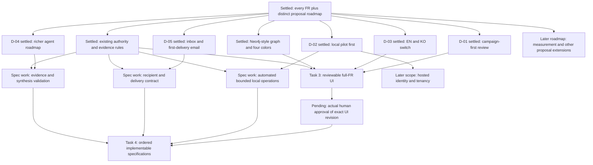

# Product decisions and design tree

Analysis date: 2026-11-03. Shared understanding is explicitly confirmed. Actual UI approval remains pending. The authoritative answer record for this recovery is the coordinator's [recovery brief](../history/task1-recovery-brief.md), corroborated by [run-state.md](../history/run-state.md). This worker did not conduct a second interview or infer answers from silence.

## Actual answers to the independent question round

The original round covered five decisions whose prerequisites were factual reading rather than another open user answer. The coordinator relayed them to the user and supplied the exact replies below. This recovery preserves those replies rather than reconstructing the original question wording or claiming a new exchange.

| Decision | Decision asked | Actual user reply | Accepted effect | Trace |
| --- | --- | --- | --- | --- |
| D-01 | Main review journey | "Campaign-first (recommended)" | Start human review with the campaign workflow. Retain assistant, independent monitoring, graph and lineage in full scope | Recovery L9; UD-01; PROP-04 |
| D-02 | Next implementation sequence | "Complete a single-workspace local pilot first" | Complete the local pilot before hosted multi-user operation. Automation, monitoring, background processing and email remain required pilot work | Recovery L10/L17/L31; UD-02 |
| D-03 | Interface language | "english and korean bilingual with switch" | Provide a working English/Korean switch. This does not change source language or establish model-language quality | Recovery L11/L17; UD-03; PROP-03/PROP-16 |
| D-04 | Target agent design | "Include richer agent design in the target roadmap (recommended)" | Design richer research and grounded synthesis with explicit evidence/validation contracts. Do not silently weaken existing bounded-answer or approval decisions | Recovery L12/L17/L31; UD-04; PROP-05 |
| D-05 | Notification scope | "Include email in the first delivery" | Include email alongside the inbox in design and implementation planning. No actual sending is authorized in this run | Recovery L13/L17/L33; UD-05 |

The earlier worker's matrix said decisions were pending. That statement is superseded by this actual-answer record and the confirmed understanding below. The earlier reports remain untouched as required by the ownership fence.

## Explicit shared-understanding confirmation

The coordinator records the user's reply as:

> Yes, proceed with this design brief

The confirmed understanding is recorded in [recovery brief lines 15–17](../history/task1-recovery-brief.md):

> The confirmed brief is a campaign-first UI covering every FR, including the Neo4j-style graph, using `#E6002A`, `#F4ABAF`, `#3E3A39`, and `#FFFFFF`, with a working EN/KO switch. The implementation sequence completes a single-workspace local pilot first, including automated workers, an in-product inbox, and email notifications. The target roadmap also designs richer agent research and grounded synthesis. Automatic shortlist saving, explicit regeneration, exact approval for assistant-origin external enrichment, publication before answers, and monitoring investigations using existing KB context remain intact. Human review of the actual UI is required before Task 4 starts.

This is actual human confirmation relayed by the coordinator. The task's shared-understanding condition is satisfied. It authorizes Task 3 design under this brief, while the actual UI-review gate remains open. The recovery instruction explicitly prohibits repeating the answered interview or requesting another confirmation without a newly discovered material contradiction. None was found.

The user later answered "Cancel this attempt and restart Task 1 (recommended)". The coordinator fenced the original attempt and assigned this replacement only `task1-recovery/`. This operational restart does not undo the accepted product decisions. See [recovery brief lines 19–33](../history/task1-recovery-brief.md).

## Design decision tree

Settled nodes are accepted source requirements or actual answers. Recommendation nodes name design/spec work, not additional user consent. The tree covers the consequential choices needed to start Task 3. It does not pretend that provider selection, budgets, retention or implementation details have been decided.

The source authority branch includes automatic shortlist persistence without approval, visible criteria preserving human constraints, incomplete-account eligibility, save-before-discovery, explicit regeneration, exact assistant proposal approval, publication before answer, KB-only alert investigation, source lifecycle, finite bounds and independent spending admission. These are accepted decisions, not questions to reopen in Task 3. See [ADRs 0002–0004](../../../docs/README.md#design-decisions), [interface invariants](../../../docs/implementation-spec.md#shared-invariants), and UD-08.

The decision frontier needed to begin Task 3 is settled. No new independent product question is pending in this recovery. The pending human decision is approval of an artifact that Task 3 has not yet produced. Asking for that approval now would not be reviewable.

## Unresolved details retained for their proper stage

These details remain explicit rather than acquiring invented defaults. Most are engineering or operator configuration decisions. If future specifications expose a real product trade-off, the coordinator should ask its whole independent frontier through Orca and wait for actual answers.

| Detail | Current fact | Recommendation and next decision owner |
| --- | --- | --- |
| Continuous local operation | Installed workers and ticks are explicit invocations. No dispatcher or scheduler daemon is deployed | Task 4 should define finite due-work advancement, worker execution, polling, health and restart/recovery using public owners. Choose the concrete process/scheduler arrangement from the operational requirements |
| Email delivery | Only local completion/alert notifications are installed | Recommend source-free outcome/status plus governed links, durable event-to-delivery identity, configured recipients and visible transport failure. Define actual provider/credentials and allowed sending at implementation time. Never treat this planning agreement as live-send permission |
| Email links in a local pilot | A local application is not a hosted public service | Explain that local links require access to the review machine/runtime. Public hosting or remote exposure is not implied by the accepted email requirement |
| Research plans and fluent synthesis | Current ADRs deliberately permit exact finding selection and human-supplied executable gap scope | Task 4 should propose bounded tool/plan contracts and claim validation, then obtain the appropriate durable design agreement before changing those semantics. The agent cannot approve itself or infer broader paid scope |
| Core monitoring extensions | Installed methods cover sampled volume and one provisional semantic controversy method | Keep engagement and semantic/sentiment-shift work traceable to FR-C02/FR-C03 with baseline, method, evidence, sampling and evaluation dependencies. Their installed absence does not make them optional proposal features |
| Acquisition selection and supplementation | Current discovery, avoidance and one nickname fill are bounded | Define recency/engagement/trend prioritization, supported routes, missing-field value decisions, stop reasons and cross-route avoidance in explicit ordered specs. Do not call the supplied-profile adapter general discovery |
| Bilingual details | EN/KO UI switch is accepted. Source text can have a different language | Recommend stable domain IDs, preserved input/state, complete status/error localization and unchanged original evidence. User has not requested automatic source translation or Japanese UI |
| Operating configuration | Ten keywords and the initial configurable fifty-post daily total are the fixed FR numbers | Model/provider choice, cadence, retention, thresholds, ceiling amount/currency/period and freshness policies remain explicit validated configuration. Do not invent values, prices or accuracy/throughput claims |
| Hosted operation | Single-workspace pilot comes first | Retain later identity, tenant authorization, secrets, backup/restore, telemetry and lifecycle reconciliation dependencies. A local actor label is not a hosted identity model |
| Wider proposal intelligence and measurement | Accepted destination exceeds installed KB/ranking methods and plans/notes | Preserve multimodal evidence, Creator associations, portfolio analysis, actual outcomes, attribution and causal methods as distinct roadmap work with data/permission/evaluation prerequisites |

No row is a request to block Task 3. The designer can show an understandable target journey and label the current limitations while those contracts receive later specifications. Task 4 still waits for actual review of the UI.

## Proposed glossary changes after design agreement

No glossary edit is made in this recovery. The following are precise candidate definitions, not accepted vocabulary. Add a term only when its distinction is needed by the approved design and its contract is settled. Keep implementation choices out of glossary definitions.

| Candidate term or edit | Proposed domain wording | Why and where |
| --- | --- | --- |
| Notification | "An attributable indication that a task outcome or monitoring alert is available for a recipient. It is distinct from the underlying outcome and from a recipient's acknowledgment." | Add to root GLOSSARY only if the approved design needs a shared term across completion and alert owners. Preserve the existing Task completion event and Anomaly alert meanings |
| Notification delivery | "An attempt to convey one notification to an intended recipient through a channel. Its status does not change the underlying task or alert, and successful delivery does not establish that the recipient read it." | Distinguish event, channel attempt and user attention for first-delivery email. Do not add provider or retry mechanics to the definition |
| Research plan | "A proposed sequence of investigation steps with a stated purpose, subject scope, evidence needs and limits. A plan is distinct from authorization to acquire external evidence." | Add only after a future research-plan contract is accepted. Keep Enrichment proposal, Enrichment approval and Enrichment task distinct |
| Grounded synthesis | "A response that combines identified knowledge support into claims, retaining relevant dates, uncertainty, coverage and limits. A generated explanation remains distinct from independent verification." | Add only after its evidence/claim-validation contract is accepted. Do not silently redefine the installed Knowledge answer as fluent or validated synthesis |

No new glossary term is needed for campaign-first navigation, the color palette or a language switch. Preserve Target market, Creator versus Platform account, Source reference versus Source observation, observed/derived/human Assertion, Knowledge publication and pinned Shortlist revision as already defined. Matching labels across languages do not create new entities or evidence.

## Proposed ADR and owner-contract updates

These are recommendations for later reviewed changes. This recovery changes no ADR, accepted glossary or owner contract. Do not allocate the next ADR number until the repository's actual next available number is known.

| Candidate durable decision | Trade-off requiring review | Precise documentation targets and gate |
| --- | --- | --- |
| Deliver source-free external notifications linked to governed evidence | Rich copied content can be useful in email but cannot be retroactively withdrawn from delivered copies. Source-free status reduces content exposure while requiring application access | Propose a new ADR only when email payload/lifecycle choices are agreed. Extend tasks durable-completion and monitoring notification contracts with event-to-delivery ownership, recipient authority, idempotency, transport status/failure and policy. Update architecture and physical ERD only with the actual design/implementation |
| Validate richer answer claims and explicit research plans | Arbitrary prose and inferred executable scope improve expressiveness but exceed what citation membership or the current exact-input schema proves | A future ADR must explicitly retain or supersede relevant parts of ADR 0017/0018, describe alternatives and validation failure/withholding, preserve exact human external approval and publication-before-answer, and define full input dependencies. Update knowledge, task/assistant, evaluation and interface contracts together after actual design agreement |
| Operate the local pilot continuously under existing authority | An automatic dispatcher improves timeliness but introduces unattended recurrence, recovery and ambiguous paid-response handling | First specify operational ownership, finite ticks, safe retries, activation and readiness gates in tasks/monitoring/architecture. Create an ADR only if the chosen mechanism meets the hard-to-reverse, surprising and genuine-trade-off criteria. The accepted local-first choice alone does not select a queue vendor or workflow engine |

After actual UI approval, update the local-review contract to describe the final interaction, navigation, EN/KO behavior and evidence states. Keep FR target additions distinct from installed behavior. Update roadmap sequencing for confirmed pilot automation/email and richer-agent work. Measurement, advanced ontology and hosted tenancy remain separately labeled. Colors and routine screen ordering need design documentation, not ADRs.

The source lifecycle decision [ADR 0002](../../../docs/adr/0002-pinned-support-current-policy.md), automatic-save decision [ADR 0003](../../../docs/adr/0003-automatic-shortlist-persistence.md), monitoring separation [ADR 0004](../../../docs/adr/0004-lightweight-monitoring-evidence.md) and exact assistant contracts [0017](../../../docs/adr/0017-exact-supported-answers.md)/[0018](../../../docs/adr/0018-explicit-assistant-gap-scope.md) remain authoritative throughout. Roadmap inclusion is not consent to replace them.

## Handoff and remaining gate

Task 1's decision record is complete for the confirmed design brief. The [requirements analysis](requirements-analysis.md#task-3-design-brief) supplies the Task 3 brief, and the [matrix](requirements-matrix.md) covers every FR capability, operational obligation, proposal goal and recorded design choice.

The coordinator should provide all three recovery reports plus Task 2's investigation to Task 3. Present the resulting exact UI revision to the user, record actual approval or requested changes, and resolve the Task 4 gate only on actual approval. No UI has been built or reviewed in this recovery, and live/provider/language/usefulness readiness remains unverified.
