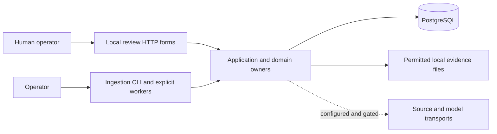
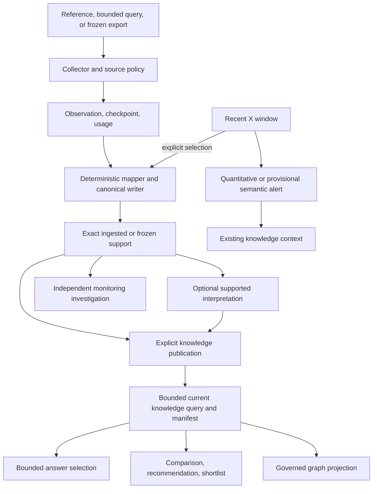
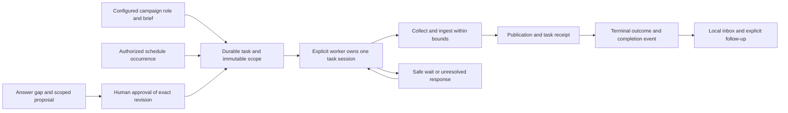

# Backend and agent architecture investigation

The goal is a requirements-grounded, human-reviewed UI and an implementable backend and agent roadmap. This report describes the current code and identifies constraints for that design. It does not establish product quality, live-provider readiness, or a need to rewrite the application.

Throughput checkpoint: n/a, read-only investigation.

## Overview

The installed system is a modular Python application backed by PostgreSQL and optional local evidence files. Its modules are ownership boundaries within one application and database, not independently deployed services. `compose.yaml` starts PostgreSQL alone. `pyproject.toml` installs the `smi-ingest` CLI and `smi-review` browser server. The latter composes owner objects in `src/smi_review/app.py`; `src/smi_review/server.py` uses the standard-library HTTP server. A task submission records work but does not start a background consumer. A caller invokes `OfflineTaskWorker.run_one` for a particular task, and `RecentPolling.run_due` is a separate explicit operation (`src/smi_tasks/worker.py`, `src/smi_monitoring/polling/store.py`).

The accepted destination is broader than these installed bounds. `docs/roadmap.md` describes semantic retrieval, richer synthesis, a managed scheduler or queue, hosted authorization, additional sources, measurement and other future capabilities. It describes these as destination or technology options rather than deployed components. Model and live-source routes exist in code but have not established real access, billing acceptance, or human relevance and language quality. The roadmap also records a freshness-sensitive fixture failure on the unchanged baseline. No live operation or human review was conducted in this investigation.

## Key concepts

- A source reference is a pointer, not evidence that retrieval or identity verification succeeded. Source observations preserve acquisition context and policy. Canonical accounts and content preserve identities, assertions and metrics. A creator is distinct from an account, and cross-platform creator association remains future work. See `GLOSSARY.md`, `src/smi_ingestion/contracts.py` and `src/smi_ingestion/canonical.py`.
- A knowledge publication makes exact permitted ingested support and selected interpretations available for queries. A query pins its selected support and method; later publication changes a new query, not the historical selection. Current permissions can still withhold historical material. See `src/smi_knowledge/publications/store.py`, `src/smi_knowledge/queries/store.py` and `tests/test_publications.py`.
- A campaign is an internal planning context, not an external campaign activation. A shortlist is a versioned automated or human decision, and saving one is not creator consent or a human endorsement. See `src/smi_campaigns/store.py` and `GLOSSARY.md`.
- A task is an authorized, bounded acquisition with durable execution and outcome records. An assistant proposal, its exact human approval, submission, retrieval, publication and completion are different events. See `src/smi_tasks/AGENTS.md` and `src/smi_tasks/assistant/AGENTS.md`.
- Monitoring is independent of campaign creation and can retain recent observations without publishing every post into shared knowledge. A bounded snapshot or alert does not prove a market trend or causation. See `src/smi_monitoring/AGENTS.md` and `docs/monitoring.md`.

## How it works

### Evidence through decisions

`IngestionRunner` composes a collector registry, evidence store and canonical writer (`src/smi_ingestion/runner.py`). It persists a source capture and collection frontier, then maps observations into canonical entities and derivations. Replay uses retained evidence and idempotent mapping, not a guarantee that unavailable material can be fetched again. `tests/test_pipeline.py` exercises separate provenance for shared identity, replay, conflicting observations, retention and revocation using simulated input. Exact support readers enforce purpose and current policy. Publications make selected support available, and queries operate on publications rather than all fetched observations (`src/smi_ingestion/support/`, `src/smi_ingestion/evidence_sets/`, `src/smi_knowledge/publications/store.py`, `src/smi_knowledge/queries/store.py`).

`CampaignStore` owns briefs, comparisons and saved shortlist revisions. Campaign task composition saves a recommendation and coverage decision before a possible discovery disposition (`src/smi_tasks/campaigns/`). The assistant reads published knowledge and stores a constrained selection of supplied fact IDs and uncertainty codes; the application resolves actual values through governed readers (`src/smi_assistant/answers.py`). The graph is a bounded projection of supported relationships, not a separate authoritative graph database (`src/smi_knowledge/graph/`).

Recent monitoring has its own topic, window and capture lifecycle (`src/smi_monitoring/recent/`). Quantitative assessment needs comparable windows, while semantic assessment is a provisional bounded interpretation. Alert investigation combines selected recent evidence with existing knowledge. Explicit promotion uses normal ingestion and publication with inherited source lifecycle (`src/smi_monitoring/alerts/`, `semantic/`, `context/`, `promotion/`). See `tests/test_recent_monitoring.py` and `tests/test_monitoring_promotion.py` for representative contracts.

### Task lifecycle and authority

`AcquisitionTasks` owns task admission and scope. Campaign, schedule and assistant origins have distinct authority paths. `ReviewApp` constructs trusted local actor contexts and configures roles; form fields and model text do not grant those roles (`src/smi_review/app.py`, `src/smi_tasks/store.py`). The assistant journey requires the question owner and configured human approver, and a changed proposal scope needs its own approval (`tests/test_assistant_enrichment.py`).

`TaskExecution` obtains a PostgreSQL session advisory lock for a task and fences local effects on the ownership connection (`src/smi_tasks/execution.py`). `OfflineTaskWorker.run_one` resumes one named task, retains the attempt and run through recovery, and composes ingestion, publication, cost and completion (`src/smi_tasks/worker.py`). External I/O is outside the local transaction. Session ownership fences local writes; it cannot promise provider-side exactly-once behavior after an ambiguous response. Tests simulate competing workers, disconnects and phase-specific commit loss with real PostgreSQL (`tests/test_task_concurrency.py`). A terminal result distinguishes usable, partial, no-update and failed work; the local completion event is separate from later support availability (`src/smi_tasks/notifications/`, `docs/tasks.md`).

A schedule tick records due work rather than providing a continuously running dispatcher. Scheduled discovery has a shared daily unique-new-post allowance, separate from request, bytes, record and spending bounds (`src/smi_tasks/schedules/`). The accounting owner admits operations against configured scopes and outstanding commitments; unknown charges and lost responses remain visible (`src/smi_costs/admission.py`, `tests/test_cost_admission.py`). A permitted task is not automatically a permitted or affordable external dispatch.

### Agent and model authority

The current assistant is not a general autonomous tool-using agent. Its request explicitly disables tools, streaming and stored responses, and instructs the model to select supplied support rather than acquire data or grant approval (`src/smi_assistant/answers.py`). Shared bounded model transport is also used by criteria interpretation, ranking and semantic monitoring (`src/smi_campaigns/responses/`, `src/smi_campaigns/interpretation/`, `src/smi_campaigns/ranking/`, `src/smi_monitoring/semantic/`). The exact inputs, model settings, usage and policy govern saved derived output. Model selection is a relevance judgment, not proof that the source claim is true. `tests/test_assistant.py` covers unsupported output, withdrawal and retry behavior using simulated model responses.

Future orchestration can compose public operations, but it must not manufacture human authority or bypass the existing proposal, cost, policy and publication boundaries. `docs/roadmap.md` identifies richer research orchestration as future work, not a currently installed autonomous agent.

### Persistence and UI contract

`Database` is a psycopg connection factory and owners install SQL schemas (`src/smi_ingestion/db.py`, owner `schema.sql` files). The database stores workflow identities, decisions and provenance. Evidence files hold permitted raw payloads; availability and retention are policy-dependent. Exact IDs and request IDs support reopening and retry, while expected versions reject stale edits. `tests/conftest.py` creates isolated PostgreSQL schemas and simulated source fixtures. Tests cited here were read, not executed for this report.

The current UI is server-rendered HTML and forms composed through `ReviewApp`, not a documented independent JSON service. `ReviewApp.handle` routes requests and translates domain errors to HTTP results. `server.py` provides the loopback HTTP boundary, and `forms.py` parses submitted fields. UI views call the same owner interfaces as other application compositions. The browser is configured for a trusted local human and uses a process-generated CSRF token; it is not hosted multi-user authentication. The precise route and form details belong to `docs/local-review.md`, `src/smi_review/app.py`, and the view modules. A new UI needs an explicit adapter contract if it separates from this process. It cannot assume existing form handlers are a stable remote API.

## Ownership and dependency direction

| Owner | Responsibility and boundary |
| --- | --- |
| `smi_ingestion` | Source adapters, source evidence, canonical identities, mapping and lifecycle. Downstream consumers use exact support readers. |
| `smi_knowledge` | Catalogs, interpretations, publications, bounded queries and graph projection. It consumes evidence rather than owning acquisition. |
| `smi_campaigns` | Briefs, comparison and shortlist decisions, ranking and measurement planning. It consumes governed knowledge. |
| `smi_assistant` | Questions and bounded answer selections. It does not own task authority. |
| `smi_tasks` | Task authority, scope, execution, schedules, recovery, completion and compositions across campaign and assistant owners. |
| `smi_costs` | Usage, commitments, admission and reconciliation. Task attribution is injected rather than importing task internals. |
| `smi_monitoring` | Independent snapshots, recent observations, alerts, investigations, promotion and polling. |
| `smi_review` | Local composition, forms and views, plus attributable quality review records. |

These contracts are documented in each owner's `AGENTS.md` and reflected in the composition imports in `src/smi_review/app.py`. This is a broad review, not an exhaustive audit of every SQL access or dependency.

## Gotchas and constraints for Task 4

1. Show distinctions among retrieved, ingested, published, queryable and currently permitted evidence. A successful source request alone is not a usable answer. Preserve evidence basis, exact support, relevant dates, unknowns and coverage limits.
2. Show human input, model interpretation and source observation as different kinds of statement. A saved shortlist may be automatic. Human review, selection and creator participation are separate states.
3. Design explicit scope review and approval before assistant-origin acquisition. Approval belongs to a particular saved revision. Show independent dispatch, wait, partial, failure, publication and completion states, including unresolved cost or response uncertainty.
4. Do not imply schedules or monitoring run continuously in the installed local system. A local inbox event is not an external notification, and an alert investigation does not authorize acquisition or campaign creation.
5. Design for current policy withdrawal and stale state. A previously saved result can become unavailable, and a later publication does not silently rewrite a historical answer or shortlist. Expose clear recovery and a deliberate new request where appropriate.
6. A new backend interface needs explicit actor identity, authorization, request idempotency, version conflicts and task status semantics. Current local actor configuration and loopback controls do not establish hosted tenant security.
7. The roadmap needs separate milestones for technical implementation, permitted live provider acceptance, actual billing and named human/language review. Simulated tests and installed transports do not establish those outcomes.

## Structural assessment and confidence

The main architectural risk for a hosted or continuously operating product is an operational gap, not evidence that the current modular boundaries have failed. `compose.yaml` provisions only PostgreSQL, explicit worker entry points require an operator or future dispatcher, and the current review server assumes one trusted local actor. A hosted design needs a scheduler or queue, authentication, secrets, telemetry, backup and lifecycle reconciliation chosen for its actual deployment. `docs/roadmap.md` already identifies those gaps. A wholesale rewrite is not supported by this evidence.

The model and source boundaries are intentionally narrow. Their principal product risk is overstating coverage and readiness in the UI. Source-use permissions, uncertain provider responses, simulated cost controls and current-policy rechecks must remain visible in any broader orchestration. Current support for a live route is code availability, not proof of a permitted or useful production operation.

Confidence is high for the described composition and major boundaries because the report inspected entry points, owner contracts and representative implementation and tests. Confidence is moderate for end-to-end operational behavior because tests were inspected but not run, and the investigation did not execute an application or live integration. Claims about actual marketer usefulness, language accuracy, live provider access, billing, production reliability and exhaustive cross-owner correctness remain unverified. The roadmap's known freshness fixture issue further limits any inference from an unrun test suite.
