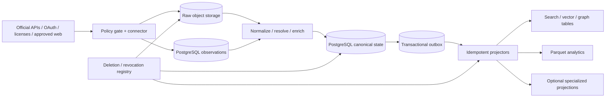

# Governed data acquisition and founder-scale technology architecture

**Research date:** 2026-09-22  
**Scope:** A South Korea/Japan-first Social Marketing Intelligence Platform, with Python/FastAPI as the preferred application stack.  
**Evidence standard:** Primary and authoritative sources: platform documentation, statutes and regulator guidance, standards, and first-party technical documentation.

This note is architecture research, not legal advice. South Korean and Japanese rules are jurisdiction-specific; the applicable law also depends on the operator, data subjects, processing purpose, contracts, and where data is transferred. Platform terms and API policies can change independently of legislation. Counsel should review each proposed source/use pair before production collection.

## Decision summary

The platform should start as a modular Python/FastAPI application with separately scalable workers, a managed PostgreSQL database as the single authority for canonical state, policy metadata and the transactional outbox, and policy-partitioned object storage for append-only raw observations. Use PostgreSQL extensions and ordinary tables for vectors, keyword retrieval, relationships, job state, audit records, and aggregates until measured product requirements justify another system. DuckDB over Parquet provides inexpensive exploratory analytics without creating a warehouse.

Acquisition must be governed per **source × access method × purpose × jurisdiction**, not just per platform. Every connector should be disabled unless a versioned `SourcePolicy` record says what may be collected, under which grant or contract, for which purpose, at what rate, for how long, whether content may be displayed or used for model training, and how deletion or revocation propagates. Official APIs, licensed feeds, and first-party OAuth integrations are preferred. Governed web collection may fill narrow gaps only where access and use are affirmatively approved; it must honor robots directives and site terms, identify itself, rate-limit itself, and stop at access controls rather than evade them.

Official APIs alone do not support the proposed cross-channel coverage. YouTube offers substantial public metadata but imposes quotas and unusually specific refresh/deletion rules. Instagram and TikTok developer APIs center on professional or authorizing accounts; TikTok's Research API is non-commercial and is unavailable to South Korea/Japan-based commercial operators, while its Commercial Content API currently exposes European data. Kakao and LINE APIs are first-party/consent surfaces rather than general listening feeds. Naver search offers useful result slices, and Rakuten offers product search, but neither is a complete historical corpus. That evidence supports a multi-source strategy while also ruling out any promise of complete or perfectly synchronized market coverage.

## 1. What official access actually provides

The table describes architectural planning limits, not an exhaustive legal or contractual review.

| Source | First-party capability and current constraint | Architectural consequence |
| --- | --- | --- |
| **YouTube** | The Data API exposes videos, channels, playlists, comments and search. It uses project quotas; as of June 2026, `search.list` and `videos.insert` are moving to separate granular quota buckets, and quota increases require compliance review ([overview](https://developers.google.com/youtube/v3/getting-started), [2026 revision history](https://developers.google.com/youtube/v3/revision_history), [audit process](https://developers.google.com/youtube/v3/guides/quota_and_compliance_audits)). Developer policy generally requires stored API data to be refreshed or deleted after 30 days, user-requested stored data to be deleted within 7 days, and current API data to be reflected; an approved analytics amendment permits certain statistics and derived metrics for up to 36 months while titles, descriptions, creator names and comment text remain under the ordinary rule ([developer policies](https://developers.google.com/youtube/terms/developer-policies), [derived-metrics policy](https://developers.google.com/youtube/terms/derived-metrics-policy)). | Treat policy expiry as data, not documentation. Store `observed_at`, `refresh_due_at`, authorization class and policy version on every observation. Separate eligible historical metrics from short-retention text/metadata. Quota-aware incremental refresh and deletion are core connector functions. |
| **Instagram / Meta** | Meta's verified official API workspace says the Facebook Login API serves Instagram professional accounts, can access their media, insights, comments, mentions and hashtagged media plus basic information about other professional accounts, and cannot access consumer accounts. The Instagram Login route also serves businesses/creators and cannot access ads or tagging ([official Meta workspace](https://www.postman.com/meta/instagram/overview), [API documentation](https://www.postman.com/meta/instagram/documentation/6yqw8pt/instagram-api), [Instagram Login limitations](https://www.postman.com/meta/instagram/folder/6raa77c/instagram-api-with-instagram-login)). | Build owner-authorized account analytics first. Do not base broad creator discovery or consumer listening coverage on the official API. Keep API-version and permission-review state in the connector registry. |
| **TikTok** | Display API exposes an authorizing user's profile and own public videos through `user.info.basic` and `video.list`; calls are scope- and consent-bound, and current default rates are 600 requests/minute for its three listed endpoints ([Display API](https://developers.tiktok.com/docs/en/display-api-overview), [scopes](https://developers.tiktok.com/docs/en/scopes-overview), [rate limits](https://developers.tiktok.com/docs/en/tiktok-api-v2-rate-limit)). Research Tools require a qualifying, non-commercial public-interest researcher in the US, Europe, Canada or Brazil ([Research API](https://developers.tiktok.com/products/research-api)). Commercial Content API is globally requestable but, as of 2026-09-01, its available ad/commercial-content countries are European; data starts with EU/EEA coverage, not South Korea or Japan ([product page](https://developers.tiktok.com/products/commercial-content-api), [supported countries](https://developers.tiktok.com/docs/en/commercial-content-api-supported-countries)). | Official access supports connected creator accounts, not general KR/JP listening. A vendor license or separately approved source is needed for broader coverage. Do not mischaracterize research access as a commercial route. |
| **X** | X says registered applications can access public information and that protected surfaces require added user permission ([About X APIs](https://help.x.com/en/rules-and-policies/x-api)). Rate limits are endpoint/app/user specific and can return `429` ([rate-limit guidance](https://developer.x.com/en/support/twitter-api/error-troubleshooting)). X's April 2026 automation rules prohibit attempts to circumvent rate limits and non-API scripting of the website ([automation rules](https://help.x.com/en/rules-and-policies/x-automation)). | Use only an approved X API/data product or license for automated access. Treat plan, endpoint cap and permitted use as runtime configuration. Website scripting is outside the governed collection route described here. |
| **Naver** | Naver Search API returns blog, news, shopping, café and web-search results. Web search has a 25,000-call daily limit; blog search returns at most 100 results per call and permits a start position only through 1,000 ([Search overview](https://developers.naver.com/docs/serviceapi/search/web/web.md), [Blog Search reference](https://developers.naver.com/docs/serviceapi/search/blog/blog.md)). Commerce API requires application permission and OAuth client credentials and exposes Smart Store products/orders for an authorized merchant ([Commerce API introduction](https://apicenter.commerce.naver.com/docs/introduction), [authentication/API surface](https://apicenter.commerce.naver.com/docs/commerce-api/current)). | Search API is a ranked result sample, not a firehose or complete archive. Merchant Commerce API is first-party operational data. Preserve query, rank, page and retrieval time so downstream analysis does not mistake search results for prevalence. |
| **Kakao** | Kakao's friends API requires review and consent and returns only friends who are connected to the app, consented, are not hidden/blocked and expose their profiles. Kakao explicitly says there is no API for all friends and prohibits analyzing, combining, re-providing, or storing friend data for purposes beyond improving the user experience ([KakaoTalk Social overview](https://developers.kakao.com/docs/ko/kakaotalk-social/common), [REST API](https://developers.kakao.com/docs/ko/kakaotalk-social/rest-api)). | This is not a listening or audience-intelligence feed. Keep Kakao integrations isolated to the approved connected-user use case and prohibit feature reuse outside it. |
| **LINE** | LINE Login is OAuth 2.0/OIDC and provides only fields in user-authorized scopes such as profile, OpenID and separately approved email; richer Profile+ fields require an application ([LINE Login integration](https://developers.line.biz/en/docs/line-login/integrate-line-login/), [API reference](https://developers.line.biz/en/reference/line-login/)). | Use it for identity/first-party integration, not general social listening. Consent scope and token revocation must be first-class records. |
| **Rakuten** | The 2026-07 Ichiba Item Search API supports keyword/shop/genre/item retrieval with an application ID/access key, returns up to 30 results per page and up to 100 pages, excludes auctions, flea-market/C2C and co-listed items, and returns `429` when limits are exceeded ([Item Search API](https://webservice.rakuten.co.jp/documentation/ichiba-item-search), [API catalogue](https://webservice.rakuten.co.jp/documentation)). | Useful for product/catalog observations, but paging and exclusions prevent treating it as complete commerce truth. Store result scope and exclusion semantics. |
| **Coupang** | Coupang's Open API is available to sellers and exposes seller-side marketplace functions such as product listing and approval; the official FAQ says any Coupang seller can use it ([seller eligibility](https://developers.coupangcorp.com/hc/en-us/articles/360023110393-Do-I-have-to-pay-for-Coupang-open-API-service-), [product approval endpoint](https://developers.coupangcorp.com/hc/en-us/articles/360033644894)). | Treat it as a first-party seller integration. Broader market intelligence needs a licensed or otherwise approved source. |

**Inference from those first-party documents:** the product can offer strong analysis for connected brand/creator/seller accounts and selected public-search observations. It cannot honestly promise exhaustive Instagram, TikTok, Kakao, LINE, Naver or commerce-market coverage from official APIs alone. Coverage, freshness and source class must therefore be visible in every insight and product claim.

## 2. Acquisition governance as an executable control plane

### 2.1 Required source-policy record

Create a versioned policy record before writing a connector. A useful minimum schema is:

```text
SourcePolicy
  source + access_method + policy_version
  owner / approving_role / reviewed_at / review_due_at
  jurisdictions and data-subject markets
  authority: API terms | OAuth consent | customer grant | license | approved public-web use
  permitted purposes and prohibited purposes
  endpoints / paths / field allow-list / content classes
  display, redistribution, analytics, embedding and model-training rights
  authentication and consent scopes
  robots/directive result and terms URLs/version hashes
  request budget, concurrency, refresh cadence and backoff
  raw, normalized, canonical and derived retention rules
  deletion, revocation and source-unavailability rules
  cross-border destination and subprocessors
  risk tier and automatic kill-switch conditions
```

Each `AcquisitionRun` records the policy version, credential grant, collector version, request/response timestamps, HTTP status, source URL or object ID, robots decision, content hash, raw object reference, and error/retry history. This turns terms, consent, rate limits and retention into testable configuration. A connector may become more restrictive automatically when policy expires, a scope is revoked, a `401/403/429` persists, robots rules change, or the legal/commercial owner disables it.

### 2.2 Governed public-web collection

Robots rules are crawler directives, and RFC 9309 explicitly says they are **not access authorization**; it also says robots is not a substitute for real content security ([RFC 9309](https://www.rfc-editor.org/rfc/rfc9309.html)). Conversely, HTTP `401` signals missing/invalid credentials and `403` signals refusal, so they are hard stop conditions rather than prompts to rotate identities or evade controls ([RFC 9110](https://www.rfc-editor.org/rfc/rfc9110.html)). The safe operational rule is to require both an approved use basis and compliance with machine-readable/site directives.

An approved collector should:

- use a stable, descriptive user agent with a contact URL;
- fetch and cache `robots.txt` per origin and user agent, rechecking on a defined cadence;
- honor applicable `Disallow`, page-level directives and explicit contractual exclusions;
- use conservative per-origin request/concurrency budgets, conditional requests and exponential backoff;
- collect allow-listed fields only and prefer source IDs, links, timestamps, hashes and permitted snippets over full media/body copies;
- record the terms/policy/robots version used for each run;
- stop on authentication walls, `401`, `403`, CAPTCHA, paywall, private endpoint, signed-URL failure, or other technical access control;
- never rotate accounts/IPs, replay private mobile APIs, forge sessions, defeat bot controls, or otherwise bypass access restrictions;
- stop automatically if error rate, block rate, directive changes or complaint/deletion volume crosses the policy threshold.

This remains a conservative engineering posture, not a conclusion that a specific scrape is lawful. Robots permission does not grant copyright, privacy, database, contract, or redistribution rights. A terms restriction can remain relevant even when robots allows the path.

### 2.3 Privacy duties the architecture must support

Public availability does not make identifiable creator/account data non-personal. The platform should assume profile, content, behavior, relationship and inferred-interest data may be personal information unless a documented assessment says otherwise.

For South Korea, the PIPA principles require a clear processing purpose, lawful and fair collection of the minimum needed data, purpose-bounded use, appropriate accuracy, risk-based safety, transparency, rights support and preference for anonymous/pseudonymous processing where possible ([current Article 3](https://www.law.go.kr/LSW/lsLawLinkInfo.do?chrClsCd=010202&lsJoLnkSeq=900072509)). The version effective 2026-09-11 requires destruction without delay when retention expires, the purpose is complete, or the data is no longer needed, with destruction made irrecoverable and legally retained material separated ([Article 21](https://law.go.kr/LSW/lsSideInfoP.do?docCls=jo&joBrNo=00&joNo=0021&lsiSeq=283839&urlMode=lsScJoRltInfoR)). It also requires technical, managerial and physical safeguards including internal plans and access logs ([Article 29](https://www.law.go.kr/LSW/lsLawLinkInfo.do?chrClsCd=010202&lsJoLnkSeq=900079357)), supports access and correction/deletion requests ([Articles 35–36](https://www.law.go.kr/LSW/lsLawLinkInfo.do?chrClsCd=010202&lsJoLnkSeq=900078747)), and permits cross-border provision, outsourced processing or storage only through enumerated routes and disclosures ([Article 28-8](https://law.go.kr/lsLinkCommonInfo.do?chrClsCd=010202&lsJoLnkSeq=1029331979)). PIPC's 2024 public-data-for-AI guidance illustrates that publicly available Internet data still needs PIPA analysis and safeguards; it is useful regulator direction, though its stated context is generative-AI development ([PIPC guidance announcement](https://pipc.go.kr/eng/user/ltn/new/noticeDetail.do?bbsId=BBSMSTR_000000000001&nttId=2591)).

For Japan, the PPC publishes the APPI and warns that only Japanese originals have legal effect ([PPC laws page](https://www.ppc.go.jp/en/legal/)). Its current general guideline covers use-purpose notice, accuracy, security, processor supervision, breach handling, access/correction/use-cessation rights and organizational/technical controls; it specifically recommends tracking database purpose, owner, authorized users, use/export and deletion/destruction records ([general guideline](https://www.ppc.go.jp/personalinfo/legal/guidelines_tsusoku/)). PPC Q&A says the APPI does not set one universal retention period but businesses should erase personal data without delay when no longer needed and avoid unnecessarily long retention ([APPI Q&A A5-2/A5-3](https://www.ppc.go.jp/personalinfo/faq/APPI_QA/)). Transfers to a foreign third party can require informed consent or a qualifying equivalent-measures route plus continuing oversight and information for the individual ([foreign-transfer guideline](https://www.ppc.go.jp/personalinfo/legal/guidelines_offshore/)). The general guideline also notes extraterritorial application when an overseas business handles data about people in Japan in connection with supplying goods/services there.

Architecture implications:

1. Maintain a personal-data inventory linked to source policies, purposes, fields, tenants, locations, processors and retention clocks.
2. Separate direct identifiers and credential/token material from analytical features; encrypt both with distinct keys and restrict access by service role and tenant.
3. Make access, correction, objection/use cessation and deletion cases executable workflows with identity verification, deadlines, evidence, exceptions and downstream completion receipts.
4. Maintain a subject/source-object linkage index so a request can find raw objects, observations, canonical entities, embeddings, search documents, graph edges, analytical extracts and model/evaluation datasets.
5. Store region/cross-border destination and subprocessor information. A cloud region choice alone does not settle transfer analysis.
6. Prefer aggregate, pseudonymous or anonymous outputs where the product does not need an identifiable creator. PIPC describes purpose planning, minimum collection, re-identification-risk review and follow-up controls for pseudonymization ([PIPC pseudonymization overview](https://pipc.go.kr/eng/user/lgp/bnp/pseudonymization.do)).

### 2.4 Copyright and content-use uncertainty

Do not infer model-training, embedding, redistribution or full-text display rights from permission to fetch a URL or call an API.

South Korea currently supplies a general fair-use rule: Article 35-5 weighs purpose and character, work type/purpose, amount/substantiality, and market effect ([Copyright Act, Article 35-5](https://elaw.klri.re.kr/eng_service/jomunPrint.do?cseq=2063077&hseq=65951)). That is a fact-specific balancing test, not a blanket text/data-mining permission.

Japan's Copyright Act Article 30-4 can cover necessary use whose purpose is not enjoying the thoughts or sentiments expressed in the work, including some information analysis. The Agency for Cultural Affairs says the flexible limitation was designed for uses that do not materially affect the work's market ([2018 amendment Q&A](https://www.bunka.go.jp/seisaku/chosakuken/hokaisei/h30_hokaisei/)). Its 2024 AI/copyright analysis emphasizes unresolved case-law, possible mixed enjoyment purpose, unreasonable prejudice to rights holders (including conflict with a licensed analysis-dataset market), and heightened concern when technical measures are bypassed ([AI and copyright materials](https://www.bunka.go.jp/seisaku/chosakuken/aiandcopyright.html), [committee explanation](https://www.bunka.go.jp/seisaku/bunkashingikai/chosakuken/bunkakai/69/)).

Therefore encode distinct permissions for: transient parsing, raw retention, derived features, human display, customer export, embedding, supervised training, foundation-model training and evaluation. Default to “no” for reuse not clearly granted. Preserve source attribution and content hashes even when the permitted payload has expired, but ensure hashes/metadata themselves do not defeat a deletion duty or retain reconstructable/personal information.

## 3. Recommended founder-scale architecture



### 3.1 Minimal starting stack

| Capability | Start with | Why / tradeoff |
| --- | --- | --- |
| API and application | Python 3.12+ modular monolith; FastAPI; Pydantic schemas; SQLAlchemy or equivalent; Alembic migrations | One language across API, connectors, NLP and workers. Keep domain modules and dependency boundaries so workers can scale independently without premature microservices. FastAPI supports multiple workers, but each process owns its memory ([deployment concepts](https://fastapi.tiangolo.com/deployment/concepts/)). |
| Durable async work | Separate Python worker process plus managed queue, or a PostgreSQL job table with leases, attempts and `FOR UPDATE SKIP LOCKED`; managed scheduler/cron for periodic pulls | In-process `BackgroundTasks` is suitable only for small same-process work; FastAPI itself recommends a real queue/tool for heavy or multi-server tasks ([FastAPI background-task caveat](https://fastapi.tiangolo.com/tutorial/background-tasks/)). PostgreSQL jobs minimize components at very small scale; a managed queue adds durable delivery and dead-lettering with less operational burden than self-hosting Redis/RabbitMQ. |
| Raw observations | Cloud object storage with content-addressed/versioned keys, checksums, encryption, per-policy prefixes and lifecycle rules; JSON for faithful small payloads, compressed JSONL/Parquet for batches | Cheap replayable evidence and schema isolation. “Immutable” should mean no in-place mutation: a corrected observation is a new object. Lifecycle rules can expire objects automatically ([S3 lifecycle behavior](https://docs.aws.amazon.com/AmazonS3/latest/userguide/object-lifecycle-mgmt.html)). Do **not** apply WORM/Object Lock broadly to personal/content payloads: locked versions cannot be deleted by lifecycle expiration ([Object Lock considerations](https://docs.aws.amazon.com/AmazonS3/latest/userguide/object-lock-managing.html)). Use lock only for separately assessed audit artifacts with a mandatory fixed retention. |
| Canonical transactional state | Managed PostgreSQL with normalized core tables, temporal assertion/observation tables, `jsonb` for source-specific tails, constraints, tenant IDs and row-level access controls | ACID transactions keep identity resolution, facts, provenance, permissions and outbox events consistent. `jsonb` offers validation, querying and GIN indexing while avoiding a schema column for every source field ([PostgreSQL JSON types](https://www.postgresql.org/docs/16/datatype-json.html)). Avoid an all-JSON canonical model; stable domain semantics belong in typed columns/tables. |
| Transformation | Versioned Python/SQL functions run by workers; deterministic dataset/partition IDs; tests and quality results stored beside each run | Keeps logic close to the application. Add dbt or Dagster only when the transformation graph and backfills justify their runtime and deployment surface. |
| Keyword/entity search | PostgreSQL indexes, trigram/exact fields and a small application-level Korean/Japanese normalization layer initially | Avoid a second authority. PostgreSQL full-text search supports tokenization, dictionaries, ranking and indexes ([PostgreSQL FTS](https://www.postgresql.org/docs/17/textsearch-intro.html)), but production Korean/Japanese relevance usually needs morphological analyzers. Use measured relevance tests to decide when to add a search projection. |
| Semantic retrieval | `pgvector` in PostgreSQL; exact search first, then HNSW when measured latency requires it | Co-locates vector permissions and tenant filters with canonical identifiers. pgvector documents exact and approximate modes; HNSW/IVFFlat trade speed for recall and post-index filtering can reduce returned matches ([pgvector](https://github.com/pgvector/pgvector)). Track embedding model, dimensions, preprocessing, language, source fact version and permission policy. |
| Relationships / ontology | Typed PostgreSQL edge tables, foreign keys, recursive CTEs and materialized adjacency/summary tables | The Operational Ontology is an interface and semantic contract. A graph database creates another projection and operating surface; add one only for proven traversal/algorithm needs. |
| Analytics | PostgreSQL materialized views for product aggregates; Parquet extracts in object storage queried by DuckDB for exploration and offline jobs | DuckDB can query Parquet directly in parallel with projection and filter pushdown ([DuckDB Parquet guide](https://duckdb.org/docs/current/guides/file_formats/query_parquet)). This offers columnar analysis without a permanent warehouse service. |
| ML / LLM services | Versioned Python service interfaces and managed inference APIs; asynchronous batch embeddings/classification; a registry table for model/prompt/schema versions, input references, outputs, cost, latency, confidence and review status | Managed inference saves GPU/MLOps burden. Treat all outputs as derived assertions. Validate typed output, apply policy/redaction before sending inputs, and never let an LLM mutate canonical facts directly. Cache only when the source-policy and model-version keys match. |
| Data quality | Source contract tests, Pydantic validation, SQL constraints, quarantine tables, completeness/freshness/duplication metrics and sampled multilingual evaluation sets | Code-native checks are inspectable and inexpensive. Quarantine malformed records rather than silently coercing them. Store quality outcome and rule version as provenance. |
| Provenance / metadata | Native PostgreSQL provenance tables aligned conceptually with W3C PROV Entity–Activity–Agent; content-addressed artifacts and run IDs | W3C PROV defines provenance around entities, activities and responsible agents and supports derivation chains ([PROV overview](https://www.w3.org/TR/prov-overview/), [PROV primer](https://www.w3.org/TR/prov-primer/)). Use the concepts without requiring RDF/OWL. Add OpenLineage export when multiple pipeline tools need interoperability; its object model represents Jobs, Runs and input/output Datasets ([OpenLineage model](https://openlineage.io/docs/spec/object-model/)). |
| Observability | Structured logs, metrics and traces via OpenTelemetry to a managed backend; connector dashboards for lag, freshness, quota, blocks, deletion SLA, quality and cost | OpenTelemetry standardizes traces, metrics, logs and context propagation ([signals](https://opentelemetry.io/docs/concepts/signals/)). Keep sensitive payloads out of telemetry; log IDs and policy/run references. |
| Security | Cloud IAM/workload identity, secrets manager, KMS envelope encryption, TLS, least-privilege DB roles, tenant-scoped authorization, token vault, audit log, dependency/container scanning and tested restore | Avoid long-lived credentials in application tables or logs. Separate production/customer/source credentials. Encrypt object prefixes and sensitive columns with keys that can be revoked for deletion where appropriate. |
| Runtime | Managed PostgreSQL, managed object storage, managed queue/scheduler, and two container types (`api`, `worker`) on a serverless/container service; one primary region chosen after transfer assessment | This is enough to scale processes independently. Kubernetes, self-hosted Kafka and self-hosted search introduce disproportionate on-call work for a founding team. |

Redis is optional, not foundational. Add it only for a measured hot cache, distributed rate limiter or queue requirement. The database, object store and queue should remain the durable systems.

### 3.2 Canonical truth and temporal records

Use three different records instead of one overwritten row:

1. **Raw observation:** source-shaped payload or permitted subset, checksum, acquisition metadata and retention policy.
2. **Normalized assertion:** a typed claim such as “account A reported 12,300 followers,” with `valid_at`/source observation time, `recorded_at`, source, transformation version and confidence.
3. **Canonical current state:** the platform's selected current assertion for each object/property plus the resolution rule and source assertion IDs.

This supports two questions: “what did the source report at time T?” and “what did the platform believe at time T?” A source correction creates a new assertion and may select a new current value; it does not rewrite the prior observation. Derived facts additionally store model/rule version and the exact input assertion IDs.

Raw payload retention is not automatically historical retention. If policy requires the payload to expire, retain only the minimum non-reconstructive provenance/audit record that is independently permitted. Canonical state can mark a fact `unavailable`, `deleted_at_source`, `revoked`, `expired_by_policy` or `superseded` rather than pretending it never existed, but the tombstone must not carry the prohibited content.

### 3.3 Change propagation and rebuilds

Write canonical changes and an `outbox_event` in the same PostgreSQL transaction. A worker leases undispatched events and publishes/executes them at least once. Each event includes a UUID, aggregate ID, canonical version, policy/tenant, event type and payload reference. Every projector:

- is idempotent on event UUID and canonical version;
- upserts rather than blindly inserts;
- records its checkpoint, projection schema/model version and build generation;
- checks the deletion/suppression registry before materializing;
- sends persistent failures to a replayable dead-letter table/queue;
- supports complete rebuild from a canonical snapshot plus subsequent outbox events.

The outbox pattern exists to prevent divergence between database state and emitted events; Debezium's official documentation describes capturing an outbox table in order to avoid inconsistency and uses a unique event ID for deduplication ([Debezium Outbox Event Router](https://debezium.io/documentation/reference/transformations/outbox-event-router.html)). Start by polling the outbox because it is simple and observable. Move to PostgreSQL logical decoding/Debezium only when polling becomes a measured bottleneck or consumers require lower-latency CDC. PostgreSQL warns that logical-decoding slots can resend recent changes after a crash, reinforcing the need for idempotent consumers ([logical decoding concepts](https://www.postgresql.org/docs/16/logicaldecoding-explanation.html)).

A rebuild creates a new generation alongside the serving generation, validates document counts, tenant/policy filters, deletion suppressions, sampled ranking and model compatibility, then atomically switches an alias/pointer. This makes search, vector, graph and analytics stores disposable. Never rebuild directly from expired raw content when canonical state or the policy no longer permits it.

Deletion/revocation is a high-priority event, not an ordinary nightly transformation:

```text
verified request / OAuth revocation / source deletion / policy expiry
  -> create immutable case record and mutable suppression key
  -> stop future acquisition
  -> remove or redact raw payload where required
  -> delete/expire normalized and canonical personal/content fields
  -> emit suppression event to every projection
  -> delete/recompute embeddings, search docs, graph edges and analytics extracts
  -> ensure future rebuilds consult suppression registry
  -> record completion receipts without retaining deleted payload
  -> expire affected backup copies under the documented backup schedule
```

## 4. Evidence-based triggers for specialized systems

Avoid row-count folklore. Add a system when a product requirement fails a benchmark/SLO or an operational capability is otherwise missing.

| Specialized system | Introduce when evidence shows | Do not introduce merely because |
| --- | --- | --- |
| **Elasticsearch/OpenSearch** | A labeled Korean/Japanese relevance set shows unacceptable precision/recall; the product needs morphological analysis, typo/fuzzy matching, synonyms, highlighting/facets and independent search scaling; or search load harms PostgreSQL. Kuromoji supplies Japanese morphological tokenization and user dictionaries, while Nori supplies Korean morphological analysis ([Kuromoji plugin](https://www.elastic.co/docs/reference/elasticsearch/plugins/analysis-kuromoji), [Kuromoji tokenizer](https://www.elastic.co/docs/reference/elasticsearch/plugins/analysis-kuromoji-tokenizer), [Nori description](https://www.elastic.co/blog/nori-the-official-elasticsearch-plugin-for-korean-language-analysis)). | The product has text or “AI search.” It remains a rebuildable projection with canonical IDs, policy fields and version aliases. |
| **Dedicated vector service** | Vector indexes consume enough PostgreSQL memory/IO to affect OLTP SLOs; filtered ANN misses the recall target despite tuning; independent query scaling/availability or capabilities such as large multi-vector indexes are required; measured total cost favors separation. | Embeddings exist. pgvector supports exact and approximate retrieval and is adequate for many founder-scale workloads. |
| **Graph database** | Core user queries require variable-depth traversals/path finding/community algorithms across large relationship sets; profiled recursive SQL/materialized adjacency cannot meet latency or engineering-maintainability targets; graph algorithms create product value. | The domain has relationships or is called an ontology. The graph remains a projection of canonical objects/edges. |
| **Columnar warehouse / ClickHouse / lakehouse** | Scan-heavy aggregations contend with OLTP, dashboard concurrency and latency fail targets, or recurring analytics/ML scans exceed the cost/performance envelope of materialized views plus DuckDB/Parquet. | Event data exists. Partitioned PostgreSQL is useful only once the table is genuinely large; PostgreSQL itself says the benefit is normally worthwhile when a table would otherwise be very large, with a rule of thumb above server memory ([partitioning guidance](https://www.postgresql.org/docs/18/ddl-partitioning.html)). |
| **Kafka/Pulsar** | Many independent consumers need replayable ordered streams, retention beyond a task queue, high sustained throughput or cross-team stream ownership, and database/managed-queue propagation demonstrably cannot meet lag/throughput SLOs. Kafka durably stores event streams for later retrieval and orders events within a partition ([Kafka introduction](https://kafka.apache.org/34/documentation/)). | There are background jobs. A managed queue plus transactional outbox is simpler initially. |
| **Temporal** | Workflows run for hours/days, await callbacks or human review, need durable timers, or hand-written checkpoint/recovery logic becomes a material source of defects. Temporal persists event history and replays it to resume after worker failure ([Temporal docs](https://docs.temporal.io/), [event-history explanation](https://github.com/temporalio/documentation/blob/main/docs/encyclopedia/event-history/event-history.mdx)). | Jobs have retries. Ordinary queue workers cover short idempotent tasks. |
| **Dagster or another data orchestrator** | The team operates a real graph of partitioned assets with cross-asset dependencies, scheduled materializations, backfills and lineage needs. Dagster explicitly models persistent assets, dependencies, partitions and backfills ([overview](https://docs.dagster.io/), [partitions](https://dbt-tags.dagster.dagster-docs.io/concepts/partitions-schedules-sensors/partitions)). | There are a few cron jobs. |
| **dbt** | SQL transformations become numerous/shared, require model-level dependency graphs, environment promotion, tests and documentation, and an analytical target exists separate from OLTP. | SQL is used. Keep transactional canonical logic in application migrations/services. |
| **Metadata catalog / OpenLineage backend** | More than one orchestrator/store/team makes native provenance hard to discover, impact analysis is routinely manual, or governance requires a cross-system inventory. | A standards diagram looks desirable. Emit/export OpenLineage later from stable native run IDs. |
| **Data-quality platform** | Quality rules span many assets/sources and teams, failures need ownership/workflows/impact views, or non-engineers need self-service evidence that code-native checks cannot provide. | Validation exists. Store rules/results now so migration is possible. |
| **Feature store** | Multiple models reuse online and offline features, training/serving skew or point-in-time leakage is measured, and low-latency online serving is required. | ML exists. SQL/Python feature definitions with versioned snapshots are simpler first. |
| **Self-hosted model/GPU serving** | Stable high utilization, latency/residency constraints, or evaluated unit economics outweigh GPU operations; the team can own batching, autoscaling, model rollout and monitoring. | Managed API cost looks high in isolation. Include engineering/on-call cost and model quality in the comparison. |
| **Kubernetes** | Multiple services need scheduling/isolation patterns that the managed container platform cannot supply, infrastructure portability is a real requirement, or platform operations are staffed. | Containers are used. |

For every escalation, capture: failing workload and SLO, representative benchmark, baseline tuning attempted, expected gain, added on-call surface, monthly cost, data-governance impact, rebuild plan and exit plan.

## 5. Operational controls and quality gates

### Connector quality

- Contract fixtures for each source schema/API version; unknown fields are retained only in policy-approved raw data and never silently promoted.
- Per-source dashboards for success/`401`/`403`/`429` rate, quota remaining, observation lag, refresh-due backlog, deletion backlog, field null rate and schema drift.
- Adaptive scheduling by entity importance, volatility, active campaign and staleness, bounded by source policy.
- Periodic reconciliation against authoritative endpoints to detect missed changes, deletion and revocation.
- Coverage metadata on every analysis: source classes, query/time window, sampling/limits, last observation, excluded surfaces and known gaps.

### Multilingual quality

- Preserve original text and language/script tags; store normalized text as a derived artifact, never as replacement evidence.
- Version Unicode normalization, tokenization, translation, entity linking, sentiment/topic and romanization components independently.
- Maintain labeled Korean and Japanese evaluation sets by workflow and domain, including code-switching, hashtags, brand/product aliases, slang, honorifics, emoji and beauty vocabulary.
- Measure retrieval relevance and model quality per language/market rather than relying on aggregate scores.
- Keep translated text linked to the original assertion and model/version; show original evidence when policy permits.

### Security and tenancy

- Enforce tenant authorization in application queries and database policies; include tenant and policy IDs in every projection document/event.
- Use separate OAuth grants per connected account and encrypt refresh/access tokens in a dedicated vault table/service.
- Run collectors with egress allow-lists and credentials scoped to one source/application.
- Log administrative and data-access events with actor, purpose, object, result and correlation ID; never log tokens or collected content by default.
- Test restoration, deletion propagation and projection rebuilds. Backups need documented retention and a way to ensure deleted payload is not restored into live serving state.

## 6. Recommended delivery sequence

1. **Foundation:** managed PostgreSQL, policy-partitioned object storage, FastAPI, one worker, managed scheduler/queue, source-policy registry, acquisition/run/provenance tables, deletion/suppression registry, OpenTelemetry, and one official API connector.
2. **Canonical loop:** normalized observations, identity resolution with human review, temporal assertions/current state, transactional outbox, idempotent PostgreSQL search/vector/relationship projections, reconciliation and deletion end-to-end tests.
3. **Market coverage:** connected-account OAuth sources, licensed feeds and a narrowly approved web collector; Parquet/DuckDB analytics; multilingual labeled retrieval/model evaluations; visible coverage/freshness evidence in product results.
4. **Specialize only from evidence:** run representative benchmarks and add CJK search, orchestration, CDC, streaming, warehouse, vector or graph infrastructure only when the trigger in Section 4 is met.

The architectural invariant is simple: raw observations preserve permitted source evidence; PostgreSQL canonical state selects the platform's current integrated understanding; every search, vector, graph and analytical representation is a versioned, disposable projection. Permission, provenance, retention, deletion and coverage remain attached throughout the path.

## 7. Key uncertainties for counsel or commercial validation

- Exact terms, display/derivation/training rights and retention for each API plan, vendor dataset and customer-owned account.
- Whether a proposed public-web source/use is compatible with site terms, applicable database/copyright doctrines and PIPA/APPI obligations.
- Applicable controller/processor roles, privacy notices, legal bases and cross-border mechanisms for Korean/Japanese data subjects and chosen cloud/model vendors.
- Whether a proposed derived metric is allowed by the source policy (YouTube is a concrete example where derived-metric rules are unusually specific).
- Required response/deletion time across live stores, backups, licensed downstream data and trained/evaluated models.
- Whether a source's machine-readable anti-training or crawler directives create contractual, copyright or other consequences in the proposed jurisdiction and use. Japan's Agency for Cultural Affairs materials specifically caution that technical-measure avoidance can affect the Article 30-4 analysis; this area remains fact-dependent.

