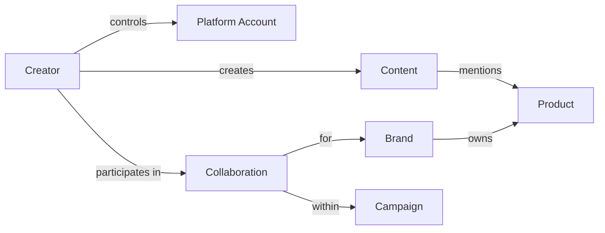
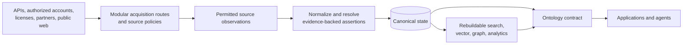

# Social Marketing Intelligence Platform

## 1. Thesis and product boundary

Build a shared intelligence foundation for brand and agency marketers who now assemble fragmented social, creator, campaign, and commerce evidence by hand. The platform helps them observe markets, investigate signals, compare creators, plan campaigns, measure outcomes, and reuse what they learn. It supports human decisions and does not publish content, contact creators, purchase media, or change connected marketing systems.

Beauty in South Korea and Japan is the first domain in which to prove the platform. One multilingual core model and one system serve both markets. Beauty concepts and market-specific labels, channels, taxonomies, and effective-dated policies extend that core without redefining it.

## 2. Connected decision loops

| Loop | Decisions supported |
| --- | --- |
| **Market and Brand Intelligence** | What is being said about a brand, product, topic, or competitor? What changed, and which signals or risks warrant investigation? |
| **Creator and Campaign Decision Support** | Which creators satisfy a brief, why, and which shortlist or portfolio scenarios fit the objective, audience, budget, and risk constraints? |
| **Measurement and Learning** | What happened, what can be attributed under a stated rule, what incremental effect can be estimated, and what should be tested next? |

Agentic Research provides a permission-filtered interface across all three loops for searching, comparing, investigating, and explaining evidence. The first integrated product provides beauty listening, creator shortlisting, campaign measurement planning, and a learning record over the same knowledge foundation. Market monitoring operates independently and keeps marketers and the shared knowledge current. A marketer initiates campaign planning and creator selection from a campaign brief; monitoring insights may inform that brief, but detecting a signal does not automatically initiate a campaign or create its shortlist.

## 3. Intelligence and evidence

Listening combines retrieval across permitted text, image, audio, and video observations with entity resolution, aspect and topic extraction, sentiment, trend detection, and human investigation. It describes the accessible conversation with explicit source and sampling limits; it does not claim to measure public opinion. Creator discovery uses eligibility filters and separate, objective-specific evidence for brand and product fit, content, audience relevance, collaboration history, performance, cost, availability, and authenticity risk. Marketers may describe optional criteria in natural language; the system turns them into visible, versioned ranking profiles. Portfolio outputs compare feasible scenarios and assumptions.

Measurement has three levels: descriptive performance and attribution; randomized user or geographic lift where feasible; and quasi-experiments or calibrated marketing-mix modeling when the data and assumptions support them. Attribution allocates observed outcomes under a rule and does not establish incremental effect. Every consequential result states its decision, observed population, market and source coverage, time window, metric and method versions, evidence, uncertainty, freshness, and limits. Korean and Japanese language models and beauty-specific classifiers require local evaluation. These principles follow communication evaluation and social measurement guidance from [AMEC](https://amecorg.com/amecframework/home/framework/introduction/) and the [Media Rating Council](https://mediaratingcouncil.org/sites/default/files/News/General-Announcements/MRC%20Social%20Measurement%20Guidelines%20v1.0%20Final.pdf).

Deterministic services own metric definitions, joins, constraints, and reproducible calculations. Statistical models support retrieval, extraction, classification, ranking, anomaly detection, and causal estimation under explicit assumptions. LLMs support natural-language criteria, investigation, and evidence-grounded explanation. Routine analysis runs without approval; review gates apply to ambiguity, sensitive claims, material consequences, or significant resource use.

## 4. Operational Ontology

Inspired by [Palantir's operational Ontology](https://www.palantir.com/docs/foundry/ontology/overview), the platform exposes a versioned, permission-aware business contract over canonical knowledge: stable objects, meaningful relationships, curated properties, reusable analytical functions, and a small set of internal actions. Applications and agents use this contract instead of source schemas. Saving a shortlist or correcting an identity decision is an auxiliary internal action with the trace needed for correction.

The ontology definition and graph below are illustrative and may be refined or extended through further research.

The compact core also includes Topic, Audience Segment, and Social Event; supporting records hold metric observations, analytical estimates, evidence, and measurement decisions. Stable internal identities remain separate from source accounts and mutable handles. Relationships with their own dates, roles, or evidence become objects. Consequential observed, derived, and human assertions retain provenance, relevant times, method versions, and meaningful uncertainty. Canonical rules select a preferred current view while preserving material conflicts and reversible identity decisions.

Beauty extends the core with product categories, ingredients, shades, routines, concerns, sensory aspects, claims, and substantiation where needed. Market extensions carry localized labels and effective-dated disclosure or cosmetics policies. Real marketer questions, permission checks, evidence, and temporal cases validate the model as it evolves. The ontology contract does not depend on RDF, OWL, or a graph database.

## 5. Data architecture and governance

Independent acquisition routes can be enabled or combined according to source policy, configuration, cost, quotas, freshness, and available resources. APIs, customer-authorized integrations, licensed feeds, partnerships, customer data, and permitted web collection all contribute observations. Each route records its access method, allowed uses, coverage, timestamps, and retention rules. A versioned rule resolves conflicting facts by field and context, weighing source authority, freshness, and quality. Official APIs take priority for facts they authoritatively report; sampled search and web results can add evidence without implying complete coverage.

Canonical state is authoritative. Versioned changes propagate idempotently to rebuildable projections with bounded staleness; reconciliation detects missed updates and source corrections. Revocation and deletion propagate through retained observations, canonical fields, indexes, analytical extracts, and rebuilds. Tenant permissions, source rights, provenance, and coverage remain attached to product results.

## 6. Starting technologies and growth

| Capability | Start with | Expand when measured need appears |
| --- | --- | --- |
| Application and jobs | Modular Python/FastAPI service, separate workers, managed queue and scheduler | Durable workflow orchestration for long-running processes or complex backfills |
| Canonical knowledge | Managed PostgreSQL with typed domain tables, selective temporal assertions, and a transactional outbox | Change-data capture or streaming for sustained lag, replay, or many consumers |
| Source evidence | Managed object storage with policy-based retention and encryption | Specialized catalog or lineage tools when native records become hard to operate |
| Retrieval | PostgreSQL keyword and relationship queries; `pgvector` for useful embeddings | Dedicated Korean/Japanese search, vector, or graph systems when relevance, recall, or traversal benchmarks fail |
| Analytics and intelligence | Parquet and DuckDB; versioned Python/SQL methods and managed inference | A warehouse or specialized model serving when workload, latency, or cost benchmarks justify it |
| Operations | Code-native quality checks, source and projection health metrics, tenant authorization, secrets management, and OpenTelemetry | Dedicated quality or governance tools when ownership and policy operations outgrow the founding team's workflow |

Every specialized store remains a rebuildable projection or supporting service. The first delivery goal is a trusted intelligence loop with visible coverage, freshness, evidence, and measurement limits. Detailed methods and sources are recorded in the [social-marketing](.scratch/proposal-research/research/01-social-marketing-methods.md), [ontology](.scratch/proposal-research/research/02-operational-ontology.md), and [data-architecture](.scratch/proposal-research/research/03-data-and-technology-architecture.md) research notes.
