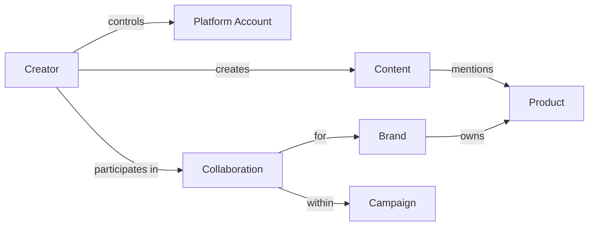
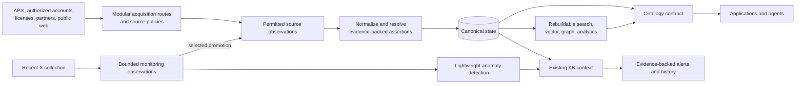

# Social Marketing Intelligence Platform

## 1. Thesis and product boundary

Build a shared intelligence foundation for brand and agency marketers who now assemble fragmented social, creator, campaign, and commerce evidence by hand. The platform helps them observe markets, investigate signals, compare creators, plan campaigns, measure outcomes, and reuse what they learn. It supports human decisions and does not publish content, contact creators, purchase media, or change connected marketing systems.

Beauty in South Korea and Japan is the first domain in which to prove the platform. One multilingual core model and one system serve both markets. Beauty concepts and market-specific labels, channels, taxonomies, and effective-dated policies extend that core without redefining it.

The [functional requirements](FR.md) and [operational contract](docs/functional-requirements.md) define the target workflows below. The current local application implements frozen and bounded current-KB evidence, supported deterministic/model recommendations and automatic shortlists, approved assistant enrichment, explicit bounded workers, recent X alerts, graph traversal and lineage. Optional model/live routes require trusted configuration and retain unverified live readiness; broader autonomous research, semantic monitoring, hosted operation and actual measurement remain future work. See the [current roadmap](docs/roadmap.md) for the distinction between installed software, live acceptance and human validation.

## 2. Connected decision loops

| Loop | Decisions supported |
| --- | --- |
| **Market and Brand Intelligence** | What is being said about a brand, product, topic, or competitor? What changed, and which signals or risks warrant investigation? |
| **Creator and Campaign Decision Support** | Which creators satisfy a brief, why, and which shortlist or portfolio scenarios fit the objective, audience, budget, and risk constraints? |
| **Measurement and Learning** | What happened, what can be attributed under a stated rule, what incremental effect can be estimated, and what should be tested next? |

Agentic Research provides a permission-filtered interface across all three loops for searching, comparing, investigating, and explaining evidence. The operational product connects campaign recommendations, a knowledge assistant and independent X monitoring over shared evidence. Campaign measurement planning and a learning record remain supported; actual outcome ingestion, attribution and causal measurement are longer-term capabilities. A marketer initiates a campaign from a brief; detecting a monitoring signal does not automatically initiate a campaign.

### Operational flows and application surfaces

- **Campaign recommendations:** interpret structured/natural-language criteria, search the current KB, and apply rules plus LLM assessment to produce ranked, evidence-backed recommendations. Save the ranked recommendation as a shortlist automatically; human review or approval is not a prerequisite. Stable platform identity and one permitted ingested supporting observation admit a candidate even if profile information is incomplete. Assess candidate quantity, relevance and freshness; automatically queue additional discovery when coverage is insufficient. Notify after usable KB updates and offer explicit regeneration, preserving existing saved results.
- **Knowledge assistant:** answer free-form questions from existing KB knowledge. Propose enrichment for stale, missing or incomplete evidence and require user approval before submitting each assistant-origin task. Approval can cover searches beyond the registered keywords. Execute asynchronously through ingestion and KB publication; newly fetched material cannot directly become an answer or be used before ingestion. Return acknowledgment/status and completion notification for later queries.
- **Independent X monitoring:** periodically collect recent posts for configured topics, detect quantitative and semantic anomalies, and investigate them using existing KB context without additional external searches. Use a lightweight recent-observation path rather than fully modeling every fetched post; retain bounded monitoring evidence and alert history, selectively promoting useful material to the KB. Notify users with concise explanations and source support.
- **Knowledge graph explorer:** provide interactive entity/relationship search, filtering, traversal, details and evidence over governed KB read models. Graph-inspired navigation does not require a graph database.
- **Pipeline and lineage view:** expose jobs/tasks, status/failures, source provenance, transformations and KB update history through linked operational records.

Scheduled discovery registers at most ten keywords per workspace. The initial configurable daily allowance is fifty unique eligible new posts total across those keywords, prioritized by recency, engagement and trend evidence. On-demand campaign discovery and approved assistant enrichment share the acquisition pipeline; the scheduled keyword list does not limit approved on-demand scope. Progressive acquisition combines broad discovery with selective supplementary routes and stops when further information is not worth its cost or operational bounds are reached. Structured submission/status operations enforce origin-specific approval and spending rules server-side, whether called through internal endpoints or agent tools.

## 3. Intelligence and evidence

Listening combines retrieval across permitted text, image, audio, and video observations with entity resolution, aspect and topic extraction, sentiment, trend detection, and human investigation. It describes the accessible conversation with explicit source and sampling limits; it does not claim to measure public opinion. Creator discovery uses eligibility filters and separate, objective-specific evidence for brand and product fit, content, audience relevance, collaboration history, performance, cost, availability, and authenticity risk. Marketers may describe optional criteria in natural language; the system turns them into visible, versioned ranking profiles. Portfolio outputs compare feasible scenarios and assumptions.

Measurement has three levels: descriptive performance and attribution; randomized user or geographic lift where feasible; and quasi-experiments or calibrated marketing-mix modeling when the data and assumptions support them. Attribution allocates observed outcomes under a rule and does not establish incremental effect. Every consequential result states its decision, observed population, market and source coverage, time window, metric and method versions, evidence, uncertainty, freshness, and limits. Korean and Japanese language models and beauty-specific classifiers require local evaluation. These principles follow communication evaluation and social measurement guidance from [AMEC](https://amecorg.com/amecframework/home/framework/introduction/) and the [Media Rating Council](https://mediaratingcouncil.org/sites/default/files/News/General-Announcements/MRC%20Social%20Measurement%20Guidelines%20v1.0%20Final.pdf).

Deterministic services own metric definitions, joins, constraints, and reproducible calculations. Statistical models support retrieval, extraction, classification, ranking, anomaly detection, and causal estimation under explicit assumptions. LLMs support natural-language criteria, investigation, and evidence-grounded explanation. Routine KB analysis and ranked-shortlist persistence do not require human approval. Human curation is optional and remains separately attributable; saving an automated result cannot imply human review or verified claims. Assistant-origin external enrichment always requires its scoped approval. Scheduled and campaign-coverage acquisition use their separately configured authorization; spending ceilings and source constraints apply independently.

## 4. Operational Ontology

Inspired by [Palantir's operational Ontology](https://www.palantir.com/docs/foundry/ontology/overview), the platform exposes a versioned, permission-aware business contract over canonical knowledge: stable objects, meaningful relationships, curated properties, reusable analytical functions, and a small set of internal actions. Applications and agents use this contract instead of source schemas. Saving a shortlist or correcting an identity decision is an auxiliary internal action with the trace needed for correction.

The ontology definition and graph below are illustrative and may be refined or extended through further research.

The compact core also includes Topic, Audience Segment, and Social Event; supporting records hold metric observations, analytical estimates, evidence, and measurement decisions. Stable internal identities remain separate from source accounts and mutable handles. Relationships with their own dates, roles, or evidence become objects. Consequential observed, derived, and human assertions retain provenance, relevant times, method versions, and meaningful uncertainty. Canonical rules select a preferred current view while preserving material conflicts and reversible identity decisions.

Beauty extends the core with product categories, ingredients, shades, routines, concerns, sensory aspects, claims, and substantiation where needed. Market extensions carry localized labels and effective-dated disclosure or cosmetics policies. Real marketer questions, permission checks, evidence, and temporal cases validate the model as it evolves. The ontology contract does not depend on RDF, OWL, or a graph database.

## 5. Data architecture and governance

Independent acquisition routes can be enabled or combined according to source policy, configuration, cost, quotas, freshness, and available resources. APIs, customer-authorized integrations, licensed feeds, partnerships, customer data, and permitted web collection all contribute observations. Each route records its access method, allowed uses, coverage, timestamps, and retention rules. A versioned rule resolves conflicting facts by field and context, weighing source authority, freshness, and quality. Official APIs take priority for facts they authoritatively report; sampled search and web results can add evidence without implying complete coverage.

Canonical state is authoritative for KB queries, campaign recommendations and assistant answers. X detection may use its own bounded recent observations before full KB publication; these observations and pinned alert support do not become authoritative general KB facts merely by triggering an alert. Anomaly investigation reads existing KB context without launching further searches. Versioned KB changes propagate idempotently to rebuildable projections with bounded staleness; reconciliation detects missed updates and source corrections. Revocation and deletion must propagate through retained observations, canonical fields, indexes, analytical extracts, monitoring/alert copies and rebuilds. Tenant permissions, source rights, provenance, and coverage remain attached to product results.

Where actual spending can be derived reliably, record attributed usage/charges and enforce configured ceilings across jobs and tools. Costs that cannot be derived remain clearly labeled forecasts. Track meter/rate versions, currency, accounting period and in-flight commitments; reconcile actual charges without double-counting retries. A strict pre-call limit requires bounded charges or a provider-side cap; delayed billing limitations remain visible. Request/record bounds and expected-value stopping are separate from monetary ceilings. Ceiling amounts are configuration, not assumed provider prices, and the approximate all-in operating target is not proof that a particular workload fits it.

## 6. Starting technologies and growth

This table describes accepted target options and growth criteria, not the current deployment. The installed local runtime is a standard-library Python browser/CLI application, explicit bounded worker operations, PostgreSQL and local payload files; Compose starts PostgreSQL only.

| Capability | Start with | Expand when measured need appears |
| --- | --- | --- |
| Application and jobs | Modular Python/FastAPI service, separate workers, managed queue and scheduler | Durable workflow orchestration for long-running processes or complex backfills |
| Canonical knowledge | Managed PostgreSQL with typed domain tables, selective temporal assertions, and a transactional outbox | Change-data capture or streaming for sustained lag, replay, or many consumers |
| Source evidence | Managed object storage with policy-based retention and encryption | Specialized catalog or lineage tools when native records become hard to operate |
| Retrieval | PostgreSQL keyword and relationship queries; `pgvector` for useful embeddings | Dedicated Korean/Japanese search, vector, or graph systems when relevance, recall, or traversal benchmarks fail |
| Analytics and intelligence | Parquet and DuckDB; versioned Python/SQL methods and managed inference | A warehouse or specialized model serving when workload, latency, or cost benchmarks justify it |
| Operations | Code-native quality checks, source and projection health metrics, tenant authorization, secrets management, and OpenTelemetry | Dedicated quality or governance tools when ownership and policy operations outgrow the founding team's workflow |

Every specialized store remains a rebuildable projection or supporting service. The first delivery goal is a trusted intelligence loop with visible coverage, freshness, evidence, and measurement limits. The maintained [architecture](docs/architecture.md), [data model](docs/data-model.md), [functional requirements](docs/functional-requirements.md), [source integrations](docs/source-integrations.md) and [quality review contract](docs/evaluation.md) define the implementation and validation boundaries.
