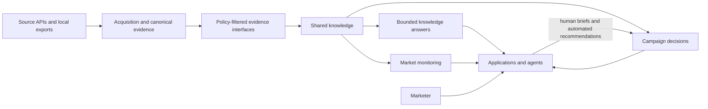
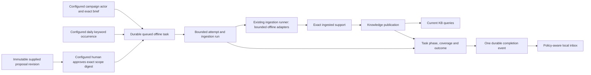
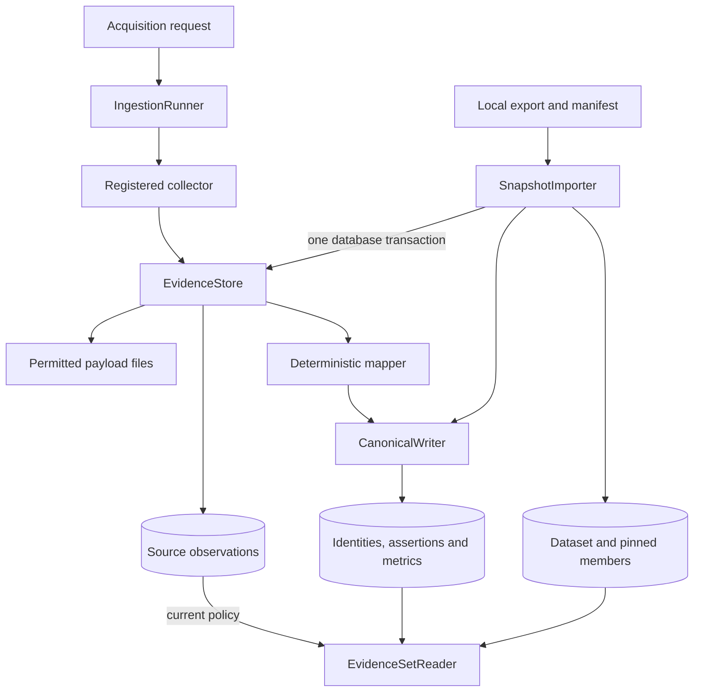
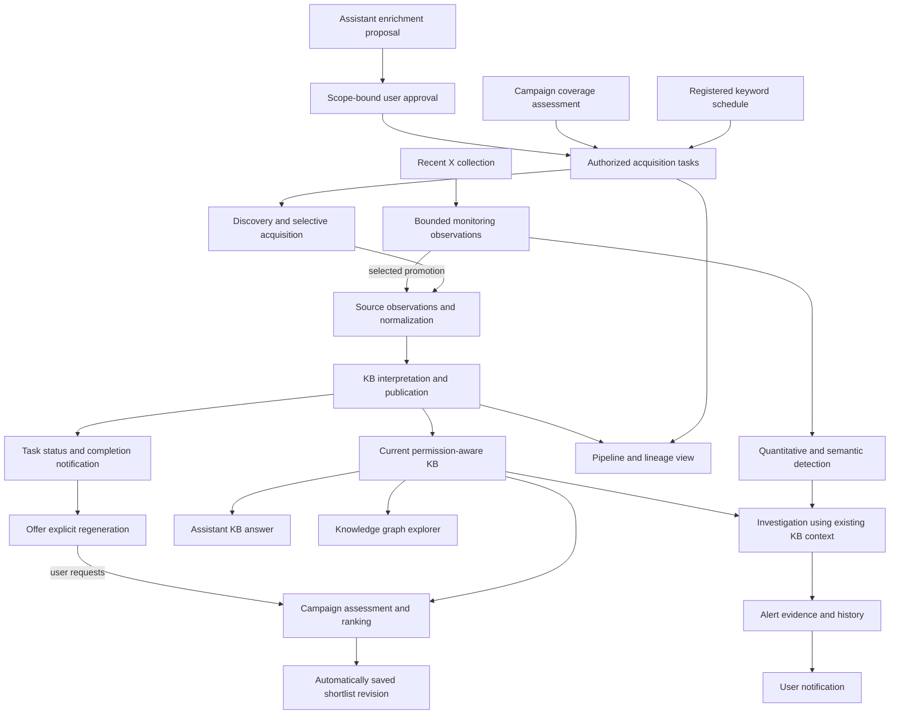

# System architecture

Social Marketing Intelligence supports market investigation and campaign recommendations over shared evidence. In the [target operational contract](functional-requirements.md), an agent can save ranked shortlists without human review or approval; assistant-origin enrichment separately requires approval. Independent X monitoring uses a lightweight evidence path. The implemented local pilot supports bounded current-KB and frozen-evidence comparisons with deterministic or validated model-ordered automatic shortlist saves and distinct human selections. Campaign measurement distinguishes observed outcomes, attribution rules and causal effects.

## Implemented product boundaries

These are module boundaries within one Python application and PostgreSQL instance. They do not prescribe separately deployed services. Source adapters depend on ingestion contracts; downstream business modules depend on public evidence interfaces, never adapter internals or direct writes to ingestion tables.

| Owner | Responsibilities | Implementation coverage |
| --- | --- | --- |
| Offline acquisition tasks | Campaign-role and saved-coverage discovery admission, immutable supplied proposals, exact human approval, route/scope/limits, execution ownership, attempts, phases, run/publication outcomes and completion inbox | Implemented in `smi_tasks` for supplied-reference JSON and bounded offline keyword discovery with competing-worker fencing, recovery, partial outcomes and local completion delivery; configured synthetic spending admission shares the collector boundary; registered daily keyword authority, due offline task creation and atomic shared unique-new-post admission are installed; explicit recorded live scheduling and optional exact approved nickname supplementation are installed behind independent runtime/source/cost gates |
| Offline cost accounting | Immutable metered/forecast-only configuration, exact synthetic measurements, equivalent operation/task attribution, forecasts, declared commitments and uncertainty | Implemented in `smi_costs`, including shared bounded synthetic admission, explicit final reconciliation, meter recovery and the configured fixture worker meter; no commercial calls |
| Acquisition and canonical evidence | Collection, source policy, observations, stable account/content identity, field assertions, metrics and replay | Implemented in `smi_ingestion` |
| Exact ingested support | Bounded selection and purpose-aware reads of observation/derivation/assertion/metric IDs, including fresh runs | Implemented in `smi_ingestion.support` |
| Frozen evidence sets | Validated snapshot import, fixed member/derivation bindings, lineage and workspace/purpose-aware reads | Implemented in `smi_ingestion.evidence_sets` |
| Shared knowledge | Brand/product references, supported caption interpretations, explicit knowledge publications, bounded current-KB queries and pinned result manifests, method/catalog versions and dependency cleanup | Implemented in `smi_knowledge`; Creator associations and human correction workflows remain future work |
| Market monitoring | Saved snapshot investigations and separate bounded offline X topics/windows/captures | Implemented in `smi_monitoring` and `smi_monitoring.recent`; live X collection, baselines, detection and alerts remain future work |
| Campaign decisions | Briefs, comparisons, automated and human shortlists, proposed measurement plans and decision notes | Implemented in `smi_campaigns` and `smi_campaigns.planning`; observed outcomes/attribution remain future work |
| Knowledge answers | Free-form questions, bounded model relevance selection, full exact-input dependencies and governed extractive findings | Implemented in `smi_assistant`, with explicit gap/proposal/approval/task follow-up composed by `smi_tasks.assistant`; semantic retrieval remains future work |
| Review application | Independent investigation/campaign forms, evidence and uncertainty panels | Implemented in `smi_review`; translation/language and marketer evaluation require actual review |

## Offline task orchestration

`smi_tasks` composes `CampaignStore`, `IngestionRunner`, `IngestedEvidence` and `KnowledgePublications` through their public interfaces. Server-configured identity roles separately authorize campaign humans/services and proposal approvers. Arbitrary assistant automation cannot obtain campaign authority by choosing that operation. Campaign submission establishes origin from an exact existing current brief share-locked through `CampaignStore.require_current_brief` in the admission transaction; assistant submission requires an immutable supplied proposal and its exact attributable human approval. Admission commits immutable route/configuration digest, actor, scope and limits, then returns a queued task ID without collecting. The bounded worker persists an attempt/run link and actual automation producer, registers only the saved supplied-reference or deterministic keyword fixture capability, rejects changed manifests and records collected versus ingested versus published counts. Recovery reuses the same attempt/run and committed evidence/canonical effects, retaining exact prepared publication support and bounded recovery history. Publication and a task-owned receipt commit atomically. Source-free task recovery requires that receipt, exact durable prepared membership and source-owner validation of the attempt/run lineage, preserving the actual producer after a lost acknowledgment. Public publication request text alone grants no task ownership. Valid subsets publish as partial updates with the failed remainder visible; empty or unchanged usable captures create no fictitious update. Simulated pending operations resume an opaque checkpoint, while ambiguous operations remain waiting without another collector call. Terminal retries reuse the original outcome. See [the task contract](tasks.md).

A task-specific PostgreSQL session lock grants one worker authority. Task admission/approval remains immutable and separate from this temporary execution ownership. Every consequent source/canonical/publication/task mutation joins an owner transaction on that same session connection, validating the task execution ID under its row lock. Session loss aborts pending writes and prevents late results committing over a successor. I/O occurs outside transactions; a paused connected session retains its task, and different tasks progress independently. Source-free execution views distinguish running work from recoverable committed progress. This is per-task local-effect fencing, without provider-side exactly-once guarantees or cross-task novelty admission; [ADR 0005](adr/0005-task-session-effect-ownership.md) records the trade-off.

The offline task slice retains one attempt across competing-worker recovery, including exact support and partial publication. `CompletionInbox` reads one source-free event committed with each terminal outcome on the same fenced ownership session. It reopens task coverage and current publication support through their owners, exposing usable/partial/no-update/failure messages and permitted navigation after restart. Migration and workspace reconciliation idempotently backfill older outcomes; source withdrawal preserves historical counts while withholding unavailable publication links. See [the inbox contract](tasks.md#durable-completion-inbox). External transports remain future work; explicit campaign regeneration belongs to the campaign composition below. Configured synthetic monetary admission shares the task execution session. Source-free synthetic accounting is owned independently below.

The distinct `offline-keyword-json` collector applies the exact human-approved or server-established schedule/campaign query/subject/publication window to a digest-pinned bounded synthetic corpus, then emits source-shaped pages through the existing runner/mapper. Source coverage owns selection lineage and original capture times; stable source namespace/native IDs remain independent of query/task identity. Unassessable selection rows quarantine with partial/failure semantics. Empty/unchanged selection creates no publication benefit. The task owner validates immutable selection/configuration and hard limits; the existing cost owner binds either offline adapter to its one-request synthetic contract. See [bounded offline discovery](tasks.md#bounded-offline-keyword-discovery).

`smi_tasks.schedules` owns registered keyword configuration and occurrence history, independently of monitoring. `ScheduledDiscovery` receives the task owner by injection (type-only reference), serializes edits/ticks on one workspace lock and atomically composes the task owner's `submit_scheduled` on the same admission transaction. The task owner reopens exact persisted authority through `require_occurrence`; only the schedule owner issues schedule SQL. Trusted operator/service roles authorize ticks, and a separate human operator role authorizes configuration; forms cannot choose origin or those roles. At most ten current-day occurrences acknowledge bounded tasks under default offline or explicitly recorded live authority, with stable local-date/key uniqueness across configuration versions and retained refusals. The first accounting timezone/local-midnight boundaries remain fixed; exact UTC day/window and allowance context travel with each task. The existing worker, cost guard, receipt-backed recovery and completion inbox retain execution ownership. No source/model I/O occurs in admission and no daemon is enabled. Explicit human live activation pins route/version/manifest/limits/policy independently of process enablement; queued tasks retain that immutable authority. New paid POST work stops at shared post-cap exhaustion; same-snapshot GET recovery remains independently metered and atomically cap-enforced. The schedule-owned daily allowance serializes new-post counts across all keywords and workers. The worker injects its public admission operation into canonical application on the fenced execution transaction, after normalization/policy checks and identity locking but before canonical writes. Day admissions and canonical effects commit or roll back together; known refreshes and duplicate identities consume no extra new-post allowance. Current cap/usage reads remain separate from immutable task authority, and cap edits preserve consumption. See [the schedule contract](tasks.md#registered-offline-keyword-schedule) and [ADR 0011](adr/0011-stable-schedule-accounting-day.md).

`smi_tasks.discovery` owns reference-only query/retrieval history and capture-based avoidance for this one route. New admission pins explicit operator freshness/processing policy and input context. The worker records one decision on its fenced session before source dispatch, then completes history with its task outcome/event. Governed source/publication interfaces resolve exact capture/mapping usability, including already published no-update support; their links grant no task receipt. Only complete eligible support with every capture known/nonfuture/fresh may skip. Quota exclusions, failed/partial work and stale/unknown captures remain eligible; actual mapper and canonical-processing revisions stay distinct. A skip creates no collector/cost dispatch, canonical admission or publication, and never extends capture freshness. Current permissions withhold withdrawn input while old result pins remain exact. See [the avoidance contract](tasks.md#capture-based-discovery-avoidance) and [ADR 0013](adr/0013-capture-based-discovery-avoidance.md).

## Offline cost accounting

`smi_costs.UsageAccounting` owns immutable operator-configured synthetic metered and forecast-only service scopes, stable operations and append-only records. Exact decimal unit/rate measurements produce auditable synthetic amounts, separately from forecasts, declared outstanding commitments and explicit unknown/meter-failure records. Workspace-global measurement identities serialize retries and reject conflicting reuse. The bounded synthetic operation adapter coordinates configured scope ceilings, one-use dispatch reservations and measured settlement; operator-bound fixture workers use that same guard. Explicit final-evidence reconciliation settles named reservations/declarations/uncertainty without replacing their audit records or granting another dispatch; operator meter-health recovery is separate. Commercial calls and provider-specific reconciliation remain future work. See [the accounting contract](costs.md).

The composition boundary injects `AcquisitionTasks.resolve_cost_attribution`; it validates exact workspace task/attempt membership through public task reads. Accounting has no task dependency or foreign-table SQL, while task execution depends on the public accounting adapter, preserving one-way dependency direction. Equivalent model operations retain actor/method/service and stable retry identities without tasks. Accounting metadata contains no copied source material; source withdrawal cannot erase historical synthetic resource usage or expose restricted values. The local application reads costs through this owner and reopens tasks before task-filtered navigation. Configuration, currencies, periods, rates, recorder/provenance and synthetic basis remain inspectable after restart. Final measurement, named liability resolution and separate failed-meter recovery share the same scope lock as admission. Task detail reopens current cost bounds, billing state and meter health without modifying task progress, evidence or receipt-backed publication recovery. Late actual overage stays truthful; delayed/unbounded charges carry no zero-overshoot guarantee. See [ADR 0007](adr/0007-final-cost-evidence-and-meter-recovery.md).

## Acquisition and persistence

Collectors perform bounded I/O and produce source-shaped observations. Mappers deterministically interpret those observations. The canonical writer owns identity matching and versioned derivations. Retained payloads have integrity hashes and can be replayed; transient inputs cannot. Replaying the same mapper/policy version has no additional canonical effect.

`EvidenceStore.save` accepts the keyword-only `complete` marker, defaulting to `False` for existing callers. The observation, checkpoint, usage counters and input-completion marker share one database transaction. A supplied connection remains caller-owned, including commit/rollback and retained-payload cleanup after rollback. `IngestionRunner.resume` processes saved pending evidence before considering further collection; a saved final capture needs no collector call even when it exhausted a request or record limit. Nonfinal captures retain their checkpoint for continued collection. Schema upgrades preserve existing run and observation identities; completed legacy runs remain complete without reacquisition.

An external identity consists of platform, namespace, resource kind, native string ID and synthetic status. Handles are mutable observed fields. Different namespaces remain separate until a future explicit identity association establishes equivalence. Metrics retain source-specific definitions, native names, precision, units and relevant times.

An offline import validates a complete export, persists local observations through the existing evidence/writer interfaces and registers immutable membership. Original run/observation IDs remain origin references; locally created UUIDs identify the imported records. Source capture time is preserved independently of import time. See the [evidence-set contract](evidence-sets.md).

## Evidence access

`CanonicalReader` is a low-level current-view inspection interface. It selects active source derivations and filters source display permissions; it does not authorize application users or pin a decision's dataset.

`EvidenceSetReader` is the downstream interface for frozen inputs. It intersects a trusted actor's configured workspace with source permission for the requested purpose. It returns exact assertion/metric IDs and source locators, coverage, missing states and current support health. A later observation or mapper revision cannot silently substitute for a pinned assertion. New computations use `purpose="process"`; human-facing evidence uses `purpose="display"`.

The current local actor boundary is an in-process contract. The CLI runs as a named human operator in the local workspace. A hosted API will require authenticated identities and server-side permission resolution before it constructs actor contexts. Client-submitted actor kind is not authentication.

`IngestedEvidence` provides exact, workspace-scoped support from freshly ingested runs or imported observations. Run ownership defaults to the local workspace for compatibility; snapshot imports retain their configured workspace. Explicit references pin selected assertion/metric IDs and their derivation. Purpose checks and source/derivation transaction locks belong to ingestion. This reader creates no dataset and never mutates frozen membership.

## Shared knowledge

`smi_knowledge` owns business references and rule-based caption interpretations. Catalogs configure aliases and category topics separately from source evidence. Each interpretation pins a source assertion, original text span, method/catalog version and provisional review status. Preparation reads processable evidence through `EvidenceSetReader` and checks retention/current support again while committing. Knowledge reads reconcile retained copies and apply the requested display/process permission. See the [knowledge contract](knowledge.md).

The rules identify literal mentions and markers. Their output distinguishes product-family references, unresolved stance and script evidence from audience or sales claims. A translation-assisted packet carries original captions and supported spans, with translation and reviewer fields explicitly pending.

`KnowledgePublications` owns atomic availability of a bounded support selection. It validates exact source IDs and optional existing interpretation IDs through their owners, records the actual producer, method, publication time and coverage, and commits all membership together. Workspace/request identity serializes retries and conflicts on changed payloads. Reads reopen the exact selection under current permissions and derivation health; publication stores no additional source text. Imported datasets and prior publications stay immutable. Durable acquisition tasks compose publication through the separate task owner.

`KnowledgeQueries` selects at most 100 members from at most 100 recent committed publications through public publication reads. New computation requires process permission plus its output-purpose permission; reopening applies its requested read purpose to exact saved support. The query owner persists source-free manifests with actual observation/derivation/assertion/metric/interpretation IDs, method/publication versions, producer and original coverage. New publications cannot rewrite saved membership. Capture-age freshness requires an explicit threshold and remains separate from permission/derivation health; truncated scope and unknowns remain visible. See the [query contract](knowledge.md#bounded-current-knowledge-queries). General semantic retrieval and graph traversal remain future work; campaign ranking and bounded extractive answers compose this public query interface.

## Bounded knowledge answers

`smi_assistant` is an application owner above public knowledge retrieval and the existing shared Responses transport. `KnowledgeAssistant.ask/read` owns a durable human question, exact query/full model-input support IDs, immutable actual model/method/bounds and source-free generated selection. It selects up to 20 exact original findings from at most 20 published members/100 facts; source values/dates remain with their existing owners. The model supplies relevance IDs and fixed uncertainty only. Missing/stale/ambiguous/unsupported information stays visible; the answer operation has no raw acquisition response, tool/search, enrichment submission or approval authority.

Shared admission rechecks every input's current process/display and derivation health after waiting for the cost lock, retaining source locks through dispatch commit and recording refusal with no liability. No transaction spans model I/O; finalization repeats the check. Any later loss of an actual input withholds all derived selection, including when chosen citations survive. Reopening requires no configured model and preserves exact historical context; later questions use later publications. Human cost attribution remains separate from generated authorship. See [the answer contract](knowledge.md#bounded-free-form-knowledge-answers) and [ADR 0017](adr/0017-exact-supported-answers.md). No semantic-entailment or human-usefulness claim follows from validation.

`smi_tasks.assistant.AssistantEnrichment` composes the answer owner with existing proposal/approval/task and completion owners. A source-free linkage pins the original asker/answer, gap code, exact human keyword/subject/window input and a fresh nested proposal identity. The fixed gap-purpose template requires no extra model call. A separate configured human approves the saved exact revision; queue acknowledgment never executes the worker. The parent task owner alone resolves saved proposal requests after interrupted linkage without current route files. The browser can reopen the pending exact scope after restart. Actual completion/current links come from `CompletionInbox.read_task`, independently of its bounded list. New questions can use new publications while older answers remain pinned. See [the journey contract](tasks.md#assistant-knowledge-gap-enrichment) and [ADR 0018](adr/0018-explicit-assistant-gap-scope.md).

## Campaign decisions

`smi_campaigns` owns briefs, comparison drafts and shortlist revisions through a small transactional interface. A human starts or revises the brief, atomically saving original prose when supplied and an executable structured-profile snapshot with stable criterion IDs and exact brief identity/version. Installed versions describe caption rules, unranked ordering and descriptive coverage; legacy revisions retain an unrecorded profile. Automation may prepare a comparison for that existing campaign. A draft pins the exact brief/profile and either a legacy knowledge run/frozen dataset or an immutable current-KB query result. Current-KB candidates require stable account identity and one permitted published ingested observation; incomplete profiles remain eligible and unsupported references remain discovery gaps. Public knowledge/evidence readers own all foreign-table access. A human saves a draft or confirms an exploratory account selection with source-supported relevance and acknowledged unknowns.

`smi_campaigns.responses` shares one explicitly configured OpenAI Responses route, bounded transport port, disabled-by-default HTTPS adapter and monetary settlement across criteria interpretation, ranking and the top-level knowledge assistant. `smi_campaigns.interpretation` owns criteria mapping and validation. Campaigns own immutable exact-brief interpretation attempts and validated additive generated profiles; accounting owns shared admission, synthetic/provider-reported usage and explicit final evidence/recovery. Generated data preserves human constraints and remains distinct from source facts and task authority. A separate user selection pins a visible successful interpretation to a later comparison. Missing configuration is unavailable; stale/invalid/refused/incomplete/uncertain outcomes remain visible. Provider mode requires explicit server enablement and a verified snapshot context/input/output contract; default verification intercepts all external connections. See [the interpretation contract](campaigns.md#bounded-natural-language-interpretation) and [ADR 0008](adr/0008-generated-criteria-preserve-human-constraints.md).

Request identities make retries safe, and expected-version checks prevent competing edits from overwriting the campaign's brief or shortlist head. Later work creates successor records. Candidate bodies and copied automated or human reasons track their source/interpretation dependencies; current policy can hide/purge explanations while preserving permitted historical membership, order and producer metadata. See the [campaign contract](campaigns.md).

`CampaignStore.recommend` composes current-KB preparation and an ordered `generated` shortlist in one transaction, with actual automation producer, exact brief/profile/method, rationale, explicit gaps and pinned support. It filters required exclusions/deferred unknowns, saves empty outcomes explicitly and records source-free selection counts. No human review/endorsement or model assessment is asserted. Identical retries reopen the original before reassessment; new requests check both brief and shortlist heads. Legacy human revisions preserve statuses/attribution and null historical ordering. Current-KB preparation shares the knowledge publication-frontier lock and source/derivation locks through its result/draft commit, including the automatic shortlist transaction. Exact support manifests, source dates, selected freshness, bounded coverage and actual unranked method/profile versions remain pinned; newer publications only affect explicit successor requests. `shortlist_support` supplies current policy and pinned dependencies to planning in its caller transaction, including source-only metric support without a field assertion.

`CampaignRecommendations` in `smi_tasks.campaigns` composes both recommendation methods with automatic discovery after the saved recommendation commits. Campaign core owns the pure versioned sufficiency policy and pins exact inputs/clock/results on the shortlist. Tasks own one immutable per-shortlist disposition and its atomically linked task, or a sanitized refusal. Exact retries reopen the saved decision/disposition; current support policy gates coverage explanations. This dependency direction avoids a campaign-to-task import cycle. The exact current human brief is returned under the task admission transaction's public campaign lock; no model/source I/O spans a transaction. Worker monetary admission remains the existing task/cost boundary. See [automatic coverage](campaigns.md#automatic-coverage-and-discovery) and [ADR 0010](adr/0010-save-before-coverage-discovery-admission.md).

`CompletionInbox` composes source-free automatic-campaign completion links with current exact-publication availability. Only explicit human submission through `CampaignRecommendations.regenerate` assesses/saves a successor using the original recommendation's actual deterministic/ranked method and current brief/head checks. The task-owned regeneration request pins actual actors, exact body, event/source and a server-owned nested identity before I/O, retaining only source-free outcome links/status afterward. `CampaignStore.read_shortlist_context` supplies saved method and current human/profile navigation without opening evidence bodies; source policy continues to govern all actual assessment/support reads. Completed retries reopen before changed context, while an interrupted action reopens the existing campaign claim/result without model redispatch. Both histories remain immutable; no campaign-to-task dependency, automatic rerank or new method is introduced. See [explicit regeneration](campaigns.md#explicit-regeneration-after-discovery).

`CampaignStore.recommend_ranked` commits one durable assessment claim and exact eligible comparison inputs before dispatch. `smi_campaigns.ranking` validates an exact candidate permutation and constrained criterion-scoped judgments; server-rendered reasons prevent unsupported factual prose. Shared Responses admission commits before I/O; no transaction spans the call. Actual support/policy and brief/shortlist heads are rechecked under locks before automatic save. Failed/stale/uncertain attempts have no successful fallback; valid reported consumption remains accounted. Empty eligible batches save explicit no-call outcomes. Exact retries reopen the original, including interrupted claims, without another dispatch. Governed candidate inputs/judgments purge with their existing dependencies. See [the ranking contract](campaigns.md#bounded-supported-llm-ranking).

`save_shortlist(..., source_shortlist_id=...)` extends the existing human selection operation with optional select/reorder curation. It pins the exact current source revision and persists an attributable ordered human draft or separately confirmed successor under the campaign head lock. The comparison, deterministic/model recommendation and their support stay immutable; curation needs no model/source I/O or mandatory review gate. Legacy human saves/history keep their original unrecorded ordering. Unavailable support can retain content-free membership but cannot enter a copied/submitted human reason; the existing candidate dependencies govern cleanup and error forms.

The deterministic method reports criterion states and coverage rather than universal creator scores. Its meaning remains bounded by the provisional caption interpretations actually available. Both the local operator CLI and browser review surface use the same persistence contracts.

## Local review application

`smi_review` composes public stores into escaped server-rendered forms and policy-aware evidence panels. Its standard-library HTTP server binds to loopback. A configured named human starts/revises briefs and saves/confirms shortlists; a distinct automation context prepares the rule-based knowledge/comparison and saves deterministic generated shortlists. Brief editing retains original human prose alongside the campaign-owned immutable executable profile, exact brief revision and truthful installed version labels. Request IDs and expected versions pass through to the domain stores, which own validation and transactions.

The browser can propose explicit bounded research from a saved assistant knowledge gap or save a supplied immutable enrichment proposal, review and approve its exact scope, acknowledge its single task and follow actual completion. It can create a brief, automatically recommend/save, prepare/review a comparison, save a draft, explicitly confirm and reopen exact historical revisions after server restarts. Dataset/catalog/campaign listing interfaces provide navigation without bypassing evidence ownership. Original permitted captions, exact support spans, source/date lineage, provisional judgments and unknowns remain visible. Current-policy withdrawal withholds source-dependent form contents as well as saved explanations. See [local review](local-review.md).

Same-origin form/Host checks and CSRF tokens protect local writes; the server constructs actor identity and serves only bundled assets. Browser state is not durable. Independent investigations, campaign planning, bounded knowledge search/results and committed publication list/detail pages use the same boundary. Publication details withhold denied and superseded source text while retaining permitted IDs and attribution. Language and marketer usefulness require actual review rather than technical checks.

## Independent monitoring and proposed measurement

`smi_monitoring` owns versioned human scopes and pinned snapshot-insight revisions without a campaign dependency or side effect. Rule-based findings count distinct posts/accounts, retain literal support and actual membership, and explicitly lack a growth/change baseline. Current permissions can withhold/purge copied findings while scope/answer history remains pinned. See [monitoring](monitoring.md).

`smi_monitoring.recent` owns a separate bounded local JSON route, operator-authorized topic revisions, explicit logical windows and policy-governed recent X captures. It depends on the shared PostgreSQL/context boundary and has no canonical-ingestion, publication, campaign or scheduled-keyword dependency. Native/original-capture identity survives fixture labels and import retries; copied bodies purge irreversibly while source-free window coverage and lineage survive. Current permissions and collection serialize on a workspace lock. The review server exposes protected topic/poll/window/timeline/detail operations; no daemon, live request, detector, alert or promotion is installed. [The recent evidence contract](monitoring.md#bounded-offline-recent-x-evidence) defines finite limits and original-time semantics.

`smi_campaigns.planning` owns proposed measurement-plan and human note revisions. Plans pin a current brief and relevant shortlist, keeping intended sources, definitions, matching/attribution and gaps separate from outcomes. Notes attach to a historical shortlist and inherit selected-source dependencies. Both are human-only and transactional/version checked. See [measurement and feedback](planning.md).

## Accepted future extensions

The [functional requirements](functional-requirements.md) extend the installed task/schedule, campaign ranking, bounded knowledge-answer and local completion journeys with broader autonomous research, lightweight X anomaly detection, external notifications, graph/lineage interfaces and broader spending control. The broader A/B/C workflows remain incomplete; the local task and completion inbox interfaces are described above.

The shared acquisition-task boundary owns task scope/origin, retries, approval enforcement, status and cost-control admission. Scheduled/campaign tasks and approved assistant tasks share ingestion/publication; clients cannot forge task origin to bypass approval. Initial daily scheduled discovery admits up to fifty unique eligible posts total across at most ten keywords. Routes remain modular, but existing supplied-reference adapters do not already provide query discovery.

The KB query/publication boundary selects current permitted evidence and records exact result support. Current support health and age-based freshness are different checks. A ranked account needs stable identity and ingested permitted support, not a complete profile. Current-KB results pin their actual inputs without mutating historical evidence sets. Shortlist persistence records the actual automation/human producer, method, ordered membership, rationale and gaps; human review is optional and separate from persistence. See [ADR 0003](adr/0003-automatic-shortlist-persistence.md).

Light X monitoring owns bounded recent observations, detection windows/baselines and retained alert support without requiring full KB modeling for every post. Its investigation uses existing KB context and cannot submit further external searches. Selected observations may be promoted through normal KB ingestion/publication. The separate owner inherits source-policy, provenance and withdrawal rules; it is not a second authority for general KB facts. See [ADR 0004](adr/0004-lightweight-monitoring-evidence.md).

Spending controls derive attributable actual cost where possible and enforce configured ceilings across concurrent work. Cost scopes that cannot be derived reliably retain explicit forecasts. Meter/rate versions, accounting periods, in-flight commitments and actual-charge reconciliation must be visible; no zero-overshoot guarantee is inferred from delayed or unbounded billing. Request/record bounds, value-based stopping, enrichment approval and monetary ceilings remain distinct controls. Offline synthetic accounting is implemented as described above; bounded synthetic scope ceilings and coordinated reservations are installed; explicit delayed synthetic reconciliation and failed-meter recovery are installed; commercial metering and provider-specific reconciliation remain future work.

Graph and pipeline views consume governed read interfaces; their UI requirements do not prescribe a graph database or a separate deployment per module. These future ownership boundaries do not require replacing the current local server merely to preserve the prototype workflow.

Observed facts, derived interpretations and human assertions retain distinct bases, methods, support references and review status. Future human corrections and Creator associations extend shared knowledge with attributable revisions. Caption language does not establish audience geography; an author's product claim does not establish efficacy.

Comparable repeated observations and an explicit baseline/sampling method are required before growth/change analysis. Actual outcome ingestion and versioned attribution need supplied data and agreed definitions/windows. Optional Creator grouping still needs corroboration or an attributable identity decision.

These business records belong to their own tables in PostgreSQL. They will not expand ingestion's account/content entity kinds into a universal object table. The conceptual relationships appear in the [data model](data-model.md).

## Policy and operational limits

Current policy checks prevent denied, expired or revoked evidence from replay, current display and frozen reads for the affected purpose. Revocation removes retained payload files. Canonical values remain physically stored, and operator-managed import source files remain outside the evidence store's deletion lifecycle. This implementation is not complete deletion propagation.

Knowledge operations purge retained interpretations on retention withdrawal. Campaign operations apply that contract to comparison bodies, reasons and notes; monitoring applies it to findings. Denied/superseded support is withheld. Future caches/exports must track dependencies and honor withdrawal. Permitted metadata/support remains; copied text cannot bypass policy. See [Pinned support and current policy](adr/0002-pinned-support-current-policy.md).

Local execution uses PostgreSQL and a filesystem evidence directory. Tests isolate themselves in temporary database schemas and use simulated transports for source adapters. Snapshot operations require no platform/provider/model calls. Source integrations remain explicit operations with their own access, coverage and cost behavior. Source readiness, authenticated remote access and deployment are separate from the implemented local evidence layer.

## Gated live keyword acquisition

`smi_ingestion.adapters.tiktok_keyword` owns one verified-document Bright Data keyword HTTP/schema contract, transient enablement/credentials and source-owned snapshot phase/not-before semantics. It depends on ingestion contracts and no business owner or SQL. Task admission retains exact approved human scope and configured policy; the worker composes shared `DeferredProviderOperationAdapter` admission on the existing execution session before HTTP. Unknown source charges retain reservations for explicit final reconciliation. `IngestionRunner` additionally commits response bytes for no-observation waits against the same run budget. There is no new persistence owner/table: source checkpoints, task history, cost admissions and publication receipts retain their established ownership.

The review server explicitly enables live proposal admission; separate process/source/operation/credential/cost gates still govern execution. The transport has finite HTTP/body/response/record/request bounds and no automatic retry/redirect/poll loop. Known failed/canceled snapshots terminate honestly. Source/native metric semantics and unknown capture/measurement times survive normal ingestion/publication and exact governed retrieval history. Simulated external I/O proves local behavior; live readiness remains unestablished; scheduled use requires [recorded operator activation](tasks.md#recorded-live-keyword-schedule-activation). See [source integration](source-integrations.md#bounded-live-tiktok-keyword-discovery) and [ADR 0014](adr/0014-live-discovery-response-and-billing-identity.md).

## Exact supplementary acquisition

`smi_tasks.supplementation` owns the optional one-field selection and durable stopping result, composing current KB/support/publication reads and deferred cost admission through public owners. Exact approved profile URL/native ID plus primary corroboration constrain the single Bright Data nickname operation; schedules retain primary authority only. The existing runner keeps both routes in the same attempt/run under original cumulative bounds and one exact publication receipt. Source HTTP/schema and nickname-only mapping remain in the existing Bright Data adapter, preserving `tiktok:public` independently from `brightdata:tiktok-posts`. All decision/query/cost/evidence/publication effects join the fenced task session; I/O spans no DB transaction. Current gates reopen after recovery, and unresolved source responses retain liabilities without reissue. [The task contract](tasks.md#one-missing-profile-nickname) describes configured value, capture freshness, current support and honest remaining prerequisites.
