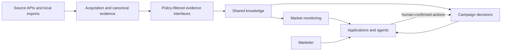
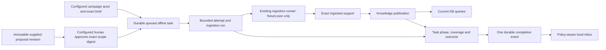
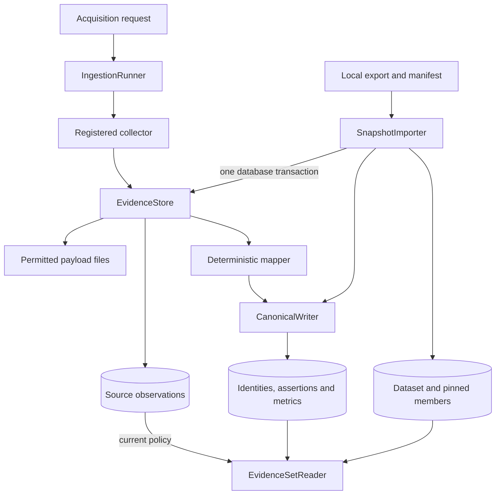
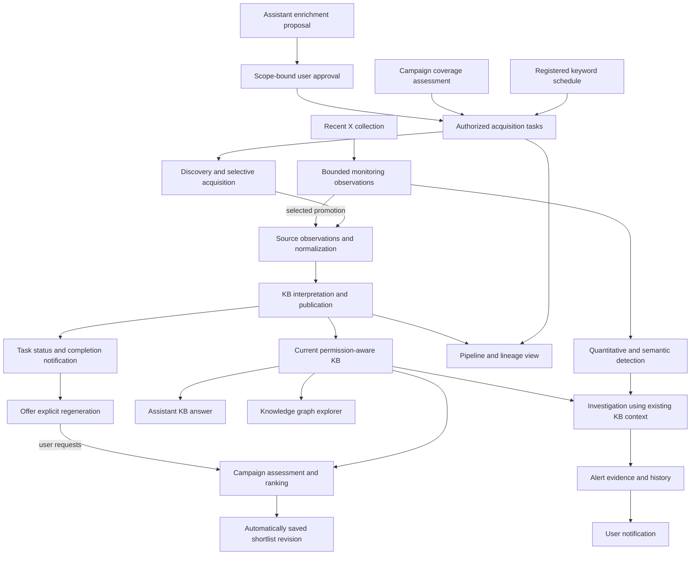

# System architecture

Social Marketing Intelligence supports market investigation and campaign recommendations over shared evidence. In the [target operational contract](functional-requirements.md), an agent can save ranked shortlists without human review or approval; assistant-origin enrichment separately requires approval. Independent X monitoring uses a lightweight evidence path. The implemented local pilot still uses frozen evidence and human-only shortlist saves. Campaign measurement distinguishes observed outcomes, attribution rules and causal effects.

## Implemented product boundaries

These are module boundaries within one Python application and PostgreSQL instance. They do not prescribe separately deployed services. Source adapters depend on ingestion contracts; downstream business modules depend on public evidence interfaces, never adapter internals or direct writes to ingestion tables.

| Owner | Responsibilities | Implementation coverage |
| --- | --- | --- |
| Offline acquisition tasks | Campaign-role admission, immutable supplied proposals, exact human approval, route/scope/limits, execution ownership, attempts, phases, run/publication outcomes and completion inbox | Implemented in `smi_tasks` for synthetic fixture JSON with competing-worker fencing, recovery, partial outcomes and local completion delivery; scheduled authority and spending admission remain future work |
| Offline cost accounting | Immutable metered/forecast-only configuration, exact synthetic measurements, equivalent operation/task attribution, forecasts, declared commitments and uncertainty | Implemented in `smi_costs`; no commercial calls, worker meter, ceiling or admission |
| Acquisition and canonical evidence | Collection, source policy, observations, stable account/content identity, field assertions, metrics and replay | Implemented in `smi_ingestion` |
| Exact ingested support | Bounded selection and purpose-aware reads of observation/derivation/assertion/metric IDs, including fresh runs | Implemented in `smi_ingestion.support` |
| Frozen evidence sets | Validated snapshot import, fixed member/derivation bindings, lineage and workspace/purpose-aware reads | Implemented in `smi_ingestion.evidence_sets` |
| Shared knowledge | Brand/product references, supported caption interpretations, explicit knowledge publications, bounded current-KB queries and pinned result manifests, method/catalog versions and dependency cleanup | Implemented in `smi_knowledge`; Creator associations and human correction workflows remain future work |
| Market monitoring | Saved investigations and insight revisions with scoped findings | Implemented in `smi_monitoring`; repeated-capture trend analysis remains future work |
| Campaign decisions | Briefs, comparisons, human shortlists, proposed measurement plans and decision notes | Implemented in `smi_campaigns` and `smi_campaigns.planning`; observed outcomes/attribution remain future work |
| Review application | Independent investigation/campaign forms, evidence and uncertainty panels | Implemented in `smi_review`; translation/language and marketer evaluation require actual review |

## Offline task orchestration

`smi_tasks` composes `CampaignStore`, `IngestionRunner`, `IngestedEvidence` and `KnowledgePublications` through their public interfaces. Server-configured identity roles separately authorize campaign humans/services and proposal approvers. Arbitrary assistant automation cannot obtain campaign authority by choosing that operation. Campaign submission establishes origin from an exact existing current brief; assistant submission requires an immutable supplied proposal and its exact attributable human approval. Admission commits immutable route/configuration digest, actor, scope and limits, then returns a queued task ID without collecting. The bounded worker persists an attempt/run link and actual automation producer, uses a fixture-json-only registry, rejects changed manifests and records collected versus ingested versus published counts. Recovery reuses the same attempt/run and committed evidence/canonical effects, retaining exact prepared publication support and bounded recovery history. Source-free task reads reopen a request-bound committed publication even after a lost task acknowledgment, preserving its actual producer. Valid subsets publish as partial updates with the failed remainder visible; empty or unchanged usable captures create no fictitious update. Simulated pending operations resume an opaque checkpoint, while ambiguous operations remain waiting without another collector call. Terminal retries reuse the original outcome. See [the task contract](tasks.md).

A task-specific PostgreSQL session lock grants one worker authority. Task admission/approval remains immutable and separate from this temporary execution ownership. Every consequent source/canonical/publication/task mutation joins an owner transaction on that same session connection, validating the task execution ID under its row lock. Session loss aborts pending writes and prevents late results committing over a successor. I/O occurs outside transactions; a paused connected session retains its task, and different tasks progress independently. Source-free execution views distinguish running work from recoverable committed progress. This is per-task local-effect fencing, without provider-side exactly-once guarantees or cross-task novelty admission; [ADR 0005](adr/0005-task-session-effect-ownership.md) records the trade-off.

The offline task slice retains one attempt across competing-worker recovery, including exact support and partial publication. `CompletionInbox` reads one source-free event committed with each terminal outcome on the same fenced ownership session. It reopens task coverage and current publication support through their owners, exposing usable/partial/no-update/failure messages and permitted navigation after restart. Migration and workspace reconciliation idempotently backfill older outcomes; source withdrawal preserves historical counts while withholding unavailable publication links. See [the inbox contract](tasks.md#durable-completion-inbox). External transports, campaign regeneration and monetary admission remain separate extensions. Source-free synthetic accounting is owned independently below.

## Offline cost accounting

`smi_costs.UsageAccounting` owns immutable operator-configured synthetic metered and forecast-only service scopes, stable operations and append-only records. Exact decimal unit/rate measurements produce auditable synthetic amounts, separately from forecasts, declared outstanding commitments and explicit unknown/meter-failure records. Workspace-global measurement identities serialize retries and reject conflicting reuse. No monetary admission, ceiling, commercial charge or automatic worker meter is installed. See [the accounting contract](costs.md).

The composition boundary injects `AcquisitionTasks.resolve_cost_attribution`; it validates exact workspace task/attempt membership through public task reads. Accounting has no task dependency or foreign-table SQL, and tasks import no accounting code. Equivalent model operations retain actor/method/service and stable retry identities without tasks. Accounting metadata contains no copied source material; source withdrawal cannot erase historical synthetic resource usage or expose restricted values. The local application reads costs through this owner and reopens tasks before task-filtered navigation. Configuration, currencies, periods, rates, recorder/provenance and synthetic basis remain inspectable after restart.

## Acquisition and persistence

Collectors perform bounded I/O and produce source-shaped observations. Mappers deterministically interpret those observations. The canonical writer owns identity matching and versioned derivations. Retained payloads have integrity hashes and can be replayed; transient inputs cannot. Replaying the same mapper/policy version has no additional canonical effect.

`EvidenceStore.save` accepts the keyword-only `complete` marker, defaulting to `False` for existing callers. The observation, checkpoint, usage counters and input-completion marker share one database transaction. A supplied connection remains caller-owned, including commit/rollback and retained-payload cleanup after rollback. `IngestionRunner.resume` processes saved pending evidence before considering further collection; a saved final capture needs no collector call even when it exhausted a request or record limit. Nonfinal captures retain their checkpoint for continued collection. Schema upgrades preserve existing run and observation identities; completed legacy runs remain complete without reacquisition.

An external identity consists of platform, namespace, resource kind, native string ID and synthetic status. Handles are mutable observed fields. Different namespaces remain separate until a future explicit identity association establishes equivalence. Metrics retain source-specific definitions, native names, precision, units and relevant times.

An offline import validates a complete export, persists local observations through the existing evidence/writer interfaces and registers immutable membership. Original run/observation IDs remain origin references; locally created UUIDs identify the imported records. Source capture time is preserved independently of import time. See the [evidence-set contract](evidence-sets.md).

## Evidence access

`CanonicalReader` is a low-level current-view inspection interface. It selects active source derivations and filters source display permissions; it does not authorize application users or pin a decision's dataset.

`EvidenceSetReader` is the downstream interface for frozen inputs. It intersects a trusted actor's configured workspace with source permission for the requested purpose. It returns exact assertion/metric IDs and source locators, coverage, missing states and current support health. A later observation or mapper revision cannot silently substitute for a pinned assertion. New computations use `purpose="process"`; human-facing evidence uses `purpose="display"`.

The current local actor boundary is an in-process contract. The CLI runs as a named human operator in the local workspace. A hosted API will require authenticated identities and server-side permission resolution before it constructs actor contexts. Client-submitted actor kind is not authentication.

`IngestedEvidence` provides exact, workspace-scoped support from freshly ingested runs or imported observations. Run ownership defaults to the local workspace for compatibility; snapshot imports retain their configured workspace. Explicit references pin selected assertion/metric IDs and their derivation. Purpose checks and source/derivation transaction locks belong to ingestion. This reader creates no dataset and never mutates frozen membership.

## Shared knowledge

`smi_knowledge` owns business references and rule-based caption interpretations. Catalogs configure aliases and category topics separately from source evidence. Each interpretation pins a source assertion, original text span, method/catalog version and provisional review status. Preparation reads processable evidence through `EvidenceSetReader` and checks retention/current support again while committing. Knowledge reads reconcile retained copies and apply the requested display/process permission. See the [knowledge contract](knowledge.md).

The rules identify literal mentions and markers. Their output distinguishes product-family references, unresolved stance and script evidence from audience or sales claims. A translation-assisted packet carries original captions and supported spans, with translation and reviewer fields explicitly pending.

`KnowledgePublications` owns atomic availability of a bounded support selection. It validates exact source IDs and optional existing interpretation IDs through their owners, records the actual producer, method, publication time and coverage, and commits all membership together. Workspace/request identity serializes retries and conflicts on changed payloads. Reads reopen the exact selection under current permissions and derivation health; publication stores no additional source text. Imported datasets and prior publications stay immutable. Durable acquisition tasks compose publication through the separate task owner.

`KnowledgeQueries` selects at most 100 members from at most 100 recent committed publications through public publication reads. New computation requires process permission plus its output-purpose permission; reopening applies its requested read purpose to exact saved support. The query owner persists source-free manifests with actual observation/derivation/assertion/metric/interpretation IDs, method/publication versions, producer and original coverage. New publications cannot rewrite saved membership. Capture-age freshness requires an explicit threshold and remains separate from permission/derivation health; truncated scope and unknowns remain visible. See the [query contract](knowledge.md#bounded-current-knowledge-queries). General semantic search, graph traversal and ranking remain future work.

## Campaign decisions

`smi_campaigns` owns briefs, comparison drafts and shortlist revisions through a small transactional interface. A human starts or revises the brief; automation may prepare a comparison for that existing campaign. The draft pins the exact brief, knowledge run and enumerated frozen evidence. A human saves a draft or confirms an exploratory account selection with source-supported relevance and acknowledged unknowns.

Request identities make retries safe, and expected-version checks prevent competing edits from overwriting the campaign's brief or shortlist head. Later work creates successor records. Candidate bodies and copied human reasons track their source/interpretation dependencies; current policy can hide/purge explanations while preserving permitted historical membership and reviewer metadata. See the [campaign contract](campaigns.md).

The deterministic method reports criterion states and coverage rather than universal creator scores. Its meaning remains bounded by the provisional caption interpretations actually available. Both the local operator CLI and browser review surface use the same persistence contracts.

## Local review application

`smi_review` composes public stores into escaped server-rendered forms and policy-aware evidence panels. Its standard-library HTTP server binds to loopback. A configured named human starts/revises briefs and saves/confirms shortlists; a distinct automation context prepares the rule-based knowledge/comparison. Request IDs and expected versions pass through to the domain stores, which own validation and transactions.

The browser can save/review a supplied immutable enrichment proposal, approve its exact scope and submit its single offline task. It can create a brief, prepare/review a comparison, save a draft, explicitly confirm and reopen exact historical revisions after server restarts. Dataset/catalog/campaign listing interfaces provide navigation without bypassing evidence ownership. Original permitted captions, exact support spans, source/date lineage, provisional judgments and unknowns remain visible. Current-policy withdrawal withholds source-dependent form contents as well as saved explanations. See [local review](local-review.md).

Same-origin form/Host checks and CSRF tokens protect local writes; the server constructs actor identity and serves only bundled assets. Browser state is not durable. Independent investigations, campaign planning, bounded knowledge search/results and committed publication list/detail pages use the same boundary. Publication details withhold denied and superseded source text while retaining permitted IDs and attribution. Language and marketer usefulness require actual review rather than technical checks.

## Independent monitoring and proposed measurement

`smi_monitoring` owns versioned human scopes and pinned snapshot-insight revisions without a campaign dependency or side effect. Rule-based findings count distinct posts/accounts, retain literal support and actual membership, and explicitly lack a growth/change baseline. Current permissions can withhold/purge copied findings while scope/answer history remains pinned. See [monitoring](monitoring.md).

`smi_campaigns.planning` owns proposed measurement-plan and human note revisions. Plans pin a current brief and relevant shortlist, keeping intended sources, definitions, matching/attribution and gaps separate from outcomes. Notes attach to a historical shortlist and inherit selected-source dependencies. Both are human-only and transactional/version checked. See [measurement and feedback](planning.md).

## Accepted future extensions

The [functional requirements](functional-requirements.md) extend bounded KB retrieval with LLM ranking, automatic shortlist persistence, an enrichment assistant, acquisition tasks/schedules, lightweight X anomaly detection, notifications, graph/lineage interfaces and hybrid spending control. The broader A/B/C workflows remain incomplete; the local task and completion inbox interfaces are described above.

The shared acquisition-task boundary owns task scope/origin, retries, approval enforcement, status and cost-control admission. Scheduled/campaign tasks and approved assistant tasks share ingestion/publication; clients cannot forge task origin to bypass approval. Initial daily scheduled discovery admits up to fifty unique eligible posts total across at most ten keywords. Routes remain modular, but existing supplied-reference adapters do not already provide query discovery.

The KB query/publication boundary selects current permitted evidence and records exact result support. Current support health and age-based freshness are different checks. A ranked account needs stable identity and ingested permitted support, not a complete profile. Current-KB results pin their actual inputs without mutating historical evidence sets. Shortlist persistence records the actual automation/human producer, method, ordered membership, rationale and gaps; human review is optional and separate from persistence. See [ADR 0003](adr/0003-automatic-shortlist-persistence.md).

Light X monitoring owns bounded recent observations, detection windows/baselines and retained alert support without requiring full KB modeling for every post. Its investigation uses existing KB context and cannot submit further external searches. Selected observations may be promoted through normal KB ingestion/publication. The separate owner inherits source-policy, provenance and withdrawal rules; it is not a second authority for general KB facts. See [ADR 0004](adr/0004-lightweight-monitoring-evidence.md).

Spending controls derive attributable actual cost where possible and enforce configured ceilings across concurrent work. Cost scopes that cannot be derived reliably retain explicit forecasts. Meter/rate versions, accounting periods, in-flight commitments and actual-charge reconciliation must be visible; no zero-overshoot guarantee is inferred from delayed or unbounded billing. Request/record bounds, value-based stopping, enrichment approval and monetary ceilings remain distinct controls. Offline synthetic accounting is implemented as described above; commercial metering, coordinated monetary admission and ceiling enforcement remain future work.

Graph and pipeline views consume governed read interfaces; their UI requirements do not prescribe a graph database or a separate deployment per module. These future ownership boundaries do not require replacing the current local server merely to preserve the prototype workflow.

Observed facts, derived interpretations and human assertions retain distinct bases, methods, support references and review status. Future human corrections and Creator associations extend shared knowledge with attributable revisions. Caption language does not establish audience geography; an author's product claim does not establish efficacy.

Comparable repeated observations and an explicit baseline/sampling method are required before growth/change analysis. Actual outcome ingestion and versioned attribution need supplied data and agreed definitions/windows. Optional Creator grouping still needs corroboration or an attributable identity decision.

These business records belong to their own tables in PostgreSQL. They will not expand ingestion's account/content entity kinds into a universal object table. The conceptual relationships appear in the [data model](data-model.md).

## Policy and operational limits

Current policy checks prevent denied, expired or revoked evidence from replay, current display and frozen reads for the affected purpose. Revocation removes retained payload files. Canonical values remain physically stored, and operator-managed import source files remain outside the evidence store's deletion lifecycle. This implementation is not complete deletion propagation.

Knowledge operations purge retained interpretations on retention withdrawal. Campaign operations apply that contract to comparison bodies, reasons and notes; monitoring applies it to findings. Denied/superseded support is withheld. Future caches/exports must track dependencies and honor withdrawal. Permitted metadata/support remains; copied text cannot bypass policy. See [Pinned support and current policy](adr/0002-pinned-support-current-policy.md).

Local execution uses PostgreSQL and a filesystem evidence directory. Tests isolate themselves in temporary database schemas and use simulated transports for source adapters. Snapshot operations require no platform/provider/model calls. Source integrations remain explicit operations with their own access, coverage and cost behavior. Source readiness, authenticated remote access and deployment are separate from the implemented local evidence layer.
