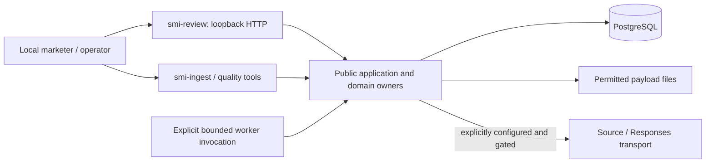
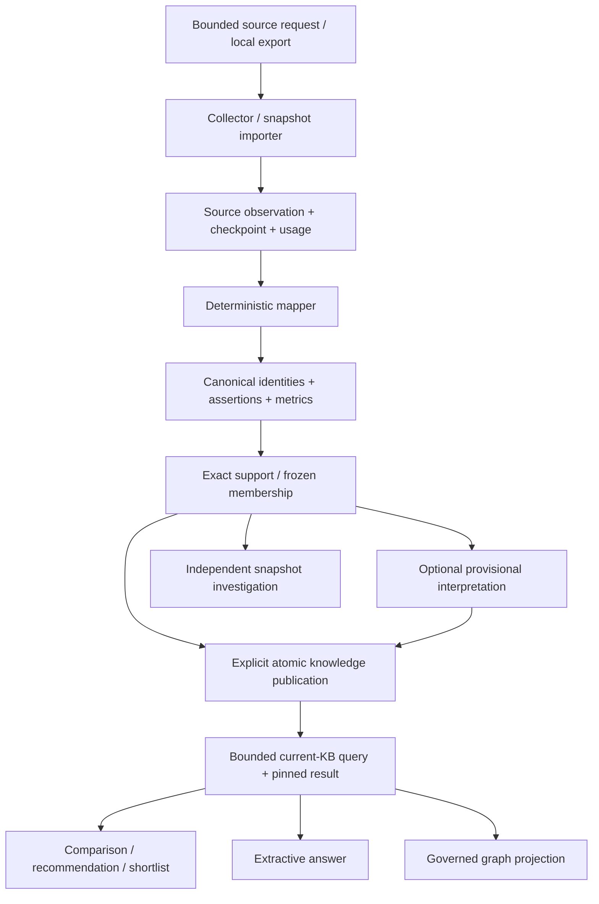
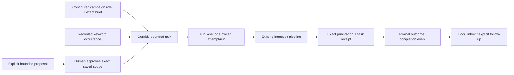
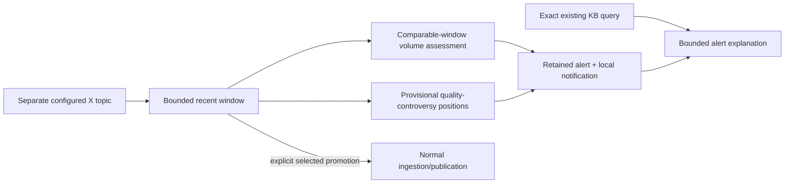

# System architecture

Social Marketing Intelligence is a modular Python application for evidence-backed market investigation and campaign decisions. PostgreSQL stores identities, provenance, immutable inputs, workflow state and decisions; permitted raw payloads live in a local evidence directory. The browser and CLI compose the same public domain interfaces.

The [requirements](functional-requirements.md) define the accepted product, the [roadmap](roadmap.md) distinguishes installed capabilities from readiness and future work, and the [data model](data-model.md) contains every physical table, its purpose and the conceptual future model.

## Runtime and deployment

`compose.yaml` starts **PostgreSQL only**, bound to `127.0.0.1:6543`. `smi-review` runs a separate standard-library HTTP server on `127.0.0.1:8765` by default. There is no deployed queue consumer, dispatcher, cron service or scheduler daemon. Submission acknowledges durable work; `OfflineTaskWorker.run_one(task_id, actor)` executes or resumes one named task. Keyword `tick` acknowledges due work without collecting. `RecentPolling.run_due` is a separately invoked bounded monitoring worker.

The default development path imports frozen evidence and performs deterministic local work. Model operations require an explicitly configured Responses route. Live sources additionally require recorded authority, runtime enablement, source policy, credentials and cost configuration. Installed transport software has simulated verification; it supplies no current account-access or live acceptance receipt. See [source readiness](source-integrations.md).

## Module ownership and dependency direction

| Owner | Public responsibility | Depends on |
| --- | --- | --- |
| `smi_ingestion` | Bounded collection, observations, mapping, canonical account/content identity, assertions, metrics, replay/resume and source policy | Collector/mapper contracts, PostgreSQL and evidence files |
| `smi_ingestion.support` / `evidence_sets` | Exact ingested support; immutable frozen dataset import/membership and purpose-aware reads | Ingestion-owned evidence and derivations |
| `smi_knowledge` | Brand/Product catalogs, supported caption interpretations, explicit publications, bounded literal current-KB queries and exact result manifests | Public evidence interfaces |
| `smi_knowledge.graph` | Governed entity search, cycle-safe traversal and relationship evidence | Public queries, evidence and catalog reads |
| `smi_campaigns` | Human briefs, visible executable criteria, comparisons, deterministic/model recommendations, automatic shortlists and optional human curation | Public knowledge/evidence; shared Responses port |
| `smi_campaigns.planning` | Proposed measurement plans and human decision notes | Public campaign and exact support interfaces |
| `smi_assistant` | Durable questions and bounded extractive model relevance selection | Public knowledge queries and shared Responses port |
| `smi_tasks` | Configured campaign/schedule and exactly approved assistant admission, worker ownership/recovery, outcomes and completion inbox | Public campaigns, ingestion, publication and injected cost operations |
| `smi_tasks.campaigns` / `assistant` | Save-first coverage discovery/regeneration; exact answer-gap-to-proposal/approval/task journey | Campaign/answer owners and task/completion interfaces |
| `smi_tasks.schedules` / `discovery` / `supplementation` | Keyword authority/day allowance, capture-based avoidance, one exact approved missing-field choice | Task composition and public source/canonical/cost ports |
| `smi_costs` | Scope/rate configuration, usage, forecasts, commitments, admission, final reconciliation and meter recovery | PostgreSQL and injected task-attribution resolver |
| `smi_monitoring` | Frozen investigations; separate recent X evidence, volume/provisional semantic alerts, KB context, promotion and gated periodic polling | Public knowledge/evidence, shared Responses/cost ports |
| `smi_review` / `quality` | Local forms and governed views; operational review packets and human annotations | Public owners; each keeps its own persistence |

These are boundaries in one application/database, not separate deployments. Each owner writes its own tables. Downstream modules use public readers and caller-owned transactions rather than adapter schemas or cross-owner SQL. Tasks point toward campaigns and answers; those owners do not import task authority. Accounting uses an injected task resolver, with no task dependency. Monitoring promotion uses an ingestion-owned dependency port so ingestion never calls back into monitoring.

## Evidence and knowledge flow

Collectors perform bounded I/O; mappers return deterministic candidates; `CanonicalWriter` owns identity matching and derivation effects. Saving an observation atomically advances its checkpoint, resource counters and final-input marker. Resume processes saved pending evidence first; a saved final capture can finish at its request/record limit without another source call. Same mapper/policy replay is idempotent. Retained payloads are hash-checked; transient payloads cannot be replayed after loss.

`EvidenceStore.save(..., complete=False)` accepts an explicit final-input marker with a backward-compatible default. Observation/checkpoint/usage/completion commit together. A supplied connection remains caller-owned for commit/rollback and retained-file cleanup. `CanonicalReader` is the administrative current-value inspector: it filters active source/display support but neither authorizes application actors nor pins decisions. `EvidenceSetReader` intersects trusted workspace/actor and purpose with exact frozen support; `IngestedEvidence` selects exact fresh/imported observation/derivation/assertion/metric IDs without creating a dataset. New computations use `purpose="process"`, evidence panels use `purpose="display"`, and both retain current source/derivation checks.

An external identity is `(platform, namespace, resource kind, native string ID, synthetic flag)`. Handles and URLs are references or mutable fields. Alternate namespaces and source-specific metric definitions remain separate until supported equivalence/comparability exists. Canonical entity kinds are currently account and content; Creator/person association is future work.

The [data-model reading guide](data-model.md#reading-the-records) distinguishes observed information, derived interpretation and human judgment, follows a real sample through the tables, and explains every table. Frozen sets pin observation/derivation membership and original export lineage; later posts never enter that set implicitly. Current-KB queries search committed publications, selecting at most 100 support members from at most 100 recent publications and saving exact support/method/freshness manifests. Later publications affect new queries while historical results retain their original inputs.

Interpretations pin source assertions, Unicode spans and catalog/method/review status. Literal product mentions, kana script and PR/Qoo10 markers establish neither stance nor audience geography, contracts, shade identity or sales. Publication atomically makes exact permitted ingested support and selected existing interpretations usable. Fetch success, normalization and publication are distinct stages.

## Task authority, execution and completion

Trusted composition establishes actor roles. Assistant enrichment requires exact human approval of one immutable proposal revision; campaign coverage and keyword schedules use independent configured authority. Forms, model/source text and actor labels grant no role. One approval authorizes at most one logical task. Identical workspace/operation request retries reopen the original; changed payload conflicts.

The worker holds a task-specific PostgreSQL session advisory lock and execution ID. Every dependent source/canonical/publication/task/accounting mutation joins that session and validates execution under a row lock. No transaction spans source/model I/O. Disconnect aborts pending local effects and fences late writes; a connected paused worker keeps ownership. Recovery retains the original attempt/run, exact prepared support and publication producer. This fences local effects without provider-side exactly-once or cross-task semantic novelty guarantees.

Publication and the task-owned receipt commit together; request text alone establishes no ownership. Terminal outcome and one source-free completion event commit together later. Usable, partial, no-update and failed outcomes retain actual coverage and sanitized failed phase. A valid subset can publish when another input fails. Historical completion remains distinct from current support availability. Delivery is a local inbox; external transports are future work.

Keyword configuration permits at most ten registrations and initially 50 unique eligible new posts per workspace/day **total**, with a fixed accounting timezone. Due ticks handle only the current local day. Edits preserve occurrence/day identity and consumption. New-post admission commits with canonical effects after normalization, current policy and identity locking; known refreshes and duplicate identities consume no extra debit. Request/byte/record/spending bounds remain independent, with no fill or throughput promise.

Offline avoidance compares exact query/input/mapper/processing context and every original capture's usable support. Fresh complete reuse creates no source call, cost dispatch, daily debit or publication. Unknown/stale captures, partial work and quota exclusions remain eligible. Live keyword scope is one returned post per bounded query. Recorded live schedule activation and optional exact nickname supplementation retain independent authority, source identities and unknown capture times. [Tasks](tasks.md) owns all schemas, bounds and stopping/recovery behavior.

## Campaigns, answers and human decisions

A human creates a campaign brief and immutable executable profile. Generated criteria append validated additions to unchanged human requirements; explicit later selection pins the visible interpretation. Deterministic eligibility admits a stable platform account with one permitted published observation, allowing incomplete profiles and keeping handle-only seeds as gaps.

`CampaignStore.recommend` automatically saves deterministic ordered `generated` revisions. `recommend_ranked` adds one bounded exact candidate permutation and constrained criterion judgments, with server-rendered reasons and full input provenance. Both retain exact brief/profile/support, producer, gaps, retry identity and head checks. Human select/reorder curation creates a separate successor with optional explicit confirmation. Saving neither contacts a creator nor activates a campaign.

Coverage records quantity, literal relevance and capture freshness under a versioned policy. Task-side `CampaignRecommendations` saves the result first, then commits one discovery disposition/task or refusal. Refusal leaves even an empty saved recommendation intact. Usable discovery completion offers explicit current-context regeneration; it never changes prior membership/order.

The answer owner accepts free-form questions, but one bounded model selects exact published fact IDs and fixed uncertainty codes. Values/dates render through their owners. Every actual model input, including unselected support, governs reopening. The task-side journey turns a supported gap into human keyword/subject/window scope, saved proposal, exact approval and completion status. Only later explicit questions use new publications.

Measurement plans describe intended outcomes, sources, matching/attribution assumptions and gaps. Decision notes record human learning. Neither stores actual commercial results or causal lift. See [campaigns](campaigns.md), [knowledge](knowledge.md) and [planning](planning.md).

## Independent monitoring

Frozen investigations answer independent product/topic questions over selected samples and do not establish continuous trends. Recent X monitoring separately owns topic revisions, original windows/captures, source policy and retention. Detection needs no KB publication of every post.

Volume detection compares complete equal-duration nonoverlapping samples with matching topic/query, source/acquisition/schema/sampling/limits context. Missing/incomparable baselines yield limitations. The provisional semantic method classifies exact product-quality spans into concern/counterposition/unresolved positions; it has no baseline and makes no verified sentiment or change-over-time claim. Thresholds are configured sample rules, not independent statistical significance.

Investigations pin recent dependencies and one exact existing-KB query. A deterministic explanation juxtaposes those contexts, with no acquisition or campaign authority. Selected promotion uses normal ingestion/publication, preserving identity, metrics, unknowns and policy. An ingestion-owned dependency record enforces parent withdrawal/deadlines on independent KB reads. Gated official recent-X polling retains topic authority and one-use uncertain response/cost identities. Its worker is explicitly invoked; live readiness remains unverified. See [monitoring](monitoring.md).

## Spending and bounded model transport

`UsageAccounting` separates synthetic or provider-reported usage, forecasts, declared commitments and unknown/meter-failure coverage. Scope/rate/currency/period configuration is immutable. Scope locking admits one bounded dispatch against measured use plus all unresolved commitments. Forecast-only scopes retain resource bounds without claiming monetary enforcement.

The shared Responses route serves criteria, ranking, answers and semantic monitoring with explicit model/method/schema, finite input/output/byte bounds, no tools, `store=false` and no automatic retry. Reported tokens and configured weights value consumption rather than verify invoices. Missing/invalid usage retains liability and fails the meter. Source responses retain declared commitments until final provider evidence; returned rows cannot settle a bill.

Final reconciliation names exact liabilities, preserves audit entries and truthful overage, and never restores a lost response or grants another dispatch. Meter health requires separate recovery. Billing lag and unverified/unbounded charges remain visible; zero overshoot cannot be promised there. Commercial rates and real billing acceptance remain external readiness work. See [costs](costs.md) and [source integrations](source-integrations.md).

## Application, exploration and quality

`ReviewApp` constructs trusted local actors and composes public owners into escaped forms. It enforces loopback Host, same-origin writes, CSRF, bounded input, bundled assets and restrictive response policy. Restart requires reopening for a fresh token. Hosted authentication is future work. Ingestion and catalog registration use the CLI; the browser has no general database/catalog editor or translation tool. A named automation actor records actual automated preparation, not an autonomous agent or a human review.

Graph search saves source-free query/filter manifests; bounded 1–3-hop cycle-safe traversal and exact source narrowing resolve current governed labels and edges. Observed authorship, provisional derived mentions and human catalog associations remain distinct. This read projection infers no cross-platform Creator identity. Task lineage composes task/source/publication/cost frontiers read-only, with explicit truncation and unknown costs rather than an atomic cross-owner snapshot.

Quality packets pin recommendation/answer/semantic-alert membership and all input dependencies. Original text/spans/dates reopen from owners; actual annotations retain reviewer/translator/method attribution, full denominators and corrections. Technical correctness, translation-assisted judgments, Japanese-original adjudication and marketer usefulness remain separate. No actual human quality review has been completed. See [local review](local-review.md) and [evaluation](evaluation.md).

## Policy and operational limits

Computations require current process and output permissions; display requires display permission; retained dependent copies require retention rights. Source/derivation locks survive dependent commits and are reacquired after cost contention before dispatch. Later support loss can withhold an entire derived result even when selected citations survive. Pinned history grants no permanent content access.

Explicit revoke/expiry operations hide support and remove retained payloads. Reads reconcile interpretation, campaign, answer, alert/context and review copies according to owner contracts. Some owners permanently purge derived bodies; safe membership, attribution and tombstones remain. Canonical retention cleanup is explicit: frozen reads alone do not erase every canonical value. Promoted monitoring copies directly inherit parent lifecycle. Cleanup is synchronous on documented public operations, with no universal background deletion guarantee. Original manifests, exports, translations and other operator-managed files remain outside automatic copy cleanup.

Request IDs prevent duplicate logical effects; expected versions reject stale edits. Digests detect changed bytes/configuration and have no relevance meaning. Source capture, post publication, local ingestion/import and KB publication times stay distinct. Unknown differs from zero; complete bounded input processing differs from complete market coverage.

The [ADRs](README.md#design-decisions) retain the trade-offs. The [roadmap](roadmap.md) preserves the larger product destination and remaining work, distinguishing installed software, live acceptance and actual human validation.
