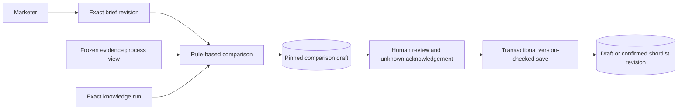

# Campaign decision contract

[`smi_campaigns`](../src/smi_campaigns/__init__.py) currently owns internal campaigns, immutable briefs, rule-based comparison drafts and human shortlist revisions. The public interface consists of `CampaignStore`, `Brief`, `Criterion` and `Selection`. The sections below describe this implemented contract. The [target requirements](functional-requirements.md#a--campaign-based-recommendations-and-shortlists) additionally permit automatically saved ranked shortlists without human review or approval; that interface is not implemented yet.

## Implemented briefs and actors

`CampaignStore.start(brief, actor, request_id=...)` creates a human-authored campaign and its first brief. A brief requires brand/product scope, objective, target market, platform scope and at least one criterion. The catalog binds human-configured Brand/Product references; product IDs must belong to the stated brand. A brand-level brief can leave `product_ids` empty.

Criteria carry a stable ID, visible label, typed kind, expected value, inclusion/exclusion operator, requirement flag and unknown handling. `unknown_handling="acknowledge"` permits an exploratory decision with an explicit gap. `"defer"` blocks confirmation for an unknown required criterion. Optional campaign dates, budget, currency and audience details remain human context or explicit unknowns. Publication filters use a separate timezone-aware window.

Known accounts use exact platform/namespace/native string IDs. Handles are not identity keys. Unsupported account references can remain requested candidates with no observed evidence.

`revise_brief(..., expected_version=..., request_id=...)` appends a successor rather than changing an earlier question. A stale expected version raises `brief_version_conflict`. Starting and revising require a trusted human actor in the configured workspace. Automation can read and prepare a comparison for an existing human-initiated campaign, but cannot save a human selection or confirmation.

`require_current_brief(campaign_id, brief_id, actor, expected_version=..., connection=...)` validates an exact current workspace brief and holds its campaign share lock until the caller's transaction commits. Dependent task admission joins this transaction, so a concurrent brief revision cannot change the authorized campaign question between validation and acknowledgment. Historical or foreign brief/version combinations fail with `brief_version_conflict`; task retries reopen their original acknowledgment before this new-admission check.

The local actor context is supplied by the trusted application boundary. It is not hosted authentication; a future browser server must construct actor kind/identity itself rather than accept those fields from submitted JSON.

## Comparison preparation



`prepare_comparison(campaign_id, brief_id, knowledge_run_id, actor, request_id=...)` pins the current brief, exact knowledge run, dataset ID/digest, enumerated actual observation membership, method/version, preparation actor and time. The catalog must match the brief. Old brief comparisons remain readable but cannot confirm a new decision after the campaign question changes.

The method is explicitly `rule_based`, version `campaign-caption-comparison-v1`. Candidates come from marketer-known exact references and accounts observed within the supplied dataset/platform/publication scope. Origin is `marketer_known`, `retrieved` or `both`, relative to that campaign. A requested account without evidence is not presented as successfully discovered. A publication window with no records yields no retrieved candidates, not an assertion of no market activity.

Each criterion has one of three states:

| State | Meaning |
| --- | --- |
| `satisfied` | A current, unambiguous interpretation supports the requested literal inclusion criterion in the selected captions |
| `not_satisfied_on_evidence` | A requested literal exclusion is contradicted by an observed matching mention/marker |
| `unknown` | The bounded evidence/method does not establish the criterion; absence of a match is not automatically a negative claim |

Supported kinds are Brand/Product/topic mentions, kana script evidence and literal PR/Qoo10 markers. Exact meaning follows the [knowledge method](knowledge.md): a family mention does not establish a variant, kana does not prove caption language or audience geography, and a PR marker does not establish a paid contract. Semantic review remains provisional. Other typed needs—caption language, audience, fees, availability, sales, history or custom criteria—remain unknown under this method.

Every candidate shows baseline unknown audience geography, fees, availability, sales effectiveness and complete recent-post history, plus unmet unknown criteria. The method does not calculate a global creator score, creator-average performance or sales prediction. Evidence panels return exact interpretation/source assertion IDs, original spans, source references and publication/capture times through policy-aware readers.

Preparation checks process/retention permission and current derivations before committing source-dependent copies. It locks source support and rejects a withdrawal/correction race with `comparison_support_changed`. New work uses a new request ID and can pin a newly prepared knowledge run; repeating an identical request returns the original draft.

## Shortlist persistence

`save_shortlist(comparison_id, selections, actor, confirmed=..., expected_version=..., request_id=...)` saves an unconfirmed human draft or appends a confirmed revision. The initial expected shortlist version is zero. Subsequent saves must name the current head; stale competing edits raise `shortlist_version_conflict`.

For each confirmed account:

- It must be a candidate of this exact comparison.
- A nonempty human reason must cite at least one current positive relevance interpretation from that candidate's judgments. Invented or cross-candidate support is rejected.
- All recorded unknowns must be acknowledged; submitted acknowledgements can reference only those declared unknowns. A required contradicted exclusion or required unknown set to `defer` prevents confirmation.
- Its support must still be processable and displayable. The comparison's brief must still be current.

A human reason is labeled `human_supplied`; confirmation records an internal selection rather than independently validating every sentence of that reason or its supporting semantic interpretation. An empty selected set can record deliberate deferral. Automation cannot set confirmation state through this action.

Saving locks the campaign head, validates expected versions and commits the revision, selected membership, exact brief/comparison links, supporting interpretation IDs, acknowledged unknowns, human actor and timestamp together. Identical request retries return the original revision even if the head subsequently advanced. Reusing an ID with a different payload or actor raises a request conflict. Request IDs are scoped to the relevant action/campaign; campaign-start IDs are workspace-scoped.

Edits, new evidence or changed judgments produce successor brief/comparison/shortlist records. Old selected membership and reviewer attribution remain inspectable. `read_campaign`, `read_comparison` and `read_shortlist` reopen database-backed records across process restarts.

## Source-policy overlays and cleanup

Comparison candidates retain explicit observation, source assertion and interpretation dependencies. Copied candidate bodies and human reasons inherit that support's policy. A current read checks purpose-specific permission, derivation health and surviving knowledge interpretations.

Denied support hides the candidate body, reason, evidence excerpts and dependent explanations, returning unavailable metadata. Superseded derivations require review. A retention withdrawal, expiry or revocation purges the stored candidate body and associated saved reasons. Account references, membership, actors, times and permitted audit/support IDs remain. Retrying the same request never rebuilds a purged explanation.

Redaction is conservative at candidate scope: if any cited observation is withdrawn, the copied candidate explanation and its saved reasons are withheld rather than guessing which sentences can survive. An explicit successor comparison can reconsider still-permitted evidence with its own provenance. Reconciliation runs synchronously on comparison/shortlist reads and saves. It does not claim a background deletion service or complete cleanup of operator-managed files.

## Local operator workflow

After migrating and preparing the frozen sample's knowledge:

```bash
uv run smi-ingest migrate
uv run smi-ingest start-campaign examples/campaigns/hero-cushion-brief.json --request-id campaign-1
uv run smi-ingest prepare-comparison CAMPAIGN_ID BRIEF_ID KNOWLEDGE_RUN_ID --request-id comparison-1
uv run smi-ingest inspect-comparison COMPARISON_ID
uv run smi-ingest save-shortlist COMPARISON_ID selections.json --expected-version 0 --request-id selection-draft
uv run smi-ingest save-shortlist COMPARISON_ID selections.json --confirm --expected-version 1 --request-id selection-confirmed
uv run smi-ingest inspect-shortlist SHORTLIST_ID
```

IDs come from preceding command results. `selections.json` is a list of `candidate_id`, `reason`, `support_ids` and `acknowledged_unknowns` taken from human review of that comparison. Empty selections are `[]`. Submitted selection JSON cannot supply actor or confirmation fields. The console commands run as the named trusted local human operator; `--actor` records attribution.

The [local browser surface](local-review.md) implements this workflow over the same public actions. `list_campaigns` returns heads/human brief context; `read_campaign` includes content-free history metadata. [Monitoring](monitoring.md) operates independently. [Campaign planning](planning.md) adds proposed plans and human notes, using public `shortlist_support` for content-free dependencies. No action contacts creators, activates campaigns or calculates outcomes.

## Accepted future recommendation workflow

Search the current permitted KB, interpret natural-language criteria into visible versioned ranking profiles, and combine rules with LLM assessment. Eligibility requires stable account identity and at least one permitted ingested supporting observation; full profiles/history are not required. Other missing/stale attributes remain visible. Unlike the current known-reference comparison behavior, unregistered reference-only accounts are discovery inputs rather than ranked output candidates.

The agent can save the ordered recommendation as a shortlist without a human save, review, confirmation or approval step. Record actual authorship, ranking/model/method versions, source support, exact brief, rationale and gaps. Optional human curation/review is separately attributed; an automated save cannot claim human confirmation. This deliberately extends the current store's human-only authority, as recorded in [ADR 0003](adr/0003-automatic-shortlist-persistence.md).

Coverage assessment evaluates quantity, relevance and freshness against an explicit profile. Insufficiency automatically requests bounded discovery through the shared task service. The returned/saved recommendation still uses only the current KB. After ingestion/publication, notify and offer regeneration; an explicit regeneration creates a successor and never silently changes saved membership, order or explanations. Current policy still governs the availability of pinned source-dependent text.

Automatic persistence is internal decision support, not external campaign activation or permission to acquire additional assistant-requested evidence. Assistant enrichment approval and hybrid spending checks remain separate contracts.
