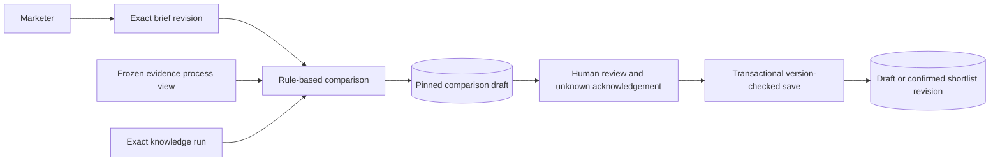

# Campaign decision contract

[`smi_campaigns`](../src/smi_campaigns/__init__.py) currently owns internal campaigns, immutable briefs, visible simulated model criteria interpretations, rule-based comparison drafts, bounded supported LLM ranking and attributed automated or human shortlist revisions. The public interface consists of `CampaignStore`, `Brief`, `Criterion` and `Selection`. The sections below describe this implemented contract. The current-KB recommendation operation saves deterministic ordered shortlists automatically without human review or approval. An explicitly configured model route additionally supports [bounded LLM ranking](#bounded-supported-llm-ranking), verified with simulated I/O; live receipts and human usefulness remain unestablished.

## Implemented briefs and actors

`CampaignStore.start(brief, actor, request_id=...)` creates a human-authored campaign and its first brief. A brief requires brand/product scope, objective, target market, platform scope and at least one criterion. The catalog binds human-configured Brand/Product references; product IDs must belong to the stated brand. A brand-level brief can leave `product_ids` empty.

Criteria carry a stable ID, visible label, typed kind, expected value, inclusion/exclusion operator, requirement flag and unknown handling. `unknown_handling="acknowledge"` permits an exploratory decision with an explicit gap. `"defer"` blocks confirmation for an unknown required criterion. Optional campaign dates, budget, currency and audience details remain human context or explicit unknowns. Publication filters use a separate timezone-aware window.

`Brief.original_input` optionally retains the marketer's exact prose alongside those structured choices. Prose is human context, not an interpreted assessment or source evidence. Callers submit stable criterion IDs again when editing the same need; adding/removing needs changes the successor's criteria without changing historical IDs. The browser preserves IDs while editing rows or adding/removing neighboring rows.

Every newly saved brief atomically records `campaign_briefs.executable_profile`, an immutable structured snapshot pinned by `brief_id` and `brief_version`. `read_campaign` returns it alongside the original brief document, author and time; `read_comparison` exposes the snapshot from its exact pinned brief. Requirements/preferences, exclusions and explicit unknown policies retain the existing caption-judgment and human-confirmation effects described below. Changed prose or structured choices participate in request conflict checks and create attributable successors through `revise_brief`. The application cannot supply or overwrite execution-version metadata.

The installed profile versions describe these bounded capabilities:

| Profile | Recorded version | Installed behavior |
| --- | --- | --- |
| Criteria | `structured-caption-criteria-v1` | Human structured choices, with `human_structured_input` basis; literal caption method `campaign-caption-comparison-v1` |
| Ranking | `unranked-caption-comparison-v1` | Explicitly `unranked`: marketer-known accounts followed by dataset encounter order; no fit score or ranked assessment |
| Coverage | `fixed-selected-observations-v1` | `descriptive_only` for fixed selected observations; sufficiency assessment is `not_implemented` |

The profile records baseline unknown audience geography, fees, availability, sales effectiveness and recent-post history. A structured audience/fee/availability/sales need remains a need, even if its label sounds factual; it cannot supply source support. Migration leaves pre-profile revisions with `executable_profile=null`. Reads never reconstruct their historical method versions; a new brief revision records the installed profile. Briefs without separate prose retain their structured fields as the original input and preserve their existing request identity.

Known accounts use exact platform/namespace/native string IDs. Handles are not identity keys. In the legacy frozen-dataset path, unsupported references can remain requested candidates with no observed evidence. In the current-KB path they remain discovery gaps only.

`revise_brief(..., expected_version=..., request_id=...)` appends a successor rather than changing an earlier question. A stale expected version raises `brief_version_conflict`. Starting and revising require a trusted human actor in the configured workspace. Automation can read and prepare a comparison for an existing human-initiated campaign, but cannot save a human selection or confirmation.

`require_current_brief(campaign_id, brief_id, actor, expected_version=..., connection=...)` validates an exact current workspace brief and holds its campaign share lock until the caller's transaction commits. Dependent task admission joins this transaction, so a concurrent brief revision cannot change the authorized campaign question between validation and acknowledgment. Historical or foreign brief/version combinations fail with `brief_version_conflict`; task retries reopen their original acknowledgment before this new-admission check.

The local actor context is supplied by the trusted application boundary. It is not hosted authentication; the local browser server constructs actor kind/identity itself, and submitted fields cannot grant it.

## Comparison preparation



`prepare_comparison(campaign_id, brief_id, knowledge_run_id, actor, request_id=...)` pins the current brief, exact knowledge run, dataset ID/digest, enumerated actual observation membership, method/version, preparation actor and time. The catalog must match the brief. Old brief comparisons remain readable but cannot confirm a new decision after the campaign question changes.

The method is explicitly `rule_based`, version `campaign-caption-comparison-v1`. Candidates come from marketer-known exact references and accounts observed within the supplied dataset/platform/publication scope. Origin is `marketer_known`, `retrieved` or `both`, relative to that campaign. A requested account without evidence is not presented as successfully discovered. A publication window with no records yields no retrieved candidates, not an assertion of no market activity.

Each criterion has one of three states:

| State | Meaning |
| --- | --- |
| `satisfied` | A current, unambiguous interpretation supports the requested literal inclusion criterion in the selected captions |
| `not_satisfied_on_evidence` | A requested literal exclusion is contradicted by an observed matching mention/marker |
| `unknown` | The bounded evidence/method does not establish the criterion; absence of a match is not automatically a negative claim |

Supported kinds are Brand/Product/topic mentions, kana script evidence and literal PR/Qoo10 markers. Exact meaning follows the [knowledge method](knowledge.md): a family mention does not establish a variant, kana does not prove caption language or audience geography, and a PR marker does not establish a paid contract. Semantic review remains provisional. Other typed needs—caption language, audience, fees, availability, sales, history or custom criteria—remain unknown under this method.

Every candidate shows baseline unknown audience geography, fees, availability, sales effectiveness and complete recent-post history, plus unmet unknown criteria. The method does not calculate a global creator score, creator-average performance or sales prediction. Evidence panels return exact interpretation/source assertion IDs, original spans, source references and publication/capture times through policy-aware readers.

Preparation checks process/retention permission and current derivations before committing source-dependent copies. It locks source support and rejects a withdrawal/correction race with `comparison_support_changed`. New work uses a new request ID and can pin a newly prepared knowledge run; repeating an identical request returns the original draft.

## Current-KB comparison

`prepare_current_comparison(campaign_id, brief_id, actor, request_id=..., interpretation_id=None, include_synthetic=False, max_age_seconds=None, connection=None)` prepares an additional comparison over current committed knowledge. It uses the exact current human brief, optionally the explicitly selected successful immutable model criteria interpretation for that same brief, and the existing deterministic caption criteria. It performs no acquisition, model dispatch, ranking or automatic shortlist save. Legacy `prepare_comparison` and its frozen-dataset behavior remain supported.

The campaign owner calls public `KnowledgeQueries.search` and `account_support`; it never queries knowledge or ingestion tables. Retrieval examines at most the 100 newest committed publications and pins at most 100 distinct support bundles. Platform scope is enforced in retrieval and account selection; the brief's inclusive publication window applies to observed source publication dates. A configured window excludes observations whose publication date is unknown. Brand/product needs are evaluated through the recorded criteria, not inferred from language or geography. The result contains at most 100 stable platform/namespace/kind/native account identities, ordered by publication/member/account encounter order, explicitly **unranked**. Candidate and retrieval bounds are reported independently.

One current, process/retention-permitted ingested observation supporting an account identity suffices. Account subjects on assertions (including missing profile fields) or metrics, and observed post-author account assertions establish identity. Mutable handles and URLs do not. Full profiles, captions, interpretations, fees and history are not prerequisites. Caption claims must belong to the candidate's account/author subject and exact catalog. Unsupported or out-of-scope marketer references are recorded as `coverage.discovery_seeds`, never supported candidates. Missing attributes remain explicit gaps, including unknown contracts; kana, language and PR markers do not establish audience, contracts or sales.

Each candidate retains its exact actual support manifest and source capture/as-of/ingestion dates. The linked `knowledge_query` exposes publication, observation, derivation, assertion, metric and interpretation IDs, method/catalog/publication versions, original retrieval coverage and current health. Freshness uses source capture time; an omitted threshold is `not_assessed`, and ingestion/publication do not renew it. Candidate explanations preserve the selected freshness assessment. Original human/generated profiles stay exact; `execution_profile` separately records this run's actual `current-kb-caption-comparison-v1` method, brief/profile versions, unranked ordering and bounded coverage.

Required observed exclusions produce `excluded_on_required_evidence`; required unknowns with `defer` produce `deferred_unknown_requirements`. Otherwise the displayed assessment is `eligible_with_explicit_gaps`, retaining each criterion's acknowledge/defer policy and requirement/preference status. These states do not imply human acknowledgment or ranking. Zero candidates records `no_eligible_supported_accounts_in_campaign_scope`, preserves discovery gaps and saves a readable empty comparison, without asserting an empty market.

Preparation holds the campaign head, workspace publication frontier, source policy and exact derivation locks through the draft/result commit. A concurrent publication or withdrawal serializes before selection or after that commit. Identical retries return the original draft before checking a newer brief or KB; changed retries conflict. Reopening never refreshes membership, order, explanations, brief/profile or support. Current display/process permissions and supersession still govern visibility, and retention withdrawal permanently purges copied bodies and dependent human reasons. An explicit new request can reconsider currently permitted support.

## Automatic deterministic shortlist persistence

`recommend(campaign_id, brief_id, automation_actor, expected_brief_version=..., expected_shortlist_version=..., request_id=..., interpretation_id=None, include_synthetic=False, max_age_seconds=None)` compares current permitted KB support and automatically saves an ordered `generated` shortlist revision in one transaction. It requires an existing human-initiated campaign and a trusted automation actor. There is no human save, review, approval, confirmation or unknown-acknowledgement action. The browser constructs its actual producer on the server; form/model strings cannot select identity, status or method.

The operation reuses `prepare_current_comparison(..., connection=...)`, including exact query membership, source-only eligibility, selected human/generated profile, freshness and policy locks. It selects only `eligible_with_explicit_gaps` candidates, retaining their relative comparison order. Required observed exclusions and required unknowns with `defer` stay in the pinned comparison but remain unselected. Unknowns with `acknowledge` remain explicit gaps; automation never represents them as human acknowledgements. No un-ingested reference is added to make a result nonempty.

The revision pins actual `actor_kind=automation`, producer/time, exact brief/comparison/profile, method `current-kb-deterministic-shortlist-v1` and `ordering=comparison_order`. Ordered selections use zero-based positions, `reason_basis=automated_deterministic`, deterministic rationale, interpretation support IDs and empty `acknowledged_unknowns`. Rationale, explicit gaps, exact support manifests and query/source versions reopen through the immutable comparison, with its current policy overlay. The execution profile remains explicitly **unranked**; positions express deterministic encounter order, not an LLM assessment or global creator score.

Every successful request saves a revision, including an empty one. Its source-free `selection_summary` preserves candidate/selected/excluded/deferred counts and the empty reason (`no_supported_candidates_in_scope` or `required_criteria_not_met`). The linked comparison retains discovery seeds and bounded coverage; emptiness does not establish an empty market or trigger acquisition.

The outer shortlist request owns retries; its nested comparison receives a fresh server-created identity, so a client-selected comparison request cannot supply a historical assessment. The campaign head, query selection, comparison, selections and revision commit atomically while holding publication/source locks. A write failure leaves no partial comparison or shortlist. A new request checks both expected heads and the exact current brief. Identical requests reopen the original saved revision before reassessment, even after restart, a newer brief, a successor shortlist or later publications. Changed body, expected versions, profile, freshness, synthetic visibility or actor under that identity raises `shortlist_request_conflict`; stale new requests raise the corresponding brief/shortlist version conflict.

Migration preserves existing human statuses, authors, timestamps, IDs, reasons, acknowledgements and history. Legacy rows receive the factual human producer kind because the prior interface was human-only. Historical method/order/selection-summary and positions remain null; no earlier ordering or endorsement is invented. `read_campaign` exposes actual revision provenance; `read_shortlist` adds order, selected outcome, exact profiles and currently permitted rationale/gaps/manifests.

## Bounded supported LLM ranking

`recommend_ranked(campaign_id, brief_id, automation_actor, expected_brief_version=..., expected_shortlist_version=..., request_id=..., interpretation_id=None, include_synthetic=False, max_age_seconds=None)` adds one bounded model-assessment journey. It first prepares the same deterministic current-KB comparison as `recommend`, including required exclusions and required unknowns with `defer`. Incomplete supported accounts with acknowledged-as-gap unknown policies remain eligible. Unsupported references remain discovery gaps. It uses one installed profile (`supported-criteria-order-v1`), at most 100 eligible candidates and the existing explicitly configured Responses transport; it performs no discovery, tools, secondary judge or acquisition.

The model sees the exact brief, explicitly selected immutable human/generated criteria profile and eligible candidate inputs: account identities, deterministic criterion states, their permitted interpretation IDs, unknowns, exact support manifests and source dates. It orders every eligible candidate exactly once. The installed schema `campaign-supported-ranking-v1` permits one constrained reason per criterion: `supported_fit` only for a satisfied criterion with its own nonempty support subset; `contradicted_preference` only for an observed optional exclusion with its own citations; `limited_evidence` only for an unknown criterion without citations. Duplicate/missing/invented accounts, foreign or invented citations, omitted/foreign criteria, factual prose and authority-bearing fields invalidate the whole assessment. Reasons are rendered from validated codes by the server. Citation membership alone never validates arbitrary model prose.

This is a relative generated fit judgment over existing provisional caption criteria, not independent verification, a universal creator score or a richer semantic account analysis. Audience geography, fees, availability, contracts, sales effectiveness and complete recent history remain unknown. The model cannot remove recorded gaps, weaken deterministic eligibility or create human acknowledgements. The actual request has no tools/state/storage, finite byte/deadline/output bounds and no paid preflight/retry. Shared `smi_campaigns.responses` owns the concrete route/HTTP/envelope/usage mechanics; criteria interpretation preserves its public imports. Both consumers use the same `UsageAccounting` admission, metering and final-evidence reconciliation contracts.

A campaign-owned `campaign_ranking_assessments` claim and fresh server-owned comparison identity commit before provider I/O. Its exact request/producer identity owns every retry. Concurrent identical requests reopen the in-flight attempt; another generation is blocked while that campaign has an in-flight or interrupted claim. No database transaction or lock spans provider I/O. Before saving, the owner locks and rechecks the actual pinned source/derivation support, current brief and shortlist heads. Stale/withdrawn results cannot publish a shortlist. Valid reported usage is still accounted when model output is invalid, incomplete, refused or stale; transport uncertainty/missing metering retains the existing cost liability.

A valid result automatically saves a `generated` shortlist with actual automation producer, zero-based model order, method `current-kb-supported-ranking-responses-v1`, exact criteria and ranking profiles, model/schema/configuration, validated reasons, gaps and governed assessed inputs. The original comparison retains its truthful deterministic unranked execution; the shortlist's execution profile separately records the actual validated model ranking. An empty or fully excluded/deferred batch saves a truthful empty revision with `ranking=not_assessed_empty_batch` and `model_status=not_called_empty_batch` and `ordering=empty_eligible_batch`, without requiring a model route or creating a cost operation. It does not claim a successful nonempty LLM assessment.

`read_ranking_assessment` exposes the source-free attempt/configuration/cost/producer outcome and currently permitted candidate inputs/judgments. `read_campaign` lists attempts; `read_shortlist` links its exact assessment. Malformed, unavailable, failed, refused, incomplete, stale and uncertain outcomes remain visible with no fallback shortlist. A crash after dispatch or during final save leaves the durable claim in progress with unknown outcome; it never automatically reissues, recovers a missing response or manufactures a completed ranking. Completed retries reopen the original saved revision even after restart, new KB publications or new brief/shortlist heads; changed identity payload/actor conflicts. A fresh request checks both heads and may save an attributable successor.

Candidate `ranking_input` and `ranking_judgment` copies inherit the exact comparison dependencies. Current display policy hides them and dependent reasons; supersession requires review; retention withdrawal purges them with the comparison body and saved reason. Permitted membership/order, producer and source-free method/cost provenance stay pinned. Restoration or retry never reconstructs purged copies from another store. Cleanup is synchronous on public reads/commit checks, with the same limits as comparison cleanup. Live credentials, rates, account readiness, receipts and human language/usefulness validation remain separate prerequisites/results; default verification uses synthetic rates/credentials and intercepted external I/O only.

## Human shortlist persistence

`save_shortlist(comparison_id, selections, actor, confirmed=..., expected_version=..., request_id=...)` saves an unconfirmed human draft or appends a confirmed revision. The initial expected shortlist version is zero. Subsequent saves must name the current head; stale competing edits raise `shortlist_version_conflict`.

For each confirmed account:

- It must be a candidate of this exact comparison.
- A nonempty human reason must cite at least one current positive relevance interpretation from that candidate's judgments. Invented or cross-candidate support is rejected.
- All recorded unknowns must be acknowledged; submitted acknowledgements can reference only those declared unknowns. A required contradicted exclusion or required unknown set to `defer` prevents confirmation.
- Its support must still be processable and displayable. The comparison's brief must still be current.

A human reason is labeled `human_supplied`; confirmation records an internal selection rather than independently validating every sentence of that reason or its supporting semantic interpretation. An empty selected set can record deliberate deferral. Automation cannot set confirmation state through this action.

Saving locks the campaign head, validates expected versions and commits the revision, selected membership, exact brief/comparison links, supporting interpretation IDs, acknowledged unknowns, human actor and timestamp together. Identical request retries return the original revision even if the head subsequently advanced. Reusing an ID with a different payload or actor raises a request conflict. Request IDs are scoped to the relevant action/campaign; campaign-start IDs are workspace-scoped.

Edits, new evidence or changed judgments produce successor brief/comparison/shortlist records. Old selected membership and reviewer attribution remain inspectable. `read_campaign`, `read_comparison` and `read_shortlist` reopen database-backed records across process restarts.

## Source-policy overlays and cleanup

Comparison candidates retain explicit observation, source assertion and interpretation dependencies. Copied candidate bodies, assessed ranking inputs/validated judgments and automated or human reasons inherit that support's policy. A current read checks purpose-specific permission, derivation health and surviving knowledge interpretations.

Denied support hides the candidate body, reason, evidence excerpts and dependent explanations, returning unavailable metadata. Superseded derivations require review. A retention withdrawal, expiry or revocation purges the stored candidate body and associated saved reasons. Account references, membership, order, producer, method, source-free selection counts, times and permitted audit/support IDs remain. Retrying the same request never rebuilds a purged explanation.

Redaction is conservative at candidate scope: if any cited observation is withdrawn, the copied candidate explanation and its saved reasons are withheld rather than guessing which sentences can survive. An explicit successor comparison can reconsider still-permitted evidence with its own provenance. Reconciliation runs synchronously on comparison/shortlist reads and saves. It does not claim a background deletion service or complete cleanup of operator-managed files.

## Local operator workflow

After migrating and preparing the frozen sample's knowledge:

```bash
uv run smi-ingest migrate
uv run smi-ingest start-campaign examples/campaigns/hero-cushion-brief.json --request-id campaign-1
uv run smi-ingest prepare-comparison CAMPAIGN_ID BRIEF_ID KNOWLEDGE_RUN_ID --request-id comparison-1
uv run smi-ingest inspect-comparison COMPARISON_ID
uv run smi-ingest save-shortlist COMPARISON_ID selections.json --expected-version 0 --request-id selection-draft
uv run smi-ingest save-shortlist COMPARISON_ID selections.json --confirm --expected-version 1 --request-id selection-confirmed
uv run smi-ingest inspect-shortlist SHORTLIST_ID
```

IDs come from preceding command results. `selections.json` is a list of `candidate_id`, `reason`, `support_ids` and `acknowledged_unknowns` taken from human review of that comparison. Empty selections are `[]`. Submitted selection JSON cannot supply actor or confirmation fields. The console commands run as the named trusted local human operator; `--actor` records attribution.

The [local browser surface](local-review.md) implements this workflow over the same public actions. `list_campaigns` returns heads/human brief context; `read_campaign` includes comparison/shortlist history metadata and saved original-input interpretation outcomes. [Monitoring](monitoring.md) operates independently. [Campaign planning](planning.md) adds proposed plans and human notes, using public `shortlist_support` for content-free dependencies. No action contacts creators, activates campaigns or calculates outcomes.

## Accepted future recommendation workflow

Extend the installed current-KB deterministic comparison and structured/simulated natural-language profiles with live model operation and LLM assessment. The current unranked/descriptive version labels do not claim that assessment or sufficiency checks are implemented. Eligibility requires stable account identity and at least one permitted ingested supporting observation; full profiles/history are not required. Other missing/stale attributes remain visible. The current-KB path already treats unsupported references as discovery inputs; legacy frozen comparisons retain their earlier compatibility behavior.

Automatic persistence is installed for deterministic ordered results under [ADR 0003](adr/0003-automatic-shortlist-persistence.md). Future LLM ranking must preserve this exact producer, support and retry contract. Optional richer human curation/review remains separately attributed and cannot be fabricated by the automated save.

Coverage assessment evaluates quantity, relevance and freshness against an explicit profile. Insufficiency automatically requests bounded discovery through the shared task service. The returned/saved recommendation still uses only the current KB. After ingestion/publication, notify and offer regeneration; an explicit regeneration creates a successor and never silently changes saved membership, order or explanations. Current policy still governs the availability of pinned source-dependent text.

Automatic persistence is internal decision support, not external campaign activation or permission to acquire additional assistant-requested evidence. Assistant enrichment approval and hybrid spending checks remain separate contracts.

## Bounded natural-language interpretation

`CampaignStore(..., model_route=ResponsesRoute(...), model_transport=..., model_credential=...)` composes one explicitly configured OpenAI Responses route. `ResponsesHTTPTransport(enabled=False)` is a concrete fixed-endpoint HTTPS adapter, disabled by default. Trusted server composition must opt in with `enabled=True`, provider execution mode and explicit credential/configuration. There is no environment-key lookup, default model/rate, implicit retry or paid preflight. CLI/server startup without composition visibly reports the route unavailable. **All verification in this change uses simulated external connections**: no live receipt, account readiness or language/marketer-quality result is established.

Provider mode supports the explicitly selected snapshot `gpt-5.4-mini-2026-03-17`, not an inferred model alias. Contract `openai-gpt-5.4-mini-2026-03-17:2026-10-20` pins the [official model documentation](https://developers.openai.com/api/docs/models/gpt-5.4-mini), verified 2026-10-20: 400,000 context, 272,000 maximum input and 128,000 maximum generated output tokens. The route must declare the full 272,000 input bound and a finite configured output cap (this journey caps it at 10,000). `truncation=disabled` prevents silently dropping constraints. This is a conservative model-input admission bound, **not** a character-derived exact token estimate. Unsupported model/contract/bounds or missing model/credential/rate classification/enablement block before transport. No commercial rates are installed: the operator explicitly supplies rate version, scope unit rate and input/cached/output weights. Cache-write input uses the uncached-input weight rather than inventing a separate price class.

The single request uses strict structured text (`text.format`), `service_tier=default`, `store=false`, `background=false`, no tools and no streaming. The concrete adapter fixes host `api.openai.com` and path `/v1/responses`, uses verified TLS, refuses non-200 responses without following redirects, closes on every outcome and enforces finite request/response byte caps plus connection/socket/deadline timeouts. No secondary retrieval, polling or hidden request occurs. Timeouts/lost acknowledgments remain uncertain consumption; client limits do not establish provider cancellation or a final-billing deadline.

`interpret_criteria(campaign_id, brief_id, human_actor, expected_version=..., request_id=...)` reads original prose from an existing human-initiated brief and commits one attempt before I/O. Identical body/actor retries reopen that outcome across restart and later brief revisions without another dispatch; changed reuse conflicts. New requests require the exact current workspace brief/version. Interrupted `in_progress` attempts remain visibly in flight or uncertain. New identities are explicit new work, not recovery permission for an earlier possible charge.

Successful profiles retain requirements/preferences, inclusion/exclusion, acknowledge/defer unknown policies, method `campaign-criteria-responses-v1`, schema `campaign-generated-criteria-v1`, original brief/prose linkage and exact profile revision. Generated IDs are namespaced under the interpretation identity. The profile **appends** independently validated generated criteria to unchanged human structured constraints. Human input and `model_generated` basis remain visible. Generated values are campaign needs, never source facts, task authority or approval; they cannot replace platforms, market, product scope, candidates or external-action limits. Unsupported/extra fields, authority-forging objects and malformed criteria are invalid. Existing caption-method limitations remain unchanged.

`read_interpretation` and campaign history expose input, requester, model automation, configuration, outcome, validated profile, usage and cost-operation link. The browser displays the saved interpretation before offering separate explicit selection in `prepare_comparison(..., interpretation_id=...)`. Selection requires success for that exact campaign/brief. Comparison drafts pin the immutable profile; current-brief checks protect commit/confirmation. A successor racing transport makes the result `stale`, with no executable profile. Historical comparisons remain unchanged. Assessment stays rule-based and unranked; LLM assessment is separate work.

Durable outcomes include success, invalid/refused/incomplete, blocked, meter failure, transport uncertainty, stale and interrupted in-progress. Only matching-model `completed` or `incomplete` response envelopes with valid final usage can settle; provider mode also requires the returned standard service tier. Queued/in-progress/unknown statuses, unsupported terminal statuses, model/tier mismatch and missing/invalid usage retain the reservation and fail the expected meter. No partial count releases a full bound. Valid final usage settles even malformed/refused/incomplete/stale interpretations. Raw responses, refusal strings and provider exceptions are not retained. Explicit final operator reconciliation and separate meter-health recovery remain with [the cost owner](costs.md#responses-token-measurement-and-provider-provenance).

A simulated execution mode remains available for local fixtures with `synthetic-transport-input-bound-v1`. Its input bound is a declared fake-service contract, not proof for commercial dispatch. The transport execution mode must match the route and immutable cost-scope basis; a real HTTP adapter cannot run under synthetic classification. `interpretation_capability` inspects configuration/enablement without I/O, credentials or admission. All test keys/rates are unmistakably synthetic even when testing the provider-shaped accounting path.
