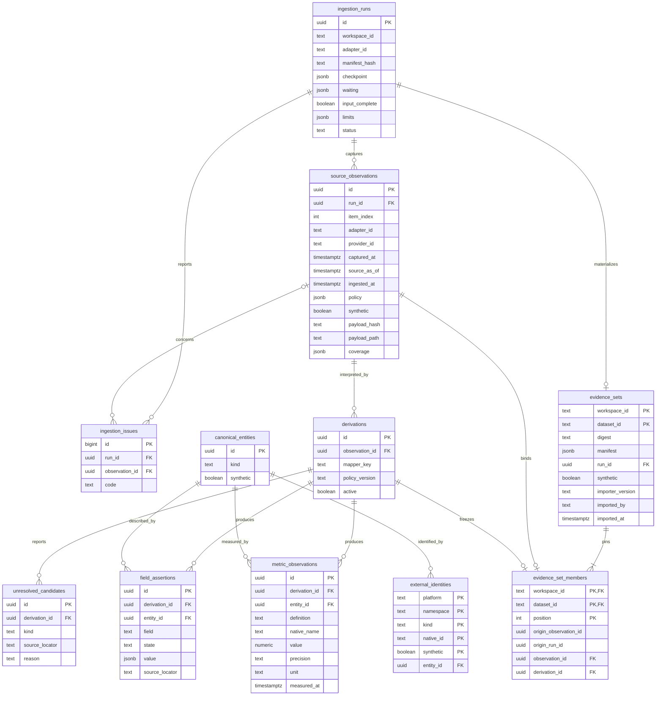
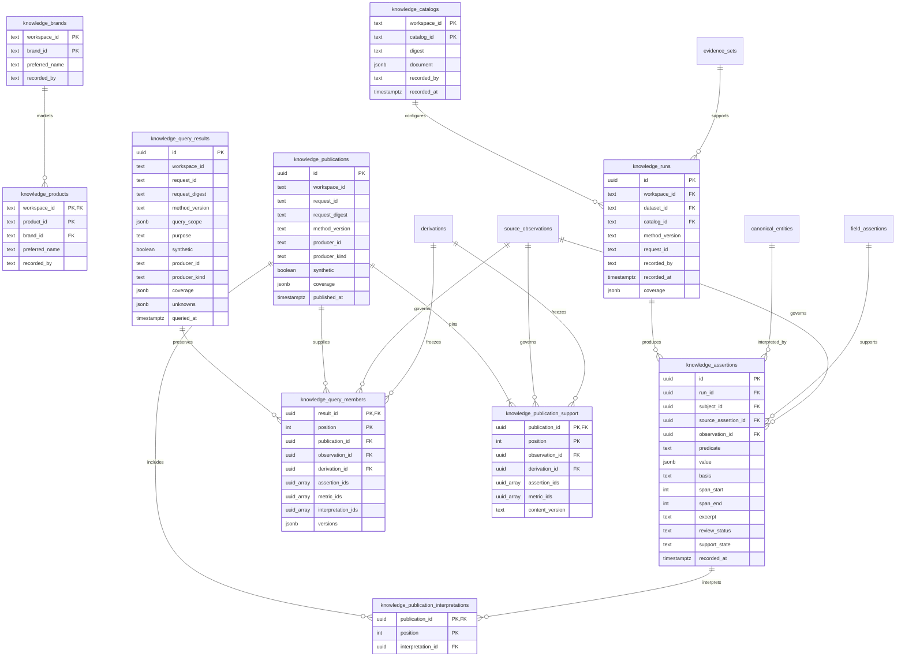
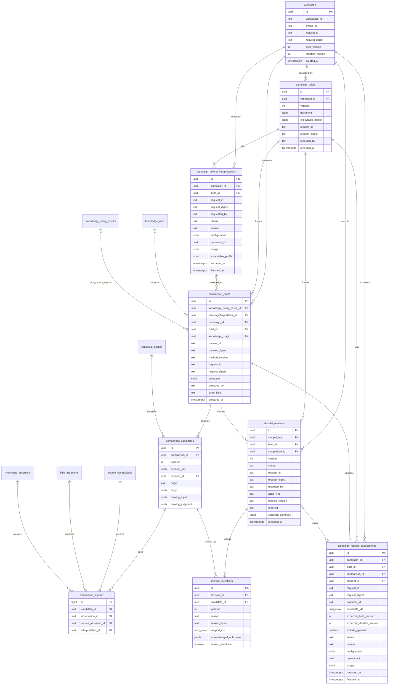
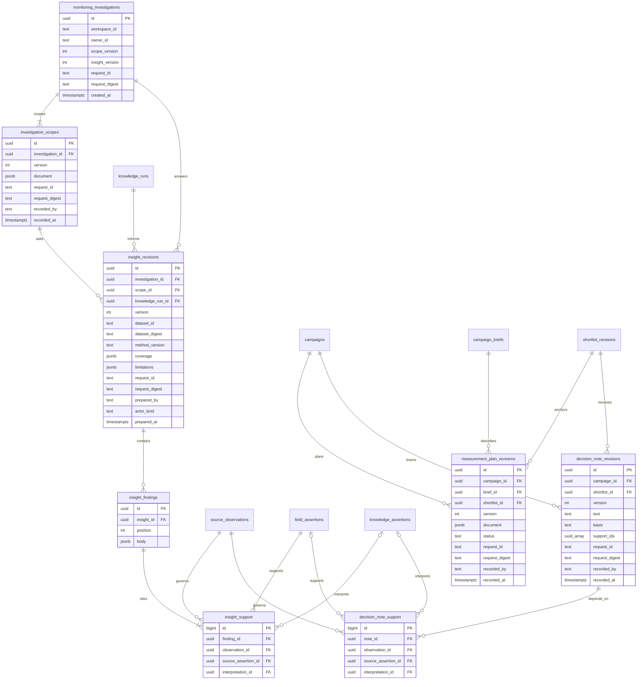
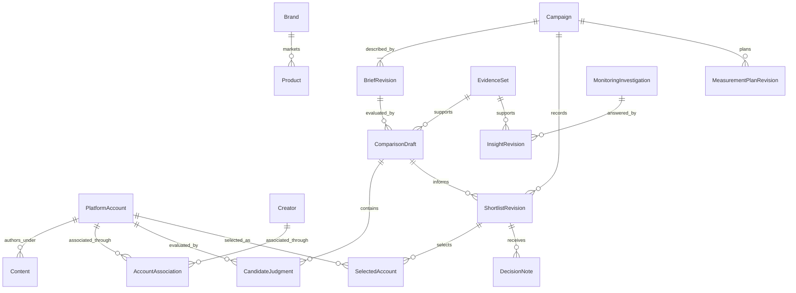
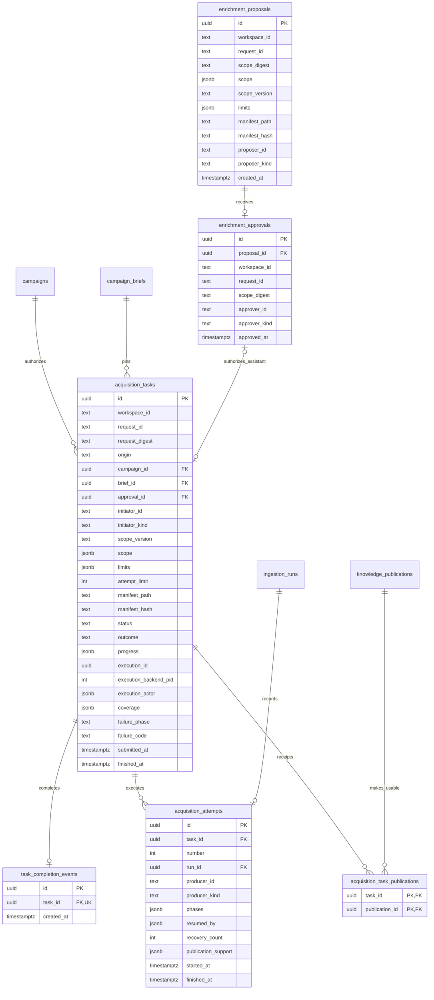
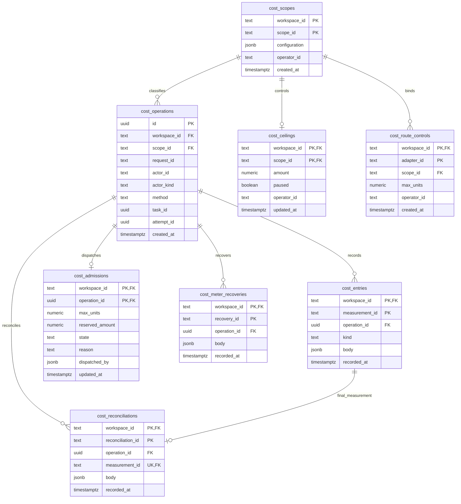
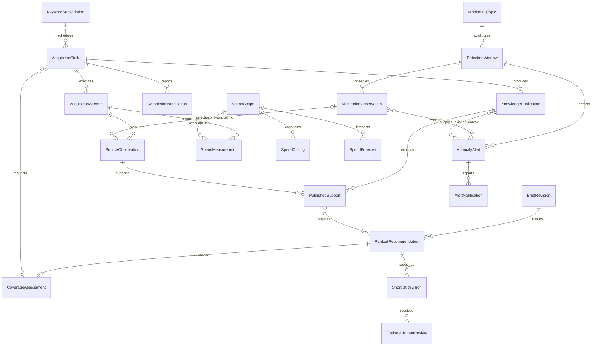

# Data model and ERD

## Implemented relational model

The physical schemas are owned by [ingestion](../src/smi_ingestion/schema.sql), [shared knowledge](../src/smi_knowledge/schema.sql), [campaign decisions](../src/smi_campaigns/schema.sql), [campaign planning](../src/smi_campaigns/planning/schema.sql), [monitoring](../src/smi_monitoring/schema.sql), [offline tasks](../src/smi_tasks/schema.sql) and [offline costs](../src/smi_costs/schema.sql). The diagrams show primary keys, important foreign keys and ownership fields; the SQL is authoritative for the complete columns and constraints.

## Identity, membership and time

- Canonical entities currently have only `account` and `content` kinds. Their UUIDs are separate from native string identifiers. Synthetic evidence has separate identities even if its native strings match real records.
- Field assertion states are `observed`, `not_returned`, `unavailable` and `removed`. Zero is a value, not a missing state. Current views may additionally report conflicts or aggregate unknowns.
- A derivation identifies one mapper/policy interpretation of one observation. Exactly one derivation per observation can be active; old derivations remain addressable.
- Dataset identity is `(workspace_id, dataset_id)`. It binds an immutable byte digest, manifest and import run. A member pins both the local observation and a derivation belonging to that observation through a composite foreign key.
- Original source observation/run UUIDs are lineage metadata. They are not foreign keys into the local database. Dataset membership is not inferred from all rows sharing an account or run date.
- `captured_at` is the source capture; `source_as_of` is a separately reported source time when known; `ingested_at` and `imported_at` are local recording times. Metrics and publication assertions retain their own time semantics.
- Policy remains on the source observation and is evaluated at read time. A frozen member can remain addressable while its source content becomes unavailable.

## Implemented shared knowledge model

Publication membership pins exact observation/derivation/assertion/metric IDs and existing interpretation IDs, independent of frozen datasets. Assertion/metric arrays are validated against their nominated derivation by the ingestion public interface before the publication transaction commits. Publications retain ordered membership, producer, method and original coverage; current reads apply source policy without copying source text. The workspace/request identity binds the payload and producer. Ingestion run workspace ownership scopes both fresh and imported support; upgrades preserve imported workspace context.

Query results preserve the actual bounded selection rather than only the query text. Their member rows retain exact source/interpretation IDs and source-free method, publication and freshness metadata; values are re-read through the publication owner under current policy. The public owner validates all membership against immutable publications, and source/derivation locks remain held until result commit. Workspace/request identity binds scope, purpose, synthetic mode, method and producer. New publications and withdrawal cannot rewrite prior membership or original coverage; current availability, supersession and age are separate read attributes. Query storage holds no raw source fact or interpretation-value copy.

Catalog documents pin human-configured aliases and product specificity. Business reference IDs persist across catalog revisions. Run identity includes workspace, frozen dataset, catalog, method version and preparation request ID. An explicit new request creates a fresh run under unchanged semantic configuration; retries retain the original run. Each interpretation points to its exact source caption assertion and observation; source policy controls its permitted use and retained copies. Withdrawal purges values/excerpts while retaining support metadata. A separate semantic-review/correction lifecycle remains future work.

## Implemented campaign model

Campaign heads serialize brief/shortlist saves. Revision/request uniqueness separates a new automated recommendation or human decision from retries. `generated` revisions record the actual automation kind/producer, shortlist method, comparison ordering and source-free candidate/selection/exclusion/deferral summary. Selection positions are unique per revision and pin either deterministic comparison order or validated model assessment order. Existing human draft/confirmed records retain attribution and null method/order/summary/positions; migration does not infer historical order or review. Each new brief atomically saves the human document (including optional original prose) and its exact structured executable profile, with stable criterion IDs, unknown policies and installed criteria/ranking/coverage versions. The profile is one-to-one with its brief revision and contains its exact ID/version; older rows keep a null profile rather than reconstructed history. Its current ranking is explicitly unranked and coverage descriptive. Comparisons pin exact brief/profile and knowledge IDs plus dataset digest and actual member IDs. Candidate keys retain platform/namespace/native string identity; an absent requested account has no canonical account UUID. Explicit support rows bind copied bodies and automated or human reasons to their source-policy dependencies. Purging removes the source-derived copy, not the selected membership or actor history.

`campaign_ranking_assessments` is a durable one-call claim for an exact comparison/brief/producer/request, expected heads and assessed candidate IDs. Its optional shortlist link identifies a validated automatic save; failed/interrupted claims have no saved fallback. Configuration pins actual model/method/schema/ranking profile; logical cost-operation references preserve cost ownership without cross-owner SQL. Candidate `ranking_input` and `ranking_judgment` retain only required governed input components and validated structured judgments; they share `comparison_support` cleanup. No transaction spans provider I/O. Final publication rechecks pinned support and both heads; reported consumption remains accounted for unusable results. See [the ranking contract](campaigns.md#bounded-supported-llm-ranking).

## Monitoring and planning tables

Monitoring has no campaign foreign key. Its scope and insight heads preserve independent question/answer history. Finding bodies carry sample-derived text/counts and can be purged while support/attribution metadata remains. Plans pin a brief and relevant shortlist and remain proposed; notes pin historical shortlists and conservatively inherit selected-source dependencies. Plan/note version heads are derived under campaign locks.

## Product domain model

This conceptual model expresses the accepted domain. Evidence, Brand/Product references, human campaign decisions/plans/notes and snapshot monitoring are implemented. Creator associations, operational ranking/automatic shortlist saving, scheduled acquisition authority, lightweight X alerts, spending controls and actual outcomes/attribution remain accepted future design; the physical diagrams describe implemented tables, including task execution ownership and independent synthetic accounting below.

Semantic assertions connect Brand/Product/topic interpretations to exact source assertion/span references, with basis, method and review context. These relationships are owned by shared knowledge, while brief, comparison and shortlist revisions are owned by campaign decisions. The same platform account can participate in many campaign-specific comparisons without becoming globally “discovered” or “selected.”

An optional Creator association carries its own evidence, role and applicable interval. An identity correction does not rewrite historical selected account IDs. Monitoring can produce an insight without any campaign, and a campaign can start without an insight.

## Implemented offline task model

Task admission persists its campaign/brief or exact proposal/approval basis, configuration and resource limits before returning. Proposal IDs identify immutable supplied revisions; each pins purpose, refresh/fill/expansion intent, subject/search and input scope, route/configuration and limits. Approval records the configured human, exact digest and request identity; one proposal permits at most one approval and one approval at most one task. The origin-basis constraint requires campaign plus brief for campaign tasks, or approval with no campaign/brief for assistant tasks. The migration preserves original campaign-only rows. Workspace/request identity binds the full scope and initiator. Only server-established campaign/assistant origins and a synthetic fixture-json route are installed. Actor roles come from trusted server configuration, separately from submitted identity metadata. Attempts retain exact run IDs, initial automation producers, recovery actors, committed phases and the exact prepared source-support selection; task/publication links are task-owned receipts committed atomically with the actual publication, before terminal acknowledgment. Task data copies no source wording. Current-policy publication reads remain responsible for values. Publication support's source-owned `content_version` fingerprint compares capture/mapping/selection identity across new run UUIDs without copying payloads; denied or superseded support does not suppress a newly usable publication. See [the task contract](tasks.md) for installed lifecycle and recovery limits. Task `progress` records the durable phase/observation frontier. A publication committed before task acknowledgment is reopened through the publication owner by request identity only after validating the task receipt, exact prepared support and source-owned attempt/run lineage. Ingestion-run `waiting` stores only a bounded reason/resumability pair; the opaque operation handle remains in its checkpoint. No-observation waits and their request usage commit together. These columns upgrade existing rows without changing their IDs or authority basis.

Task `execution_id`, `execution_backend_pid` and `execution_actor` identify the latest claim. Their metadata grants no ownership by itself: the exact backend's task-specific session lock determines running state. Owner transactions validate the execution ID and nonterminal task under its row lock and use that same connection for all dependent owner mutations. Disconnected sessions become recoverable without creating another attempt. `recovery_count` retains total handoffs; `resumed_by` keeps the most recent 20 actors and `phases` the most recent 100 entries. Migration truncates legacy arrays while preserving the original producer, IDs, exact support and total known recovery count. See [ADR 0005](adr/0005-task-session-effect-ownership.md).

A terminal outcome, attempt completion and one `task_completion_events` row commit on the same fenced task connection. Any task/publication receipt already committed atomically with its publication on that session; it survives a lost terminal acknowledgment. The event has one unique task reference and retains only source-free identity/time. Migration and workspace reconciliation backfill legacy terminal tasks idempotently. Inbox messages read the immutable outcome/coverage from the task and current display/support state from the publication owner, retaining historical counts while withholding unavailable publication links. See [the completion contract](tasks.md#durable-completion-inbox).

## Implemented offline accounting model

`cost_scopes.configuration` explicitly persists immutable provider/service, metered or forecast-only classification, currency, UTC period, unit/rate version/rate where applicable, and explicit provider-reported measurement basis for opted-in provider scopes; default synthetic documents retain their historical shape. The configuring human and time are retained. Scope identity is workspace-local; changed configuration conflicts. `cost_operations` pins one workspace/request identity to that scope, actual actor/method and either both exact task/attempt IDs or neither. Task references are logical, validated through the public task owner's injected resolver rather than a cross-owner foreign key or direct SQL. This preserves acyclic module dependencies and equivalent model attribution without a task.

`cost_entries` has a workspace-global measurement identity and composite operation/workspace foreign key. `kind` separates usage, forecast, declared outstanding commitment, unknown and meter failure. The body stores canonical exact decimal strings, actual recorder, provenance and measurement time; usage adds unit/rate/version, derived amount and synthetic or provider-reported basis; provider usage retains source-free token/cache/reasoning counts, and final operator reports remain distinct from verified invoices; forecasts require assumptions. Repeated identities reconcile once and changed reuse conflicts without overwriting history. Totals remain per-operation/currency/period and missing categories remain unknown. Declared commitments remain outstanding until an explicit final reconciliation names them; independent usage does not retire them. `cost_ceilings` holds current trusted amount/pause control for that exact immutable currency/period scope. `cost_route_controls` permanently binds the installed synthetic fixture route to one scope and its one-request service contract. `cost_admissions` has one row per operation and a bounded reservation plus dispatched/settled/refused state, reason and actual dispatcher. The scope row serializes ledger writes, decisions and settlement across connections; no transaction spans external I/O. Automatic adapter settlement appends usage and replaces only its own dispatched reservation; final reconciliation can also resolve explicitly named declarations and uncertainty. Session-loss uncertainty retains liabilities and pauses replay. `cost_reconciliations` binds a workspace-global event identity to one final usage entry and exact named admission/declaration/uncertainty targets in its immutable body, with operator, final outcome, report evidence/provenance and reconciliation time. The final measurement is unique per workspace across reconciliation events; explicit targets are validated under the scope lock. An equal existing measurement retains its original recorder. Reconciliation changes active totals rather than updating/deleting the entry audit. `cost_meter_recoveries` retains workspace-global health-check identity, exact already-reconciled failure IDs, operator, evidence/provenance and recovery time; no amount or dispatch permission follows from it. Unrecovered meter failure still blocks the scope after final usage. Both new tables use composite workspace/operation references; accounting retains no task dependency. See [the accounting contract](costs.md#final-synthetic-reconciliation-and-meter-recovery).

## Accepted future operational records

These are conceptual relationships for the [operational requirements](functional-requirements.md), not installed tables or a migration specification. The physical ERDs above describe the installed schema, including explicit knowledge publication, exact query results and campaign and exactly approved assistant offline task/attempt paths. Synthetic accounting and bounded ceiling/admission are installed above; commercial reconciliation and the broader operational relationships below remain conceptual.

Task origin distinguishes scheduled discovery, automatic campaign coverage and approved assistant enrichment. Assistant tasks require their exact scope-bound approval; the optional approval relationship does not authorize another origin to masquerade as an approved assistant task. Attempts and publications preserve retries, actual membership, failures and the distinction between retrieved versus usable knowledge.

A ranked recommendation can be saved automatically as a shortlist revision with its producer/method, order, rationale, support and gaps. Optional human review is separate from persistence; no human record is invented for an automatic save. Stable account identity and an ingested permitted supporting observation admit incomplete profiles to ranking. The installed deterministic `recommend` operation saves ordered `generated` revisions automatically; LLM ranking remains future work. See the [automatic persistence contract](campaigns.md#automatic-deterministic-shortlist-persistence).

Monitoring observations and alert support have their own bounded lifecycle and source policy. Selected promotion does not require every X post to become a full KB entity. Detection windows retain baseline/method/time/coverage context; an alert investigation can read existing publications without initiating external acquisition.

Spend measurements distinguish actual derived charges from forecasts, with currency, unit/rate versions, accounting periods, task/attempt attribution and meter provenance. Configured metered scopes have ceilings and coordinated in-flight commitments/reconciliation; unmeterable portions retain forecasts. These future commercial relationships do not extend the installed bounded synthetic enforcement to unbounded/delayed provider charges or prescribe particular ceiling amounts.

Campaign criteria attempts pin exact immutable brief input and retain sanitized outcome/configuration/usage plus only a validated generated profile. `operation_id` is an accounting-owner logical reference, without a cross-owner SQL foreign key. Comparison drafts optionally pin one succeeded interpretation; null retains the original human structured-profile path. Campaign and cost SQL stay with their owners. See [the interpretation contract](campaigns.md#bounded-natural-language-interpretation).

Provider cost provenance shares the same physical accounting tables. Explicit provider-basis final reconciliation and meter recovery preserve named targets, immutable original rates, overage visibility and one-use dispatch without relabelling synthetic evidence. Accounting reports its generic declared bounded-provider contract premise; the interpretation configuration owns exact verified snapshot/input/output provenance.

Current-KB comparison drafts pin `knowledge_query_result_id`; their legacy `knowledge_run_id`, `dataset_id` and `dataset_digest` are null. A database check requires exactly one of these source modes. Frozen drafts keep their original run/dataset fields and a null query link. Draft coverage includes the immutable actual execution profile. `comparison_support.source_assertion_id` and `decision_note_support.source_assertion_id` are nullable for metric-only account support; the observation and linked query manifest retain exact metric/derivation identities.
