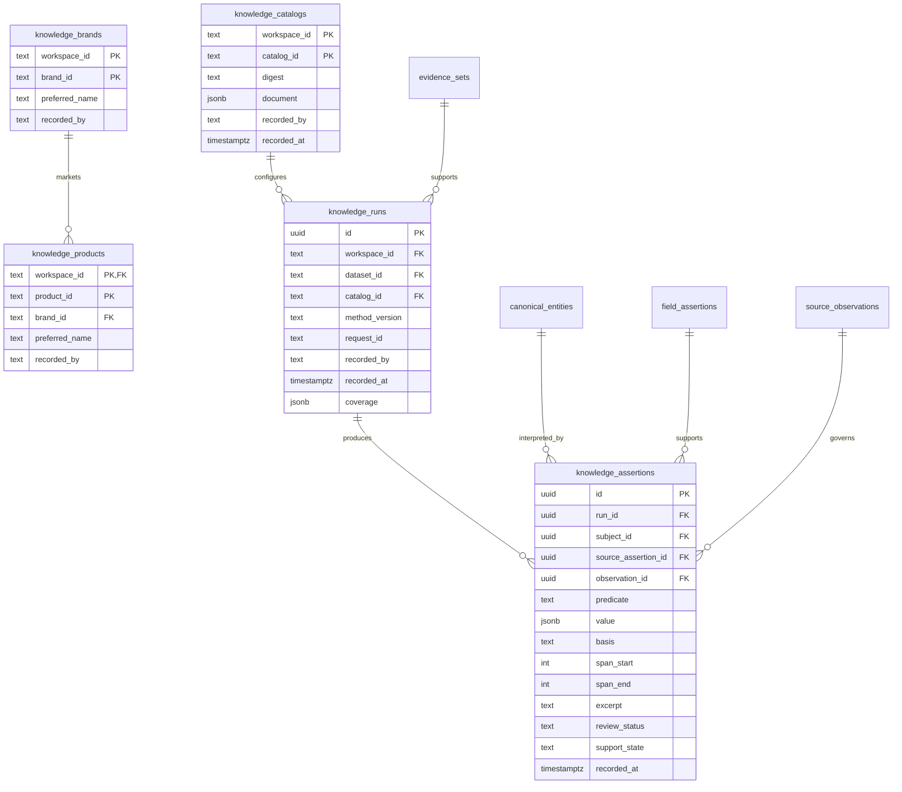
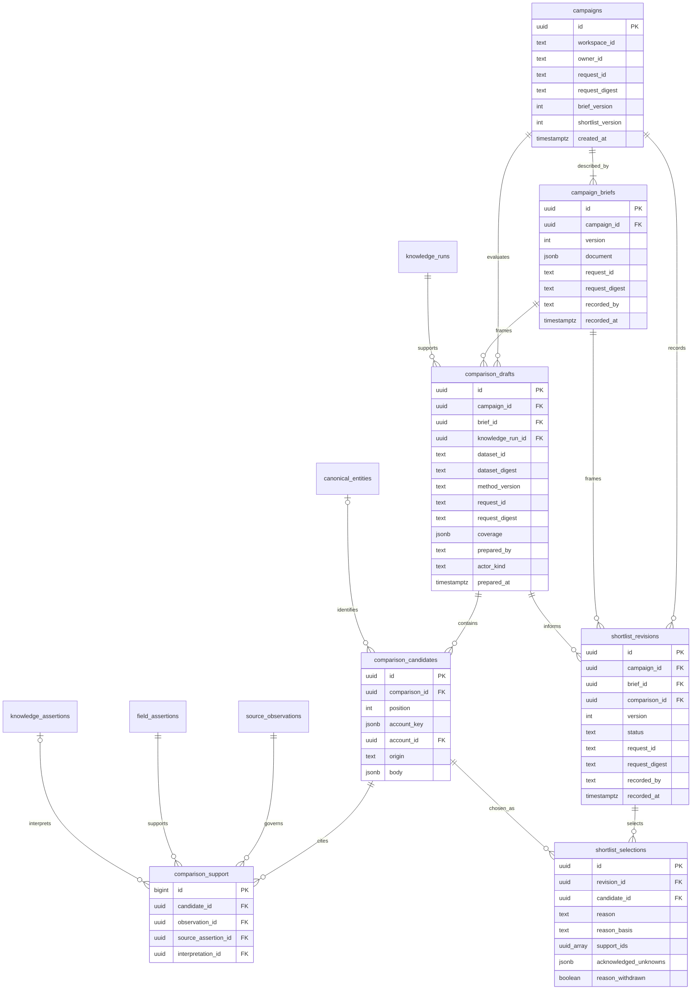
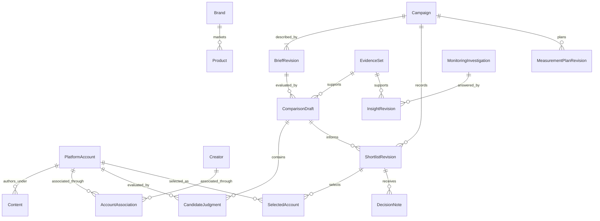
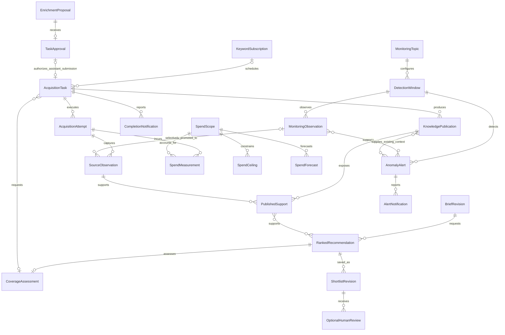

# Data model and ERD

## Implemented relational model

The physical schemas are owned by [ingestion](../src/smi_ingestion/schema.sql), [shared knowledge](../src/smi_knowledge/schema.sql), [campaign decisions](../src/smi_campaigns/schema.sql), [campaign planning](../src/smi_campaigns/planning/schema.sql) and [monitoring](../src/smi_monitoring/schema.sql). The diagrams show primary keys, important foreign keys and ownership fields; the SQL is authoritative for the complete columns and constraints.

```mermaid
erDiagram
    ingestion_runs ||--o{ source_observations : captures
    ingestion_runs ||--o{ ingestion_issues : reports
    source_observations o|--o{ ingestion_issues : concerns
    source_observations ||--o{ derivations : interpreted_by
    canonical_entities ||--o{ external_identities : identified_by
    derivations ||--o{ field_assertions : produces
    canonical_entities ||--o{ field_assertions : described_by
    derivations ||--o{ metric_observations : produces
    canonical_entities ||--o{ metric_observations : measured_by
    derivations ||--o{ unresolved_candidates : reports
    ingestion_runs ||--o| evidence_sets : materializes
    evidence_sets ||--|{ evidence_set_members : pins
    source_observations ||--o| evidence_set_members : binds
    derivations ||--o| evidence_set_members : freezes

    ingestion_runs {
        uuid id PK
        text adapter_id
        text manifest_hash
        jsonb checkpoint
        boolean input_complete
        jsonb limits
        text status
    }
    source_observations {
        uuid id PK
        uuid run_id FK
        int item_index
        text adapter_id
        text provider_id
        timestamptz captured_at
        timestamptz source_as_of
        timestamptz ingested_at
        jsonb policy
        boolean synthetic
        text payload_hash
        text payload_path
        jsonb coverage
    }
    ingestion_issues {
        bigint id PK
        uuid run_id FK
        uuid observation_id FK
        text code
    }
    canonical_entities {
        uuid id PK
        text kind
        boolean synthetic
    }
    external_identities {
        text platform PK
        text namespace PK
        text kind PK
        text native_id PK
        boolean synthetic PK
        uuid entity_id FK
    }
    derivations {
        uuid id PK
        uuid observation_id FK
        text mapper_key
        text policy_version
        boolean active
    }
    field_assertions {
        uuid id PK
        uuid derivation_id FK
        uuid entity_id FK
        text field
        text state
        jsonb value
        text source_locator
    }
    metric_observations {
        uuid id PK
        uuid derivation_id FK
        uuid entity_id FK
        text definition
        text native_name
        numeric value
        text precision
        text unit
        timestamptz measured_at
    }
    unresolved_candidates {
        uuid id PK
        uuid derivation_id FK
        text kind
        text source_locator
        text reason
    }
    evidence_sets {
        text workspace_id PK
        text dataset_id PK
        text digest
        jsonb manifest
        uuid run_id FK
        boolean synthetic
        text importer_version
        text imported_by
        timestamptz imported_at
    }
    evidence_set_members {
        text workspace_id PK, FK
        text dataset_id PK, FK
        int position PK
        uuid origin_observation_id
        uuid origin_run_id
        uuid observation_id FK
        uuid derivation_id FK
    }
```

## Identity, membership and time

- Canonical entities currently have only `account` and `content` kinds. Their UUIDs are separate from native string identifiers. Synthetic evidence has separate identities even if its native strings match real records.
- Field assertion states are `observed`, `not_returned`, `unavailable` and `removed`. Zero is a value, not a missing state. Current views may additionally report conflicts or aggregate unknowns.
- A derivation identifies one mapper/policy interpretation of one observation. Exactly one derivation per observation can be active; old derivations remain addressable.
- Dataset identity is `(workspace_id, dataset_id)`. It binds an immutable byte digest, manifest and import run. A member pins both the local observation and a derivation belonging to that observation through a composite foreign key.
- Original source observation/run UUIDs are lineage metadata. They are not foreign keys into the local database. Dataset membership is not inferred from all rows sharing an account or run date.
- `captured_at` is the source capture; `source_as_of` is a separately reported source time when known; `ingested_at` and `imported_at` are local recording times. Metrics and publication assertions retain their own time semantics.
- Policy remains on the source observation and is evaluated at read time. A frozen member can remain addressable while its source content becomes unavailable.

## Implemented shared knowledge model

Catalog documents pin human-configured aliases and product specificity. Business reference IDs persist across catalog revisions. Run identity includes workspace, frozen dataset, catalog, method version and preparation request ID. An explicit new request creates a fresh run under unchanged semantic configuration; retries retain the original run. Each interpretation points to its exact source caption assertion and observation; source policy controls its permitted use and retained copies. Withdrawal purges values/excerpts while retaining support metadata. A separate semantic-review/correction lifecycle remains future work.

## Implemented campaign model

Campaign heads serialize brief/shortlist saves. Revision/request uniqueness separates a new human decision from retries. Comparisons pin exact brief and knowledge IDs plus dataset digest and actual member IDs. Candidate keys retain platform/namespace/native string identity; an absent requested account has no canonical account UUID. Explicit support rows bind copied bodies and human reasons to their source-policy dependencies. Purging removes the source-derived copy, not the selected membership or actor history.

## Monitoring and planning tables

Monitoring has no campaign foreign key. Its scope and insight heads preserve independent question/answer history. Finding bodies carry sample-derived text/counts and can be purged while support/attribution metadata remains. Plans pin a brief and relevant shortlist and remain proposed; notes pin historical shortlists and conservatively inherit selected-source dependencies. Plan/note version heads are derived under campaign locks.

## Product domain model

This conceptual model expresses the accepted domain. Evidence, Brand/Product references, human campaign decisions/plans/notes and snapshot monitoring are implemented. Creator associations, operational ranking/automatic shortlist saving, acquisition tasks/publications, lightweight X alerts, spending controls and actual outcomes/attribution remain accepted future design; the physical diagrams above describe implemented tables.

Semantic assertions connect Brand/Product/topic interpretations to exact source assertion/span references, with basis, method and review context. These relationships are owned by shared knowledge, while brief, comparison and shortlist revisions are owned by campaign decisions. The same platform account can participate in many campaign-specific comparisons without becoming globally “discovered” or “selected.”

An optional Creator association carries its own evidence, role and applicable interval. An identity correction does not rewrite historical selected account IDs. Monitoring can produce an insight without any campaign, and a campaign can start without an insight.

## Accepted future operational records

These are conceptual relationships for the [operational requirements](functional-requirements.md), not installed tables or a migration specification. The physical ERDs above remain the implemented 31-table schema.

Task origin distinguishes scheduled discovery, automatic campaign coverage and approved assistant enrichment. Assistant tasks require their exact scope-bound approval; the optional approval relationship does not authorize another origin to masquerade as an approved assistant task. Attempts and publications preserve retries, actual membership, failures and the distinction between retrieved versus usable knowledge.

A ranked recommendation can be saved automatically as a shortlist revision with its producer/method, order, rationale, support and gaps. Optional human review is separate from persistence; no human record is invented for an automatic save. Stable account identity and an ingested permitted supporting observation admit incomplete profiles to ranking. Existing `shortlist_revisions` currently permits human records only; the future authority/interface is not yet implemented.

Monitoring observations and alert support have their own bounded lifecycle and source policy. Selected promotion does not require every X post to become a full KB entity. Detection windows retain baseline/method/time/coverage context; an alert investigation can read existing publications without initiating external acquisition.

Spend measurements distinguish actual derived charges from forecasts, with currency, unit/rate versions, accounting periods, task/attempt attribution and meter provenance. Configured metered scopes have ceilings and coordinated in-flight commitments/reconciliation; unmeterable portions retain forecasts. These relationships do not claim current monetary enforcement, particular ceiling amounts or strict bounds for unbounded/delayed provider charges.
