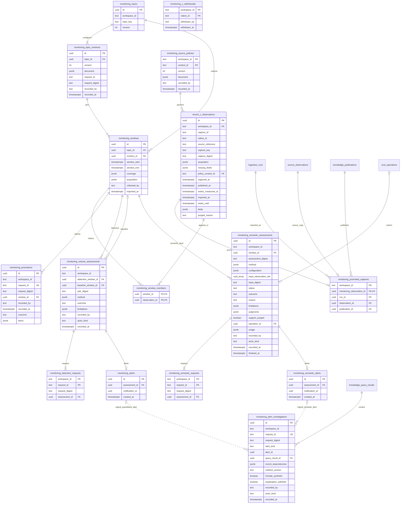
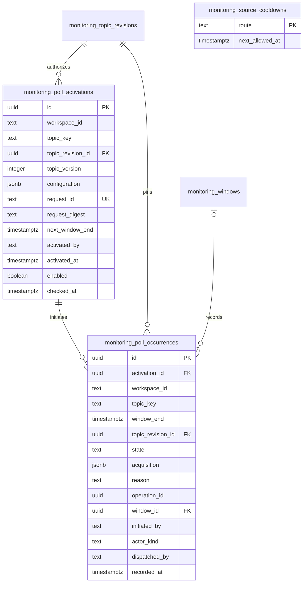
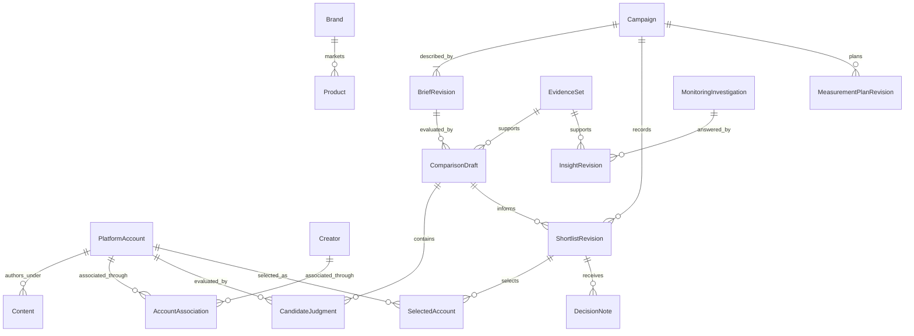
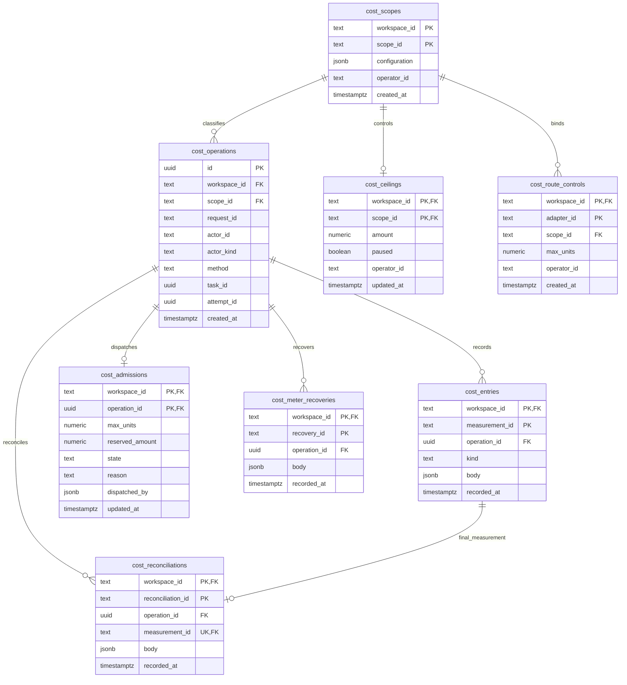
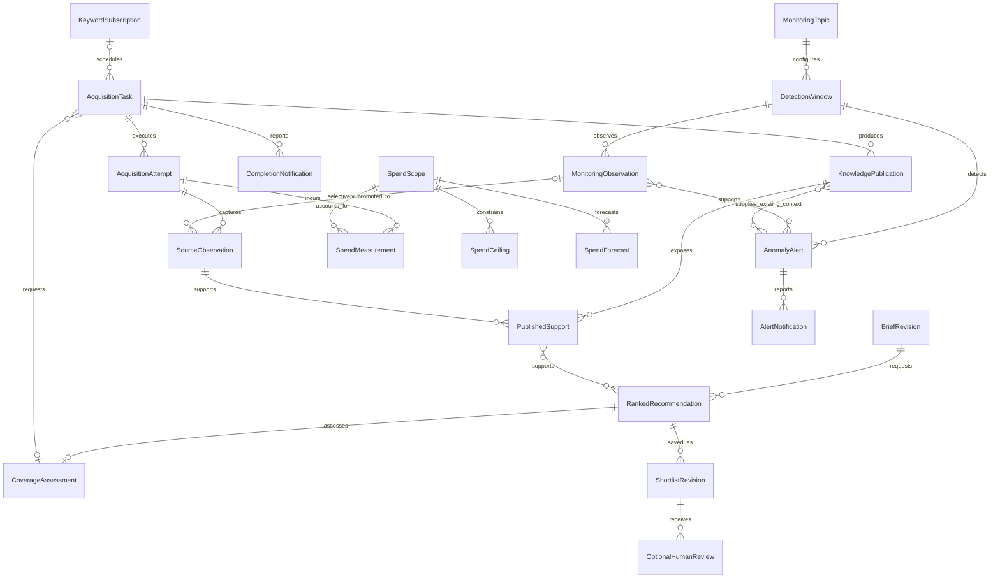
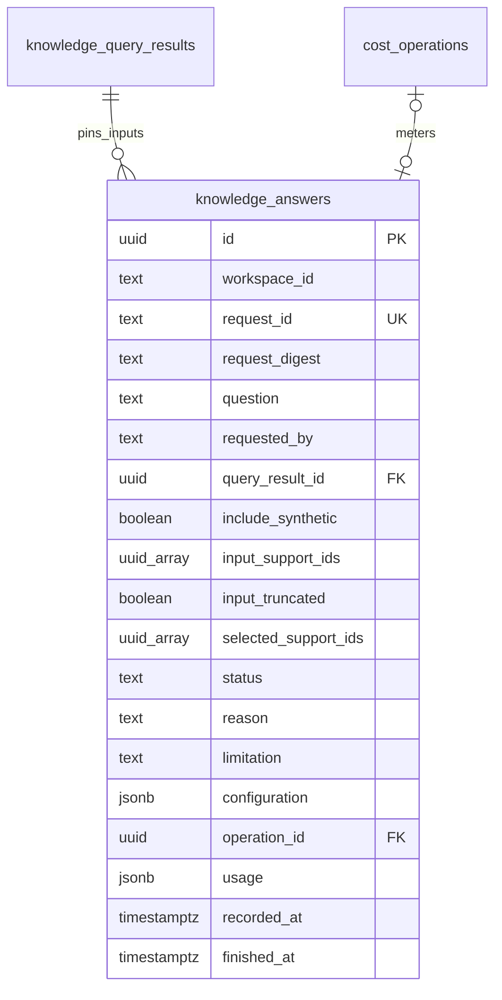
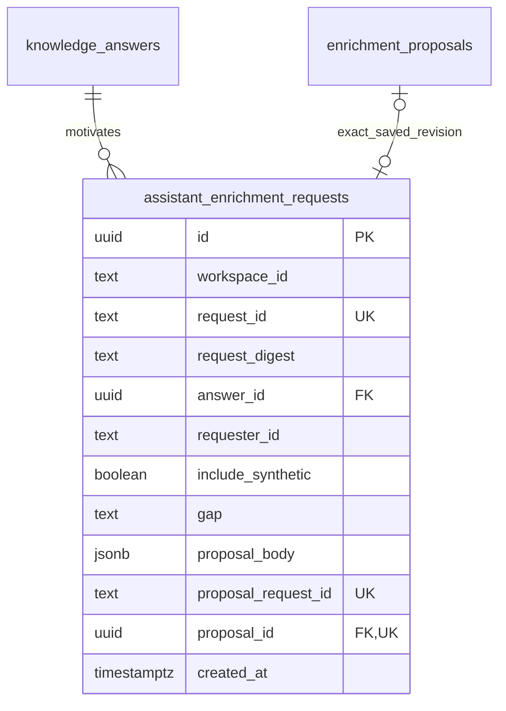

# Data model and ERD

## Implemented relational model

The physical schemas are owned by [ingestion](../src/smi_ingestion/schema.sql), [shared knowledge](../src/smi_knowledge/schema.sql), [campaign decisions](../src/smi_campaigns/schema.sql), [campaign planning](../src/smi_campaigns/planning/schema.sql), [snapshot monitoring](../src/smi_monitoring/schema.sql), [recent X evidence](../src/smi_monitoring/recent/schema.sql), [quantitative alerts](../src/smi_monitoring/alerts/schema.sql), [semantic assessments](../src/smi_monitoring/semantic/schema.sql), [alert context](../src/smi_monitoring/context/schema.sql), [selected promotion](../src/smi_monitoring/promotion/schema.sql), [offline tasks](../src/smi_tasks/schema.sql), [registered keyword schedules](../src/smi_tasks/schedules/schema.sql), [discovery history](../src/smi_tasks/discovery/schema.sql), [offline costs](../src/smi_costs/schema.sql), [knowledge answers](../src/smi_assistant/schema.sql) and [assistant enrichment linkage](../src/smi_tasks/assistant/schema.sql). The diagrams show primary keys, important foreign keys and ownership fields; the SQL is authoritative for the complete columns and constraints.

## Identity, membership and time

- Canonical entities currently have only `account` and `content` kinds. Their UUIDs are separate from native string identifiers. Synthetic evidence has separate identities even if its native strings match real records.
- Field assertion states are `observed`, `not_returned`, `unavailable` and `removed`. Zero is a value, not a missing state. Current views may additionally report conflicts or aggregate unknowns.
- A derivation identifies one mapper/policy interpretation of one observation. Exactly one derivation per observation can be active; old derivations remain addressable.
- Dataset identity is `(workspace_id, dataset_id)`. It binds an immutable byte digest, manifest and import run. A member pins both the local observation and a derivation belonging to that observation through a composite foreign key.
- Original source observation/run UUIDs are lineage metadata. They are not foreign keys into the local database. Dataset membership is not inferred from all rows sharing an account or run date.
- `captured_at` is the source capture; `source_as_of` is a separately reported source time when known; `ingested_at` and `imported_at` are local recording times. Metrics and publication assertions retain their own time semantics.
- Policy remains on the source observation and is evaluated at read time. A frozen member can remain addressable while its source content becomes unavailable.

## Implemented shared knowledge model

Publication membership pins exact observation/derivation/assertion/metric IDs and existing interpretation IDs, independent of frozen datasets. Assertion/metric arrays are validated against their nominated derivation by the ingestion public interface before the publication transaction commits. Publications retain ordered membership, producer, method and original coverage; current reads apply source policy without copying source text. The workspace/request identity binds the payload and producer. Ingestion run workspace ownership scopes both fresh and imported support; upgrades preserve imported workspace context.

Query results preserve the actual bounded selection rather than only the query text. Their member rows retain exact source/interpretation IDs and source-free method, publication and freshness metadata; values are re-read through the publication owner under current policy. The public owner validates all membership against immutable publications, and source/derivation locks remain held until result commit. Workspace/request identity binds scope, purpose, synthetic mode, method and producer. New publications and withdrawal cannot rewrite prior membership or original coverage; current availability, supersession and age are separate read attributes. Query storage holds no raw source fact or interpretation-value copy.

Catalog documents pin human-configured aliases and product specificity. Business reference IDs persist across catalog revisions. Run identity includes workspace, frozen dataset, catalog, method version and preparation request ID. An explicit new request creates a fresh run under unchanged semantic configuration; retries retain the original run. Each interpretation points to its exact source caption assertion and observation; source policy controls its permitted use and retained copies. Withdrawal purges values/excerpts while retaining support metadata. A separate semantic-review/correction lifecycle remains future work.

## Implemented campaign model

Campaign heads serialize brief/shortlist saves. Revision/request uniqueness separates a new automated recommendation or human decision from retries. `generated` revisions record the actual automation kind/producer, shortlist method, comparison ordering and source-free candidate/selection/exclusion/deferral summary. Selection positions are unique per revision and pin deterministic comparison order, validated model assessment order or an explicit human curation order. Optional `source_shortlist_id` links a newly curated revision to its exact current predecessor from the same campaign/comparison; the owner validates this under the campaign head lock. Curation records human method/order and zero-based positions without changing the predecessor or inventing human confirmation. Historical source links remain null. Existing human draft/confirmed records retain attribution and null method/order/summary/positions; migration does not infer historical order or review. Each new brief atomically saves the human document (including optional original prose) and its exact structured executable profile, with stable criterion IDs, unknown policies and installed criteria/ranking/coverage versions. The profile is one-to-one with its brief revision and contains its exact ID/version; older rows keep a null profile rather than reconstructed history. Its current ranking is explicitly unranked and coverage descriptive. Comparisons pin exact brief/profile and knowledge IDs plus dataset digest and actual member IDs. Candidate keys retain platform/namespace/native string identity; an absent requested account has no canonical account UUID. Explicit support rows bind copied bodies and automated or human reasons to their source-policy dependencies. Purging removes the source-derived copy, not the selected membership or actor history.

`campaign_ranking_assessments` is a durable one-call claim for an exact comparison/brief/producer/request, expected heads and assessed candidate IDs. Its optional shortlist link identifies a validated automatic save; failed/interrupted claims have no saved fallback. Configuration pins actual model/method/schema/ranking profile; logical cost-operation references preserve cost ownership without cross-owner SQL. Candidate `ranking_input` and `ranking_judgment` retain only required governed input components and validated structured judgments; they share `comparison_support` cleanup. No transaction spans provider I/O. Final publication rechecks pinned support and both heads; reported consumption remains accounted for unusable results. See [the ranking contract](campaigns.md#bounded-supported-llm-ranking).

`source_observation_dependencies` is ingestion-owned parent lifecycle metadata for transiently imported copies. `(owner_id, origin_id)` is unique; the parent capture deadline can only shorten and `purged` is permanent. Source policy expiry is the earlier of this deadline and parent policy expiry. Parent writes update the linked observation and canonical field/metric bodies atomically through a public ingestion port; independent workspace-scoped support reads reconcile elapsed expiry. It contains no parent SQL dependency or copied source wording.

## Recent X evidence tables

`monitoring_promotions` pins exact ordered selection/outcomes and human attribution per workspace/request. Its `items` JSON stores only selected IDs, bounded state codes and source/run/publication links. `monitoring_promoted_captures` owns one exact source/publication receipt per original recent capture; it is reused across later requests and cannot grant current usability. All new effects and result receipts commit atomically. See [the promotion contract](monitoring.md#selected-recent-evidence-promotion).

The [recent schema](../src/smi_monitoring/recent/schema.sql) is independent of canonical entities, knowledge runs/publications, campaigns and scheduled keywords. Topic/end uniqueness preserves one logical poll across configuration edits; original configuration/coverage/acquisition remain pinned. Workspace/source-capture uniqueness uses native identity and original source time rather than a fixture label, so a later import cannot restore a purged copy or refresh its first import. Current policy is a mutable versioned overlay; original acquisition records its policy version. Native withdrawal tombstones govern future captures without requiring a foreign key from an observation. Body text/metric copies purge permanently while permitted identities, original times, coverage and audit history remain. See [the contract](monitoring.md#bounded-offline-recent-x-evidence) for finite topic/revision/file/window/observation/retention/timeline limits and policy reconciliation.

The [quantitative alert schema](../src/smi_monitoring/alerts/schema.sql) pins exact original detection/baseline window references and source-free method/configuration/outcome/limitations. Workspace/pair-digest uniqueness prevents duplicate assessments/alerts for the same windows and configuration; workspace/request receipts separately reject changed actor/input reuse. A supported crossing inserts the one-to-one alert and unique local notification identity in the same transaction as assessment/request. No copied caption, metric or numerical comparison is stored here. Current claims reopen original windows through the recent owner's public caller-transaction read under its policy lock, so source denial/expiry/withdrawal hides the whole comparison while preserving history. The alert owner does not read task or recent tables privately; notifications enter the browser inbox through public composition. See [the quantitative contract](monitoring.md#configured-quantitative-volume-assessments) for finite history/request caps.

The [semantic schema](../src/smi_monitoring/semantic/schema.sql) pins one exact window, full prepared input IDs/digest, configured bounded quality-controversy method/schema/model, operator attribution, no-reissue claim status and shared usage/cost operation. Window/method/model configuration uniqueness owns the first assessment; exact request receipts additionally protect actor/input reuse. Successful provisional positions contain source-free IDs, fixed labels and quote offsets only. A supported configured signal inserts its one-to-one semantic alert and unique local notification identity in the same finalization transaction. All actual inputs (including unresolved text) govern dispatch, finalization and reopen through the public recent-policy lock port. Observed loss clears every dependent judgment irreversibly while retaining historical outcome/lineage and unavailable alert identity. Excerpts always resolve from current permitted original source values; no copied factual narrative is stored. Interrupted/uncertain claims cannot automatically redispatch; final metered usage may remain without a usable finding. See [the semantic contract](monitoring.md#bounded-provisional-quality-controversy-assessments).

The [alert-context schema](../src/smi_monitoring/context/schema.sql) retains a logical typed alert reference (the mutually exclusive alert owners remain separate), a foreign key to its exact KB query result, original recent window/capture dependency IDs, method/actor/time and permanent explanation-withheld flag. Workspace/request uniqueness binds alert, actor, method and synthetic scope. Query/context writes share source-owner locks and one transaction; original source and KB facts remain with their owners. No copied source prose or selected numeric explanation is stored. New publications require a new investigation, and dependency loss withholds explanation without replacing original membership. See [the context contract](monitoring.md#existing-kb-alert-investigations).

## Periodic recent X collection tables

The [polling schema](../src/smi_monitoring/polling/schema.sql) owns source-free recurring authority and one-use attempts. It reads no recent or cost SQL privately: public recent transaction ports pin source configuration/permissions and commit the window on the actual ownership session; public accounting owns monetary admission and settlement. The operation reference is an equivalent acquisition identity, independent of KB tasks.

`monitoring_poll_activations` pins exact topic revision and route/version/query-mode/bounds. Workspace/request is unique; a partial unique index permits one enabled activation per workspace/topic. Only next interval, fair-visit time and enabled state change; successor activation preserves prior authority. `monitoring_poll_occurrences` has a unique workspace/topic/end identity across activations, retaining original revision/initiator, source-free bounded acquisition receipt, dispatch state/reason, cost reference and original window. Exact lookup uses the whole retained history rather than the newest-100 presentation. At most 100 activations and 1000 attempts per topic are retained. `monitoring_source_cooldowns` is a single route-keyed lower bound for next admission, shared across workspaces in the installed PostgreSQL schema; admission advances it atomically and source quota responses can only lengthen it. Other installations or external app use are outside this coordination scope. No raw response, caption, pagination token or credential is stored here. The recent observation key additionally pins actual live response identity/native ID while keeping original capture/measurement time unknown; local retrieval time never replaces source time. Existing offline source-time identities are unchanged. See [the collection contract](monitoring.md#gated-periodic-live-recent-x).

## Monitoring and planning tables

Monitoring has no campaign foreign key. Its scope and insight heads preserve independent question/answer history. Finding bodies carry sample-derived text/counts and can be purged while support/attribution metadata remains. Plans pin a brief and relevant shortlist and remain proposed; notes pin historical shortlists and conservatively inherit selected-source dependencies. Plan/note version heads are derived under campaign locks.

## Product domain model

This conceptual model expresses the accepted domain. Evidence, Brand/Product references, human campaign decisions/plans/notes snapshot monitoring, bounded offline recent-X evidence and configured quantitative/provisional quality-controversy alerts/local notifications are implemented. Bounded existing-KB alert context is implemented. Creator associations, semantic shift/richer explanation and actual outcomes/attribution remain accepted future design; operational ranking/automatic shortlist persistence, bounded spending controls and recorded live schedule authority are installed as described by their current contracts; the physical diagrams describe implemented tables, including task execution ownership and independent synthetic accounting below.

Semantic assertions connect Brand/Product/topic interpretations to exact source assertion/span references, with basis, method and review context. These relationships are owned by shared knowledge, while brief, comparison and shortlist revisions are owned by campaign decisions. The same platform account can participate in many campaign-specific comparisons without becoming globally “discovered” or “selected.”

An optional Creator association carries its own evidence, role and applicable interval. An identity correction does not rewrite historical selected account IDs. Monitoring can produce an insight without any campaign, and a campaign can start without an insight.

## Implemented offline task model

Task admission persists its exact schedule occurrence, campaign/brief or proposal/approval basis, configuration and resource limits before returning. Proposal IDs identify immutable supplied revisions; each pins purpose, refresh/fill/expansion intent, subject/search and input scope, route/configuration and limits. Approval records the configured human, exact digest and request identity; one proposal permits at most one approval and one approval at most one task. The origin-basis constraint requires campaign plus brief for campaign tasks, approval with no campaign/brief for assistant tasks, or a schedule occurrence with no campaign/brief/approval for scheduled tasks. The migration preserves original campaign-only rows. Workspace/request identity binds the full scope and initiator. Only server-established schedule/campaign/assistant origins and the synthetic supplied-reference/query-discovery routes are installed. Discovery uses existing JSONB ownership: proposal/task `scope.discovery` pins query, subject IDs and a half-open publication-time window; `scope.execution_digest` binds the complete selection/route/limits/path. `source_observations.coverage.discovery` retains permitted source-owned query/route/method/selection lineage and bounded corpus counts; task coverage retains sanitized counts/unknown market coverage. The query route reuses existing JSONB scope/coverage ownership; registered schedules add their separate configuration/occurrence tables above. Legacy scopes/hashes remain intact. Actor roles come from trusted server configuration, separately from submitted identity metadata. Attempts retain exact run IDs, initial automation producers, recovery actors, committed phases and the exact prepared source-support selection; task/publication links are task-owned receipts committed atomically with the actual publication, before terminal acknowledgment. Task data copies no source wording. Current-policy publication reads remain responsible for values. Publication support's source-owned `content_version` fingerprint compares capture/mapping/selection identity across new run UUIDs without copying payloads; denied or superseded support does not suppress a newly usable publication. See [the task contract](tasks.md) for installed lifecycle and recovery limits. Task `progress` records the durable phase/observation frontier. A publication committed before task acknowledgment is reopened through the publication owner by request identity only after validating the task receipt, exact prepared support and source-owned attempt/run lineage. Ingestion-run `waiting` stores only a bounded reason/resumability pair; the opaque operation handle remains in its checkpoint. No-observation waits and their request usage commit together. These columns upgrade existing rows without changing their IDs or authority basis.

Task `execution_id`, `execution_backend_pid` and `execution_actor` identify the latest claim. Their metadata grants no ownership by itself: the exact backend's task-specific session lock determines running state. Owner transactions validate the execution ID and nonterminal task under its row lock and use that same connection for all dependent owner mutations. Disconnected sessions become recoverable without creating another attempt. `recovery_count` retains total handoffs; `resumed_by` keeps the most recent 20 actors and `phases` the most recent 100 entries. Migration truncates legacy arrays while preserving the original producer, IDs, exact support and total known recovery count. See [ADR 0005](adr/0005-task-session-effect-ownership.md).

A terminal outcome, attempt completion and one `task_completion_events` row commit on the same fenced task connection. Any task/publication receipt already committed atomically with its publication on that session; it survives a lost terminal acknowledgment. The event has one unique task reference and retains only source-free identity/time. Migration and workspace reconciliation backfill legacy terminal tasks idempotently. Inbox messages read the immutable outcome/coverage from the task and current display/support state from the publication owner, retaining historical counts while withholding unavailable publication links. See [the completion contract](tasks.md#durable-completion-inbox).

## Implemented offline accounting model

`cost_scopes.configuration` explicitly persists immutable provider/service, metered or forecast-only classification, currency, UTC period, unit/rate version/rate where applicable, and explicit provider-reported measurement basis for opted-in provider scopes; default synthetic documents retain their historical shape. The configuring human and time are retained. Scope identity is workspace-local; changed configuration conflicts. `cost_operations` pins one workspace/request identity to that scope, actual actor/method and either both exact task/attempt IDs or neither. Task references are logical, validated through the public task owner's injected resolver rather than a cross-owner foreign key or direct SQL. This preserves acyclic module dependencies and equivalent model attribution without a task.

`cost_entries` has a workspace-global measurement identity and composite operation/workspace foreign key. `kind` separates usage, forecast, declared outstanding commitment, unknown and meter failure. The body stores canonical exact decimal strings, actual recorder, provenance and measurement time; usage adds unit/rate/version, derived amount and synthetic or provider-reported basis; provider usage retains source-free token/cache/reasoning counts, and final operator reports remain distinct from verified invoices; forecasts require assumptions. Repeated identities reconcile once and changed reuse conflicts without overwriting history. Totals remain per-operation/currency/period and missing categories remain unknown. Declared commitments remain outstanding until an explicit final reconciliation names them; independent usage does not retire them. `cost_ceilings` holds current trusted amount/pause control for that exact immutable currency/period scope. `cost_route_controls` permanently binds either installed synthetic offline route or the single live keyword route to one scope and its one-attempt declared bound; live source scopes require explicit provider basis and retain admissions without final usage. `cost_admissions` has one row per operation and a bounded reservation plus dispatched/settled/refused state, reason and actual dispatcher. The scope row serializes ledger writes, decisions and settlement across connections; no transaction spans external I/O. Automatic adapter settlement appends usage and replaces only its own dispatched reservation; final reconciliation can also resolve explicitly named declarations and uncertainty. Session-loss uncertainty retains liabilities and pauses replay. `cost_reconciliations` binds a workspace-global event identity to one final usage entry and exact named admission/declaration/uncertainty targets in its immutable body, with operator, final outcome, report evidence/provenance and reconciliation time. The final measurement is unique per workspace across reconciliation events; explicit targets are validated under the scope lock. An equal existing measurement retains its original recorder. Reconciliation changes active totals rather than updating/deleting the entry audit. `cost_meter_recoveries` retains workspace-global health-check identity, exact already-reconciled failure IDs, operator, evidence/provenance and recovery time; no amount or dispatch permission follows from it. Unrecovered meter failure still blocks the scope after final usage. Both new tables use composite workspace/operation references; accounting retains no task dependency. See [the accounting contract](costs.md#final-synthetic-reconciliation-and-meter-recovery).

## Accepted future operational records

These are conceptual relationships for the [operational requirements](functional-requirements.md), not installed tables or a migration specification. The physical ERDs above describe the installed schema, including explicit knowledge publication, exact query results and configured schedule, campaign and exactly approved assistant offline task/attempt paths. Synthetic accounting and bounded ceiling/admission are installed above; commercial reconciliation and the broader operational relationships below remain conceptual.

Task origin distinguishes scheduled discovery, automatic campaign coverage and approved assistant enrichment. Assistant tasks require their exact scope-bound approval; the optional approval relationship does not authorize another origin to masquerade as an approved assistant task. Attempts and publications preserve retries, actual membership, failures and the distinction between retrieved versus usable knowledge.

A ranked recommendation can be saved automatically as a shortlist revision with its producer/method, order, rationale, support and gaps. Optional human review is separate from persistence; no human record is invented for an automatic save. Stable account identity and an ingested permitted supporting observation admit incomplete profiles to ranking. The installed deterministic `recommend` operation saves ordered `generated` revisions automatically; LLM ranking remains future work. See the [automatic persistence contract](campaigns.md#automatic-deterministic-shortlist-persistence).

Monitoring observations and alert support have their own bounded lifecycle and source policy. Selected promotion does not require every X post to become a full KB entity. Detection windows retain baseline/method/time/coverage context; an alert investigation can read existing publications without initiating external acquisition.

Spend measurements distinguish actual derived charges from forecasts, with currency, unit/rate versions, accounting periods, task/attempt attribution and meter provenance. Configured metered scopes have ceilings and coordinated in-flight commitments/reconciliation; unmeterable portions retain forecasts. These future commercial relationships do not extend the installed bounded synthetic enforcement to unbounded/delayed provider charges or prescribe particular ceiling amounts.

Campaign criteria attempts pin exact immutable brief input and retain sanitized outcome/configuration/usage plus only a validated generated profile. `operation_id` is an accounting-owner logical reference, without a cross-owner SQL foreign key. Comparison drafts optionally pin one succeeded interpretation; null retains the original human structured-profile path. Campaign and cost SQL stay with their owners. See [the interpretation contract](campaigns.md#bounded-natural-language-interpretation).

Provider cost provenance shares the same physical accounting tables. Explicit provider-basis final reconciliation and meter recovery preserve named targets, immutable original rates, overage visibility and one-use dispatch without relabelling synthetic evidence. Accounting reports its generic declared bounded-provider contract premise; the interpretation configuration owns exact verified snapshot/input/output provenance.

Current-KB comparison drafts pin `knowledge_query_result_id`; their legacy `knowledge_run_id`, `dataset_id` and `dataset_digest` are null. A database check requires exactly one of these source modes. Frozen drafts keep their original run/dataset fields and a null query link. Draft coverage includes the immutable actual execution profile. `comparison_support.source_assertion_id` and `decision_note_support.source_assertion_id` are nullable for metric-only account support; the observation and linked query manifest retain exact metric/derivation identities.

`shortlist_revisions.coverage_assessment` pins the sufficiency policy, clock, exact comparison/candidate input references and historical scalar results. Inputs remain owned by the governed comparison; current support health withholds coverage inputs/results. `campaign_discovery_requests` owns a unique immutable disposition per shortlist; its optional unique task commits atomically with submitted admission. Source/configuration refusal creates no task and never removes the saved recommendation. Task scope JSON pins the human brief, shortlist/coverage clock/profile, catalog digest, explicit derivation/query/subject/window and executable configuration. See [automatic coverage](campaigns.md#automatic-coverage-and-discovery).

`campaign_regeneration_requests` retains an explicit human action's exact source-free body/digest, actual initiator/automation producer, exact completion/original-shortlist references, saved method choice and unique server-owned nested recommendation identity. Claim commit precedes assessment; no lock/transaction spans model I/O. Nullable `outcome` holds only status/IDs/reason/cost link, never candidate/source bodies. Completed retries reopen the same result before current-context checks; unfinished receipts reopen the existing campaign-owned assessment/save. The saved successor is linked through its outcome ID and retains campaign-owned immutable support/order/producer and head fencing. Notifications remain identity/task/time only. See [regeneration](campaigns.md#explicit-regeneration-after-discovery).

The schedule owner retains one fixed accounting timezone per workspace and immutable configuration JSON/digests/operator times. Each occurrence has a composite configuration foreign key and unique workspace/local-date/keyword key, regardless of configuration edits; its exact UTC day bounds, cadence, publication window and allowance version remain in `context`. Its optional task FK binds the submitted task atomically. Tasks retain the unique logical `schedule_occurrence_id` plus immutable `scope.schedule`; public admission validates it through the schedule owner rather than foreign-table SQL. Origin constraints distinguish schedule authority from exact campaign and human approval bases. Refused dispositions persist without a task; `pending` is transaction-local. The schedule-owned `scheduled_post_days` row keys shared workspace/day consumption and effective configuration cap. `scheduled_post_admissions` records one disposition per observation, with a partial unique index preventing a second successful new admission of the same day/platform/namespace/native/synthetic identity. The canonical owner supplies locked identity knowledge through its public admission callback; only schedule SQL lives here. Admission and canonical effects share the fenced worker transaction, while skipped observations retain no canonical derivation. Cap edits preserve used history and historical day bounds; known refresh/dedup dispositions do not debit new-post usage. Legacy day metadata is bootstrapped from the latest configuration before its recorded day end; no pre-enforcement debit is invented. Optional immutable `route_authority` pins exact explicitly activated live route/version/manifest/limits/policy; null preserves offline authority independently of process configuration. The configuration digest and occurrence context retain that binding; no new scheduling or allowance identity is introduced. See [the schedule contract](tasks.md#registered-offline-keyword-schedule).

`discovery_history` is owned by `smi_tasks.discovery`, with one decision per task and monotonic sequence for prior retrieval ordering independently of capture/clock dates. Exact query/window, input/provider/format, manifest/route/bounds and mapper/canonical-processing context are immutable decision inputs. JSON support stores only exact source IDs; source captures, namespace/native identities and metric definitions stay with ingestion and are read under current policy. Prior/usable publication links explain usable evidence separately from this task's optional actual publication receipt. `processing_complete` requires complete eligible support for every retrieved observation, successful no-failure completion and no remainder; daily exclusions and partial work cannot certify a whole query. Decisions commit before I/O and completion joins the task/event transaction. Capture-based freshness never uses `completed_at` or publication/import times; old task scopes/results remain unchanged. See [the avoidance contract](tasks.md#capture-based-discovery-avoidance).

### Live keyword persistence extensions

The physical ERD above is unchanged: no new table/column is introduced. `acquisition_tasks.scope` can pin the live keyword adapter/provider/schema, exact approved query and independent bounds; `discovery_history.retrieval_context` retains the actual live mapper key and explicit unknown response hash rather than a fictitious offline corpus identity. `ingestion_runs.checkpoint` owns opaque snapshot ID, phase, monotonic step and UTC not-before; source-free waiting metadata exposes resumability and byte/request totals, never credentials or opaque handles. Existing `bytes_used` now includes no-observation HTTP response bytes atomically with those checkpoints. Original source capture/measurement dates remain null when absent; separate source coverage records retrieval time, returned/eligible counts and unavailable field names.

`cost_route_controls` identifies the configured live source scope and one-unit declared attempt bound. `cost_admissions.state='dispatched'` remains an outstanding conservative liability after source responses; final usage is absent until explicit provider-basis final reconciliation. `source_observations.coverage` can carry a terminal failed/canceled provider-status observation with zero returned records; it cannot create canonical facts or a knowledge publication. Exact task-owned support/receipt/history references retain their existing physical relationships. See [the live task interface](tasks.md#gated-live-on-demand-keyword-tasks).

### Missing-field decision persistence

`acquisition_tasks.supplementation` is a nullable task-owned JSON decision/result, added idempotently for existing databases. It retains the pinned policy, source-free checks/stopping reason, selected primary support references, exact optional supplementary support IDs and attributable accounting operation. Source wording, nickname values, credentials and provider snapshot handles remain outside it. `scope.profile_supplement` pins the exact approved reference/native ID; `scope.supplementation_policy` pins trusted field/value configuration and participates in the execution digest and recorded schedule route authority. No extra task, attempt, ingestion run or publication receipt is created. The original ingestion frontier and cumulative bounds cover both routes; canonical observations/derivations remain separate with their own namespaces and unknown capture dates. Current task reads reopen supplementary support health through ingestion rather than caching permission. See [the contract](tasks.md#one-missing-profile-nickname).

## Bounded knowledge answers

The [assistant schema](../src/smi_assistant/schema.sql) owns one durable claim per workspace/request. The question is human input; source-dependent output stores only exact UUID selections and fixed limitation codes. Full actual source membership, versions, coverage and policy-aware values remain in the query/knowledge/evidence owners.

`input_support_ids` records every actual model-input fact, including unselected support; `query_result_id` retains the full original query manifest. The immutable configuration pins method/schema/model/measurement and bounds. Claims precede I/O and exact retries never redispatch. Shared cost admission checks exact current support under source locks through dispatch commit, then finalization checks again. Current process/display permission or support loss withholds the entire derived selection without rewriting historical model/input/accounting context. Values are read afresh, so the answer table has no source text cache to purge. See [the answer interface](knowledge.md#bounded-free-form-knowledge-answers).

## Assistant enrichment linkage

The [task-side assistant schema](../src/smi_tasks/assistant/schema.sql) links a human's saved answer to an exact proposal through public owners. Existing proposal, approval, task, publication and completion relationships remain unchanged.

One workspace/request pins the original answer/requester, fixed gap code, exact human-supplied intent/query/subject/window body and synthetic visibility in its digest. The body contains a source-free template purpose, not copied evidence or model answer prose. A fresh nested request commits before proposal save; nullable `proposal_id` allows recovery after either save boundary. The parent owner resolves that exact proposer-bound request without rebinding saved route files. Approval and submission retain their original request identities and task bounds. No completion copy or source-value/permission cache is added; the application composes exact task/event reads and current-policy answer/publication support. See [the public contract](tasks.md#assistant-knowledge-gap-enrichment).

The implemented `knowledge_graph_searches` table stores human filter input, requester and an exact query-result ID only. Node labels, relationship values and evidence are transient public-reader projections under current policy. Multi-hop selection/filter controls remain in navigation URLs and add no persistence; no second raw-fact or edge store is introduced. See [the graph contract](knowledge.md#governed-entity-graph).
