# Data model and ERD

## Implemented relational model

The physical schemas are owned by [ingestion](../src/smi_ingestion/schema.sql), [shared knowledge](../src/smi_knowledge/schema.sql), [campaign decisions](../src/smi_campaigns/schema.sql), [campaign planning](../src/smi_campaigns/planning/schema.sql), [snapshot monitoring](../src/smi_monitoring/schema.sql), [recent X evidence](../src/smi_monitoring/recent/schema.sql), [quantitative alerts](../src/smi_monitoring/alerts/schema.sql), [semantic assessments](../src/smi_monitoring/semantic/schema.sql), [alert context](../src/smi_monitoring/context/schema.sql), [selected promotion](../src/smi_monitoring/promotion/schema.sql), [offline tasks](../src/smi_tasks/schema.sql), [registered keyword schedules](../src/smi_tasks/schedules/schema.sql), [discovery history](../src/smi_tasks/discovery/schema.sql), [offline costs](../src/smi_costs/schema.sql), [knowledge answers](../src/smi_assistant/schema.sql) and [assistant enrichment linkage](../src/smi_tasks/assistant/schema.sql). The diagrams cover all 85 installed tables and show primary keys, important foreign keys and ownership fields; the SQL is authoritative for complete columns and constraints. The [reading guide](#reading-the-records) follows a real sample and the [dictionary](#table-dictionary) explains every table. Graph manifests, periodic polling and operational review are additionally owned by their linked schemas below.

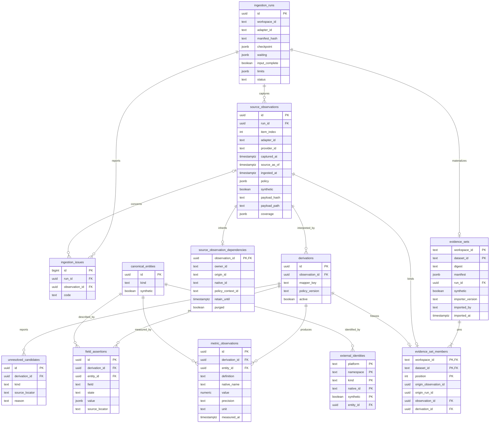

## Identity, membership and time

- Canonical entities currently have only `account` and `content` kinds. Their UUIDs are separate from native string identifiers. Synthetic evidence has separate identities even if its native strings match real records.
- Field assertion states are `observed`, `not_returned`, `unavailable` and `removed`. Zero is a value, not a missing state. Current views may additionally report conflicts or aggregate unknowns.
- A derivation identifies one mapper/policy interpretation of one observation. Exactly one derivation per observation can be active; old derivations remain addressable.
- Dataset identity is `(workspace_id, dataset_id)`. It binds an immutable byte digest, manifest and import run. A member pins both the local observation and a derivation belonging to that observation through a composite foreign key.
- Original source observation/run UUIDs are lineage metadata. They are not foreign keys into the local database. Dataset membership is not inferred from all rows sharing an account or run date.
- `captured_at` is the source capture; `source_as_of` is a separately reported source time when known; `ingested_at` and `imported_at` are local recording times. Metrics and publication assertions retain their own time semantics.
- Policy remains on the source observation and is evaluated at read time. A frozen member can remain addressable while its source content becomes unavailable.

## Implemented shared knowledge model

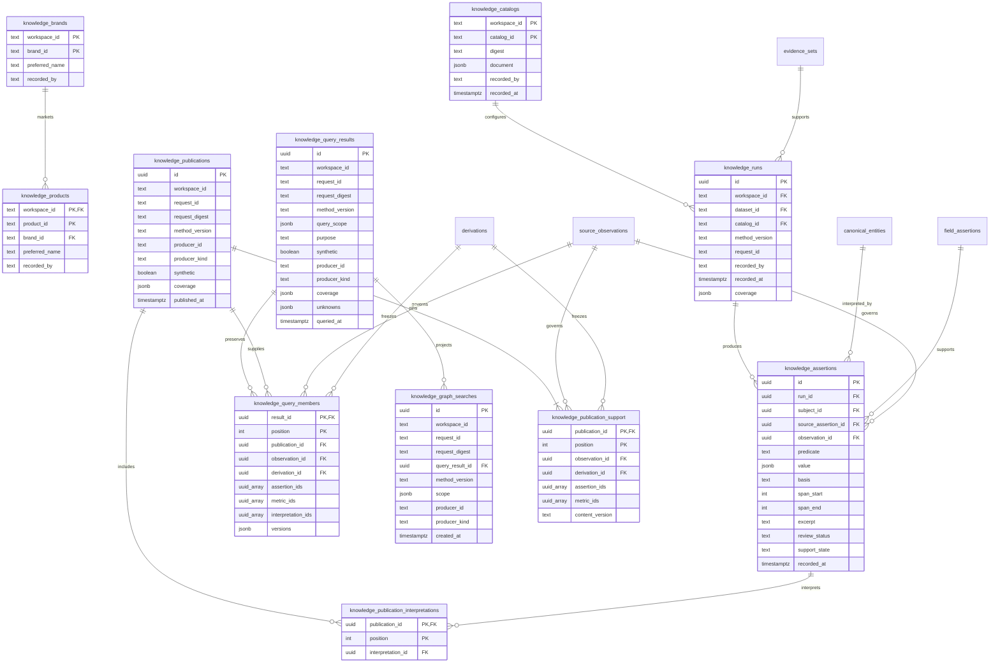

Publication membership pins exact observation/derivation/assertion/metric IDs and existing interpretation IDs, independent of frozen datasets. Assertion/metric arrays are validated against their nominated derivation by the ingestion public interface before the publication transaction commits. Publications retain ordered membership, producer, method and original coverage; current reads apply source policy without copying source text. The workspace/request identity binds the payload and producer. Ingestion run workspace ownership scopes both fresh and imported support; upgrades preserve imported workspace context.

Query results preserve the actual bounded selection rather than only the query text. Their member rows retain exact source/interpretation IDs and source-free method, publication and freshness metadata; values are re-read through the publication owner under current policy. The public owner validates all membership against immutable publications, and source/derivation locks remain held until result commit. Workspace/request identity binds scope, purpose, synthetic mode, method and producer. New publications and withdrawal cannot rewrite prior membership or original coverage; current availability, supersession and age are separate read attributes. Query storage holds no raw source fact or interpretation-value copy.

Catalog documents pin human-configured aliases and product specificity. Business reference IDs persist across catalog revisions. Run identity includes workspace, frozen dataset, catalog, method version and preparation request ID. An explicit new request creates a fresh run under unchanged semantic configuration; retries retain the original run. Each interpretation points to its exact source caption assertion and observation; source policy controls its permitted use and retained copies. Withdrawal purges values/excerpts while retaining support metadata. A separate semantic-review/correction lifecycle remains future work.

## Implemented campaign model

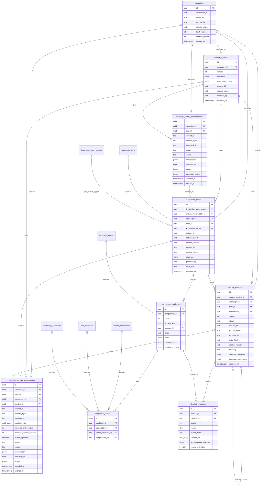

Campaign heads serialize brief/shortlist saves. Revision/request uniqueness separates a new automated recommendation or human decision from retries. `generated` revisions record the actual automation kind/producer, shortlist method, comparison ordering and source-free candidate/selection/exclusion/deferral summary. Selection positions are unique per revision and pin deterministic comparison order, validated model assessment order or an explicit human curation order. Optional `source_shortlist_id` links a newly curated revision to its exact current predecessor from the same campaign/comparison; the owner validates this under the campaign head lock. Curation records human method/order and zero-based positions without changing the predecessor or inventing human confirmation. Historical source links remain null. Existing human draft/confirmed records retain attribution and null method/order/summary/positions; migration does not infer historical order or review. Each new brief atomically saves the human document (including optional original prose) and its exact structured executable profile, with stable criterion IDs, unknown policies and installed criteria/ranking/coverage versions. The profile is one-to-one with its brief revision and contains its exact ID/version; older rows keep a null profile rather than reconstructed history. Its current ranking is explicitly unranked and coverage descriptive. Comparisons pin exact brief/profile and knowledge IDs plus dataset digest and actual member IDs. Candidate keys retain platform/namespace/native string identity; an absent requested account has no canonical account UUID. Explicit support rows bind copied bodies and automated or human reasons to their source-policy dependencies. Purging removes the source-derived copy, not the selected membership or actor history.

`campaign_ranking_assessments` is a durable one-call claim for an exact comparison/brief/producer/request, expected heads and assessed candidate IDs. Its optional shortlist link identifies a validated automatic save; failed/interrupted claims have no saved fallback. Configuration pins actual model/method/schema/ranking profile; logical cost-operation references preserve cost ownership without cross-owner SQL. Candidate `ranking_input` and `ranking_judgment` retain only required governed input components and validated structured judgments; they share `comparison_support` cleanup. No transaction spans provider I/O. Final publication rechecks pinned support and both heads; reported consumption remains accounted for unusable results. See [the ranking contract](campaigns.md#bounded-supported-llm-ranking).

`source_observation_dependencies` is ingestion-owned parent lifecycle metadata for transiently imported copies. `(owner_id, origin_id)` is unique; the parent capture deadline can only shorten and `purged` is permanent. Source policy expiry is the earlier of this deadline and parent policy expiry. Parent writes update the linked observation and canonical field/metric bodies atomically through a public ingestion port; independent workspace-scoped support reads reconcile elapsed expiry. It contains no parent SQL dependency or copied source wording.

## Recent X evidence tables

`monitoring_promotions` pins exact ordered selection/outcomes and human attribution per workspace/request. Its `items` JSON stores only selected IDs, bounded state codes and source/run/publication links. `monitoring_promoted_captures` owns one exact source/publication receipt per original recent capture; it is reused across later requests and cannot grant current usability. All new effects and result receipts commit atomically. See [the promotion contract](monitoring.md#selected-recent-evidence-promotion).


The [recent schema](../src/smi_monitoring/recent/schema.sql) is independent of canonical entities, knowledge runs/publications, campaigns and scheduled keywords. Topic/end uniqueness preserves one logical poll across configuration edits; original configuration/coverage/acquisition remain pinned. Workspace/source-capture uniqueness uses native identity and original source time rather than a fixture label, so a later import cannot restore a purged copy or refresh its first import. Current policy is a mutable versioned overlay; original acquisition records its policy version. Native withdrawal tombstones govern future captures without requiring a foreign key from an observation. Body text/metric copies purge permanently while permitted identities, original times, coverage and audit history remain. See [the contract](monitoring.md#bounded-offline-recent-x-evidence) for finite topic/revision/file/window/observation/retention/timeline limits and policy reconciliation.

The [quantitative alert schema](../src/smi_monitoring/alerts/schema.sql) pins exact original detection/baseline window references and source-free method/configuration/outcome/limitations. Workspace/pair-digest uniqueness prevents duplicate assessments/alerts for the same windows and configuration; workspace/request receipts separately reject changed actor/input reuse. A supported crossing inserts the one-to-one alert and unique local notification identity in the same transaction as assessment/request. No copied caption, metric or numerical comparison is stored here. Current claims reopen original windows through the recent owner's public caller-transaction read under its policy lock, so source denial/expiry/withdrawal hides the whole comparison while preserving history. The alert owner does not read task or recent tables privately; notifications enter the browser inbox through public composition. See [the quantitative contract](monitoring.md#configured-quantitative-volume-assessments) for finite history/request caps.

The [semantic schema](../src/smi_monitoring/semantic/schema.sql) pins one exact window, full prepared input IDs/digest, configured bounded quality-controversy method/schema/model, operator attribution, no-reissue claim status and shared usage/cost operation. Window/method/model configuration uniqueness owns the first assessment; exact request receipts additionally protect actor/input reuse. Successful provisional positions contain source-free IDs, fixed labels and quote offsets only. A supported configured signal inserts its one-to-one semantic alert and unique local notification identity in the same finalization transaction. All actual inputs (including unresolved text) govern dispatch, finalization and reopen through the public recent-policy lock port. Observed loss clears every dependent judgment irreversibly while retaining historical outcome/lineage and unavailable alert identity. Excerpts always resolve from current permitted original source values; no copied factual narrative is stored. Interrupted/uncertain claims cannot automatically redispatch; final metered usage may remain without a usable finding. See [the semantic contract](monitoring.md#bounded-provisional-quality-controversy-assessments).

The [alert-context schema](../src/smi_monitoring/context/schema.sql) retains a logical typed alert reference (the mutually exclusive alert owners remain separate), a foreign key to its exact KB query result, original recent window/capture dependency IDs, method/actor/time and permanent explanation-withheld flag. Workspace/request uniqueness binds alert, actor, method and synthetic scope. Query/context writes share source-owner locks and one transaction; original source and KB facts remain with their owners. No copied source prose or selected numeric explanation is stored. New publications require a new investigation, and dependency loss withholds explanation without replacing original membership. See [the context contract](monitoring.md#existing-kb-alert-investigations).

## Periodic recent X collection tables

The [polling schema](../src/smi_monitoring/polling/schema.sql) owns source-free recurring authority and one-use attempts. It reads no recent or cost SQL privately: public recent transaction ports pin source configuration/permissions and commit the window on the actual ownership session; public accounting owns monetary admission and settlement. The operation reference is an equivalent acquisition identity, independent of KB tasks.

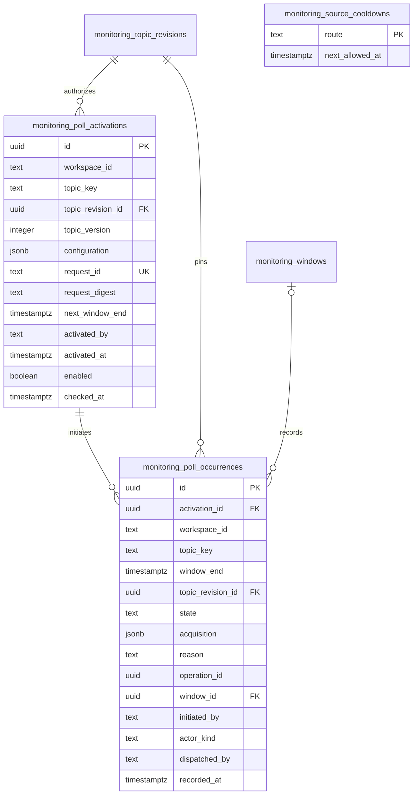

`monitoring_poll_activations` pins exact topic revision and route/version/query-mode/bounds. Workspace/request is unique; a partial unique index permits one enabled activation per workspace/topic. Only next interval, fair-visit time and enabled state change; successor activation preserves prior authority. `monitoring_poll_occurrences` has a unique workspace/topic/end identity across activations, retaining original revision/initiator, source-free bounded acquisition receipt, dispatch state/reason, cost reference and original window. Exact lookup uses the whole retained history rather than the newest-100 presentation. At most 100 activations and 1000 attempts per topic are retained. `monitoring_source_cooldowns` is a single route-keyed lower bound for next admission, shared across workspaces in the installed PostgreSQL schema; admission advances it atomically and source quota responses can only lengthen it. Other installations or external app use are outside this coordination scope. No raw response, caption, pagination token or credential is stored here. The recent observation key additionally pins actual live response identity/native ID while keeping original capture/measurement time unknown; local retrieval time never replaces source time. Existing offline source-time identities are unchanged. See [the collection contract](monitoring.md#gated-periodic-live-recent-x).

## Monitoring and planning tables


Monitoring has no campaign foreign key. Its scope and insight heads preserve independent question/answer history. Finding bodies carry sample-derived text/counts and can be purged while support/attribution metadata remains. Plans pin a brief and relevant shortlist and remain proposed; notes pin historical shortlists and conservatively inherit selected-source dependencies. Plan/note version heads are derived under campaign locks.

## Product domain model

This conceptual model expresses the accepted domain. Evidence, Brand/Product references, human campaign decisions/plans/notes snapshot monitoring, bounded offline recent-X evidence and configured quantitative/provisional quality-controversy alerts/local notifications are implemented. Bounded existing-KB alert context is implemented. Creator associations, semantic shift/richer explanation and actual outcomes/attribution remain accepted future design; operational ranking/automatic shortlist persistence, bounded spending controls and recorded live schedule authority are installed as described by their current contracts; the physical diagrams describe implemented tables, including task execution ownership and independent synthetic accounting below.

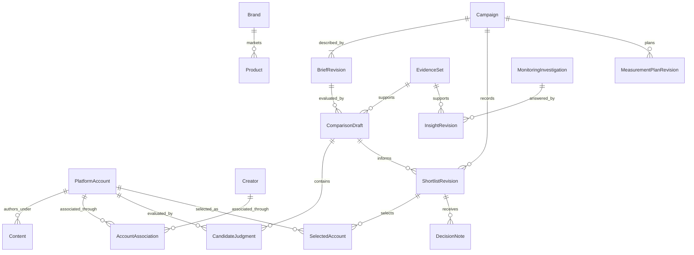

Semantic assertions connect Brand/Product/topic interpretations to exact source assertion/span references, with basis, method and review context. These relationships are owned by shared knowledge, while brief, comparison and shortlist revisions are owned by campaign decisions. The same platform account can participate in many campaign-specific comparisons without becoming globally “discovered” or “selected.”

An optional Creator association carries its own evidence, role and applicable interval. An identity correction does not rewrite historical selected account IDs. Monitoring can produce an insight without any campaign, and a campaign can start without an insight.

## Implemented offline task model

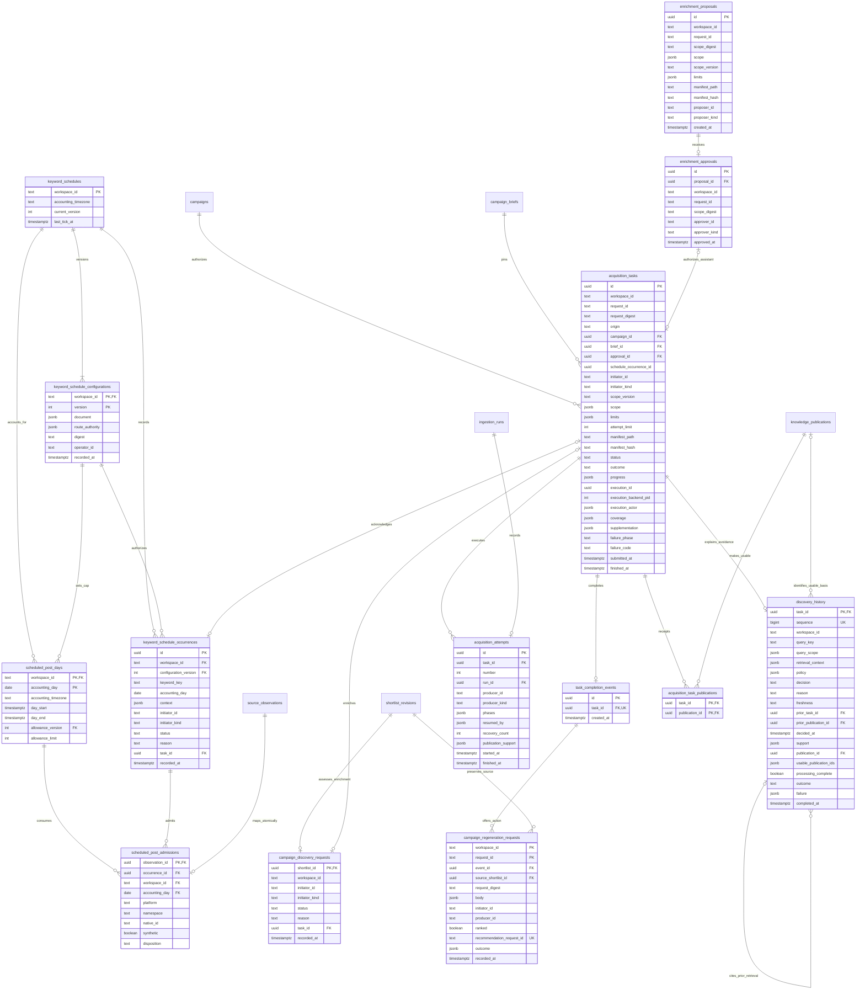

Task admission persists its exact schedule occurrence, campaign/brief or proposal/approval basis, configuration and resource limits before returning. Proposal IDs identify immutable supplied revisions; each pins purpose, refresh/fill/expansion intent, subject/search and input scope, route/configuration and limits. Approval records the configured human, exact digest and request identity; one proposal permits at most one approval and one approval at most one task. The origin-basis constraint requires campaign plus brief for campaign tasks, approval with no campaign/brief for assistant tasks, or a schedule occurrence with no campaign/brief/approval for scheduled tasks. The migration preserves original campaign-only rows. Workspace/request identity binds the full scope and initiator. Only server-established schedule/campaign/assistant origins and the synthetic supplied-reference/query-discovery routes are installed. Discovery uses existing JSONB ownership: proposal/task `scope.discovery` pins query, subject IDs and a half-open publication-time window; `scope.execution_digest` binds the complete selection/route/limits/path. `source_observations.coverage.discovery` retains permitted source-owned query/route/method/selection lineage and bounded corpus counts; task coverage retains sanitized counts/unknown market coverage. The query route reuses existing JSONB scope/coverage ownership; registered schedules add their separate configuration/occurrence tables above. Legacy scopes/hashes remain intact. Actor roles come from trusted server configuration, separately from submitted identity metadata. Attempts retain exact run IDs, initial automation producers, recovery actors, committed phases and the exact prepared source-support selection; task/publication links are task-owned receipts committed atomically with the actual publication, before terminal acknowledgment. Task data copies no source wording. Current-policy publication reads remain responsible for values. Publication support's source-owned `content_version` fingerprint compares capture/mapping/selection identity across new run UUIDs without copying payloads; denied or superseded support does not suppress a newly usable publication. See [the task contract](tasks.md) for installed lifecycle and recovery limits. Task `progress` records the durable phase/observation frontier. A publication committed before task acknowledgment is reopened through the publication owner by request identity only after validating the task receipt, exact prepared support and source-owned attempt/run lineage. Ingestion-run `waiting` stores only a bounded reason/resumability pair; the opaque operation handle remains in its checkpoint. No-observation waits and their request usage commit together. These columns upgrade existing rows without changing their IDs or authority basis.

Task `execution_id`, `execution_backend_pid` and `execution_actor` identify the latest claim. Their metadata grants no ownership by itself: the exact backend's task-specific session lock determines running state. Owner transactions validate the execution ID and nonterminal task under its row lock and use that same connection for all dependent owner mutations. Disconnected sessions become recoverable without creating another attempt. `recovery_count` retains total handoffs; `resumed_by` keeps the most recent 20 actors and `phases` the most recent 100 entries. Migration truncates legacy arrays while preserving the original producer, IDs, exact support and total known recovery count. See [ADR 0005](adr/0005-task-session-effect-ownership.md).

A terminal outcome, attempt completion and one `task_completion_events` row commit on the same fenced task connection. Any task/publication receipt already committed atomically with its publication on that session; it survives a lost terminal acknowledgment. The event has one unique task reference and retains only source-free identity/time. Migration and workspace reconciliation backfill legacy terminal tasks idempotently. Inbox messages read the immutable outcome/coverage from the task and current display/support state from the publication owner, retaining historical counts while withholding unavailable publication links. See [the completion contract](tasks.md#durable-completion-inbox).

## Implemented offline accounting model

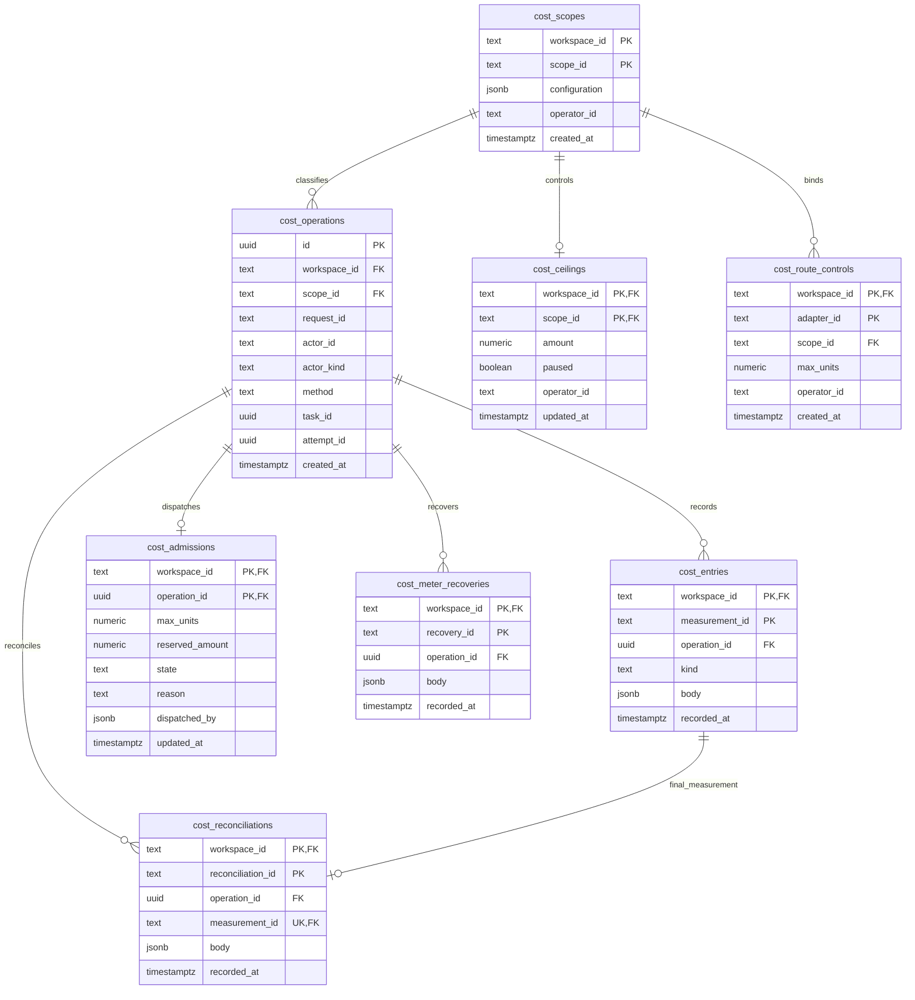

`cost_scopes.configuration` explicitly persists immutable provider/service, metered or forecast-only classification, currency, UTC period, unit/rate version/rate where applicable, and explicit provider-reported measurement basis for opted-in provider scopes; default synthetic documents retain their historical shape. The configuring human and time are retained. Scope identity is workspace-local; changed configuration conflicts. `cost_operations` pins one workspace/request identity to that scope, actual actor/method and either both exact task/attempt IDs or neither. Task references are logical, validated through the public task owner's injected resolver rather than a cross-owner foreign key or direct SQL. This preserves acyclic module dependencies and equivalent model attribution without a task.

`cost_entries` has a workspace-global measurement identity and composite operation/workspace foreign key. `kind` separates usage, forecast, declared outstanding commitment, unknown and meter failure. The body stores canonical exact decimal strings, actual recorder, provenance and measurement time; usage adds unit/rate/version, derived amount and synthetic or provider-reported basis; provider usage retains source-free token/cache/reasoning counts, and final operator reports remain distinct from verified invoices; forecasts require assumptions. Repeated identities reconcile once and changed reuse conflicts without overwriting history. Totals remain per-operation/currency/period and missing categories remain unknown. Declared commitments remain outstanding until an explicit final reconciliation names them; independent usage does not retire them. `cost_ceilings` holds current trusted amount/pause control for that exact immutable currency/period scope. `cost_route_controls` permanently binds either installed synthetic offline route or the single live keyword route to one scope and its one-attempt declared bound; live source scopes require explicit provider basis and retain admissions without final usage. `cost_admissions` has one row per operation and a bounded reservation plus dispatched/settled/refused state, reason and actual dispatcher. The scope row serializes ledger writes, decisions and settlement across connections; no transaction spans external I/O. Automatic adapter settlement appends usage and replaces only its own dispatched reservation; final reconciliation can also resolve explicitly named declarations and uncertainty. Session-loss uncertainty retains liabilities and pauses replay. `cost_reconciliations` binds a workspace-global event identity to one final usage entry and exact named admission/declaration/uncertainty targets in its immutable body, with operator, final outcome, report evidence/provenance and reconciliation time. The final measurement is unique per workspace across reconciliation events; explicit targets are validated under the scope lock. An equal existing measurement retains its original recorder. Reconciliation changes active totals rather than updating/deleting the entry audit. `cost_meter_recoveries` retains workspace-global health-check identity, exact already-reconciled failure IDs, operator, evidence/provenance and recovery time; no amount or dispatch permission follows from it. Unrecovered meter failure still blocks the scope after final usage. Both new tables use composite workspace/operation references; accounting retains no task dependency. See [the accounting contract](costs.md#final-synthetic-reconciliation-and-meter-recovery).

## Operational relationships and persistence invariants

This conceptual view summarizes the [operational requirements](functional-requirements.md); its names are domain roles rather than additional SQL tables. Tasks, publications, automatic deterministic/model shortlists, coverage, schedules, monitoring/alerts, selected promotion and configured spending controls have the physical records shown elsewhere in this document. Broader semantic research, verified commercial billing and actual measurement remain future capabilities in the [roadmap](roadmap.md).

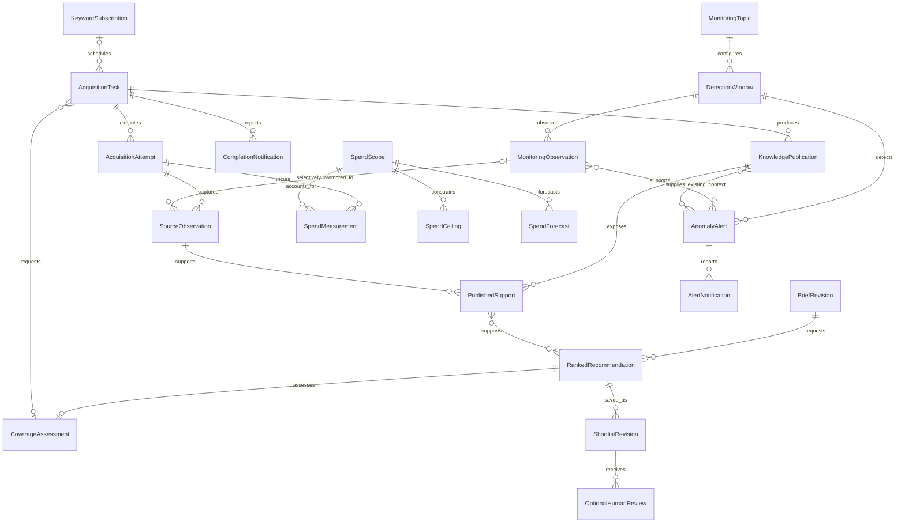

Task origin distinguishes scheduled discovery, automatic campaign coverage and approved assistant enrichment. Assistant tasks require their exact scope-bound approval; the optional approval relationship does not authorize another origin to masquerade as an approved assistant task. Attempts and publications preserve retries, actual membership, failures and the distinction between retrieved versus usable knowledge.

A ranked recommendation can be saved automatically as a shortlist revision with its producer/method, order, rationale, support and gaps. Optional human review is separate from persistence; no human record is invented for an automatic save. Stable account identity and an ingested permitted supporting observation admit incomplete profiles to ranking. The installed deterministic `recommend` and bounded supported `recommend_ranked` operations save ordered `generated` revisions automatically; richer semantic assessment and human ranking usefulness remain unvalidated/future work. See the [automatic persistence contract](campaigns.md#automatic-deterministic-shortlist-persistence).

Monitoring observations and alert support have their own bounded lifecycle and source policy. Selected promotion does not require every X post to become a full KB entity. Detection windows retain baseline/method/time/coverage context; an alert investigation can read existing publications without initiating external acquisition.

Spend measurements distinguish actual derived charges from forecasts, with currency, unit/rate versions, accounting periods, task/attempt attribution and meter provenance. Configured metered scopes have ceilings and coordinated in-flight commitments/reconciliation; unmeterable portions retain forecasts. These future commercial relationships do not extend the installed bounded synthetic enforcement to unbounded/delayed provider charges or prescribe particular ceiling amounts.

Campaign criteria attempts pin exact immutable brief input and retain sanitized outcome/configuration/usage plus only a validated generated profile. `operation_id` is an accounting-owner logical reference, without a cross-owner SQL foreign key. Comparison drafts optionally pin one succeeded interpretation; null retains the original human structured-profile path. Campaign and cost SQL stay with their owners. See [the interpretation contract](campaigns.md#bounded-natural-language-interpretation).

Provider cost provenance shares the same physical accounting tables. Explicit provider-basis final reconciliation and meter recovery preserve named targets, immutable original rates, overage visibility and one-use dispatch without relabelling synthetic evidence. Accounting reports its generic declared bounded-provider contract premise; the interpretation configuration owns exact verified snapshot/input/output provenance.

Current-KB comparison drafts pin `knowledge_query_result_id`; their legacy `knowledge_run_id`, `dataset_id` and `dataset_digest` are null. A database check requires exactly one of these source modes. Frozen drafts keep their original run/dataset fields and a null query link. Draft coverage includes the immutable actual execution profile. `comparison_support.source_assertion_id` and `decision_note_support.source_assertion_id` are nullable for metric-only account support; the observation and linked query manifest retain exact metric/derivation identities.

`shortlist_revisions.coverage_assessment` pins the sufficiency policy, clock, exact comparison/candidate input references and historical scalar results. Inputs remain owned by the governed comparison; current support health withholds coverage inputs/results. `campaign_discovery_requests` owns a unique immutable disposition per shortlist; its optional unique task commits atomically with submitted admission. Source/configuration refusal creates no task and never removes the saved recommendation. Task scope JSON pins the human brief, shortlist/coverage clock/profile, catalog digest, explicit derivation/query/subject/window and executable configuration. See [automatic coverage](campaigns.md#automatic-coverage-and-discovery).


`campaign_regeneration_requests` retains an explicit human action's exact source-free body/digest, actual initiator/automation producer, exact completion/original-shortlist references, saved method choice and unique server-owned nested recommendation identity. Claim commit precedes assessment; no lock/transaction spans model I/O. Nullable `outcome` holds only status/IDs/reason/cost link, never candidate/source bodies. Completed retries reopen the same result before current-context checks; unfinished receipts reopen the existing campaign-owned assessment/save. The saved successor is linked through its outcome ID and retains campaign-owned immutable support/order/producer and head fencing. Notifications remain identity/task/time only. See [regeneration](campaigns.md#explicit-regeneration-after-discovery).


The schedule owner retains one fixed accounting timezone per workspace and immutable configuration JSON/digests/operator times. Each occurrence has a composite configuration foreign key and unique workspace/local-date/keyword key, regardless of configuration edits; its exact UTC day bounds, cadence, publication window and allowance version remain in `context`. Its optional task FK binds the submitted task atomically. Tasks retain the unique logical `schedule_occurrence_id` plus immutable `scope.schedule`; public admission validates it through the schedule owner rather than foreign-table SQL. Origin constraints distinguish schedule authority from exact campaign and human approval bases. Refused dispositions persist without a task; `pending` is transaction-local. The schedule-owned `scheduled_post_days` row keys shared workspace/day consumption and effective configuration cap. `scheduled_post_admissions` records one disposition per observation, with a partial unique index preventing a second successful new admission of the same day/platform/namespace/native/synthetic identity. The canonical owner supplies locked identity knowledge through its public admission callback; only schedule SQL lives here. Admission and canonical effects share the fenced worker transaction, while skipped observations retain no canonical derivation. Cap edits preserve used history and historical day bounds; known refresh/dedup dispositions do not debit new-post usage. Legacy day metadata is bootstrapped from the latest configuration before its recorded day end; no pre-enforcement debit is invented. Optional immutable `route_authority` pins exact explicitly activated live route/version/manifest/limits/policy; null preserves offline authority independently of process configuration. The configuration digest and occurrence context retain that binding; no new scheduling or allowance identity is introduced. See [the schedule contract](tasks.md#registered-offline-keyword-schedule).

`discovery_history` is owned by `smi_tasks.discovery`, with one decision per task and monotonic sequence for prior retrieval ordering independently of capture/clock dates. Exact query/window, input/provider/format, manifest/route/bounds and mapper/canonical-processing context are immutable decision inputs. JSON support stores only exact source IDs; source captures, namespace/native identities and metric definitions stay with ingestion and are read under current policy. Prior/usable publication links explain usable evidence separately from this task's optional actual publication receipt. `processing_complete` requires complete eligible support for every retrieved observation, successful no-failure completion and no remainder; daily exclusions and partial work cannot certify a whole query. Decisions commit before I/O and completion joins the task/event transaction. Capture-based freshness never uses `completed_at` or publication/import times; old task scopes/results remain unchanged. See [the avoidance contract](tasks.md#capture-based-discovery-avoidance).


### Live keyword persistence extensions

The physical ERD above is unchanged: no new table/column is introduced. `acquisition_tasks.scope` can pin the live keyword adapter/provider/schema, exact approved query and independent bounds; `discovery_history.retrieval_context` retains the actual live mapper key and explicit unknown response hash rather than a fictitious offline corpus identity. `ingestion_runs.checkpoint` owns opaque snapshot ID, phase, monotonic step and UTC not-before; source-free waiting metadata exposes resumability and byte/request totals, never credentials or opaque handles. Existing `bytes_used` now includes no-observation HTTP response bytes atomically with those checkpoints. Original source capture/measurement dates remain null when absent; separate source coverage records retrieval time, returned/eligible counts and unavailable field names.

`cost_route_controls` identifies the configured live source scope and one-unit declared attempt bound. `cost_admissions.state='dispatched'` remains an outstanding conservative liability after source responses; final usage is absent until explicit provider-basis final reconciliation. `source_observations.coverage` can carry a terminal failed/canceled provider-status observation with zero returned records; it cannot create canonical facts or a knowledge publication. Exact task-owned support/receipt/history references retain their existing physical relationships. See [the live task interface](tasks.md#gated-live-on-demand-keyword-tasks).

### Missing-field decision persistence

`acquisition_tasks.supplementation` is a nullable task-owned JSON decision/result, added idempotently for existing databases. It retains the pinned policy, source-free checks/stopping reason, selected primary support references, exact optional supplementary support IDs and attributable accounting operation. Source wording, nickname values, credentials and provider snapshot handles remain outside it. `scope.profile_supplement` pins the exact approved reference/native ID; `scope.supplementation_policy` pins trusted field/value configuration and participates in the execution digest and recorded schedule route authority. No extra task, attempt, ingestion run or publication receipt is created. The original ingestion frontier and cumulative bounds cover both routes; canonical observations/derivations remain separate with their own namespaces and unknown capture dates. Current task reads reopen supplementary support health through ingestion rather than caching permission. See [the contract](tasks.md#one-missing-profile-nickname).

## Bounded knowledge answers

The [assistant schema](../src/smi_assistant/schema.sql) owns one durable claim per workspace/request. The question is human input; source-dependent output stores only exact UUID selections and fixed limitation codes. Full actual source membership, versions, coverage and policy-aware values remain in the query/knowledge/evidence owners.

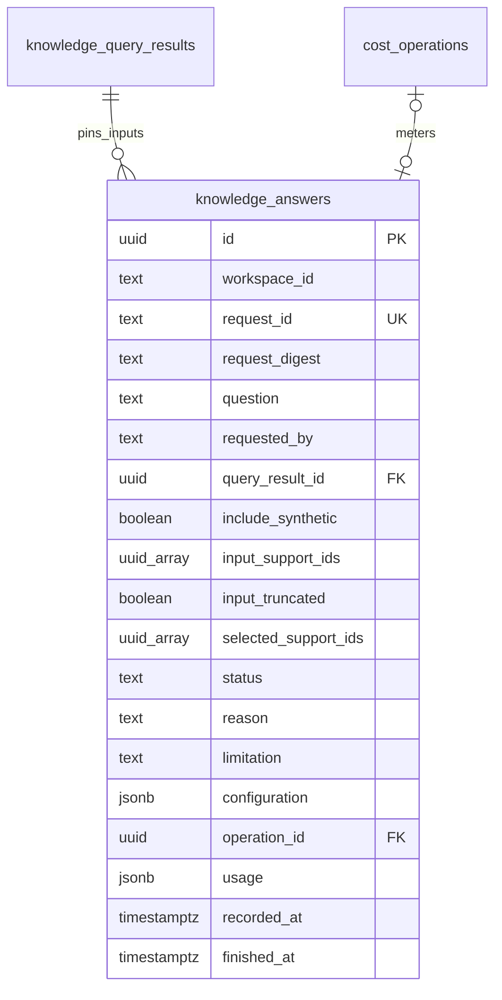

`input_support_ids` records every actual model-input fact, including unselected support; `query_result_id` retains the full original query manifest. The immutable configuration pins method/schema/model/measurement and bounds. Claims precede I/O and exact retries never redispatch. Shared cost admission checks exact current support under source locks through dispatch commit, then finalization checks again. Current process/display permission or support loss withholds the entire derived selection without rewriting historical model/input/accounting context. Values are read afresh, so the answer table has no source text cache to purge. See [the answer interface](knowledge.md#bounded-free-form-knowledge-answers).


## Assistant enrichment linkage

The [task-side assistant schema](../src/smi_tasks/assistant/schema.sql) links a human's saved answer to an exact proposal through public owners. Existing proposal, approval, task, publication and completion relationships remain unchanged.

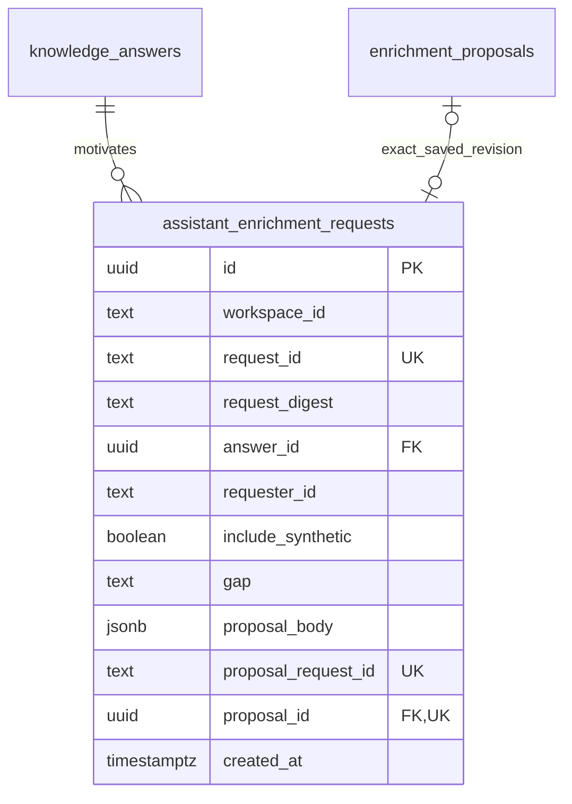

One workspace/request pins the original answer/requester, fixed gap code, exact human-supplied intent/query/subject/window body and synthetic visibility in its digest. The body contains a source-free template purpose, not copied evidence or model answer prose. A fresh nested request commits before proposal save; nullable `proposal_id` allows recovery after either save boundary. The parent owner resolves that exact proposer-bound request without rebinding saved route files. Approval and submission retain their original request identities and task bounds. No completion copy or source-value/permission cache is added; the application composes exact task/event reads and current-policy answer/publication support. See [the public contract](tasks.md#assistant-knowledge-gap-enrichment).

The implemented `knowledge_graph_searches` table stores human filter input, requester and an exact query-result ID only. Node labels, relationship values and evidence are transient public-reader projections under current policy. Multi-hop selection/filter controls remain in navigation URLs and add no persistence; no second raw-fact or edge store is introduced. See [the graph contract](knowledge.md#governed-entity-graph).

## Task pipeline projection

`TaskLineage` adds no table or physical relationship. It composes the existing `acquisition_tasks` → `acquisition_attempts` → `ingestion_runs` → `source_observations` → `derivations` identities, exact prepared support and `acquisition_task_publications` receipt → `knowledge_publications`/`knowledge_publication_support`. `cost_operations` retains its existing logical task/attempt references, validated by the task owner's public resolver at creation rather than a cross-owner accounting import or SQL foreign key. Current permissions/derivation health and accounting state are independently reopened; no copied source text or synthetic successful pipeline row is persisted. See [the task lineage contract](tasks.md#read-only-task-pipeline-lineage) for finite history limits and independent committed-frontier semantics.

## Operational quality review records

The [review schema](../src/smi_review/quality/schema.sql) adds two review-owned tables. Result IDs are logical references resolved by public workspace-scoped owners, without cross-owner SQL.

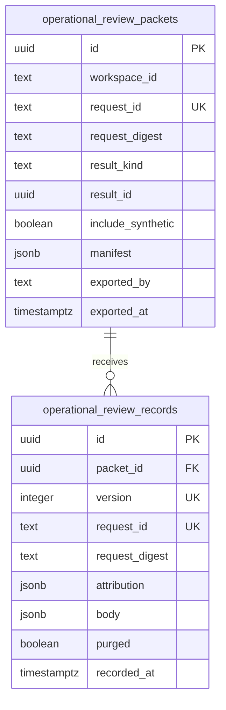

A packet's workspace/request digest pins the result kind/ID, exporter and explicit synthetic visibility. Its immutable manifest contains source-free reviewed membership, complete original input dependencies and method/model/result lineage. Exported text is a fresh public-reader projection and is never stored in this manifest. Record request identities and serial versions are packet-local; the packet lock assigns up to 50 revisions, so latest review does not depend on wall-clock ordering. Workspaces admit at most 5,000 packets, while exact retries remain recoverable at either limit; explicit reviewer/translator/method/time and reviewed IDs remain in attribution. Annotation bodies contain translations, labels, ambiguity, material errors/corrections and optional human usefulness/task measurements. Current-policy reconciliation hides bodies on any input loss and permanently nulls every retained packet annotation on retention loss, leaving `purged` tombstones. These system export/record times do not substitute for actual human review/task times. See [the review contract](evaluation.md#operational-result-review-packets).

## Reading the records

| Kind | Example | What it means |
| --- | --- | --- |
| Observed source information | A captured caption contains `ヒーロークッション`; the post displayed 1,875 views | The source reported this information at a particular time. It is not independent verification of the author's claims. |
| Derived interpretation | A configured alias maps that caption span to the Hero Cushion product family | A named method interpreted source text. Its evidence, configuration and provisional status remain visible. |
| Human input or decision | A marketer selects the account for further investigation and acknowledges unknown audience geography | An attributable human judgment. It does not become an observed fact or a measured outcome. |

Keeping these separate is the reason for many of the tables. A caption, an interpretation of that caption and a decision based on that interpretation need different owners and histories.

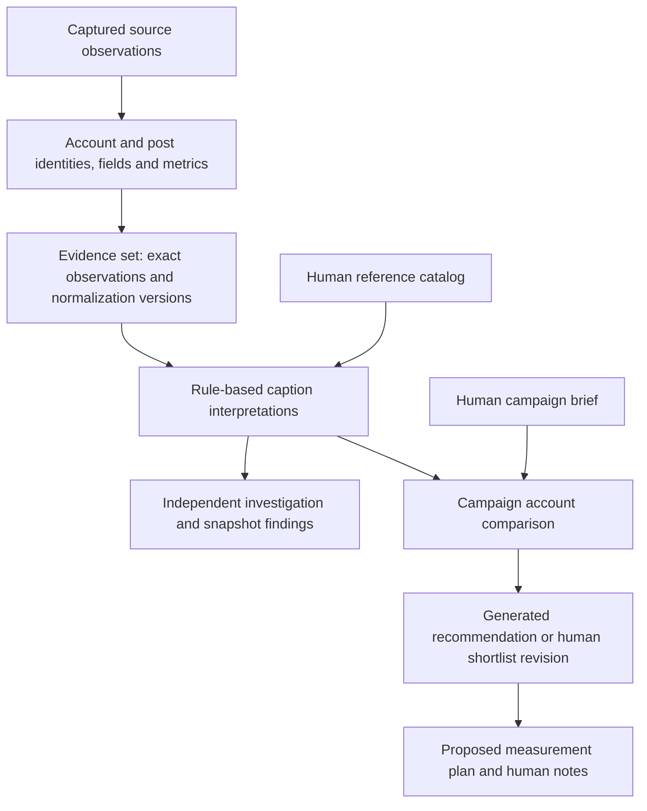

Investigations and campaigns are separate uses of shared evidence. An investigation does not automatically start a campaign, and a campaign does not require a preceding investigation.

### Follow one real sample post

The first record in [the frozen sample](../examples/curated/jp-kbeauty-tiktok-2026-10-05/observations.json) provides these values:

| Item | Captured sample value |
| --- | --- |
| TikTok handle | `guga9791` |
| Native account ID | `6819904612390634498` |
| Native post ID | `7549049550934166804` |
| Published | 2025-09-12 04:07:52 UTC |
| Captured | 2026-10-05 04:15:22 UTC |
| Caption fragments | `APRILSKINのヒーロークッション（21）`, `#pr` |
| Sampled metrics | 1,875 views, 27 likes, 1 comment, 0 shares |

These are historical sample values, not current TikTok counts. Zero shares is an observed zero. An unknown fee would remain unknown, not zero.

For the sample and table dictionary below, `O1`, `D1`, `P1`, `A1` and similar labels are explanatory shortcuts for database UUIDs, not literal stored IDs.

1. **Capture:** `source_observations` stores O1's acquisition metadata, capture time, permission policy and retained-payload reference. Permitted payload bytes live in the evidence directory. For this offline import, the payload is the exported JSON record, not original TikTok HTML.
2. **Identity:** `canonical_entities` contains account A1 and post P1. `external_identities` connects them to TikTok's native string IDs. A mutable handle is recorded separately; it does not define account identity.
3. **Normalization:** `derivations` records that mapper `snapshot-json:v1`, using canonical policy `canonical-v1`, interpreted O1 as D1. `field_assertions` records the caption, URL, publication time and author account for P1, plus the observed handle for A1. `metric_observations` contains four count records; the views record uses definition `tiktok.web.views.v1` and value `1875`.
4. **Fixed input:** `evidence_set_members` pins O1 and D1 inside the selected dataset. Original export observation/run IDs are retained as lineage alongside the new local IDs.
5. **Interpretation:** When preparation is requested, the catalog maps `ヒーロークッション` to product `aprilskin-hero-cushion`. The current rules identify the first occurrence at caption character range `[66, 75)`, meaning start inclusive and end exclusive. They record a product-family mention with stance `not_assessed`. A second occurrence in a hashtag is another supported span. The caption also contains a literal PR marker. This method does not turn `(21)` into a verified shade interpretation.
6. **Campaign use:** With the [example brief](../examples/campaigns/hero-cushion-brief.json), the account has literal support for product mention and kana-script criteria. Japan audience geography remains unknown. Because the brief supplies this account and the dataset also contains it, its comparison origin is `both`.
7. **Human decision:** A marketer could write “Investigate this account because its sampled post mentions Hero Cushion,” cite support, acknowledge unknowns and confirm an exploratory shortlist. That wording is an illustrative decision, not a decision already saved by the sample import.
8. **Planning:** A subsequent plan could propose checking matched orders once seller data is available. A note could say to defer commercial commitment pending audience and fee information. Neither creates sales results.

Importing the sample loads source evidence and curation annotations. It does not automatically prepare knowledge, create a campaign or save a decision. Curation annotations are separately labeled development annotations; the extraction rules read source captions and the registered catalog.

### What an evidence set does

An **evidence set is a named, fixed collection of inputs for an analysis**. Think of it as an analysis's input manifest: “Use precisely these captured observations, with these normalization versions.”

For the repository sample:

```text
evidence_sets
  workspace_id: local
  dataset_id: jp-kbeauty-tiktok-public-video-sample-2026-10-05
  digest: fingerprint of the exact exported file bytes
  manifest: format, namespace, expected membership and import information

evidence_set_members
  member 0 -> observation O1 + derivation D1 + original source IDs
  member 1 -> observation O2 + derivation D2 + original source IDs
  ...19 selected observations from 17 accounts in total
```

The set row describes the collection; member rows specify its exact contents. They reference the imported evidence rather than storing another complete caption copy per campaign. The current importer creates those local observations and member bindings together.

Without fixed membership, a result that queried “all posts currently in the database” could change whenever new posts arrived. Without a pinned derivation, a parser update could silently change what an old analysis meant. The set prevents both substitutions. A changed export requires an explicit new dataset ID; the importer rejects changed bytes under the existing ID.

One evidence set can support many knowledge runs, investigations and campaign comparisons. Each result records which subset its scope actually used. An ingestion run answers **which acquisition/import job ran**; an evidence set answers **which exact inputs this analysis may use**. A shortlist answers **which accounts were recommended or selected for the campaign**; the current pilot records automatic deterministic/model-ordered recommendations and human selections. They are different objects.

Fixed membership does not freeze permission to display evidence. Current source permissions can make a member unavailable; downstream explanations must respect that change. Corrections can also mark pinned support as requiring review rather than silently replacing it. See the [evidence-set contract](evidence-sets.md) and [policy ADR](adr/0002-pinned-support-current-policy.md).


## Versions and timestamps


- A **capture time** says when the source was observed. A **publication time** says when the post was published. An **import time** says when the local application recorded the export. A **knowledge publication time** says when an exact ingested selection became available; it does not refresh a source capture. Importing an old post today does not make it a new post or a fresh measurement.
- A **derivation version** identifies how a source observation was normalized. A **knowledge run** identifies how its caption was interpreted using a catalog/method. A **brief revision** identifies which human question was asked. A **shortlist revision** identifies a saved set of recommendations or selections and its producer; the producer is explicitly automation or human. Legacy human ordering remains unrecorded. These are different histories.
- A **digest** is a fingerprint used to detect changed bytes or changed request/configuration content. It is not a relevance score.
- A **request ID** lets a retried save/preparation return its existing result instead of accidentally creating another one. An **expected version** makes an outdated form fail visibly rather than overwrite newer work.
- Historical references are stable; permission and support health remain current. Versioning does not grant permanent access to source wording.


## Table dictionary


Most implemented tables hold supporting records for evidence, versions and explanations rather than separate user workflows. JSONB columns hold structured documents such as a brief or candidate judgment; UUID references connect those documents to their exact sources.

The examples below describe row shapes. Campaign and investigation examples are illustrative; loading the sample alone does not create them. Full columns and relationships are in the [physical ERD](data-model.md) and linked SQL.

### Acquisition, normalization and fixed inputs — 12 tables

Owner: [`smi_ingestion`](../src/smi_ingestion/schema.sql), including [`evidence_sets`](../src/smi_ingestion/evidence_sets/__init__.py).

| Table | What one row stores | Example |
| --- | --- | --- |
| `ingestion_runs` | One workspace-owned acquisition/import job: adapter, input manifest, limits, resource use, checkpoint, optional provider wait reason/resumability and status. | The offline job that imports all 19 sample observations. Its local run differs from the export's original collection runs. |
| `source_observation_dependencies` | A promoted source observation's one-way parent identity, native ID, policy context, earliest retain deadline and permanent purge state. | Independent KB reads enforce original monitoring withdrawal and expiry without opening a promotion page. |
| `source_observations` | One captured source response or imported record, with acquisition lineage, times, policy, payload hash/path and coverage. | O1: the captured `guga9791` post record. |
| `ingestion_issues` | A reported problem associated with a run and optionally an observation. | An adapter failure code and sanitized message. |
| `canonical_entities` | A stable internal UUID for an account or a content item. It does not hold a complete mutable profile. | A1 is an account; P1 is its post. There is no implemented Creator/person entity here. |
| `external_identities` | A native identity tuple mapped to an internal entity: platform, namespace, kind, native string ID and synthetic flag. | `tiktok / web:public / account / 6819904612390634498 / false` maps to A1. |
| `derivations` | One mapper/policy version's normalization of one observation, with current/history status. | D1 normalizes O1 using `snapshot-json:v1`. This is source normalization, not the product-mention extraction run. |
| `field_assertions` | One field value or explicit missing/removal state, tied to an entity, derivation and source location. | P1's caption from `$.caption`; A1's handle from `$.author.handle`. An assertion means “the source reported this.” |
| `metric_observations` | One sourced metric value, definition, native name, precision, unit and time. | P1's `tiktok.web.views.v1 = 1875` at capture. It is not a sales result. |
| `unresolved_candidates` | A normalization item that could not be established, including the reason and source location. | A source account reference without enough native identity information. These are not campaign candidate accounts. |
| `evidence_sets` | One named, immutable dataset registration: manifest, byte digest, local import run and actor/time. | The 19-post sample dataset. |
| `evidence_set_members` | One ordered dataset member, pinning its local observation and derivation plus original source IDs. | Member 0 binds O1/D1 to the original exported observation reference. |

### Task admission, schedules and outcomes — 14 tables

Owner: [`smi_tasks`](../src/smi_tasks/schema.sql); [public task contract](tasks.md).

| Table | What one row stores | Example |
| --- | --- | --- |
| `enrichment_proposals` | An immutable supplied revision with purpose, refresh/fill/expansion intent, subject/search and input scope (including explicit discovery publication window), exact route/limits digest and proposer. | Save a proposal without submitting acquisition. |
| `enrichment_approvals` | One configured human's exact workspace/revision/digest approval and original retry identity. | Approval A authorizes at most one task for proposal P. |
| `campaign_regeneration_requests` | An explicit human regeneration request, actual producer, exact completion/original-shortlist/body, server-owned assessment retry identity and source-free outcome links. | Reopen one saved successor after restart; a discovery completion alone leaves the old result intact. |
| `campaign_discovery_requests` | One immutable automatic enrichment disposition per saved shortlist, attributed initiator, source/configuration refusal or exact submitted task. | A thin/empty supported result stays available while its associated task is queued, running or cost waiting. |
| `keyword_schedules` | Stable workspace accounting timezone, current configuration head and last observed tick. | Separate from monitoring; midnight local days retain exact UTC bounds. |
| `keyword_schedule_configurations` | Immutable keyword/settings versions, digest and actual operator/time. | Up to ten current registered keywords; edits preserve earlier authority. |
| `scheduled_post_days` | Fixed workspace/day bounds, effective cap/version and shared admission identity. | Cap edits preserve used posts; historical days retain their applicable configuration. |
| `scheduled_post_admissions` | Per-observation new/refresh/dedup/excluded/ineligible disposition under a scheduled occurrence. | Successful new identities and canonical effects commit together; raw request/record/cost use stays independent. |
| `keyword_schedule_occurrences` | One workspace/day/keyword-key disposition, exact configuration/day/window/allowance context and optional task. | Refusals and task history survive restart/edits; missed days are not replayed. |
| `discovery_history` | Exact discovery query/input/processing context, policy, prior basis, capture-based avoidance decision and referenced support, usable publications and failure/outcome. | A fresh complete repeat can make zero source calls without a new publication; old/unknown capture time, quota exclusions and failures remain eligible. Current policy governs source identity/time detail. |
| `acquisition_tasks` | A workspace/request-bound configured schedule, campaign or approved assistant task, exact brief/approval/configuration scope, initiator, hard limits, latest execution ID/session owner, durable commit/wait progress, outcome and sanitized coverage/failure. | Accepted now, executed separately through configured local supplied-reference or keyword-discovery capability. Its active PostgreSQL ownership lock distinguishes running from recoverable work. |
| `acquisition_attempts` | One attributable worker attempt, exact ingestion run, total recovery count, most recent 20 recovery actors/100 phases, prepared support IDs and times. | Worker B resumes Worker A’s same run/support after a disconnected session; a late Worker A cannot commit local effects. A valid subset can publish with the failed remainder visible. |
| `acquisition_task_publications` | A task-owned receipt committed atomically with its exact knowledge publication. | Task T produced publication P; recovery checks prepared support/run lineage. Public request text and fetch-only input create no receipt. |
| `task_completion_events` | One source-free event identity/task/time, committed with a terminal outcome; one unique event per task. | Reopen usable, partial, no-update or failure in **Inbox** after restart, with historical coverage and current permitted publication links. |

### Cost accounting — 8 tables

Owner: [`smi_costs`](../src/smi_costs/schema.sql); [public accounting contract](costs.md).

| Table | What one row stores | Example |
| --- | --- | --- |
| `cost_scopes` | Immutable workspace/scope configuration: provider/service, classification, currency/period, unit/rate/version, synthetic default or explicit provider-reported basis, configuring human/time. | An operator's simulated unit rate for one accounting month; no invented commercial price. |
| `cost_operations` | Stable workspace/request identity with actual actor/method, configured scope and optional validated exact task/attempt pair. | A synthetic model operation with no task, or a measurement attributed to the original worker attempt. |
| `cost_entries` | Workspace-unique measurement identity, operation, distinct usage/forecast/declared-commitment/unknown/meter-failure kind, exact decimal inputs and provenance/time/recorder; provider usage adds source-free token/cache/reasoning counts. | Three synthetic units at 0.125 derive 0.375; forecasts and unresolved declared commitments remain separate. |
| `cost_ceilings` | Current trusted scope amount, pause state, configuring human/time; scope fixes currency/period. | 0.125 synthetic allowance admits one bounded request costing 0.125. |
| `cost_route_controls` | Immutable workspace route binding, exact cost scope and declared dispatch bound (one fixture/Bright Data unit or ten X-post units). | Every campaign/approved-assistant worker reopens the configured guard after restart. |
| `cost_admissions` | One bounded dispatch per operation, reserved amount, dispatched/settled/refused state, reason and actual dispatcher. | A lost response retains its commitment; final reconciliation keeps the operation settled without permitting another call. |
| `cost_reconciliations` | Immutable workspace/event identity, exact operation/final measurement and named liability targets, final outcome, operator, report evidence/provenance and time. | A final 0.125 report replaces a named 0.25 reservation; its bill cannot release another portion. |
| `cost_meter_recoveries` | Immutable workspace/health-check identity, exact operation and already-reconciled failure IDs, operator, health evidence/provenance and time. | Late usage settles accounting while the scope remains blocked until an explicit meter-health recovery. |

### Shared business vocabulary, interpretations, publication, queries and graph — 11 tables

Owner: [`smi_knowledge`](../src/smi_knowledge/schema.sql) and its [graph manifest](../src/smi_knowledge/graph/schema.sql).

| Table | What one row stores | Example |
| --- | --- | --- |
| `knowledge_brands` | A workspace's stable human-supplied brand reference and preferred name. | `aprilskin` → APRILSKIN. |
| `knowledge_products` | A human-supplied product reference, brand association and preferred name. | `aprilskin-hero-cushion`, associated with `aprilskin`. This is not automatically a purchasable SKU. |
| `knowledge_catalogs` | An immutable configuration document containing brand/product/topic references and aliases, with its digest and recorder. | `beauty-caption-lexicon-v1` maps `ヒーロークッション` to the Hero Cushion family. Topics are in this document; no separate topic table exists. |
| `knowledge_runs` | One preparation against an exact dataset, catalog, method and request identity, including coverage and recorder/time. | K1 ran `caption-literal-rules-v1` over the sample using the beauty catalog. |
| `knowledge_assertions` | One derived typed interpretation with a source caption assertion, exact character span, value, provisional review status and support state. | “Span `[66,75)` is a family-level Hero Cushion mention,” supported by P1's caption. |
| `knowledge_publications` | One committed bounded selection, with workspace/request identity, method, actual producer, coverage and publication time. | A source-only update can publish an ingested account while profile attributes remain unknown. |
| `knowledge_publication_support` | One ordered exact observation/derivation and its selected assertion/metric IDs. | Publication member 0 pins O1/D1 without extending its frozen dataset. |
| `knowledge_publication_interpretations` | One selected existing interpretation ID in publication order. | A provisional caption mention is usable with its exact original source dependency. |
| `knowledge_graph_searches` | One source-free entity-search manifest: exact query result, human filters, requester and selection method/time. | A saved graph search with transient bounded traversal reopens exact support under current process/display/retention without caching labels or edges. |
| `knowledge_query_results` | One bounded current query with workspace/request identity, purpose, filters, producer, original coverage and time. | Q1 searches recent committed publications and preserves an explicit incomplete-market limit. |
| `knowledge_query_members` | One ordered actual source/interpretation selection plus method/publication/freshness versions, with no source-value copy. | Q1 member 0 pins O1/D1 and specific published assertion/interpretation IDs; withdrawal later redacts its values. |

These tables are shared vocabulary and supported interpretations. They are not a vector database, an LLM's memory or an agent's internal reasoning log.

### Campaign questions, comparisons and decisions — 9 tables

Owner: [`smi_campaigns`](../src/smi_campaigns/schema.sql).

| Table | What one row stores | Example |
| --- | --- | --- |
| `campaigns` | A human-owned campaign workspace with current brief/shortlist version counters. | C1: an investigation of potential Hero Cushion accounts for Japan. |
| `campaign_briefs` | One immutable human question, optional original prose and structured executable-profile snapshot pinned to this exact brief/version, with author/time. Older rows retain a null profile. | Brief v1: stable product/script/audience criteria and unknown policies, `structured-caption-criteria-v1`, unranked ordering and descriptive fixed-observation coverage. |
| `campaign_ranking_assessments` | One exact-brief/current-KB assessment claim, actual automation, bounded model/method/schema/ranking profile, usage/cost linkage, status and optional saved shortlist. | Completed retries reopen; interrupted attempts never redispatch. Required unknowns can defer all accounts without a model call. |
| `campaign_criteria_interpretations` | One exact-brief original-prose interpretation attempt, requesting human, generated provenance, sanitized outcome, explicit model/measurement-basis/weight/bounds, usage and logical cost-operation reference. Failed/interrupted attempts cannot be silently retried or assessed. | Responses generated additions preserve human constraints; concrete provider HTTP is opt-in, and all verification is simulated with no live receipt. |
| `comparison_drafts` | One prepared comparison's exact brief, optional explicitly selected immutable criteria interpretation, either a frozen knowledge run/dataset/digest or current-KB query-result link, actual method/execution profile, coverage and preparation actor/time. | Compare brief v1 against K1, using `campaign-caption-comparison-v1`. |
| `comparison_candidates` | One account within that comparison: native key, campaign-relative origin, order and structured criterion judgments/unknowns, plus governed exact ranking inputs and validated judgments when assessed. | A1: origin `both`; product mention satisfied; audience unknown. Deterministic encounter order is unranked; a separately validated model assessment records relative fit order. |
| `comparison_support` | A candidate's dependencies on observations, field assertions and optional knowledge interpretations. | A1's judgment depends on O1's caption interpretation and author identity assertion; metric-only support can omit a field assertion while its query manifest pins metric IDs. |
| `shortlist_revisions` | One immutable generated, draft or confirmed event pinned to brief/comparison, with actual producer/time, optional method/order/selection outcome and a nullable exact curation-source revision. Generated coverage pins its explicit policy/clock, comparison input references, counts and reasons; legacy/human coverage stays unrecorded. Legacy human order/source stays unrecorded. | Shortlist v1, confirmed by a named marketer. |
| `shortlist_selections` | One selected candidate, with generated position/rationale or human curation position/reason, cited interpretation IDs and separate human acknowledgements. Legacy human positions remain null. Generated gaps/support reopen through the pinned comparison. | A1 selected for further investigation; fees and audience remain unknown. |

### Bounded free-form KB answers — 1 table

Owner: [`smi_assistant`](../src/smi_assistant/schema.sql).

| Table | What one row stores | Example |
| --- | --- | --- |
| `knowledge_answers` | Human question/request identity, pinned query and all actual model-input IDs, source-free selected IDs, fixed uncertainty, immutable model/method/bounds, attributable usage/cost and outcome. | A model selects observed source values relevant to a question; withdrawing any input withholds the derived selection without rewriting history. |

The browser's **Ask knowledge** form needs no enrichment approval. It selects exact published findings with dates and explicit limits; it provides no semantic search, unconstrained synthesis or independent verification. A supported gap offers separate exact keyword/subject/window scope, saved proposal review, actual human approval, immediate task status and durable actual completion. Model/configuration failure alone offers no acquisition gap; only a later explicit question uses newly usable publications. Read [the answer contract](knowledge.md#bounded-free-form-knowledge-answers).

### Recent X evidence, alerts and context — 14 tables

| Table | Purpose | Example |
| --- | --- | --- |
| `monitoring_source_policies` | Current source permission with version | Offline sample may be displayed until explicit denial/expiry. |
| `monitoring_topics` | Stable topic key and current revision | Cushion topic stays independent of campaign keywords. |
| `monitoring_topic_revisions` | Original query/cadence/window/record/retention settings | An edited query does not replace a prior window. |
| `monitoring_windows` | Explicit frozen interval, acquisition and original coverage | 10:00–11:00 sample is a selected baseline. |
| `recent_x_observations` | Original native/source-time capture with governed body/tombstone | Repeated captures of one post are not new volume. |
| `monitoring_window_members` | Original window/capture membership | Detail reopens original evidence rather than newer captures. |
| `monitoring_x_withdrawals` | Permanent attributable native-post withdrawal | Later fixture aliases cannot restore a removed post. |
| `monitoring_volume_assessments` | Source-free configured method, exact pair, outcome/limitations | Missing baseline is retained without a spike claim. |
| `monitoring_detection_requests` | Exact actor/input/configuration retry receipt | Repeating a browser request reopens its assessment. |
| `monitoring_alerts` | Atomic volume alert and durable local notification identities | A supported sample threshold crossing appears once in inbox. |
| `monitoring_semantic_assessments` | Exact original window, all prepared input IDs/digest, method/model/bounds, no-reissue claim, fixed positions/spans and usage | A provisional possible quality-controversy signal has no baseline or verified controversy claim. |
| `monitoring_semantic_requests` | Exact actor/window/configuration retry identity | Retrying cannot call the model again. |
| `monitoring_semantic_alerts` | Atomic semantic alert and unique local notification identity | A distinct semantic inbox message survives as unavailable history after any input is lost. |
| `monitoring_alert_investigations` | Exact alert kind/identity, KB query result, original recent dependencies and permanent explanation-withheld marker | New KB publications do not replace old context; missing context remains a gap. |

Current numerical comparisons and semantic quotations are derived from permitted original support; denied/expired/withdrawn evidence leaves visible unavailable history. See [quantitative](monitoring.md#configured-quantitative-volume-assessments) and [semantic](monitoring.md#bounded-provisional-quality-controversy-assessments) monitoring contracts.

### Independent questions and snapshot answers — 5 tables

Owner: [`smi_monitoring`](../src/smi_monitoring/schema.sql).

| Table | What one row stores | Example |
| --- | --- | --- |
| `monitoring_investigations` | A standalone human-owned investigation with current scope/insight version counters. | I1 asks which Hero Cushion mentions occur in the sample. |
| `investigation_scopes` | One immutable question, selected references, market context, platforms and optional date/language constraints. | Hero Cushion, TikTok, intended JP context, no required language filter. |
| `insight_revisions` | One prepared answer's exact scope, knowledge run, dataset/digest, method, coverage and limitations. | Answer v1 using `caption-snapshot-summary-v1`. |
| `insight_findings` | One structured, source-dependent finding within an answer. | The frozen fixture supports Hero Cushion mentions in six distinct selected posts; this is not a market-share or growth estimate. |
| `insight_support` | A finding's observation, field assertion and optional interpretation dependencies. | The caption mentions and author assertions used to count those distinct posts/accounts. |

### Measurement intent and human learning — 3 tables

Owner: [`smi_campaigns.planning`](../src/smi_campaigns/planning/schema.sql).

| Table | What one row stores | Example |
| --- | --- | --- |
| `measurement_plan_revisions` | A human proposed plan tied to an exact campaign brief and shortlist: outcome definition, intended source, matching/attribution assumptions and gaps. | Propose matched orders and returns-adjusted revenue if seller records become available. Status remains `proposed`; no measured results are stored. |
| `decision_note_revisions` | One human note tied to a historical shortlist, with author/time and optional citations. | “Defer commitment until audience and fee information is obtained.” |
| `decision_note_support` | The note's source dependencies, inherited from the selected candidates as well as explicit citations. | If the selected evidence becomes unavailable, copied note text cannot bypass its policy. |

Support tables answer “what does this explanation depend on?” They let the system inspect, hide or purge dependent copies when permissions change. They are not additional copies of the original source text. Permitted history and membership may remain while text is withheld; implemented deletion limits are documented in [architecture](architecture.md#policy-and-operational-limits).

### Selected promotion and periodic X collection — 5 tables

Owners: [promotion](../src/smi_monitoring/promotion/schema.sql) and [polling](../src/smi_monitoring/polling/schema.sql).

| Table | What one row stores | Example |
| --- | --- | --- |
| `monitoring_promotions` | An exact actor/request/window selection, immutable digest, outcome and per-item receipts. | Promote selected captures without another provider request; retry reopens original partial/usable results. |
| `monitoring_promoted_captures` | One workspace/original-capture link to its normal ingestion run, source observation and publication. | A different promotion request cannot duplicate the same capture or resurrect withdrawn support. |
| `monitoring_poll_activations` | Explicit operator authority for one topic revision/version, exact route/bounds/policy configuration, next window end and enabled state. | Runtime enablement alone cannot activate recurring collection; a topic edit needs fresh recorded authority. |
| `monitoring_poll_occurrences` | One stable workspace/topic/window-end attempt, original activation/actor, acquisition state, reason, actual dispatcher, cost operation and optional committed window. | An uncertain dispatched attempt keeps its liability and receives no second HTTP request after restart. |
| `monitoring_source_cooldowns` | One route-wide next-request time shared across workspaces in the installed schema. | The X route enforces local spacing/provider cooldown without claiming coordination with other installations. |

### Assistant enrichment linkage — 1 table

Owner: [`smi_tasks.assistant`](../src/smi_tasks/assistant/schema.sql).

| Table | What one row stores | Public use |
| --- | --- | --- |
| `assistant_enrichment_requests` | One human request links the original answer, fixed gap code and explicit keyword/subject/window input to a fresh nested proposal request and its exact immutable revision. | Reopen pending scope, review/approve once, follow task and actual completion without copying source values or changing the old answer. |

### Operational quality review — 2 tables

Owner: [`smi_review.quality`](../src/smi_review/quality/schema.sql).

| Table | What one row stores | Example |
| --- | --- | --- |
| `operational_review_packets` | One workspace/request-bound exact saved result selection and source-free membership/full-input/method manifest, synthetic context and exporter/time. | A recommendation, answer or semantic-alert packet reopens original governed text; export supplies no review judgment. |
| `operational_review_records` | An attributable serial annotation revision, retry identity/digest, governed body and permanent purge marker. | Up to 50 actual human submissions retain the full denominator, translator/method, labels, corrections and optional measured usefulness; unavailable support cannot count as supported. |
