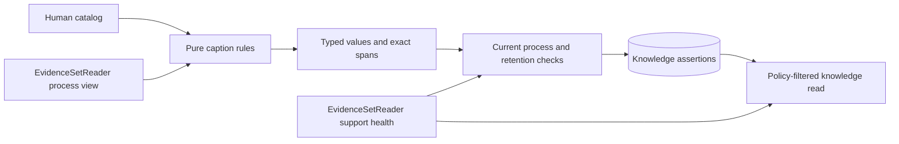

# Shared knowledge contract

[`smi_knowledge`](../src/smi_knowledge/__init__.py) owns Brand/Product references, versioned interpretation catalogs and provisional caption interpretations. Interpretation preparation consumes the public frozen evidence-set interface; explicit knowledge publication consumes exact ingested support through `IngestedEvidence`. Both leave source observations unchanged.

The implemented contract includes dataset-bound caption preparation, explicit publication by identity and bounded current-KB literal queries with pinned results. Bounded extractive free-form answers and explicit gap-to-approved-enrichment follow-up are installed below; semantic retrieval and autonomous research remain [operational targets](functional-requirements.md).

## Business references and catalog

`Catalog` contains a `catalog_id`, format `version`, Brand references, Product references and topic labels. Each entry has a stable human-defined ID, preferred name and literal aliases. Products additionally name their brand and supported specificity (`family` or `variant`). Category and market vocabulary lives in configuration; the extraction core accepts other catalogs without changing its objects.

`KnowledgeStore.register_catalog(catalog, actor)` requires a trusted human in the configured workspace. Brand/Product references are attributable human configuration, not independently verified platform facts. A product ID cannot silently change its brand or preferred name. An existing catalog ID pins its document digest; changes require a new catalog ID. References retain their business IDs across catalogs.

The [beauty catalog](../examples/catalogs/beauty-v1.json) is local development configuration. It recognizes explicit family names such as ヒーロークッション and selected competing product phrases. A generic cushion mention produces only a topic, rather than identifying a particular product family. Source `curation` labels are not extraction input or reference labels for accuracy measurement.

## Preparation and support

`KnowledgeStore.list_catalogs(actor)` provides workspace-scoped catalog IDs, digests and registration attribution for application navigation. It returns human configuration metadata rather than source-derived interpretations; `catalog` reads the exact selected configuration.

`KnowledgeStore.prepare(dataset_id, catalog_id, actor, request_id="initial")` creates a retry-safe `caption-literal-rules-v1` run. The run pins the registered catalog, frozen dataset, method version and preparation request ID. It records the requesting actor, preparation time and the actual processed/unavailable/not-retained/superseded member counts. Human and automation callers can prepare; only humans can register business configuration.



Each stored interpretation identifies its canonical content subject, source caption assertion and observation. Its excerpt must equal the original caption slice at its `[start, end)` offsets. Offsets count Unicode code points, as in Python string slicing; browser clients must account for UTF-16 indexing when highlighting emoji-containing text. The record retains basis `derived`, review status `provisional` and its run's method/catalog versions.

| Predicate | Value and scope |
| --- | --- |
| `brand_mention` | A literal alias matches a configured Brand reference |
| `product_mention` | A literal alias matches a Product reference at catalog specificity; competing matches for the same span are marked ambiguous |
| `script_evidence` | Kana characters are present; actual caption language remains unknown |
| `topic_mention` | A configured topic phrase appears; stance is not assessed |
| `literal_marker` | A literal PR marker or Qoo10 reference appears |

Literal mentions do not establish use, endorsement, product efficacy, audience geography, a sponsorship agreement or conversion. Negated, comparative or uncertain sentences still contain mentions; the rule does not resolve their stance or actual product identity. Even a technically exact span remains a provisional semantic interpretation.

The method performs no model or platform calls and treats captions as data. It does not read credentials, execute caption instructions or generate universal account scores. A future extraction method can use the same support envelope after its references, value types and semantic quality are evaluated.

## Explicit knowledge publication

`KnowledgePublications.publish(support, actor, request_id=..., interpretation_ids=(), include_synthetic=False, connection=None)` makes one bounded selection of already-ingested support available. `support` is an ordered tuple of ingestion-owned `SupportReference` values: exact observation, derivation, assertion and metric IDs. It accepts fresh ingestions as well as imported observations, without creating or extending an evidence set. An account with source-backed stable identity can be published while profile and interpretation attributes remain unknown. References without ingested assertions are rejected; callers cannot submit arbitrary interpretation values or turn a literal caption mention into an efficacy/audience fact.

`IngestedEvidence.select_run(run_id, actor)` supplies up to 100 applied observation references with their current exact assertions and metrics. Public callers can select a subset or construct a reference to narrower assertion/metric membership. Each reference supports at most 1,000 assertion/metric IDs. Publication validates every identity and its owning workspace, current derivation and process permission. Optional interpretation IDs must identify existing supported caption interpretations whose exact source assertion is in the selection. Their catalog, method, basis, provisional review state and producer remain attributable to their original knowledge run.

All publication rows and membership commit in one transaction. The ingestion and knowledge owners hold support locks through commit, serializing policy withdrawal or derivation changes against publication. Any invalid member rejects the complete request. A workspace/request ID binds the ordered support, interpretation selection, publication method version, synthetic mode and actual producer. Identical concurrent retries return one publication; changing that payload or producer returns `publication_request_conflict`. Retrying a withdrawn publication preserves its identity without republishing denied text.

`KnowledgePublications.list(actor, limit=None, newest_first=False)` returns committed, source-content-free publication metadata. `read(publication_id, actor, purpose="display")` reopens the exact membership, producer, publication method/time, original coverage and current support counts. Members retain capture/source-as-of/ingestion times, source publication assertions and mapper/policy versions; knowledge publication time never refreshes an old capture. Process and display reads apply their own permissions. Denied members expose IDs and support health only; superseded members keep their old IDs and require review rather than borrowing a new derivation. Synthetic publications are excluded unless explicitly enabled for development. List/read accept a caller-owned `connection`; source/derivation locks remain held through the dependent transaction commit. A supplied list limit is bounded from 1 to 1,000.

`KnowledgePublications.find_request(request_id, actor, include_synthetic=False, connection=None)` returns committed source-free publication identity, actual producer, original coverage, exact ordered `support` observation/derivation/assertion/metric IDs and `interpretation_ids`, or `None`. This metadata remains available after source withdrawal; current-policy value reads remain with `read`. The operation can join a caller-owned transaction. A request ID establishes publication idempotency, not authority over another owner's task: task recovery additionally requires its own atomic publication receipt, durable prepared membership and source-owned run validation. Valid recovery preserves the original producer and historical update before unchanged-support filtering.

`KnowledgePublications.unpublished(support, actor, include_synthetic=False, connection=None)` identifies capture/mapping selections not already usable in committed publications. Source-owned one-way `content_version` identities bind payload/provenance/times, methods and selected logical fields/metrics independently of fresh UUIDs. Both sides require current process permission and current derivation health. Later captures/mappings are distinct, while new ingestion/publication time alone creates no capture novelty. Legacy publication identities are filled lazily through public permitted support reads. This operation supports accurate task no-update reporting; it does not publish or establish market novelty. Publish and unpublished operations accept a caller-owned connection, retaining support locks and legacy identity updates within it. Task execution uses its owning session for actual effect fencing. Distinct tasks may both select the same capture before either commits; this is not cross-task novelty admission.

Publication stores IDs and count metadata, with no extra source text copies. Selected interpretations remain governed by `KnowledgeStore.read_interpretations`, which reads identities across existing runs, rechecks dependencies under caller-owned transactions, and purges values/excerpts after retention withdrawal. Permission restoration and publication retries do not reconstruct purged interpretations. Source-only publication does not require retention permission for an additional copy because it creates none; source-owner canonical values retain their existing separately documented lifecycle. Frozen evidence membership and prior publication support remain unchanged when another publication is added.

Operators can use `smi-ingest publish-knowledge RUN_ID --request-id ID`, optionally repeating `--observation-id` to select a bounded subset and `--interpretation-id` to include existing claims. `inspect-publication PUBLICATION_ID` reopens it. Both use a named local human actor; workers use the trusted Python interface with their actual automation context. The local browser links committed publications at `/knowledge/publications` and exact details at `/knowledge/publications/PUBLICATION_ID`. Search, task submission and acquisition are separate operations.

`KnowledgePublications.usable_publications(support, actor, include_synthetic=False, connection=None)` resolves publication IDs covering every exact capture/mapping/selection under current process permission and derivation health. It returns empty when any selected support is unavailable, superseded or unpublished, while preserving policy locks on a caller-owned connection. These links establish current usability, never caller task ownership or a new publication. The offline discovery history uses them to recognize successful already-published no-update retrievals; [avoidance](tasks.md#capture-based-discovery-avoidance) leaves exact older results and source metric definitions intact.

## Assistant and recommendation boundary

The bounded query implementation below supplies exact published support across acquisitions. Assistant answers and recommendations retain that actual membership and current policy contract while adding their own versioned methods and attribute-specific coverage profiles.

An account with stable identity and at least one permitted ingested source observation may be recommended despite incomplete profile information. Missing attributes remain unknown and may justify enrichment, rather than silently becoming zero or a claim of a complete history.

The installed bounded assistant answers free-form questions from existing KB knowledge as extractive findings. The installed task-side follow-up generates a gap-purpose template with explicit human query/subject/time scope for refresh/fill/expansion research. It requires actual human approval of every exact assistant-origin proposal and permits independently approved scopes beyond scheduled keywords. Server-side approval is bound to the actual task; no tool/caller-origin claim can bypass it. Pure KB reads and automated shortlist saving do not need this enrichment approval.

Approved work uses asynchronous acquisition followed by ingestion, normalization and KB publication. A newly fetched tool response cannot directly support an answer or be used before the publication gate. Acknowledgment/status and completion notification distinguish fetch success from usable KB updates; updated knowledge is available to later queries. Existing knowledge preparation, explicit publication and source-policy reconciliation are foundations; the [campaign and exactly approved-proposal offline task](tasks.md) now records durable execution, per-task competing-worker fencing, recovery, partial outcomes, simulated waiting and a durable local completion inbox. The [assistant enrichment journey](tasks.md#assistant-knowledge-gap-enrichment) composes those owners without a new acquisition or model provider. Broader autonomous research and external notification transports remain future work. The bounded free-form answer operation below reads existing published knowledge only.

## Persistence and source policy

Knowledge migrations install their own tables after the ingestion schema; the local CLI's `migrate` command runs both. Brand/Product and catalog records remain separate from ingestion's account/content entity kinds. The physical relationships are documented in the [ERD](data-model.md#implemented-shared-knowledge-model).

Preparation persists claims only for current support with processing and retention permission. Display permission alone cannot authorize extraction. Before committing a run, the evidence interface locks and rechecks source policy and derivation health; a withdrawal during extraction causes `knowledge_support_changed` and rolls back the run. Repeating the same request ID within a workspace/dataset/catalog/method returns its existing run.

Choose a new request ID to explicitly prepare again after evidence permissions recover or another preparation is needed. This creates a successor run with the same semantic configuration and preserves the earlier run's coverage, interpretation IDs and tombstones. The default `initial` request preserves existing caller behavior; legacy rows are migrated to that ID without replacing their history.

`KnowledgeStore.read(run_id, actor, purpose="display")` rechecks policy and returns exact interpretation IDs and support references. The process view applies processing permissions instead. Denied support returns metadata-only tombstones. A superseded caption returns `review_required`; a new caption never replaces the original support silently.

`KnowledgeStore.reconcile(dataset_id, actor)` removes retained `value` and `excerpt` copies when their observation no longer permits retention, including expiry and revocation. Reads and preparation invoke reconciliation automatically. Operators can explicitly reconcile after policy changes. Permitted dependency/audit metadata remains. Restoring permission or retrying the same request does not reconstruct purged values; explicitly new work uses a new preparation request ID and rechecks current permissions.

This is synchronous reconciliation at knowledge operations, not an autonomous cleanup worker. The source evidence store still owns raw payload cleanup; canonical source values and operator-managed input files retain their separately documented lifecycle. Future campaign reasons and caches must participate through their own dependency tracking.

## Translation-assisted review

`KnowledgeStore.review_packet(run_id, actor)` generates a current-policy-checked packet over the exact dataset. Each available item includes its post/source assertion reference, original caption, proposed values and exact spans, plus fields for translation, translator/method, reviewer judgment, materiality and ambiguity. Synthetic negation, comparison and uncertainty challenges are separately labeled and are not dataset members.

The named rubric is `caption-support-review-v1`. Reviewers label items `supported`, `unsupported`, `ambiguous` or `not_assessable`, and record whether an error changes a finding or candidate decision. The packet records provisional development-set provenance; using the same captions for rule development and checking does not establish held-out generalization.

Translations and human judgments begin empty, with status `pending_translation_assisted_review`. This implementation prepares the packet; it does not fabricate translation results, claim Japanese-original accuracy or record reviewer acceptance. Consequential semantic judgments remain provisional until the accepted review is performed.

The packet is generated on demand with source display/retention checks. The application stores no cached packet file. Any operator-saved export is an external copy requiring its own retention handling.

## Bounded current knowledge queries

`KnowledgeQueries(db, workspace_id="local").search(QueryScope(...), actor, request_id=..., purpose="display", include_synthetic=False)` searches committed publications and returns a durable `result_id` with the actual selected support manifest. It requires no acquisition or enrichment approval and performs no external I/O. New filter computation requires current **process** permission and current permission for the requested output purpose. A display grant alone cannot authorize a new search; `purpose="process"` permits downstream computation without granting display rights.

`QueryScope` accepts a case-insensitive literal `text` of at most 500 characters, at most ten exact `platforms`, at most twenty canonical `subject_ids`, optional timezone-aware `captured_from` (inclusive) and `captured_to` (exclusive) timestamps, an optional nonnegative `max_age_seconds` (at most `2**53 - 1`), and `limit` from 1 to 100. Filters combine at observation-member scope; empty filters admit the bounded published scope, including source-backed accounts with incomplete profiles. Text matches individual observed assertion values, native identities or supported published interpretation values. It does not join separate fields into invented text or match missing-state placeholders. This is deterministic filtering, with no relevance ranking, semantic/vector search or graph traversal.

Queries examine at most the **100 newest committed publications** visible under the workspace and synthetic mode, in publication-time/ID order, and retain at most `limit` distinct support bundles in publication/member order. An exact duplicate observation/derivation/assertion/metric/interpretation bundle contributes once, using its newest publication. New observations of the same account remain distinct evidence. This is a bounded publication sample, not an account count, a search of every KB record or complete market research. `coverage` reports publications scanned, publication and result truncation independently, matched member counts, process/output-policy exclusions, superseded support and selected freshness states. `unknowns` always declares `not_complete_market_coverage`; zero matches additionally declares `no_matching_permitted_published_support`. Per-member unknowns include nonobserved assertion states, source-declared missing fields, unknown source-as-of time and absent published interpretations. Permission-denied source values never participate in filtering or returned text.

Freshness uses **source capture time** and the caller's explicit threshold; no threshold returns `not_assessed`. Missing/future capture time returns an explicit unknown. Source-as-of, ingestion time, source-publication assertions, derivation time and knowledge-publication time retain their separate meanings. Source permission (`availability`) and derivation health (`support_status`) are independent of age. Stale but otherwise permitted current support remains searchable and is labeled stale. New searches exclude unavailable and superseded support.

The atomic manifest stores ordered publication, observation, derivation, assertion, metric and interpretation IDs, mapper/policy versions, interpretation run/catalog/method versions, publication method/time/producer and original freshness assessment. It stores no source values, captions or interpretation excerpts. Public publication reads join the query transaction and hold source/derivation locks through the manifest commit. New query selection and publication commits share a workspace publication-frontier lock; a caller-owned `connection` on `search`/`read` keeps these locks through a dependent comparison commit. Workspace/request identity binds scope, purpose, synthetic mode, method and actual producer; an identical concurrent retry reopens one result, while a changed request conflicts. Caller-generated automation actors remain automation authors; no human endorsement is inferred.

`read(result_id, actor, purpose="display", include_synthetic=False)` reopens the saved selection through the publication owner under the current requested read permission. It never reruns the query. Original coverage, versions, order, times and producer stay fixed; `current_coverage` reports unavailable/superseded members, and each permitted member receives a current capture-age assessment. A later publication may appear in a new query but cannot alter an old manifest. A historical display result can remain readable after process permission is removed if display is still allowed; a process reopen applies process permission. Withdrawal returns metadata-only source tombstones and governed interpretation tombstones. Synthetic support is excluded by default and requires explicit development visibility on both search and reopen. Retention-dependent interpretation cleanup remains owned by `KnowledgeStore`.

`account_support(result, actor)` projects stable account keys from the permitted exact search/read result: account subject identities on assertions or metrics and observed post-author assertions. It does not use handles/URLs as identity or require observed profile values. `statuses(result_id, actor, connection=None)` returns content-free current process/display/retention permissions and derivation health for the pinned source support, holding source locks in a caller transaction without locking interpretation copies. Campaigns use these interfaces for comparison eligibility and dependent policy checks.

The local browser exposes `/knowledge/search` and `/knowledge/results/RESULT_ID`; the CLI exposes `search-knowledge` and `inspect-query`. These surfaces use the same public operations, preserve the named local human actor and display only current permitted source text. Technical checks do not establish language quality, semantic usefulness or complete coverage.

## Local commands

```bash
uv run smi-ingest migrate
uv run smi-ingest register-catalog examples/catalogs/beauty-v1.json
uv run smi-ingest prepare-knowledge jp-kbeauty-tiktok-public-video-sample-2026-10-05 beauty-caption-lexicon-v1
uv run smi-ingest prepare-knowledge jp-kbeauty-tiktok-public-video-sample-2026-10-05 beauty-caption-lexicon-v1 --request-id refresh-1
uv run smi-ingest inspect-knowledge RUN_ID
uv run smi-ingest publish-knowledge INGESTION_RUN_ID --request-id publication-1 --observation-id OBSERVATION_ID
uv run smi-ingest inspect-publication PUBLICATION_ID
uv run smi-ingest search-knowledge --text APRILSKIN --platform tiktok --max-age-seconds 604800 --request-id search-1
uv run smi-ingest inspect-query RESULT_ID
uv run smi-ingest review-packet RUN_ID
uv run smi-ingest reconcile-knowledge jp-kbeauty-tiktok-public-video-sample-2026-10-05
```

Use the `run_id` returned by preparation. Synthetic input requires explicit `--include-synthetic`; all actions retain trusted local workspace/actor context. These commands prepare knowledge, not a campaign or confirmed shortlist.

## Bounded free-form knowledge answers

`smi_assistant.KnowledgeAssistant(db, workspace_id="local", model_route=None, model_transport=None, model_credential=None)` composes current `KnowledgeQueries` and the established shared Responses/accounting transport. `migrate()` installs knowledge/cost prerequisites and its answer table; `smi-ingest migrate` includes it. Source facts remain with their existing owners. This application sits above both retrieval and transport, keeping campaign transport out of knowledge storage.

`ask(question, actor, request_id=..., scope=None, include_synthetic=False)` accepts a human question of at most 4,000 UTF-8 bytes. The default scope examines at most 100 newest committed publications, selects at most 20 support members and assesses capture age against 30 days; an optional explicit `QueryScope` may narrow it but cannot exceed 20 members. Free-form question text is separate from the optional literal support filter. This is a bounded publication sample, not semantic retrieval or complete market coverage. Pending/unpublished acquisition material never enters it. Existing knowledge requires no enrichment approval.

The method projects at most 100 observed assertions, metrics and supported published interpretations in query order, retaining their distinct bases and original dates. Missing-state fields remain missing information. Actual support IDs and input truncation are saved alongside the exact full query manifest. One tool-free model request selects up to 20 unique supplied IDs and a fixed `bounded_support`, `missing_information` or `ambiguous_question` limitation. The independently validated output cannot add factual prose, citations, actors, roles, tools, approval, search or spending authority. The application renders the governed original values as **extractive findings**; a mention does not establish efficacy, sales or audience location. This relevance judgment is not semantic entailment, factual verification or completeness. See [ADR 0017](adr/0017-exact-supported-answers.md).

Model input JSON is limited to 128 KiB, with additional whole-request/response/deadline/token/output bounds from the explicit trusted route. Missing route/credential/configuration/rates/admission and oversized context are visible blocked outcomes; empty support is an explicit no-call missing-information result. Invalid, incomplete, meter-failure and uncertain responses stay visible without fallback. Valid reported usage settles even invalid/stale answers; unknown usage retains liability. All cost operations carry the requesting human, while generated authorship is separately labelled automation. The actual model snapshot, measurement basis, method/schema/bounds, input IDs, usage and operation link are pinned; simulated input bounds remain a declared fake-service contract and provider execution retains existing explicit runtime gates.

Claims commit before I/O. Identical workspace/request/question/scope/actor retries reopen the same answer, including an interrupted in-progress claim; changed retries conflict. There is no automatic lost-response reissue. After the shared allowance decision, an admission guard reopens exact inputs under current process/display and derivation checks, retaining source locks through dispatch commit. Refusal commits no dispatch liability or fabricated zero usage. Model I/O spans no database transaction. Finalization rechecks all exact inputs before exposing a successful selection.

`read(answer_id, actor, include_synthetic=False)` reopens without a configured transport. It preserves historical input membership, model/method/configuration, requesting human and usage. Source values and interpretation states are re-read through the exact query under current policy. If any full input loses process/display permission or current support health, all derived selected IDs/findings are withheld; independently permitted support remains inspectable. No automatic source-derived text copies need purging in the answer table. Freshness is re-evaluated separately and stale captures remain explicit, along with source-as-of unknowns, source-declared gaps, ambiguous/missing output, truncation and incomplete coverage. A new question can see later committed publications without changing an older answer.

The local `/knowledge/questions` form and `/knowledge/answers/ANSWER_ID` page expose this journey. The answer operation performs no acquisition or external search. A supported gap offers the separate [exact-scope proposal, human approval and task/completion journey](tasks.md#assistant-knowledge-gap-enrichment); it never treats model/configuration failure alone as a knowledge gap and never changes the saved answer. Technical tests use real PostgreSQL and simulated model I/O; language quality and marketer usefulness require actual human review.


Selected recent X captures can enter this ordinary publication/query path through [explicit monitoring promotion](monitoring.md#selected-recent-evidence-promotion). Source-owned inherited policy/deadline/tombstones govern copies directly, even when callers never reopen the promotion result. The source mapper creates only native X content support; unknown account/creator/product associations and source-as-of stay unknown.


## Governed entity graph

`KnowledgeGraph`, `GraphScope` and `GraphTraversal` from `smi_knowledge.graph` provide bounded `search(scope, actor, request_id=..., include_synthetic=False)` and `read(search_id, actor, entity_id=None, include_synthetic=False, traversal=None)`. Search atomically pins one public `KnowledgeQueries` support result and a source-free manifest containing the exact human filter input, query identity, selection method and actual requester. The graph stores no labels, source values, excerpts, copied catalog names or edges. Identical workspace/request/producer/filter/synthetic retries reopen the same selection; changed requests conflict. Standard `smi-ingest migrate` installs the graph manifest additively.

A scope selects source platforms and inclusive/exclusive timezone-aware capture dates, with 1–100 source members from at most 100 recent publications. Literal entity text, native namespaces and account/content/brand/product kinds filter projected matches. A platform filter also admits business references supported by that platform; native namespace filters select native nodes. Search returns 1–100 matches (default 50); a selected entity returns at most 1–50 direct incident relationships (default 20), with at most that many neighbor nodes. Each bound and truncation flag is visible, including the original publication/member scan coverage. Empty filters examine only this bounded sample; empty results establish no market absence. The transient projection is finite under the existing 100-member/1,000-fields-per-member and interpretation publication bounds; entity caps do not claim complete KB coverage.

Native subjects and observed author references retain exact platform, namespace, kind and native ID. Missing profiles and metric-only subjects remain valid entities with explicit unknowns. A label uses an identified observed assertion from the selected support when present; other potentially conflicting assertions remain inspectable rather than becoming identity evidence. Brand/Product nodes come only from published permitted mention interpretations, with exact catalog reference IDs and human registration metadata. Installed edge kinds are observed `author_account`, provisional derived `brand_mention`/`product_mention`, and human-configured `catalog_brand`. Human catalog association is conditional navigation context for a supported published mention, not independent source verification. Derived edges retain exact spans, interpretation IDs, catalog/method/review status and producer. Repeated exact edge IDs retain the newest permitted selected publication that actually includes their assertion/interpretation. Edges retain observation/derivation/assertion identity, source reference, native publication/capture/source-as-of/ingestion dates and original knowledge-publication method/time/producer. Source publication dates are resolved by exact content subject; author-reference dates and ambiguous dates remain unknown. Unknown dates remain null; publication does not renew capture age.

Every reopen reads exact support through the owning public query reader for **both process and display**, also requiring current retention permission and derivation health. Interpretation edges require both purpose reads to remain supported. Loss of any dependency removes that node’s dependent labels/attributes and incident edges; other independently supported nodes remain. An unknown or no-longer-permitted selected opaque token returns an unavailable state without reconstructing labels or source links. Original source-free support manifests and unavailable counts remain; no later publication substitutes for lost support. Source owners continue to enforce inherited withdrawal/expiry, and the graph has no retained value cache to purge. Synthetic support requires explicit selection on search and reopen; workspace checks apply before lookups. `KnowledgeStore.catalog_context` supplies one exact human configuration and its registration attribution, optionally on the graph transaction.

Omitting `traversal` preserves the selected entity’s bounded immediate neighborhood and original `neighbor_limit`. Explicit `GraphTraversal` supports breadth-first navigation with `max_hops` 1–3 (default 1), `node_limit` 1–100 including the root (default 51), `relationship_limit` 1–50 (default 50) and `work_limit` 1–5,000 (default 5,000). Cycles return each exact relationship once and enqueue each entity once. `neighbors` contains all reached entities except the selected root; every returned edge's endpoints are among those entities and the root. Stable opaque identity/relationship order makes the same permitted sample deterministic. `traversal_coverage` reports depth reached, inspected relationships, each reached bound and combined `truncated`; a hop bound reports omitted eligible edges, including unreturned cycle edges. This is a bounded partial sample, never a total reachable-graph count.

Traversal filters combine direction (`both`, `incoming`, `outgoing`), exact `predicates`, `bases`, neighbor `kinds`, `platforms` and native `namespaces`, and exact source `observation_ids`. Each list has at most ten values. Predicates/bases/kinds use the installed vocabulary; source IDs are canonical UUIDs. Neighbor filters apply at every step and a filtered node cannot bridge a path. Business references have no native platform; platform filtering permits them, while a native namespace filter excludes them. The root remains independently inspectable under neighbor filters. Exact observation filters instead narrow the entire transient projection: root and neighbor labels, assertions, metrics, supports and relationships come only from the chosen currently permitted observations. A shared entity cannot borrow an unselected observation's label. Original source-free query manifests and original coverage remain separately inspectable; `source_filtered_members` reports the current projected source subset.

The work budget counts traversal-edge inspections **after** the existing finite saved-support projection and adjacency construction; it is not a total database/projection work guarantee. Projection still has the existing 100-member/1,000-fields-per-member and publication interpretation bounds. Node/relationship output bounds apply in addition. Filtered and denied nodes do not contribute labels, relationship details or counts. Source/interpretation permission, retention, withdrawal and current derivation checks run again on every filtered read, navigation and reopen. Current traversal controls live in request URLs and responses, adding no graph persistence. Their opaque selections and filters describe current exploration, not immutable historical graph membership or a campaign decision.

Matching handles and visual adjacency never infer a cross-platform Creator; literal mentions do not establish use, endorsement or efficacy. There is no graph database or provider/model/acquisition I/O. See [the local graph surface](local-review.md#knowledge-graph) and the existing ownership/current-policy ADRs. Technical checks establish neither language accuracy nor marketer usefulness.
