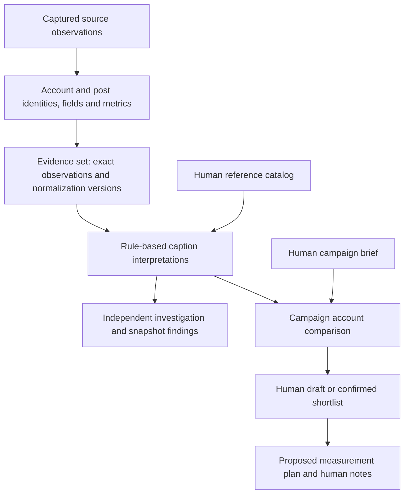

# Understanding the application

This guide connects the browser workflow, Python modules and database using the repository's Hero Cushion sample. It describes implemented behavior; the linked contracts and SQL define the precise interfaces.

The [target functional requirements](functional-requirements.md) add ranked recommendations that agents can save as shortlists without human review, an enrichment assistant, background acquisition, lightweight X alerts, graph/lineage interfaces and hybrid spending controls. Those requirements are accepted future work. The human save/confirmation steps described in this guide are the current local implementation, not a permanent requirement for automatic shortlist persistence.

## What the application is today

The application is a working local pilot for evidence-backed marketing decisions. Browser forms perform real validation and save durable PostgreSQL records. Closing the browser or restarting the server does not erase saved work. One Python application contains the modules below; they are not separately deployed services.

It can help a marketer ask a question of a selected sample, compare accounts against explicit criteria, save a reviewed exploratory shortlist, and document measurement intentions and decision notes. Its analytical methods are conservative caption rules. It does not yet establish market representativeness, creator quality, audience location or sales performance.

Calling it a prototype is reasonable when discussing product maturity. Calling it a working local pilot is more precise: the workflow and persistence exist, while usefulness and original-language interpretation still need human evaluation. The browser application is not an embedded AI agent.

## The three kinds of information

| Kind | Example | What it means |
| --- | --- | --- |
| Observed source information | A captured caption contains `ヒーロークッション`; the post displayed 1,875 views | The source reported this information at a particular time. It is not independent verification of the author's claims. |
| Derived interpretation | A configured alias maps that caption span to the Hero Cushion product family | A named method interpreted source text. Its evidence, configuration and provisional status remain visible. |
| Human input or decision | A marketer selects the account for further investigation and acknowledges unknown audience geography | An attributable human judgment. It does not become an observed fact or a measured outcome. |

Keeping these separate is the reason for many of the tables. A caption, an interpretation of that caption and a decision based on that interpretation need different owners and histories.



Investigations and campaigns are separate uses of shared evidence. An investigation does not automatically start a campaign, and a campaign does not require a preceding investigation.

## Follow one real sample post

The first record in [the frozen sample](../examples/curated/jp-kbeauty-tiktok-2026-10-05/observations.json) provides these values:

| Item | Captured sample value |
| --- | --- |
| TikTok handle | `guga9791` |
| Native account ID | `6819904612390634498` |
| Native post ID | `7549049550934166804` |
| Published | 2025-09-12 04:07:52 UTC |
| Captured | 2026-10-05 04:15:22 UTC |
| Caption fragments | `APRILSKINのヒーロークッション（21）`, `#pr` |
| Sampled metrics | 1,875 views, 27 likes, 1 comment, 0 shares |

These are historical sample values, not current TikTok counts. Zero shares is an observed zero. An unknown fee would remain unknown, not zero.

For the examples below, `O1`, `D1`, `P1`, `A1` and similar labels are explanatory shortcuts for database UUIDs, not literal stored IDs.

1. **Capture:** `source_observations` stores O1's acquisition metadata, capture time, permission policy and retained-payload reference. Permitted payload bytes live in the evidence directory. For this offline import, the payload is the exported JSON record, not original TikTok HTML.
2. **Identity:** `canonical_entities` contains account A1 and post P1. `external_identities` connects them to TikTok's native string IDs. A mutable handle is recorded separately; it does not define account identity.
3. **Normalization:** `derivations` records that mapper `snapshot-json:v1`, using canonical policy `canonical-v1`, interpreted O1 as D1. `field_assertions` records the caption, URL, publication time and author account for P1, plus the observed handle for A1. `metric_observations` contains four count records; the views record uses definition `tiktok.web.views.v1` and value `1875`.
4. **Fixed input:** `evidence_set_members` pins O1 and D1 inside the selected dataset. Original export observation/run IDs are retained as lineage alongside the new local IDs.
5. **Interpretation:** When preparation is requested, the catalog maps `ヒーロークッション` to product `aprilskin-hero-cushion`. The current rules identify the first occurrence at caption character range `[66, 75)`, meaning start inclusive and end exclusive. They record a product-family mention with stance `not_assessed`. A second occurrence in a hashtag is another supported span. The caption also contains a literal PR marker. This method does not turn `(21)` into a verified shade interpretation.
6. **Campaign use:** With the [example brief](../examples/campaigns/hero-cushion-brief.json), the account has literal support for product mention and kana-script criteria. Japan audience geography remains unknown. Because the brief supplies this account and the dataset also contains it, its comparison origin is `both`.
7. **Human decision:** A marketer could write “Investigate this account because its sampled post mentions Hero Cushion,” cite support, acknowledge unknowns and confirm an exploratory shortlist. That wording is an illustrative decision, not a decision already saved by the sample import.
8. **Planning:** A subsequent plan could propose checking matched orders once seller data is available. A note could say to defer commercial commitment pending audience and fee information. Neither creates sales results.

Importing the sample loads source evidence and curation annotations. It does not automatically prepare knowledge, create a campaign or save a decision. Curation annotations are separately labeled development annotations; the extraction rules read source captions and the registered catalog.

## What an evidence set does

An **evidence set is a named, fixed collection of inputs for an analysis**. Think of it as an analysis's input manifest: “Use precisely these captured observations, with these normalization versions.”

For the repository sample:

```text
evidence_sets
  workspace_id: local
  dataset_id: jp-kbeauty-tiktok-public-video-sample-2026-10-05
  digest: fingerprint of the exact exported file bytes
  manifest: format, namespace, expected membership and import information

evidence_set_members
  member 0 -> observation O1 + derivation D1 + original source IDs
  member 1 -> observation O2 + derivation D2 + original source IDs
  ...19 selected observations from 17 accounts in total
```

The set row describes the collection; member rows specify its exact contents. They reference the imported evidence rather than storing another complete caption copy per campaign. The current importer creates those local observations and member bindings together.

Without fixed membership, a result that queried “all posts currently in the database” could change whenever new posts arrived. Without a pinned derivation, a parser update could silently change what an old analysis meant. The set prevents both substitutions. A changed export requires an explicit new dataset ID; the importer rejects changed bytes under the existing ID.

One evidence set can support many knowledge runs, investigations and campaign comparisons. Each result records which subset its scope actually used. An ingestion run answers **which acquisition/import job ran**; an evidence set answers **which exact inputs this analysis may use**. A shortlist answers **which accounts were recommended or selected for the campaign**; the current pilot records human selections, while the target also permits automatic recommendations. They are different objects.

Fixed membership does not freeze permission to display evidence. Current source permissions can make a member unavailable; downstream explanations must respect that change. Corrections can also mark pinned support as requiring review rather than silently replacing it. See the [evidence-set contract](evidence-sets.md) and [policy ADR](adr/0002-pinned-support-current-policy.md).

## Browser screens and their code

The browser sends a form to [`ReviewApp`](../src/smi_review/app.py). That application calls the public domain stores; those stores own decisions and transactions. View files render HTML. The browser itself is not the durable database.

| Screen or control | Friendly meaning | Main code and stored records |
| --- | --- | --- |
| **Offline task submit / detail** | Submit configured synthetic work for an exact current campaign brief or reviewed proposal/human approval, then reopen exact scope, actors and outcomes. | [`AcquisitionTasks` / `OfflineTaskWorker`](../src/smi_tasks/__init__.py); six task/proposal/approval/completion tables, existing ingestion/publication owners |
| **Campaign workspace** (`/`) | Your saved campaigns and the available fixed input collections. “Loaded evidence” is sample coverage, not a complete market database. | [`views.home`](../src/smi_review/views.py); campaign, evidence-set and catalog listing interfaces |
| **Create / revise brief** | State brand/products, objective, target market, platforms and selection criteria. The catalog supplies reference names and aliases. Optional commercial details may remain unknown. | `views.brief_form`; [`CampaignStore`](../src/smi_campaigns/store.py); `campaigns`, `campaign_briefs` |
| **Selection criterion** | A named requirement or preference with an evidence type, expected value, inclusion/exclusion rule and unknown handling. Free-text labels express your intent; the current rules do not understand arbitrary prose. | [`Brief` / `Criterion`](../src/smi_campaigns/contracts.py); brief document |
| **Prepare rule-based comparison** | Run the fixed caption interpretation and account-comparison pipeline against the chosen brief and dataset. It does not search the internet. | [`KnowledgeStore.prepare`](../src/smi_knowledge/store.py), [`build_comparison`](../src/smi_campaigns/comparison.py), `CampaignStore.prepare_comparison`; knowledge and comparison tables |
| **Account comparison** | One card per known or dataset-supplied account in scope, showing criterion judgments and missing information. There is no universal quality score or sales ranking. | `views.comparison_page`; `comparison_candidates`, `comparison_support` |
| **Original captions and provenance** | Inspect the original wording, highlighted supporting spans, source link, publication/capture dates and exact source references. Translation remains pending. | `views.evidence_panel`; [`EvidenceSetReader`](../src/smi_ingestion/evidence_sets/reader.py) and supported knowledge assertions |
| **Human inclusion reason / cite relevance support / acknowledge unknowns** | Record why you selected an account, what supports that reason and what you still do not know. Checking an unknown box acknowledges a gap; it does not resolve it. | `views.comparison_page`; `CampaignStore.save_shortlist`; `shortlist_selections` |
| **Save draft / confirm shortlist** | Save working choices, or explicitly record your reviewed exploratory selection. Confirmation is an internal decision, not creator consent or campaign execution. | `shortlist_revisions`, `shortlist_selections` |
| **Saved shortlist / successor revision** | Reopen the exact saved membership and reviewer. A later edit creates another revision. Current evidence availability is checked when reopening. | `views.shortlist_page`; `CampaignStore.read_shortlist` |
| **Costs** | Inspect synthetic measured usage separately from forecasts, declared outstanding commitments and unknown/meter-failure coverage. | [`UsageAccounting`](../src/smi_costs/store.py); scopes/operations/entries plus ceilings, route controls and one-use admissions |
| **Completion inbox** | Reopen one durable completion per task with actual coverage and current permitted publication navigation. | [`CompletionInbox`](../src/smi_tasks/notifications/store.py); source-free `task_completion_events` |
| **Knowledge search** | Filter current committed permitted publications, inspect freshness and unknowns, and reopen exact saved support. Scan/result limits are explicit. | [`query_views`](../src/smi_review/query_views.py), [`KnowledgeQueries`](../src/smi_knowledge/queries/store.py) |
| **Knowledge publications** | Reopen committed bounded selections, exact support and current unavailable/superseded states. Publish explicitly through the operator CLI. | [`publication_views`](../src/smi_review/publication_views.py), [`KnowledgePublications`](../src/smi_knowledge/publications/store.py) |
| **Investigations / create investigation** | Ask a standalone question about selected brands/products/topics, with optional publication dates. Intended market describes the question, not proven audience location. Selected references match with OR. | [`monitoring_views`](../src/smi_review/monitoring_views.py), [`MonitoringStore`](../src/smi_monitoring/store.py); investigations and scope revisions |
| **Prepare rule-based insight / snapshot insight** | Count literal reference and PR/Qoo10 support within matching sample posts. “Snapshot” means a bounded answer, not continuous monitoring or a market trend. A required caption language is currently not assessable by script rules. | [`build_summary`](../src/smi_monitoring/summary.py); `insight_revisions`, `insight_findings`, `insight_support` |
| **Measurement plans and decision notes** | Propose what would be measured and record human feedback. Plans require a saved shortlist associated with the current brief; even an empty/deferred shortlist is valid. Notes can reference historical shortlists. | [`planning_views`](../src/smi_review/planning_views.py), [`CampaignPlanning`](../src/smi_campaigns/planning/store.py); plan, note and note-support tables |

Comparison vocabulary:

- **Satisfied:** literal evidence matches an inclusion criterion. Semantic review remains provisional.
- **Not satisfied on evidence:** literal evidence matches something the criterion excludes.
- **Unknown:** the selected evidence cannot establish the criterion. Absence of a mention is not proof that an account fails it.
- **Required:** a confirmation constraint. A required unknown with handling `defer` blocks confirmation; handling `acknowledge` allows an exploratory selection with explicit acknowledgement. A required exclusion contradicted by evidence blocks confirmation.
- **Marketer known / retrieved / both:** supplied in the brief, obtained from the chosen dataset, or both. “Retrieved” does not mean autonomously discovered online.
- **Provisional:** an interpretation still needs semantic review. It is separate from a shortlist's draft/confirmed status.
- **Review required:** supporting evidence is unavailable or superseded; historical identity and permitted audit information can remain while dependent wording is withheld.

The UI does not currently expose a general database browser, ingestion dashboard, catalog editor or translation tool. Source ingestion and catalog registration use the CLI. See [local review](local-review.md) for routes and operator setup.

## Table dictionary

There are 45 implemented tables. Most are supporting records for evidence, versions and explanations, not separate user workflows. JSONB columns hold structured documents such as a brief or candidate judgment; UUID references connect those documents to their exact sources.

The examples below describe row shapes. Campaign and investigation examples are illustrative; loading the sample alone does not create them. Full columns and relationships are in the [physical ERD](data-model.md) and linked SQL.

### Acquisition, normalization and fixed inputs — 11 tables

Owner: [`smi_ingestion`](../src/smi_ingestion/schema.sql), including [`evidence_sets`](../src/smi_ingestion/evidence_sets/__init__.py).

| Table | What one row stores | Example |
| --- | --- | --- |
| `ingestion_runs` | One workspace-owned acquisition/import job: adapter, input manifest, limits, resource use, checkpoint, optional provider wait reason/resumability and status. | The offline job that imports all 19 sample observations. Its local run differs from the export's original collection runs. |
| `source_observations` | One captured source response or imported record, with acquisition lineage, times, policy, payload hash/path and coverage. | O1: the captured `guga9791` post record. |
| `ingestion_issues` | A reported problem associated with a run and optionally an observation. | An adapter failure code and sanitized message. |
| `canonical_entities` | A stable internal UUID for an account or a content item. It does not hold a complete mutable profile. | A1 is an account; P1 is its post. There is no implemented Creator/person entity here. |
| `external_identities` | A native identity tuple mapped to an internal entity: platform, namespace, kind, native string ID and synthetic flag. | `tiktok / web:public / account / 6819904612390634498 / false` maps to A1. |
| `derivations` | One mapper/policy version's normalization of one observation, with current/history status. | D1 normalizes O1 using `snapshot-json:v1`. This is source normalization, not the product-mention extraction run. |
| `field_assertions` | One field value or explicit missing/removal state, tied to an entity, derivation and source location. | P1's caption from `$.caption`; A1's handle from `$.author.handle`. An assertion means “the source reported this.” |
| `metric_observations` | One sourced metric value, definition, native name, precision, unit and time. | P1's `tiktok.web.views.v1 = 1875` at capture. It is not a sales result. |
| `unresolved_candidates` | A normalization item that could not be established, including the reason and source location. | A source account reference without enough native identity information. These are not campaign candidate accounts. |
| `evidence_sets` | One named, immutable dataset registration: manifest, byte digest, local import run and actor/time. | The 19-post sample dataset. |
| `evidence_set_members` | One ordered dataset member, pinning its local observation and derivation plus original source IDs. | Member 0 binds O1/D1 to the original exported observation reference. |

### Offline task admission and outcomes — 6 tables

Owner: [`smi_tasks`](../src/smi_tasks/schema.sql); [public task contract](tasks.md).

| Table | What one row stores | Example |
| --- | --- | --- |
| `enrichment_proposals` | An immutable supplied revision with purpose, refresh/fill/expansion intent, subject/search and input scope, exact route/limits digest and proposer. | Save a proposal without submitting acquisition. |
| `enrichment_approvals` | One configured human's exact workspace/revision/digest approval and original retry identity. | Approval A authorizes at most one task for proposal P. |
| `acquisition_tasks` | A workspace/request-bound campaign or approved assistant task, exact brief/approval/configuration scope, initiator, hard limits, latest execution ID/session owner, durable commit/wait progress, outcome and sanitized coverage/failure. | Accepted now, executed separately through the local synthetic route. Its active PostgreSQL ownership lock distinguishes running from recoverable work. |
| `acquisition_attempts` | One attributable worker attempt, exact ingestion run, total recovery count, most recent 20 recovery actors/100 phases, prepared support IDs and times. | Worker B resumes Worker A’s same run/support after a disconnected session; a late Worker A cannot commit local effects. A valid subset can publish with the failed remainder visible. |
| `acquisition_task_publications` | A task-owned receipt committed atomically with its exact knowledge publication. | Task T produced publication P; recovery checks prepared support/run lineage. Public request text and fetch-only input create no receipt. |
| `task_completion_events` | One source-free event identity/task/time, committed with a terminal outcome; one unique event per task. | Reopen usable, partial, no-update or failure in **Inbox** after restart, with historical coverage and current permitted publication links. |

### Offline cost accounting — 6 tables

Owner: [`smi_costs`](../src/smi_costs/schema.sql); [public accounting contract](costs.md).

| Table | What one row stores | Example |
| --- | --- | --- |
| `cost_scopes` | Immutable workspace/scope configuration: provider/service, classification, currency/period, synthetic unit/rate/version, configuring human/time. | An operator's simulated unit rate for one accounting month; no invented commercial price. |
| `cost_operations` | Stable workspace/request identity with actual actor/method, configured scope and optional validated exact task/attempt pair. | A synthetic model operation with no task, or a measurement attributed to the original worker attempt. |
| `cost_entries` | Workspace-unique measurement identity, operation, distinct usage/forecast/declared-commitment/unknown/meter-failure kind, exact decimal inputs and provenance/time/recorder. | Three synthetic units at 0.125 derive 0.375; forecasts and unresolved declared commitments remain separate. |

| `cost_ceilings` | Current trusted scope amount, pause state, configuring human/time; scope fixes currency/period. | 0.125 synthetic allowance admits one bounded request costing 0.125. |
| `cost_route_controls` | Immutable workspace fixture-route binding, exact cost scope and one-request bound. | Every campaign/approved-assistant worker reopens the configured guard after restart. |
| `cost_admissions` | One bounded dispatch per operation, reserved amount, dispatched/settled/refused state, reason and actual dispatcher. | A lost response retains its commitment; another worker pauses instead of charging again. |

### Shared business vocabulary, interpretations, publication and queries — 10 tables

Owner: [`smi_knowledge`](../src/smi_knowledge/schema.sql).

| Table | What one row stores | Example |
| --- | --- | --- |
| `knowledge_brands` | A workspace's stable human-supplied brand reference and preferred name. | `aprilskin` → APRILSKIN. |
| `knowledge_products` | A human-supplied product reference, brand association and preferred name. | `aprilskin-hero-cushion`, associated with `aprilskin`. This is not automatically a purchasable SKU. |
| `knowledge_catalogs` | An immutable configuration document containing brand/product/topic references and aliases, with its digest and recorder. | `beauty-caption-lexicon-v1` maps `ヒーロークッション` to the Hero Cushion family. Topics are in this document; no separate topic table exists. |
| `knowledge_runs` | One preparation against an exact dataset, catalog, method and request identity, including coverage and recorder/time. | K1 ran `caption-literal-rules-v1` over the sample using the beauty catalog. |
| `knowledge_assertions` | One derived typed interpretation with a source caption assertion, exact character span, value, provisional review status and support state. | “Span `[66,75)` is a family-level Hero Cushion mention,” supported by P1's caption. |
| `knowledge_publications` | One committed bounded selection, with workspace/request identity, method, actual producer, coverage and publication time. | A source-only update can publish an ingested account while profile attributes remain unknown. |
| `knowledge_publication_support` | One ordered exact observation/derivation and its selected assertion/metric IDs. | Publication member 0 pins O1/D1 without extending its frozen dataset. |
| `knowledge_publication_interpretations` | One selected existing interpretation ID in publication order. | A provisional caption mention is usable with its exact original source dependency. |
| `knowledge_query_results` | One bounded current query with workspace/request identity, purpose, filters, producer, original coverage and time. | Q1 searches recent committed publications and preserves an explicit incomplete-market limit. |
| `knowledge_query_members` | One ordered actual source/interpretation selection plus method/publication/freshness versions, with no source-value copy. | Q1 member 0 pins O1/D1 and specific published assertion/interpretation IDs; withdrawal later redacts its values. |

These tables are shared vocabulary and supported interpretations. They are not a vector database, an LLM's memory or an agent's internal reasoning log.

### Campaign questions, comparisons and decisions — 7 tables

Owner: [`smi_campaigns`](../src/smi_campaigns/schema.sql).

| Table | What one row stores | Example |
| --- | --- | --- |
| `campaigns` | A human-owned campaign workspace with current brief/shortlist version counters. | C1: an investigation of potential Hero Cushion accounts for Japan. |
| `campaign_briefs` | One immutable version of the human question and criteria, with author/time. | Brief v1: product mention, kana script, audience geography unknown. |
| `comparison_drafts` | One prepared comparison's exact brief, knowledge run, dataset/digest, method, coverage and preparation actor/time. | Compare brief v1 against K1, using `campaign-caption-comparison-v1`. |
| `comparison_candidates` | One account within that comparison: native key, campaign-relative origin, order and structured criterion judgments/unknowns. | A1: origin `both`; product mention satisfied; audience unknown. Order is not a quality ranking. |
| `comparison_support` | A candidate's dependencies on observations, field assertions and optional knowledge interpretations. | A1's judgment depends on O1's caption interpretation and author identity assertion. |
| `shortlist_revisions` | One immutable draft or confirmed human selection event, pinned to its brief/comparison, with reviewer/time. | Shortlist v1, confirmed by a named marketer. |
| `shortlist_selections` | One selected candidate in that revision, with human reason, cited interpretation IDs and acknowledged unknowns. | A1 selected for further investigation; fees and audience remain unknown. |

### Independent questions and snapshot answers — 5 tables

Owner: [`smi_monitoring`](../src/smi_monitoring/schema.sql).

| Table | What one row stores | Example |
| --- | --- | --- |
| `monitoring_investigations` | A standalone human-owned investigation with current scope/insight version counters. | I1 asks which Hero Cushion mentions occur in the sample. |
| `investigation_scopes` | One immutable question, selected references, market context, platforms and optional date/language constraints. | Hero Cushion, TikTok, intended JP context, no required language filter. |
| `insight_revisions` | One prepared answer's exact scope, knowledge run, dataset/digest, method, coverage and limitations. | Answer v1 using `caption-snapshot-summary-v1`. |
| `insight_findings` | One structured, source-dependent finding within an answer. | The frozen fixture supports Hero Cushion mentions in six distinct selected posts; this is not a market-share or growth estimate. |
| `insight_support` | A finding's observation, field assertion and optional interpretation dependencies. | The caption mentions and author assertions used to count those distinct posts/accounts. |

### Measurement intent and human learning — 3 tables

Owner: [`smi_campaigns.planning`](../src/smi_campaigns/planning/schema.sql).

| Table | What one row stores | Example |
| --- | --- | --- |
| `measurement_plan_revisions` | A human proposed plan tied to an exact campaign brief and shortlist: outcome definition, intended source, matching/attribution assumptions and gaps. | Propose matched orders and returns-adjusted revenue if seller records become available. Status remains `proposed`; no measured results are stored. |
| `decision_note_revisions` | One human note tied to a historical shortlist, with author/time and optional citations. | “Defer commitment until audience and fee information is obtained.” |
| `decision_note_support` | The note's source dependencies, inherited from the selected candidates as well as explicit citations. | If the selected evidence becomes unavailable, copied note text cannot bypass its policy. |

Support tables answer “what does this explanation depend on?” They let the system inspect, hide or purge dependent copies when permissions change. They are not additional copies of the original source text. Permitted history and membership may remain while text is withheld; implemented deletion limits are documented in [architecture](architecture.md#policy-and-operational-limits).

## Versions and timestamps without the jargon

- A **capture time** says when the source was observed. A **publication time** says when the post was published. An **import time** says when the local application recorded the export. A **knowledge publication time** says when an exact ingested selection became available; it does not refresh a source capture. Importing an old post today does not make it a new post or a fresh measurement.
- A **derivation version** identifies how a source observation was normalized. A **knowledge run** identifies how its caption was interpreted using a catalog/method. A **brief revision** identifies which human question was asked. A **shortlist revision** identifies a saved set of recommendations or selections and its producer; currently that producer is human. These are different histories.
- A **digest** is a fingerprint used to detect changed bytes or changed request/configuration content. It is not a relevance score.
- A **request ID** lets a retried save/preparation return its existing result instead of accidentally creating another one. An **expected version** makes an outdated form fail visibly rather than overwrite newer work.
- Historical references are stable; permission and support health remain current. Versioning does not grant permanent access to source wording.

## Automation, agents and the remaining product boundary

There is implemented automation: normalization, literal alias/marker matching, criterion matching, distinct-post counting, validation, versioned saving and permission checks. The **Prepare** buttons execute a predetermined sequence:

```text
read fixed evidence -> apply caption rules -> build comparison or summary -> save result
```

There is no embedded LLM call, translation model, model-driven tool selection, autonomous research loop or scheduled monitoring job. The application's `local-rule-preparation` actor has kind `automation` so attribution and write permissions are explicit; that label does not imply an AI agent. The coding assistant developing this repository is separate from the running application.

The accepted target adds current-KB model assessment/ranking, automatically saved shortlists, conversational assistant proposals/answers, advanced shared scheduled/on-demand workers, X anomaly alerts and explorer views through evidence/knowledge interfaces. Derivable actual costs receive configured ceilings; unmeterable portions retain forecasts. The direct supplied-proposal approval, offline task path and source-free synthetic accounting/forecast surface are present; those broader capabilities remain future work. Creator/person associations, full account histories, actual outcome ingestion and attribution, and authenticated hosted operation also remain future work. Current plans and notes do not implement those capabilities.

Marketer evaluation is a human assessment of whether the findings and decisions are useful. It is not a runtime agent or a database workflow that can manufacture its own answers. The procedure is in [quality review](evaluation.md); execution records belong in `.scratch/`.

For a first reading, follow the real post through capture → source field → product interpretation → comparison → human decision. Then use the table dictionary to inspect the supporting records. You do not need to memorize all tables to understand the product.
