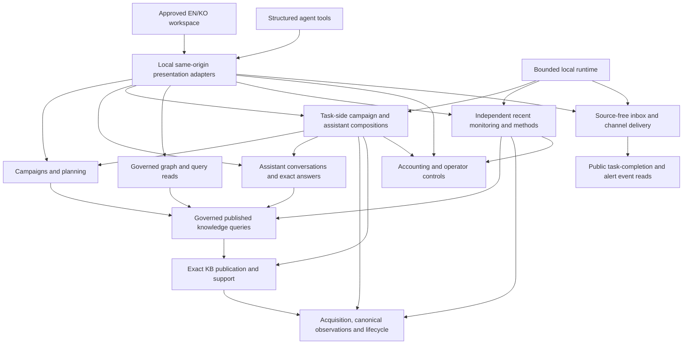
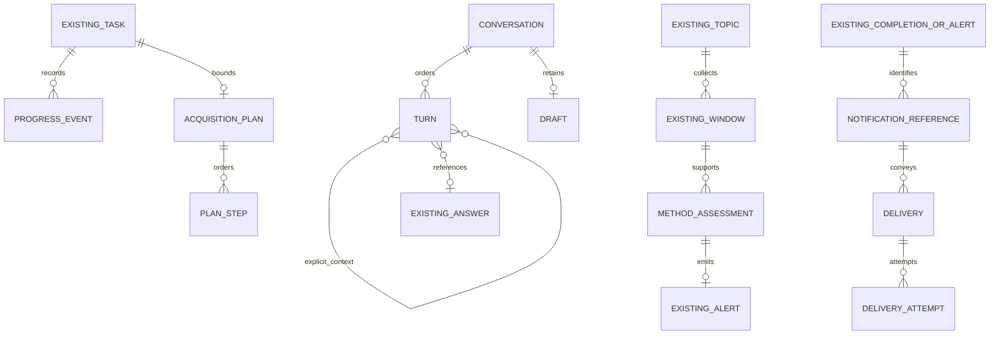

# Proposed architecture for the approved product

The recommended target extends the existing modular Python/PostgreSQL system. It adds presentation adapters, bounded continuous operation and the missing product methods. PostgreSQL remains canonical authority. The approved Neo4j-style UI does not require a graph database, multiple agents, independently deployed services or a new framework.

This document is a proposed implementation contract. It changes no accepted ADR or installed schema. [The sequence](implementation-sequence.md) identifies build, live-validation, human-validation and later work. [Actual r2 approval](../.scratch/product-design-2026-11/ui-review-status.md#actual-r2-approval) authorizes this planning input and does not certify production behavior.

## Ownership and dependency direction



Arrows describe allowed consumption, not distributed services. The graph omits persistence edges for readability. Each owner writes only its own tables. Existing source/publication policy locks and task ownership sessions remain the transaction boundaries. Tasks consume assistant answers, while assistant answers do not import task authority. Notification adapters do not write task completion. Runtime finds work through public owner operations and does not use foreign-owner SQL.

| Owner | Target responsibility | Main implementation |
| --- | --- | --- |
| `smi_review` | Pilot composition root, trusted local RequestContext, client foundation, versioned same-origin adapters, EN/KO UI, inspector, camera/chart client and protected operator forms | S02, S03 (commands live in the composition root), S04, S10, S12–S16, S18, S20–S22, S26, S29, S30 |
| `smi_campaigns` | Immutable brief/profile/comparison/shortlist, automatic saved ranking, optional curation and proposed learning | S12, S30, later S43 |
| `smi_assistant` | Existing exact selection plus conversation/turn/context/draft ownership | S15; candidate S37, accepted extension only S39 |
| `smi_tasks` | Exact proposal approval, origin authority, events, bounded plan/step execution, recovery and task compositions | S06 (worker composition), S13, S14, S27, S28 |
| Proposed `smi_runtime` | Finite due-work advancement, fairness, supervision, source-free health and bounded lifecycle maintenance through existing expire/reconcile ports | S09 |
| `smi_knowledge` | Governed publication/query/graph selection, support-based interpretation port, pilot-scale selection over an ingestion-owned index and bounded incremental graph pages | S06, S07, S17; later S36/S41/S42 |
| `smi_monitoring` | Topic activation, bounded recent windows, saturation and receipt-time projections, versioned live-page method eligibility, separate volume/engagement/semantic methods, history, KB-only context and explicit promotion | S19–S24 |
| `smi_costs` | Independent actual/commitment/forecast admission, reconciliation and meter health | S03 (commands), S26 |
| Proposed `smi_notifications` | Single configured recipient in the pilot, channel configuration, source-free event references, attention and transport attempts | S29; multi-recipient S40 |
| Later identity/access and measurement owners | Real authenticated tenants; observed outcomes, attribution and causal studies | S40, S44–S45 |

## Pilot composition and client foundation

One validated, versioned local configuration (S02) is consumed by the review server, the runtime and the CLIs. Secrets are referenced only by environment-variable name, each route's secret is named explicitly, and a source-free readiness read reports missing prerequisites. Configuration sets routes, credentials, process gates, thresholds and caps; topic activation and live schedule activation remain recorded operator commands under ADRs 0015 and 0023.

The client (S04) is plain ES modules with no build step: an envelope-aware API client, the i18n catalog mechanism and completeness check, shell and theme, one shared `display_valid_until` freshness utility implemented once, and the `node --test` harness run by the shared check. Consumer logic stays with its consumer: S18 owns the graph library decision (a time-boxed spike; recommended a vendored, pinned, licence-recorded library) and the branch reducer, S21 the chart-series reducer and method-series registration contract, and S15 the composer reducer. Human browser checks run at S25 and S35 while agent browser access stays declined.

Automated tasks publish caption interpretations with their members through a support-based interpretation port (S06). Chat turns, campaign comparison and graph seeds select support through one pilot-scale, ingestion-indexed selection port with deterministic, pinned question/brief scope and a recorded index mechanism and ranking rule (S07); model-proposed retrieval terms stay out of the pilot under ADR 0017. Cost scopes, route bindings, ceilings and X activation are explicit, attributable operator commands (S03); configuration never applies cost settings or activation implicitly. Monitoring stays within ADR 0023's one page per window; S19 projects the stored saturation and receipt time and adds a versioned live-page eligibility rule that is enabled only under decision W02, leaving installed v1 methods unchanged.

## Shared contract

These shapes are proposed, not installed JSON endpoints. Each UI spec retires the legacy form routes it replaces once parity tests pass. No compatibility abstraction is needed after callers migrate.

```text
RequestContext = trusted actor + workspace + configured capabilities + correlation_id
Command = request_id + exact target/revision IDs + expected mutable head + typed payload
Receipt = command_id + request_digest + status + saved record/revision IDs + retry disposition
Read = identity/revision + original author/input reference + immutable historical outcome
       + current usability + exact support references + coverage/unknowns + allowed_actions
       + owner frontiers/as_of + display_valid_until + sanitized error/recovery code
```

Actor/workspace/capabilities come from trusted construction in the local pilot. Hosted identity must replace that construction before public exposure. Payloads cannot set actor, task origin, model identity, source route, approval or a cost attestation. Local Host, origin, CSRF, bounds, escaping and no-store protections remain required. Server responses expose allowed actions but every command rechecks authority. Integration with a spec that has not landed is a conditional check, never a hidden blocker; each conditional check is mirrored in its partner spec, and when both exist the spec that lands second makes the check pass unconditionally.

Command idempotency binds workspace, actual actor, method, exact inputs and request identity. An equal retry reopens the original record. A changed body conflicts. Expected-head conflicts preserve the human's draft and show current context. A deliberate new operation needs a fresh identity. Domain claims commit before external I/O, with no transaction open across the call. Source and cost guards recheck immediately before dispatch and again at finalization.

Read models retain historical membership and expose current availability separately. All actual inputs influence a model result, including unselected findings. Reopen exact support through public source/query readers. Required process/display/retention rights, derivation health, source lifecycle and tenant rights govern every display and use. Labels, chart aggregates, cached claims and browser state are retained copies if they contain source values. Do not persist them outside their dependency contract. Later publications support a new operation and never rewrite an old decision.

Open source-dependent views need an implementable freshness contract. Each response supplies its owner-specific policy frontier, checked time and `display_valid_until`, bounded by configured maximum revalidation age and every known dependency expiry. Clients revalidate on focus, navigation, explicit read and a configured bounded timer while a view is open. A known invalidation or expiry clears dependent values immediately. If the client cannot revalidate by the deadline, it fails closed and shows unavailable content until a successful governed read. A stale response cannot restore a newer tombstone or expired value. This gives bounded display staleness and immediate handling of known loss. It does not promise zero-lag withdrawal across disconnected browsers or replace owner-side checks at every command/dispatch. All substantive server reads still check current policy.

The generic sanitized error shape carries `code`, `record_id`, `phase`, `retry_kind`, `expected/current_head` where safe and `next_action`. Retry kinds distinguish same-read, exact-local-resume, new-human-request, operator-reconciliation, configuration-required and unknown-external-response. Never include provider handles, raw transport errors, payload paths, credentials or unrestricted source text.

## Backend and agent support for every interaction

| Approved UI family | Governed read | Explicit command and authority | Durable result and acceptance owner |
| --- | --- | --- | --- |
| C1 campaign | Campaign/brief/profile, comparison, coverage and shortlist history | Start/revise, interpret, select, recommend, curate, regenerate with exact heads | Campaign revisions; S12 |
| K1 conversation | Bounded threads/turns/context/drafts and per-turn exact support | Create/send/save draft/delete, trusted human and expected thread/draft head | Conversation/turn IDs linked to immutable answer claims and pinned question scope; S15, S07 |
| A1 research | Exact saved proposal digest, route/limits, approval, task/status | Save human scope; actual human approve; submit once; revised scope gets successor | Task-owned approval and one logical task; S14/S27 |
| G1 graph | Exact search support, stable branch/page/filter/root IDs, current policy frontier | Search pins support; page/expand is a bounded governed read; camera/pin are presentation only | Source-free selection/page context; S17/S18 |
| M1 stream and alert | Topic/version/activation/window/status/native metric/denominator/method/baseline/history | Configure, explicitly activate/pause and assess exact windows; trusted operator/worker | Separate recent/method/alert owners; Separate recent/method/alert owners; S19–S21, S23, S24 |
| M2 investigation/promotion | Original alert and selected existing KB; selected recent observation support | Investigate with zero acquisition; explicit promote selection through normal ingestion | Context or promotion receipt with inherited lifecycle; S22 |
| T1 pipeline/inbox | Task origin/approval/attempt/events/run/observations/derivations/publication/cost | Submission is not execution; runtime executes exact admitted work; reads never execute | Fenced receipts, completion event and independent owner frontiers; S13/S09 |
| D1 discovery | Stable keyword config/occurrence/accounting day, allowance, route capability, selection/plan | Configure/tick under operator; broad/detail steps only within exact scope | Original occurrence and task scope survive edits; Original occurrence and task scope survive edits; S09/S11/S16/S27/S28 |
| S1 spending | Scope/currency/period/basis/rates/actual/commitment/forecast/health | Operator-only configure/reconcile/recover, with exact targeted evidence | Accounting record, independent of task/response recovery; Accounting record, independent of task/response recovery; S03/S26 |
| Notification preferences | Source-free event, attention, recipient/channel and transport state | Mark read, configure recipient/activate channel, safe delivery retry | Unique event/recipient/channel delivery with pinned original template/config; S29 |
| P1 planning/review | Exact campaign/shortlist plans/notes and review packet members/denominators | Save proposed plan, attributable note or actual human verdict | Planning and quality-owner records, no invented observed outcome; S30 |

Agent tools initially wrap these public operations. A local protocol wrapper is sufficient for FR-P08. An MCP transport is optional and confers no additional authority. No prompt-only rule protects an operation. Approval is excluded from autonomous tools, and task submission validates a separately recorded exact approval. Agent planning and model synthesis remain distinct from deterministic execution, monetary control and human decisions.

## New records and migrations

This is a conceptual target, not a replacement physical ERD. Every build spec updates the physical ERD only with the schema it actually introduces.



New owners install their schema after prerequisites through public migrations. Unique workspace/request/effect keys make backfill and retry idempotent. Legacy records retain explicit unrecorded context instead of fabricated threads, phases, capture times or past sends. Do not republish an old observation to create freshness. Every new retained source-dependent value declares its exact dependency and permanent purge/withholding behavior. Every substantial module gets local AGENTS.md and a relative CLAUDE.md symlink. Implementation updates the owner contract, architecture, ERD and accepted ADRs in the same change where necessary.

## Runtime, recovery and controls

The pilot service runs finite ticks over PostgreSQL work identities. Per-task/per-topic session locks remain the fence. The runtime has no workspace-wide execution lock and makes no provider-side exactly-once guarantee. It does not backfill missed schedule days beyond accepted authority. Each component has finite time/work bounds and fair progress. Health reports process liveness separately from successful useful work, source readiness and control health. A bounded lifecycle-maintenance component calls the existing expire and reconcile operations so expired payloads do not wait for a manual CLI run.

Task state, committed publication, current permitted usability, completion event, inbox attention and email delivery are separate dimensions. A task can have a committed publication while completion is pending. A historically partial task can later have no current displayable support. A delivered email can have unread attention. A final bill can be reconciled while a task still waits for an unrecoverable response. The UI must preserve those combinations.

External operation uncertainty is durable. Keep outstanding commitments after timeout, session loss or missing response. Only a verified existing provider handle permits its allowed bounded progress/read path. Do not generate a new POST or tool call to recover an unknown operation. Meter-health recovery permits future calls but does not settle failed measurements or restore responses. Email ambiguity uses the same discipline; safe retries require known failure or verified provider idempotency.

Acquisition approval, configured campaign/schedule/topic authority, source-use permission, resource limits, daily novelty admission, monetary admission and information-value stopping are independent gates. At most ten scheduled keywords and initial configurable fifty unique eligible new posts total/day are the fixed FR values. Cadence, retention, thresholds, models, rates, ceilings and source capabilities are explicit validated configuration. r2 sample numbers are not defaults or prices.

## Later target and actual decision boundary

S36 adds evaluated multilingual retrieval against the deterministic S07 baseline. S37 prepares a disabled plan/claim-validation candidate. S38 obtains actual named evidence. S39 is blocked on [Set the richer research and synthesis boundary](decisions/001-richer-agent-boundary.md) and an accepted successor to ADR 0017/0018. UI approval does not prove an evaluator's semantic correctness. No arbitrary factual prose, inferred executable scope or autonomous approval is silently enabled by this plan.

S40 adds hosted actors, memberships, tenant isolation, service identities, multi-recipient notification preferences and migration audit before remote exposure. Existing workspace fields are useful foundations but are not authenticated tenant security. S41 adds retained-copy reconciliation, bounded projection lag, managed storage, secrets/telemetry and tested restore. S42–S45 retain multimodal ontology, objective portfolios, actual outcomes/attribution and causal work with their own data/permission/evaluation prerequisites. These proposal ambitions do not block the first local pilot.
